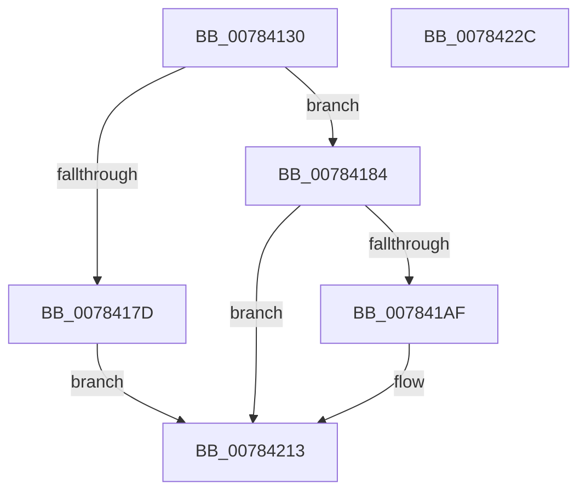

# PspCheckCpuPartitionCreateAccess

- RVA: `0x00784130`–`0x0078422D` (길이 `253` bytes)
- VA: `0x0000000140784130`
- 실행 섹션: `PAGE`
- PDB 이름 있음: `예`; PDB Function 태그: `아니요`
- unwind 정보 RVA: `0x000CEDD4`
- 디코드: `54`개 명령, `253/253` bytes 표시
- 미해석 바이트: `0` (있으면 어셈블리에 `.byte`로 보존)

> 이 문서는 커널 이미지의 기계어와 PDB 기호를 분석해 생성했습니다. 4번과 5번은 함수 원형과 자료형을 바이너리 사용 방식에서 추정한 C 해석이며 원본 소스 복구 결과는 아닙니다.

## 1. Dependencies

- 직접 호출 지점: **6**; 고유 호출 대상: **5**
- 직접 호출자로 확인된 함수: **1**
- RIP 상대 이미지 참조: **3**

### Outgoing calls
- `0x0078415A` → [memset](../../text/6C/memset_function_006C6C40.md) (function, `0x006C6C40`)
- `0x0078416F` → [memset](../../text/6C/memset_function_006C6C40.md) (function, `0x006C6C40`)
- `0x007841A2` → [SeCreateAccessState](../8C/SeCreateAccessState_function_008C6AC0.md) (function, `0x008C6AC0`)
- `0x00784200` → [SeAccessCheckWithHint](../../text/3A/SeAccessCheckWithHint_function_003A6C30.md) (function, `0x003A6C30`)
- `0x0078420A` → [SeDeleteAccessState](../8C/SeDeleteAccessState_function_008C5F70.md) (function, `0x008C5F70`)
- `0x0078421E` → [_security_check_cookie](../../text/6A/_security_check_cookie_function_006AC640.md) (function, `0x006AC640`)

### Direct callers
- [PsCreateCpuPartition](PsCreateCpuPartition_function_00783A8C.md) at `0x00783AD5`

### Static image references
- `0x00784139` → RVA `0x00E0A740` (`.data`; read)
- `0x00784184` → RVA `0x00FC6DF0` (`ALMOSTRO`; read)
- `0x007841D9` → RVA `0x00FC7020` (`ALMOSTRO`; read)

## 2. Other-region calls and transfers

- 다른 실행 섹션으로 향하는 call: **4**
  - `0x0078415A` → [memset](../../text/6C/memset_function_006C6C40.md) (`PAGE` → `.text`)
  - `0x0078416F` → [memset](../../text/6C/memset_function_006C6C40.md) (`PAGE` → `.text`)
  - `0x00784200` → [SeAccessCheckWithHint](../../text/3A/SeAccessCheckWithHint_function_003A6C30.md) (`PAGE` → `.text`)
  - `0x0078421E` → [_security_check_cookie](../../text/6A/_security_check_cookie_function_006AC640.md) (`PAGE` → `.text`)
- 별도 외부 분기/꼬리 이동을 확인하지 못했습니다.

## 3. Assembly (complete function range)

```asm
00784130  40 53                           push rbx
00784132  48 81 EC 00 02 00 00            sub rsp, 0x200
00784139  48 8B 05 00 66 68 00            mov rax, qword ptr [rip + 0x686600]
00784140  48 33 C4                        xor rax, rsp
00784143  48 89 84 24 F0 01 00 00         mov qword ptr [rsp + 0x1f0], rax
0078414B  8A D9                           mov bl, cl
0078414D  33 D2                           xor edx, edx
0078414F  48 8D 4C 24 70                  lea rcx, [rsp + 0x70]
00784154  41 B8 A0 00 00 00               mov r8d, 0xa0
0078415A  E8 E1 2A F4 FF                  call 0x1406c6c40
0078415F  33 D2                           xor edx, edx
00784161  48 8D 8C 24 10 01 00 00         lea rcx, [rsp + 0x110]
00784169  41 B8 E0 00 00 00               mov r8d, 0xe0
0078416F  E8 CC 2A F4 FF                  call 0x1406c6c40
00784174  83 64 24 64 00                  and dword ptr [rsp + 0x64], 0
00784179  84 DB                           test bl, bl
0078417B  75 07                           jne 0x140784184
0078417D  33 C0                           xor eax, eax
0078417F  E9 8F 00 00 00                  jmp 0x140784213
00784184  4C 8B 0D 65 2C 84 00            mov r9, qword ptr [rip + 0x842c65]
0078418B  48 8D 94 24 10 01 00 00         lea rdx, [rsp + 0x110]
00784193  49 83 C1 4C                     add r9, 0x4c
00784197  48 8D 4C 24 70                  lea rcx, [rsp + 0x70]
0078419C  41 B8 00 00 00 02               mov r8d, 0x2000000
007841A2  E8 19 29 14 00                  call 0x1408c6ac0
007841A7  89 44 24 60                     mov dword ptr [rsp + 0x60], eax
007841AB  85 C0                           test eax, eax
007841AD  78 64                           js 0x140784213
007841AF  48 8B 05 3A 2C 84 00            mov rax, qword ptr [rip + 0x842c3a]
007841B6  48 8D 4C 24 60                  lea rcx, [rsp + 0x60]
007841BB  48 89 4C 24 50                  mov qword ptr [rsp + 0x50], rcx
007841C0  4C 8D 84 24 90 00 00 00         lea r8, [rsp + 0x90]
007841C8  48 8D 4C 24 64                  lea rcx, [rsp + 0x64]
007841CD  45 33 C9                        xor r9d, r9d
007841D0  48 89 4C 24 48                  mov qword ptr [rsp + 0x48], rcx
007841D5  48 83 C0 4C                     add rax, 0x4c
007841D9  48 8B 0D 40 2E 84 00            mov rcx, qword ptr [rip + 0x842e40]
007841E0  88 5C 24 40                     mov byte ptr [rsp + 0x40], bl
007841E4  48 89 44 24 38                  mov qword ptr [rsp + 0x38], rax
007841E9  41 8D 51 07                     lea edx, [r9 + 7]
007841ED  48 83 64 24 30 00               and qword ptr [rsp + 0x30], 0
007841F3  83 64 24 28 00                  and dword ptr [rsp + 0x28], 0
007841F8  C7 44 24 20 00 00 00 02         mov dword ptr [rsp + 0x20], 0x2000000
00784200  E8 2B 2A C2 FF                  call 0x1403a6c30
00784205  48 8D 4C 24 70                  lea rcx, [rsp + 0x70]
0078420A  E8 61 1D 14 00                  call 0x1408c5f70
0078420F  8B 44 24 60                     mov eax, dword ptr [rsp + 0x60]
00784213  48 8B 8C 24 F0 01 00 00         mov rcx, qword ptr [rsp + 0x1f0]
0078421B  48 33 CC                        xor rcx, rsp
0078421E  E8 1D 84 F2 FF                  call 0x1406ac640
00784223  48 81 C4 00 02 00 00            add rsp, 0x200
0078422A  5B                              pop rbx
0078422B  C3                              ret
0078422C  CC                              int3
```

## 4. C-style interpretation (structured pseudocode)

```c
__int64 __fastcall PspCheckCpuPartitionCreateAccess(unsigned __int8 a1, int a2)
{
    __int64 result;
    __int64 v_rsp;
    unsigned __int64 v_stack_m178;
    unsigned __int64 v_stack_m18;
    unsigned __int64 v_stack_m198;
    unsigned int v_stack_m1A4;
    unsigned int v_stack_m1A8;
    unsigned __int64 v_stack_m1B8;
    unsigned __int64 v_stack_m1C0;
    unsigned __int8 v_stack_m1C8;
    unsigned __int64 v_stack_m1D0;
    unsigned __int64 v_stack_m1D8;
    unsigned int v_stack_m1E0;
    unsigned int v_stack_m1E8;
    unsigned __int64 v_stack_mF8;

    v_rsp = (v_rsp) - (512);
    result = (*(unsigned __int64 *)(v_rip + 6841856)) ^ (v_rsp);
    v_stack_m18 = result;
    a2 = 0;
    result = memset(v_stack_m198, a2, 160, a4);
    a2 = 0;
    result = memset(v_stack_mF8, a2, 224, a4);
    if (a1 != 0) goto loc_00784184;
    result = 0;
    goto loc_00784213;
loc_00784184:
    a4 = (*(unsigned __int64 *)(v_rip + 8662117)) + (76);
    result = SeCreateAccessState(v_stack_m198, v_stack_mF8, (unsigned int)(0x2000000ULL), a4);
    v_stack_m1A8 = (unsigned int)(result);
    if (!(sign_flag)) {
        result = *(unsigned __int64 *)(v_rip + 8662074);
        a1 = v_stack_m1A8;
        v_stack_m1B8 = a1;
        a3 = v_stack_m178;
        a1 = v_stack_m1A4;
        a4 = 0;
        v_stack_m1C0 = a1;
        result = (result) + (76);
        a1 = *(unsigned __int64 *)(v_rip + 8662592);
        v_stack_m1C8 = a1;
        v_stack_m1D0 = result;
        a2 = a4 + 7;
        v_stack_m1E8 = 0x2000000ULL;
        result = SeAccessCheckWithHint(a1, a2, a3, a4);
        a1 = v_stack_m198;
        result = SeDeleteAccessState(a1, a2, a3, a4);
        result = v_stack_m1A8;
    }
    a1 = (v_stack_m18) ^ (v_rsp);
    result = _security_check_cookie(a1, a2, a3, a4);
    v_rsp = (v_rsp) + (512);
    return result;
}
```

## 5. (Beta) C Style

```c
int64_t PspCheckCpuPartitionCreateAccess(uint8_t Arg1, int32_t Arg2)
{
    int64_t result;
    int64_t local_rsp;
    uint64_t v_stack_m178;
    uint64_t v_stack_m18;
    uint64_t v_stack_m198;
    uint32_t v_stack_m1A4;
    uint32_t v_stack_m1A8;
    uint64_t v_stack_m1B8;
    uint64_t v_stack_m1C0;
    uint8_t v_stack_m1C8;
    uint64_t v_stack_m1D0;
    uint64_t v_stack_m1D8;
    uint32_t v_stack_m1E0;
    uint32_t v_stack_m1E8;
    uint64_t v_stack_mF8;

    local_rsp = (local_rsp) - (512);
    result = (*(uint64_t *)(v_rip + 0x686600)) ^ (local_rsp);
    v_stack_m18 = result;
    Arg2 = 0;
    result = memset(v_stack_m198, Arg2, 160, a4);
    Arg2 = 0;
    result = memset(v_stack_mF8, Arg2, 224, a4);
    if (Arg1 != 0) goto loc_00784184;
    result = 0;
    goto loc_00784213;
loc_00784184:
    a4 = (*(uint64_t *)(v_rip + 0x842C65)) + (76);
    result = SeCreateAccessState(v_stack_m198, v_stack_mF8, (uint32_t)(0x2000000ULL), a4);
    v_stack_m1A8 = (uint32_t)(result);
    if (!(sign_flag)) {
        result = *(uint64_t *)(v_rip + 0x842C3A);
        Arg1 = v_stack_m1A8;
        v_stack_m1B8 = Arg1;
        a3 = v_stack_m178;
        Arg1 = v_stack_m1A4;
        a4 = 0;
        v_stack_m1C0 = Arg1;
        result = (result) + (76);
        Arg1 = *(uint64_t *)(v_rip + 0x842E40);
        v_stack_m1C8 = Arg1;
        v_stack_m1D0 = result;
        Arg2 = a4 + 7;
        v_stack_m1E8 = 0x2000000ULL;
        result = SeAccessCheckWithHint(Arg1, Arg2, a3, a4);
        Arg1 = v_stack_m198;
        result = SeDeleteAccessState(Arg1, Arg2, a3, a4);
        result = v_stack_m1A8;
    }
    Arg1 = (v_stack_m18) ^ (local_rsp);
    result = _security_check_cookie(Arg1, Arg2, a3, a4);
    local_rsp = (local_rsp) + (512);
    return result;
}
```

## 6. Execution-region graph

[열기: 2D/3D 그래프와 함수 탐색 컨트롤 패널](../../../control-panel.html?section=page&rva=0x00784130&view=graph)

- 2D 그래프는 위에서 아래로 흐르고, 3D 그래프는 빈 공간을 드래그해 회전합니다. Shift+드래그는 이동, 휠은 확대·축소, 함수 노드 선택은 대상 보고서 이동입니다.

### Static fallback


