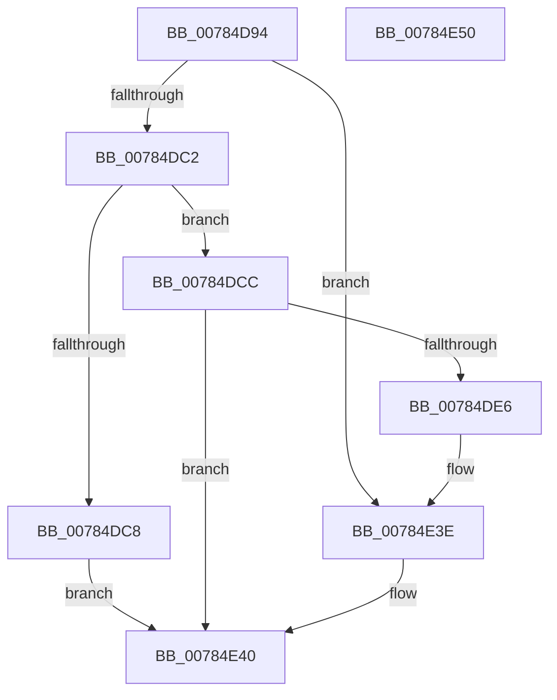

# PspCheckJobAccessState

- RVA: `0x00784D94`–`0x00784E51` (길이 `189` bytes)
- VA: `0x0000000140784D94`
- 실행 섹션: `PAGE`
- PDB 이름 있음: `예`; PDB Function 태그: `아니요`
- unwind 정보 RVA: `0x000CF258`
- 디코드: `57`개 명령, `189/189` bytes 표시
- 미해석 바이트: `0` (있으면 어셈블리에 `.byte`로 보존)

> 이 문서는 커널 이미지의 기계어와 PDB 기호를 분석해 생성했습니다. 4번과 5번은 함수 원형과 자료형을 바이너리 사용 방식에서 추정한 C 해석이며 원본 소스 복구 결과는 아닙니다.

## 1. Dependencies

- 직접 호출 지점: **3**; 고유 호출 대상: **3**
- 직접 호출자로 확인된 함수: **3**
- RIP 상대 이미지 참조: **1**

### Outgoing calls
- `0x00784DDA` → [ObpGetObjectSecurity](../87/ObpGetObjectSecurity_function_008717E0.md) (function, `0x008717E0`)
- `0x00784E27` → [SeAccessCheck](../../text/3A/SeAccessCheck_function_003A6BC0.md) (function, `0x003A6BC0`)
- `0x00784E36` → [ObReleaseObjectSecurityEx](../8C/ObReleaseObjectSecurityEx_function_008C6E30.md) (function, `0x008C6E30`)

### Direct callers
- [PspSetAffinityLimitCallback](PspSetAffinityLimitCallback_function_00785460.md) at `0x00785483`
- [PspValidateJobAssignmentProcessLimits](../87/PspValidateJobAssignmentProcessLimits_function_0087DDA8.md) at `0x0087DE6D`
- [PspValidateJobAffinityState](../A8/PspValidateJobAffinityState_function_00A85298.md) at `0x00A852FA`

### Static image references
- `0x00784DE6` → RVA `0x00FC6A98` (`ALMOSTRO`; read)

## 2. Other-region calls and transfers

- 다른 실행 섹션으로 향하는 call: **1**
  - `0x00784E27` → [SeAccessCheck](../../text/3A/SeAccessCheck_function_003A6BC0.md) (`PAGE` → `.text`)
- 별도 외부 분기/꼬리 이동을 확인하지 못했습니다.

## 3. Assembly (complete function range)

```asm
00784D94  48 89 5C 24 08                  mov qword ptr [rsp + 8], rbx
00784D99  55                              push rbp
00784D9A  56                              push rsi
00784D9B  57                              push rdi
00784D9C  48 8B EC                        mov rbp, rsp
00784D9F  48 83 EC 60                     sub rsp, 0x60
00784DA3  8B 82 F0 01 00 00               mov eax, dword ptr [rdx + 0x1f0]
00784DA9  33 DB                           xor ebx, ebx
00784DAB  89 5D 38                        mov dword ptr [rbp + 0x38], ebx
00784DAE  48 8B FA                        mov rdi, rdx
00784DB1  88 5D 28                        mov byte ptr [rbp + 0x28], bl
00784DB4  48 8B F1                        mov rsi, rcx
00784DB7  48 89 5D F0                     mov qword ptr [rbp - 0x10], rbx
00784DBB  89 5D 30                        mov dword ptr [rbp + 0x30], ebx
00784DBE  A8 01                           test al, 1
00784DC0  75 7C                           jne 0x140784e3e
00784DC2  8B 01                           mov eax, dword ptr [rcx]
00784DC4  A8 01                           test al, 1
00784DC6  74 04                           je 0x140784dcc
00784DC8  33 C0                           xor eax, eax
00784DCA  EB 74                           jmp 0x140784e40
00784DCC  45 33 C9                        xor r9d, r9d
00784DCF  4C 8D 45 28                     lea r8, [rbp + 0x28]
00784DD3  48 8D 55 F0                     lea rdx, [rbp - 0x10]
00784DD7  48 8B CF                        mov rcx, rdi
00784DDA  E8 01 CA 0E 00                  call 0x1408717e0
00784DDF  89 45 30                        mov dword ptr [rbp + 0x30], eax
00784DE2  85 C0                           test eax, eax
00784DE4  78 5A                           js 0x140784e40
00784DE6  48 8B 05 AB 1C 84 00            mov rax, qword ptr [rip + 0x841cab]
00784DED  48 8D 4D 30                     lea rcx, [rbp + 0x30]
00784DF1  48 89 4C 24 48                  mov qword ptr [rsp + 0x48], rcx
00784DF6  48 8D 56 08                     lea rdx, [rsi + 8]
00784DFA  48 8D 4D 38                     lea rcx, [rbp + 0x38]
00784DFE  48 83 C0 4C                     add rax, 0x4c
00784E02  48 89 4C 24 40                  mov qword ptr [rsp + 0x40], rcx
00784E07  41 B9 00 02 00 00               mov r9d, 0x200
00784E0D  48 8B 4D F0                     mov rcx, qword ptr [rbp - 0x10]
00784E11  45 33 C0                        xor r8d, r8d
00784E14  C6 44 24 38 01                  mov byte ptr [rsp + 0x38], 1
00784E19  48 89 44 24 30                  mov qword ptr [rsp + 0x30], rax
00784E1E  48 89 5C 24 28                  mov qword ptr [rsp + 0x28], rbx
00784E23  89 5C 24 20                     mov dword ptr [rsp + 0x20], ebx
00784E27  E8 94 1D C2 FF                  call 0x1403a6bc0
00784E2C  8A 55 28                        mov dl, byte ptr [rbp + 0x28]
00784E2F  4C 8B C7                        mov r8, rdi
00784E32  48 8B 4D F0                     mov rcx, qword ptr [rbp - 0x10]
00784E36  E8 F5 1F 14 00                  call 0x1408c6e30
00784E3B  8B 5D 30                        mov ebx, dword ptr [rbp + 0x30]
00784E3E  8B C3                           mov eax, ebx
00784E40  48 8B 9C 24 80 00 00 00         mov rbx, qword ptr [rsp + 0x80]
00784E48  48 83 C4 60                     add rsp, 0x60
00784E4C  5F                              pop rdi
00784E4D  5E                              pop rsi
00784E4E  5D                              pop rbp
00784E4F  C3                              ret
00784E50  CC                              int3
```

## 4. C-style interpretation (structured pseudocode)

```c
__int64 __fastcall PspCheckJobAccessState(__int64 a1, __int64 a2, __int64 a3, int a4)
{
    __int64 result;
    __int64 v_rbx;
    __int64 v_rsp;
    unsigned __int64 v_stack_m28;
    unsigned __int64 v_stack_m30;
    unsigned __int64 v_stack_m38;
    unsigned __int8 v_stack_m40;
    unsigned __int64 v_stack_m48;
    unsigned __int64 v_stack_m50;
    unsigned int v_stack_m58;
    unsigned __int8 v_stack_p10;
    unsigned int v_stack_p18;
    unsigned int v_stack_p20;
    unsigned __int64 v_stack_p8;

    v_stack_p8 = v_rbx;
    v_rsp = (v_rsp) - (96);
    v_rbx = 0;
    v_stack_p20 = 0;
    v_stack_p10 = 0;
    v_stack_m28 = 0;
    v_stack_p18 = 0;
    if ((((unsigned __int8)((unsigned int)(*(unsigned int *)(a2 + 496)))) & (1)) != 0) goto loc_00784E3E;
    if ((((unsigned __int8)((unsigned int)(*(unsigned int *)(a1)))) & (1)) == 0) goto loc_00784DCC;
    result = 0;
    goto loc_00784E40;
loc_00784DCC:
    a4 = 0;
    result = ObpGetObjectSecurity(a2, v_stack_m28, v_stack_p10, a4);
    v_stack_p18 = (unsigned int)(result);
    if (sign_flag) goto loc_00784E40;
    v_stack_m30 = v_stack_p18;
    result = (*(unsigned __int64 *)(v_rip + 8658091)) + (76);
    v_stack_m38 = v_stack_p20;
    a3 = 0;
    v_stack_m40 = 1;
    v_stack_m48 = result;
    v_stack_m50 = 0;
    v_stack_m58 = 0;
    result = SeAccessCheck(v_stack_m28, a1 + 8, a3, 512);
    result = ObReleaseObjectSecurityEx(v_stack_m28, v_stack_p10, a2, 512);
loc_00784E3E:
loc_00784E40:
    v_rsp = (v_rsp) + (96);
    return (unsigned int)((unsigned int)((unsigned int)(v_stack_p18)));
}
```

## 5. (Beta) C Style

```c
int64_t PspCheckJobAccessState(void *Arg1, void *Arg2, int64_t Arg3, int32_t Arg4)
{
    uint8_t *arg1 = (uint8_t *)Arg1;
    uint8_t *arg2 = (uint8_t *)Arg2;

    int64_t result;
    int64_t local_rbx;
    int64_t local_rsp;
    uint64_t v_stack_m28;
    uint64_t v_stack_m30;
    uint64_t v_stack_m38;
    uint8_t v_stack_m40;
    uint64_t v_stack_m48;
    uint64_t v_stack_m50;
    uint32_t v_stack_m58;
    uint8_t v_stack_p10;
    uint32_t v_stack_p18;
    uint32_t v_stack_p20;
    uint64_t v_stack_p8;

    v_stack_p8 = local_rbx;
    local_rsp = (local_rsp) - (96);
    local_rbx = 0;
    v_stack_p20 = 0;
    v_stack_p10 = 0;
    v_stack_m28 = 0;
    v_stack_p18 = 0;
    if ((((uint8_t)((uint32_t)(*(uint32_t *)(arg2 + 0x1F0)))) & (1)) != 0) goto loc_00784E3E;
    if ((((uint8_t)((uint32_t)(*(uint32_t *)(arg1)))) & (1)) == 0) goto loc_00784DCC;
    result = 0;
    goto loc_00784E40;
loc_00784DCC:
    Arg4 = 0;
    result = ObpGetObjectSecurity(Arg2, v_stack_m28, v_stack_p10, Arg4);
    v_stack_p18 = (uint32_t)(result);
    if (sign_flag) goto loc_00784E40;
    v_stack_m30 = v_stack_p18;
    result = (*(uint64_t *)(v_rip + 0x841CAB)) + (76);
    v_stack_m38 = v_stack_p20;
    Arg3 = 0;
    v_stack_m40 = 1;
    v_stack_m48 = result;
    v_stack_m50 = 0;
    v_stack_m58 = 0;
    result = SeAccessCheck(v_stack_m28, Arg1 + 8, Arg3, 512);
    result = ObReleaseObjectSecurityEx(v_stack_m28, v_stack_p10, Arg2, 512);
loc_00784E3E:
loc_00784E40:
    local_rsp = (local_rsp) + (96);
    return (uint32_t)((uint32_t)((uint32_t)(v_stack_p18)));
}
```

### 관측된 메모리 오프셋

구조체 형식이 확인되지 않은 접근은 인자 기준의 오프셋으로만 기록했습니다.

| 기준 인자 | 오프셋 표현 | 폭 (bit) | 접근 |
|---|---:|---:|---|
| `Arg1` | `+ 0x0` | `32` | `R` |
| `Arg1` | `+ 0x8` | `64` | `R` |
| `Arg2` | `+ 0x1F0` | `32` | `R` |

## 6. Execution-region graph

[열기: 2D/3D 그래프와 함수 탐색 컨트롤 패널](../../../control-panel.html?section=page&rva=0x00784D94&view=graph)

- 2D 그래프는 위에서 아래로 흐르고, 3D 그래프는 빈 공간을 드래그해 회전합니다. Shift+드래그는 이동, 휠은 확대·축소, 함수 노드 선택은 대상 보고서 이동입니다.

### Static fallback


