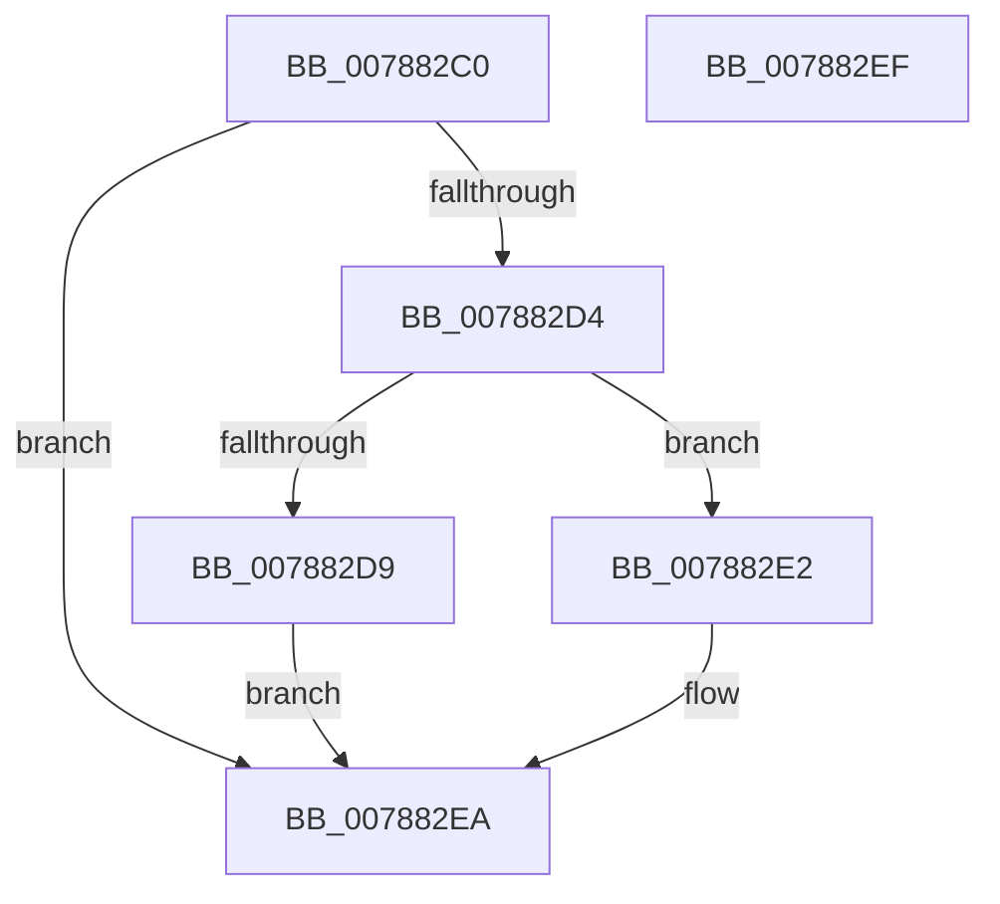

# PspClosePartitionHandle

- RVA: `0x007882C0`–`0x007882F0` (길이 `48` bytes)
- VA: `0x00000001407882C0`
- 실행 섹션: `PAGE`
- PDB 이름 있음: `예`; PDB Function 태그: `아니요`
- unwind 정보 RVA: `0x0005C788`
- 디코드: `15`개 명령, `48/48` bytes 표시
- 미해석 바이트: `0` (있으면 어셈블리에 `.byte`로 보존)

> 이 문서는 커널 이미지의 기계어와 PDB 기호를 분석해 생성했습니다. 4번과 5번은 함수 원형과 자료형을 바이너리 사용 방식에서 추정한 C 해석이며 원본 소스 복구 결과는 아닙니다.

## 1. Dependencies

- 직접 호출 지점: **1**; 고유 호출 대상: **1**
- 직접 호출자로 확인된 함수: **1**
- RIP 상대 이미지 참조: **0**

### Outgoing calls
- `0x007882E5` → [PsDereferencePartition](../../text/34/PsDereferencePartition_function_00342E70.md) (function, `0x00342E70`)

### Direct callers
- [PspAllocatePartition](PspAllocatePartition_function_0078802C.md) at `0x0078827F`

### Static image references
- 디코드된 RIP-relative 메모리 참조가 없습니다.

## 2. Other-region calls and transfers

- 다른 실행 섹션으로 향하는 call: **1**
  - `0x007882E5` → [PsDereferencePartition](../../text/34/PsDereferencePartition_function_00342E70.md) (`PAGE` → `.text`)
- 별도 외부 분기/꼬리 이동을 확인하지 못했습니다.

## 3. Assembly (complete function range)

```asm
007882C0  48 83 EC 28                     sub rsp, 0x28
007882C4  48 83 C8 FF                     or rax, 0xffffffffffffffff
007882C8  F0 48 0F C1 42 30               lock xadd qword ptr [rdx + 0x30], rax
007882CE  48 83 E8 01                     sub rax, 1
007882D2  7F 16                           jg 0x1407882ea
007882D4  48 85 C0                        test rax, rax
007882D7  74 09                           je 0x1407882e2
007882D9  B9 0E 00 00 00                  mov ecx, 0xe
007882DE  CD 29                           int 0x29
007882E0  EB 08                           jmp 0x1407882ea
007882E2  48 8B CA                        mov rcx, rdx
007882E5  E8 86 AB BB FF                  call 0x140342e70
007882EA  48 83 C4 28                     add rsp, 0x28
007882EE  C3                              ret
007882EF  CC                              int3
```

## 4. C-style interpretation (structured pseudocode)

```c
__int64 __fastcall PspClosePartitionHandle(__int64 a1, __int64 a2)
{
    __int64 result;
    __int64 v_rsp;

    v_rsp = (v_rsp) - (40);
    result = (result) | (-1);
    result = (result) - (1);
    if (condition_is_greater) goto loc_007882EA;
    if (result == 0) goto loc_007882E2;
    goto loc_007882EA;
loc_007882E2:
    result = PsDereferencePartition(a2, a2, a3, a4);
loc_007882EA:
    v_rsp = (v_rsp) + (40);
    return result;
}
```

## 5. (Beta) C Style

```c
int64_t PspClosePartitionHandle(int64_t Arg1, void *Arg2)
{
    uint8_t *arg2 = (uint8_t *)Arg2;

    int64_t result;
    int64_t local_rsp;

    local_rsp = (local_rsp) - (40);
    result = (result) | (-1);
    result = (result) - (1);
    if (condition_is_greater) goto loc_007882EA;
    if (result == 0) goto loc_007882E2;
    goto loc_007882EA;
loc_007882E2:
    result = PsDereferencePartition(Arg2, Arg2, a3, a4);
loc_007882EA:
    local_rsp = (local_rsp) + (40);
    return result;
}
```

### 관측된 메모리 오프셋

구조체 형식이 확인되지 않은 접근은 인자 기준의 오프셋으로만 기록했습니다.

| 기준 인자 | 오프셋 표현 | 폭 (bit) | 접근 |
|---|---:|---:|---|
| `Arg2` | `+ 0x30` | `64` | `R/W` |

## 6. Execution-region graph

[열기: 2D/3D 그래프와 함수 탐색 컨트롤 패널](../../../control-panel.html?section=page&rva=0x007882C0&view=graph)

- 2D 그래프는 위에서 아래로 흐르고, 3D 그래프는 빈 공간을 드래그해 회전합니다. Shift+드래그는 이동, 휠은 확대·축소, 함수 노드 선택은 대상 보고서 이동입니다.

### Static fallback


