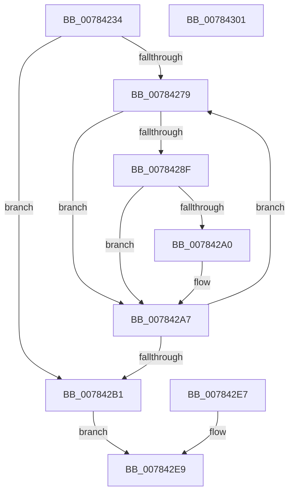

# PspCopyUserAttributes

- RVA: `0x00784234`–`0x00784302` (길이 `206` bytes)
- VA: `0x0000000140784234`
- 실행 섹션: `PAGE`
- PDB 이름 있음: `예`; PDB Function 태그: `아니요`
- unwind 정보 RVA: `0x000CEEF0`
- 디코드: `56`개 명령, `206/206` bytes 표시
- 미해석 바이트: `0` (있으면 어셈블리에 `.byte`로 보존)

> 이 문서는 커널 이미지의 기계어와 PDB 기호를 분석해 생성했습니다. 4번과 5번은 함수 원형과 자료형을 바이너리 사용 방식에서 추정한 C 해석이며 원본 소스 복구 결과는 아닙니다.

## 1. Dependencies

- 직접 호출 지점: **3**; 고유 호출 대상: **2**
- 직접 호출자로 확인된 함수: **1**
- RIP 상대 이미지 참조: **0**

### Outgoing calls
- `0x007842BC` → [RtlCopyToUser](../70/RtlCopyToUser_function_00705D68.md) (function, `0x00705D68`)
- `0x007842D2` → [RtlCopyToUser](../70/RtlCopyToUser_function_00705D68.md) (function, `0x00705D68`)
- `0x007842E0` → [RtlWriteULong64ToUser](../70/RtlWriteULong64ToUser_function_00705E44.md) (function, `0x00705E44`)

### Direct callers
- [PspCopyAndFixupParameters](../AE/PspCopyAndFixupParameters_function_00AEB878.md) at `0x00AEBC63`

### Static image references
- 디코드된 RIP-relative 메모리 참조가 없습니다.

## 2. Other-region calls and transfers

- 다른 실행 섹션으로 향하는 call: **0**
- 별도 외부 분기/꼬리 이동을 확인하지 못했습니다.

## 3. Assembly (complete function range)

```asm
00784234  48 89 5C 24 08                  mov qword ptr [rsp + 8], rbx
00784239  48 89 74 24 10                  mov qword ptr [rsp + 0x10], rsi
0078423E  48 89 7C 24 18                  mov qword ptr [rsp + 0x18], rdi
00784243  41 56                           push r14
00784245  48 83 EC 20                     sub rsp, 0x20
00784249  49 8B D8                        mov rbx, r8
0078424C  4C 8B F1                        mov r14, rcx
0078424F  33 FF                           xor edi, edi
00784251  41 8B 80 50 02 00 00            mov eax, dword ptr [r8 + 0x250]
00784258  44 8B C0                        mov r8d, eax
0078425B  49 C1 E0 05                     shl r8, 5
0078425F  48 8D 71 08                     lea rsi, [rcx + 8]
00784263  49 03 F0                        add rsi, r8
00784266  4C 8B CE                        mov r9, rsi
00784269  4C 2B CB                        sub r9, rbx
0078426C  49 81 E9 58 02 00 00            sub r9, 0x258
00784273  8B D7                           mov edx, edi
00784275  85 C0                           test eax, eax
00784277  74 38                           je 0x1407842b1
00784279  8B CA                           mov ecx, edx
0078427B  8B C2                           mov eax, edx
0078427D  48 C1 E0 05                     shl rax, 5
00784281  8B 84 18 30 02 00 00            mov eax, dword ptr [rax + rbx + 0x230]
00784288  48 0F BA E0 12                  bt rax, 0x12
0078428D  72 18                           jb 0x1407842a7
0078428F  48 83 C1 12                     add rcx, 0x12
00784293  48 C1 E1 05                     shl rcx, 5
00784297  48 8B 04 19                     mov rax, qword ptr [rcx + rbx]
0078429B  48 85 C0                        test rax, rax
0078429E  74 07                           je 0x1407842a7
007842A0  49 03 C1                        add rax, r9
007842A3  48 89 04 19                     mov qword ptr [rcx + rbx], rax
007842A7  FF C2                           inc edx
007842A9  3B 93 50 02 00 00               cmp edx, dword ptr [rbx + 0x250]
007842AF  72 C8                           jb 0x140784279
007842B1  48 8D 93 30 02 00 00            lea rdx, [rbx + 0x230]
007842B8  49 8D 4E 08                     lea rcx, [r14 + 8]
007842BC  E8 A7 1A F8 FF                  call 0x140705d68
007842C1  44 8B 83 54 02 00 00            mov r8d, dword ptr [rbx + 0x254]
007842C8  48 8D 93 58 02 00 00            lea rdx, [rbx + 0x258]
007842CF  48 8B CE                        mov rcx, rsi
007842D2  E8 91 1A F8 FF                  call 0x140705d68
007842D7  49 2B F6                        sub rsi, r14
007842DA  48 8B D6                        mov rdx, rsi
007842DD  49 8B CE                        mov rcx, r14
007842E0  E8 5F 1B F8 FF                  call 0x140705e44
007842E5  EB 02                           jmp 0x1407842e9
007842E7  8B F8                           mov edi, eax
007842E9  8B C7                           mov eax, edi
007842EB  48 8B 5C 24 30                  mov rbx, qword ptr [rsp + 0x30]
007842F0  48 8B 74 24 38                  mov rsi, qword ptr [rsp + 0x38]
007842F5  48 8B 7C 24 40                  mov rdi, qword ptr [rsp + 0x40]
007842FA  48 83 C4 20                     add rsp, 0x20
007842FE  41 5E                           pop r14
00784300  C3                              ret
00784301  CC                              int3
```

## 4. C-style interpretation (structured pseudocode)

```c
__int64 __fastcall PspCopyUserAttributes(__int64 a1, __int64 a2, __int64 a3)
{
    __int64 result;
    __int64 v_rdi;
    __int64 v_rsi;
    __int64 v_rsp;
    unsigned __int64 v_stack_p10;
    unsigned __int64 v_stack_p18;
    unsigned __int64 v_stack_p8;

    v_stack_p8 = v_rbx;
    v_stack_p10 = v_rsi;
    v_stack_p18 = v_rdi;
    v_rsp = (v_rsp) - (32);
    v_rdi = 0;
    a3 = ((unsigned int)((unsigned int)((unsigned int)(*(unsigned int *)(a3 + 592))))) << (5);
    v_rsi = (a1 + 8) + (a3);
    a4 = (v_rsi) - (a3);
    a4 = (a4) - (600);
    if ((unsigned int)((unsigned int)(*(unsigned int *)(a3 + 592))) == 0) goto loc_007842B1;
loc_00784279:
    result = (0) << (5);
    if (condition_is_below) goto loc_007842A7;
    a1 = (0) + (18);
    a1 = (a1) << (5);
    result = *(unsigned __int64 *)(a1 + a3 * 1);
    if (*(unsigned __int64 *)(a1 + a3 * 1) != 0) {
        result = (*(unsigned __int64 *)(a1 + a3 * 1)) + (a4);
        *(unsigned __int64 *)(a1 + a3 * 1) = result;
    }
    a2 = (unsigned int)((0) + 1);
    if (((unsigned int)(a2)) < (*(unsigned int *)(a3 + 592))) goto loc_00784279;
loc_007842B1:
    result = RtlCopyToUser(a1 + 8, a3 + 560, a3, a4);
    result = RtlCopyToUser(v_rsi, a3 + 600, (unsigned int)(*(unsigned int *)(a3 + 596)), a4);
    v_rsi = (v_rsi) - (a1);
    result = RtlWriteULong64ToUser(a1, v_rsi, (unsigned int)(*(unsigned int *)(a3 + 596)), a4);
    goto loc_007842E9;
loc_007842E9:
    v_rsp = (v_rsp) + (32);
    return 0;
}
```

## 5. (Beta) C Style

```c
int64_t PspCopyUserAttributes(void *Arg1, int64_t Arg2, void *Arg3)
{
    uint8_t *arg1 = (uint8_t *)Arg1;
    uint8_t *arg3 = (uint8_t *)Arg3;

    int64_t result;
    int64_t local_rdi;
    int64_t local_rsi;
    int64_t local_rsp;
    uint64_t v_stack_p10;
    uint64_t v_stack_p18;
    uint64_t v_stack_p8;

    v_stack_p8 = local_rbx;
    v_stack_p10 = local_rsi;
    v_stack_p18 = local_rdi;
    local_rsp = (local_rsp) - (32);
    local_rdi = 0;
    Arg3 = ((uint32_t)((uint32_t)((uint32_t)(*(uint32_t *)(arg3 + 0x250))))) << (5);
    local_rsi = (Arg1 + 8) + (Arg3);
    a4 = (local_rsi) - (Arg3);
    a4 = (a4) - (600);
    if ((uint32_t)((uint32_t)(*(uint32_t *)(arg3 + 0x250))) == 0) goto loc_007842B1;
loc_00784279:
    result = (0) << (5);
    if (condition_is_below) goto loc_007842A7;
    Arg1 = (0) + (18);
    Arg1 = (Arg1) << (5);
    result = *(uint64_t *)(arg1 + arg3 * 1);
    if (*(uint64_t *)(arg1 + arg3 * 1) != 0) {
        result = (*(uint64_t *)(arg1 + arg3 * 1)) + (a4);
        *(uint64_t *)(arg1 + arg3 * 1) = result;
    }
    Arg2 = (uint32_t)((0) + 1);
    if (((uint32_t)(Arg2)) < (*(uint32_t *)(arg3 + 0x250))) goto loc_00784279;
loc_007842B1:
    result = RtlCopyToUser(Arg1 + 8, Arg3 + 560, Arg3, a4);
    result = RtlCopyToUser(local_rsi, Arg3 + 600, (uint32_t)(*(uint32_t *)(arg3 + 0x254)), a4);
    local_rsi = (local_rsi) - (Arg1);
    result = RtlWriteULong64ToUser(Arg1, local_rsi, (uint32_t)(*(uint32_t *)(arg3 + 0x254)), a4);
    goto loc_007842E9;
loc_007842E9:
    local_rsp = (local_rsp) + (32);
    return 0;
}
```

### 관측된 메모리 오프셋

구조체 형식이 확인되지 않은 접근은 인자 기준의 오프셋으로만 기록했습니다.

| 기준 인자 | 오프셋 표현 | 폭 (bit) | 접근 |
|---|---:|---:|---|
| `Arg1` | `+ 0x8` | `64` | `R` |
| `Arg3` | `+ 0x230` | `64` | `R` |
| `Arg3` | `+ 0x250` | `32` | `R` |
| `Arg3` | `+ 0x254` | `32` | `R` |
| `Arg3` | `+ 0x258` | `64` | `R` |

## 6. Execution-region graph

[열기: 2D/3D 그래프와 함수 탐색 컨트롤 패널](../../../control-panel.html?section=page&rva=0x00784234&view=graph)

- 2D 그래프는 위에서 아래로 흐르고, 3D 그래프는 빈 공간을 드래그해 회전합니다. Shift+드래그는 이동, 휠은 확대·축소, 함수 노드 선택은 대상 보고서 이동입니다.

### Static fallback


