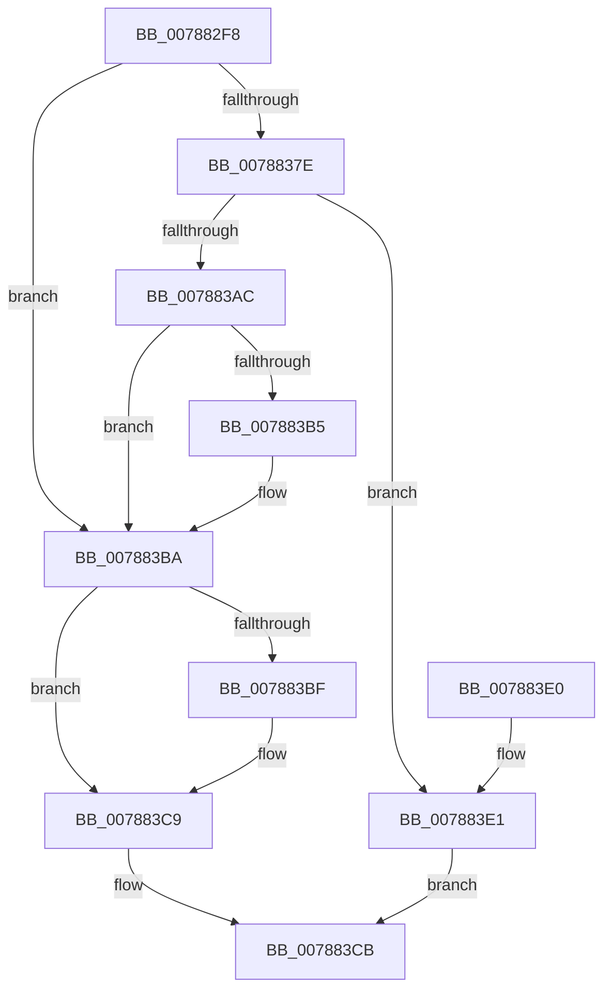

# PspCreatePartitionSystemProcess

- RVA: `0x007882F8`–`0x007883EF` (길이 `247` bytes)
- VA: `0x00000001407882F8`
- 실행 섹션: `PAGE`
- PDB 이름 있음: `예`; PDB Function 태그: `아니요`
- unwind 정보 RVA: `0x000CF470`
- 디코드: `68`개 명령, `247/247` bytes 표시
- 미해석 바이트: `0` (있으면 어셈블리에 `.byte`로 보존)

> 이 문서는 커널 이미지의 기계어와 PDB 기호를 분석해 생성했습니다. 4번과 5번은 함수 원형과 자료형을 바이너리 사용 방식에서 추정한 C 해석이며 원본 소스 복구 결과는 아닙니다.

## 1. Dependencies

- 직접 호출 지점: **4**; 고유 호출 대상: **4**
- 직접 호출자로 확인된 함수: **1**
- RIP 상대 이미지 참조: **3**

### Outgoing calls
- `0x0078836F` → [PsCreateMinimalProcess](PsCreateMinimalProcess_function_00786D14.md) (function, `0x00786D14`)
- `0x007883A1` → [ObReferenceObjectByHandle](../86/ObReferenceObjectByHandle_function_00868DB0.md) (function, `0x00868DB0`)
- `0x007883B5` → [ObfDereferenceObject](../../text/2F/ObfDereferenceObject_function_002F9350.md) (function, `0x002F9350`)
- `0x007883C4` → [ObCloseHandle](../8A/ObCloseHandle_function_008A1870.md) (function, `0x008A1870`)

### Direct callers
- [PspAllocatePartition](PspAllocatePartition_function_0078802C.md) at `0x00788210`

### Static image references
- `0x00788313` → RVA `0x00B05090` (` ?? ::NNGAKEGL::`string'`; read)
- `0x00788321` → RVA `0x00FC6AB0` (`ALMOSTRO`; read)
- `0x0078837E` → RVA `0x00FC6A98` (`ALMOSTRO`; read)

## 2. Other-region calls and transfers

- 다른 실행 섹션으로 향하는 call: **1**
  - `0x007883B5` → [ObfDereferenceObject](../../text/2F/ObfDereferenceObject_function_002F9350.md) (`PAGE` → `.text`)
- 별도 외부 분기/꼬리 이동을 확인하지 못했습니다.

## 3. Assembly (complete function range)

```asm
007882F8  4C 8B DC                        mov r11, rsp
007882FB  49 89 5B 08                     mov qword ptr [r11 + 8], rbx
007882FF  49 89 73 10                     mov qword ptr [r11 + 0x10], rsi
00788303  55                              push rbp
00788304  57                              push rdi
00788305  41 56                           push r14
00788307  48 8B EC                        mov rbp, rsp
0078830A  48 83 EC 70                     sub rsp, 0x70
0078830E  48 83 65 30 00                  and qword ptr [rbp + 0x30], 0
00788313  48 8D 05 76 CD 37 00            lea rax, [rip + 0x37cd76]
0078831A  48 89 45 F8                     mov qword ptr [rbp - 8], rax
0078831E  4C 8B F1                        mov r14, rcx
00788321  48 8B 0D 88 E7 83 00            mov rcx, qword ptr [rip + 0x83e788]
00788328  48 8D 45 30                     lea rax, [rbp + 0x30]
0078832C  49 89 43 D0                     mov qword ptr [r11 - 0x30], rax
00788330  48 8B F2                        mov rsi, rdx
00788333  49 83 63 C8 00                  and qword ptr [r11 - 0x38], 0
00788338  48 8D 55 F0                     lea rdx, [rbp - 0x10]
0078833C  49 83 63 C0 00                  and qword ptr [r11 - 0x40], 0
00788341  45 33 C0                        xor r8d, r8d
00788344  49 83 63 B8 00                  and qword ptr [r11 - 0x48], 0
00788349  49 83 63 B0 00                  and qword ptr [r11 - 0x50], 0
0078834E  44 8A 89 FA 05 00 00            mov r9b, byte ptr [rcx + 0x5fa]
00788355  C7 44 24 30 01 00 00 00         mov dword ptr [rsp + 0x30], 1
0078835D  83 64 24 28 00                  and dword ptr [rsp + 0x28], 0
00788362  49 83 63 98 00                  and qword ptr [r11 - 0x68], 0
00788367  48 C7 45 F0 1C 00 1E 00         mov qword ptr [rbp - 0x10], 0x1e001c
0078836F  E8 A0 E9 FF FF                  call 0x140786d14
00788374  48 8B 5D 30                     mov rbx, qword ptr [rbp + 0x30]
00788378  8B F8                           mov edi, eax
0078837A  85 C0                           test eax, eax
0078837C  78 3C                           js 0x1407883ba
0078837E  4C 8B 05 13 E7 83 00            mov r8, qword ptr [rip + 0x83e713]
00788385  48 8D 45 30                     lea rax, [rbp + 0x30]
00788389  48 83 64 24 28 00               and qword ptr [rsp + 0x28], 0
0078838F  45 33 C9                        xor r9d, r9d
00788392  48 83 65 30 00                  and qword ptr [rbp + 0x30], 0
00788397  33 D2                           xor edx, edx
00788399  48 8B CB                        mov rcx, rbx
0078839C  48 89 44 24 20                  mov qword ptr [rsp + 0x20], rax
007883A1  E8 0A 0A 0E 00                  call 0x140868db0
007883A6  8B F8                           mov edi, eax
007883A8  85 C0                           test eax, eax
007883AA  79 35                           jns 0x1407883e1
007883AC  48 8B 4D 30                     mov rcx, qword ptr [rbp + 0x30]
007883B0  48 85 C9                        test rcx, rcx
007883B3  74 05                           je 0x1407883ba
007883B5  E8 96 0F B7 FF                  call 0x1402f9350
007883BA  48 85 DB                        test rbx, rbx
007883BD  74 0A                           je 0x1407883c9
007883BF  33 D2                           xor edx, edx
007883C1  48 8B CB                        mov rcx, rbx
007883C4  E8 A7 94 11 00                  call 0x1408a1870
007883C9  8B C7                           mov eax, edi
007883CB  4C 8D 5C 24 70                  lea r11, [rsp + 0x70]
007883D0  49 8B 5B 20                     mov rbx, qword ptr [r11 + 0x20]
007883D4  49 8B 73 28                     mov rsi, qword ptr [r11 + 0x28]
007883D8  49 8B E3                        mov rsp, r11
007883DB  41 5E                           pop r14
007883DD  5F                              pop rdi
007883DE  5D                              pop rbp
007883DF  C3                              ret
007883E0  CC                              int3
007883E1  48 8B 45 30                     mov rax, qword ptr [rbp + 0x30]
007883E5  49 89 06                        mov qword ptr [r14], rax
007883E8  33 C0                           xor eax, eax
007883EA  48 89 1E                        mov qword ptr [rsi], rbx
007883ED  EB DC                           jmp 0x1407883cb
```

## 4. C-style interpretation (structured pseudocode)

```c
__int64 __fastcall PspCreatePartitionSystemProcess(__int64 a1, __int64 a2, int a3)
{
    __int64 result;
    __int64 v_rsp;
    unsigned __int64 v_stack_m18;
    unsigned __int64 v_stack_m20;
    unsigned __int64 v_stack_m28;
    unsigned int v_stack_m58;
    unsigned int v_stack_m60;
    unsigned __int64 v_stack_m68;
    unsigned __int64 v_stack_p18;

    *(unsigned __int64 *)(v_rsp + 8) = v_rbx;
    *(unsigned __int64 *)(v_rsp + 16) = v_rsi;
    v_rsp = (v_rsp) - (112);
    v_stack_m20 = v_rip + 3657078;
    *(unsigned __int64 *)(v_rsp - 48) = v_stack_p18;
    a3 = 0;
    v_stack_m58 = 1;
    v_stack_m28 = 0x1E001CULL;
    result = PsCreateMinimalProcess(*(unsigned __int64 *)(v_rip + 8644488), v_stack_m28, a3, *(unsigned __int8 *)(*(unsigned __int64 *)(v_rip + 8644488) + 1530));
    if (sign_flag) goto loc_007883BA;
    a4 = 0;
    a2 = 0;
    v_stack_m68 = v_stack_p18;
    result = ObReferenceObjectByHandle(v_stack_p18, a2, *(unsigned __int64 *)(v_rip + 8644371), a4);
    if (!sign_flag) goto loc_007883E1;
    if (v_stack_p18 != 0) {
        result = ObfDereferenceObject(v_stack_p18, a2, *(unsigned __int64 *)(v_rip + 8644371), a4);
    }
    if (v_stack_p18 != 0) {
        a2 = 0;
        a1 = v_stack_p18;
        result = ObCloseHandle(a1, a2, *(unsigned __int64 *)(v_rip + 8644371), a4);
    }
loc_007883CB:
    return (unsigned int)((unsigned int)((unsigned int)((unsigned int)(result))));
loc_007883E1:
    *(unsigned __int64 *)(a1) = v_stack_p18;
    result = 0;
    *(unsigned __int64 *)(*(unsigned __int64 *)(v_stack_m18 + 40)) = *(unsigned __int64 *)(v_stack_m18 + 32);
    goto loc_007883CB;
}
```

## 5. (Beta) C Style

```c
int64_t PspCreatePartitionSystemProcess(void *Arg1, void *Arg2, int32_t Arg3)
{
    uint8_t *arg1 = (uint8_t *)Arg1;
    uint8_t *arg2 = (uint8_t *)Arg2;

    int64_t result;
    int64_t local_rsp;
    uint64_t v_stack_m18;
    uint64_t v_stack_m20;
    uint64_t v_stack_m28;
    uint32_t v_stack_m58;
    uint32_t v_stack_m60;
    uint64_t v_stack_m68;
    uint64_t v_stack_p18;

    *(uint64_t *)(local_rsp + 0x8) = local_rbx;
    *(uint64_t *)(local_rsp + 0x10) = local_rsi;
    local_rsp = (local_rsp) - (112);
    v_stack_m20 = v_rip + 3657078;
    *(uint64_t *)(local_rsp - 0x30) = v_stack_p18;
    Arg3 = 0;
    v_stack_m58 = 1;
    v_stack_m28 = 0x1E001CULL;
    result = PsCreateMinimalProcess(*(uint64_t *)(v_rip + 0x83E788), v_stack_m28, Arg3, *(uint8_t *)(*(uint64_t *)(v_rip + 0x83E788) + 0x5FA));
    if (sign_flag) goto loc_007883BA;
    a4 = 0;
    Arg2 = 0;
    v_stack_m68 = v_stack_p18;
    result = ObReferenceObjectByHandle(v_stack_p18, Arg2, *(uint64_t *)(v_rip + 0x83E713), a4);
    if (!sign_flag) goto loc_007883E1;
    if (v_stack_p18 != 0) {
        result = ObfDereferenceObject(v_stack_p18, Arg2, *(uint64_t *)(v_rip + 0x83E713), a4);
    }
    if (v_stack_p18 != 0) {
        Arg2 = 0;
        Arg1 = v_stack_p18;
        result = ObCloseHandle(Arg1, Arg2, *(uint64_t *)(v_rip + 0x83E713), a4);
    }
loc_007883CB:
    return (uint32_t)((uint32_t)((uint32_t)((uint32_t)(result))));
loc_007883E1:
    *(uint64_t *)(arg1) = v_stack_p18;
    result = 0;
    *(uint64_t *)(*(uint64_t *)(v_stack_m18 + 0x28)) = *(uint64_t *)(v_stack_m18 + 0x20);
    goto loc_007883CB;
}
```

### 관측된 메모리 오프셋

구조체 형식이 확인되지 않은 접근은 인자 기준의 오프셋으로만 기록했습니다.

| 기준 인자 | 오프셋 표현 | 폭 (bit) | 접근 |
|---|---:|---:|---|
| `Arg1` | `+ 0x0` | `64` | `W` |
| `Arg2` | `+ 0x0` | `64` | `W` |

## 6. Execution-region graph

[열기: 2D/3D 그래프와 함수 탐색 컨트롤 패널](../../../control-panel.html?section=page&rva=0x007882F8&view=graph)

- 2D 그래프는 위에서 아래로 흐르고, 3D 그래프는 빈 공간을 드래그해 회전합니다. Shift+드래그는 이동, 휠은 확대·축소, 함수 노드 선택은 대상 보고서 이동입니다.

### Static fallback


