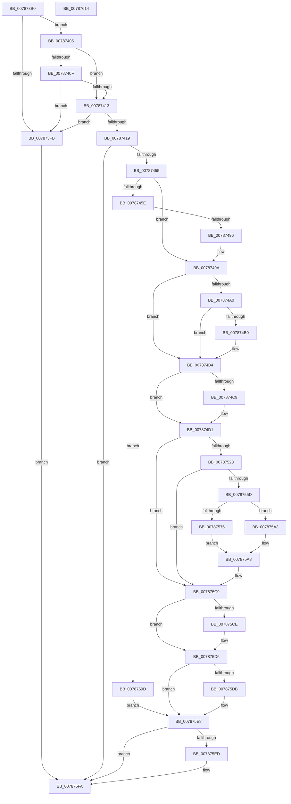

# PspCreatePicoProcess

- RVA: `0x007873B0`–`0x00787615` (길이 `613` bytes)
- VA: `0x00000001407873B0`
- 실행 섹션: `PAGE`
- PDB 이름 있음: `예`; PDB Function 태그: `아니요`
- unwind 정보 RVA: `0x000CDA30`
- 디코드: `169`개 명령, `613/613` bytes 표시
- 미해석 바이트: `0` (있으면 어셈블리에 `.byte`로 보존)

> 이 문서는 커널 이미지의 기계어와 PDB 기호를 분석해 생성했습니다. 4번과 5번은 함수 원형과 자료형을 바이너리 사용 방식에서 추정한 C 해석이며 원본 소스 복구 결과는 아닙니다.

## 1. Dependencies

- 직접 호출 지점: **10**; 고유 호출 대상: **6**
- 직접 호출자로 확인된 함수: **0**
- RIP 상대 이미지 참조: **2**

### Outgoing calls
- `0x00787446` → [ObpReferenceObjectByHandleWithTag](../86/ObpReferenceObjectByHandleWithTag_function_00869650.md) (function, `0x00869650`)
- `0x00787487` → [ObpReferenceObjectByHandleWithTag](../86/ObpReferenceObjectByHandleWithTag_function_00869650.md) (function, `0x00869650`)
- `0x00787510` → [PsCreateMinimalProcess](PsCreateMinimalProcess_function_00786D14.md) (function, `0x00786D14`)
- `0x00787552` → [ObpReferenceObjectByHandleWithTag](../86/ObpReferenceObjectByHandleWithTag_function_00869650.md) (function, `0x00869650`)
- `0x00787567` → [PspLockProcessExclusive](../../text/46/PspLockProcessExclusive_function_00460164.md) (function, `0x00460164`)
- `0x007875B0` → [PspUnlockProcessExclusive](../../text/46/PspUnlockProcessExclusive_function_004601C0.md) (function, `0x004601C0`)
- `0x007875BD` → [ObfDereferenceObjectWithTag](../../text/2F/ObfDereferenceObjectWithTag_function_002F78E0.md) (function, `0x002F78E0`)
- `0x007875D1` → [ZwClose](../../text/6A/ZwClose_function_006AD2B0.md) (function, `0x006AD2B0`)
- `0x007875E3` → [ObfDereferenceObjectWithTag](../../text/2F/ObfDereferenceObjectWithTag_function_002F78E0.md) (function, `0x002F78E0`)
- `0x007875F5` → [ObfDereferenceObjectWithTag](../../text/2F/ObfDereferenceObjectWithTag_function_002F78E0.md) (function, `0x002F78E0`)

### Direct callers
- 이 함수 시작 RVA로 연결되는 직접 call은 확인되지 않았습니다. 간접 호출은 완전히 역산할 수 없습니다.

### Static image references
- `0x00787419` → RVA `0x00FC6A98` (`ALMOSTRO`; read)
- `0x0078746F` → RVA `0x00FD8020` (`PAGEDATA`; read)

## 2. Other-region calls and transfers

- 다른 실행 섹션으로 향하는 call: **6**
  - `0x00787567` → [PspLockProcessExclusive](../../text/46/PspLockProcessExclusive_function_00460164.md) (`PAGE` → `.text`)
  - `0x007875B0` → [PspUnlockProcessExclusive](../../text/46/PspUnlockProcessExclusive_function_004601C0.md) (`PAGE` → `.text`)
  - `0x007875BD` → [ObfDereferenceObjectWithTag](../../text/2F/ObfDereferenceObjectWithTag_function_002F78E0.md) (`PAGE` → `.text`)
  - `0x007875D1` → [ZwClose](../../text/6A/ZwClose_function_006AD2B0.md) (`PAGE` → `.text`)
  - `0x007875E3` → [ObfDereferenceObjectWithTag](../../text/2F/ObfDereferenceObjectWithTag_function_002F78E0.md) (`PAGE` → `.text`)
  - `0x007875F5` → [ObfDereferenceObjectWithTag](../../text/2F/ObfDereferenceObjectWithTag_function_002F78E0.md) (`PAGE` → `.text`)
- 별도 외부 분기/꼬리 이동을 확인하지 못했습니다.

## 3. Assembly (complete function range)

```asm
007873B0  48 89 5C 24 10                  mov qword ptr [rsp + 0x10], rbx
007873B5  4C 89 44 24 18                  mov qword ptr [rsp + 0x18], r8
007873BA  55                              push rbp
007873BB  56                              push rsi
007873BC  57                              push rdi
007873BD  41 54                           push r12
007873BF  41 55                           push r13
007873C1  41 56                           push r14
007873C3  41 57                           push r15
007873C5  48 8B EC                        mov rbp, rsp
007873C8  48 83 EC 70                     sub rsp, 0x70
007873CC  65 4C 8B 2C 25 88 01 00 00      mov r13, qword ptr gs:[0x188]
007873D5  33 C0                           xor eax, eax
007873D7  8B 59 18                        mov ebx, dword ptr [rcx + 0x18]
007873DA  4C 8B FA                        mov r15, rdx
007873DD  48 89 45 F8                     mov qword ptr [rbp - 8], rax
007873E1  4C 8B F1                        mov r14, rcx
007873E4  48 89 45 40                     mov qword ptr [rbp + 0x40], rax
007873E8  44 8B E0                        mov r12d, eax
007873EB  48 89 45 58                     mov qword ptr [rbp + 0x58], rax
007873EF  48 89 45 F0                     mov qword ptr [rbp - 0x10], rax
007873F3  F7 C3 F0 FF FF FF               test ebx, 0xfffffff0
007873F9  74 0A                           je 0x140787405
007873FB  BF 0D 00 00 C0                  mov edi, 0xc000000d
00787400  E9 F5 01 00 00                  jmp 0x1407875fa
00787405  8B F3                           mov esi, ebx
00787407  83 E6 01                        and esi, 1
0078740A  F6 C3 06                        test bl, 6
0078740D  74 04                           je 0x140787413
0078740F  85 F6                           test esi, esi
00787411  74 E8                           je 0x1407873fb
00787413  48 39 41 10                     cmp qword ptr [rcx + 0x10], rax
00787417  74 E2                           je 0x1407873fb
00787419  4C 8B 05 78 F6 83 00            mov r8, qword ptr [rip + 0x83f678]
00787420  45 33 C9                        xor r9d, r9d
00787423  48 8B 09                        mov rcx, qword ptr [rcx]
00787426  BA 80 00 00 00                  mov edx, 0x80
0078742B  48 89 44 24 38                  mov qword ptr [rsp + 0x38], rax
00787430  48 89 44 24 30                  mov qword ptr [rsp + 0x30], rax
00787435  48 8D 45 40                     lea rax, [rbp + 0x40]
00787439  48 89 44 24 28                  mov qword ptr [rsp + 0x28], rax
0078743E  C7 44 24 20 50 73 43 72         mov dword ptr [rsp + 0x20], 0x72437350
00787446  E8 05 22 0E 00                  call 0x140869650
0078744B  8B F8                           mov edi, eax
0078744D  85 C0                           test eax, eax
0078744F  0F 88 A5 01 00 00               js 0x1407875fa
00787455  49 8B 4E 08                     mov rcx, qword ptr [r14 + 8]
00787459  48 85 C9                        test rcx, rcx
0078745C  74 3C                           je 0x14078749a
0078745E  4C 21 64 24 38                  and qword ptr [rsp + 0x38], r12
00787463  48 8D 45 F8                     lea rax, [rbp - 8]
00787467  4C 21 64 24 30                  and qword ptr [rsp + 0x30], r12
0078746C  45 33 C9                        xor r9d, r9d
0078746F  4C 8B 05 AA 0B 85 00            mov r8, qword ptr [rip + 0x850baa]
00787476  48 89 44 24 28                  mov qword ptr [rsp + 0x28], rax
0078747B  C7 44 24 20 50 73 43 72         mov dword ptr [rsp + 0x20], 0x72437350
00787483  41 8D 51 09                     lea edx, [r9 + 9]
00787487  E8 C4 21 0E 00                  call 0x140869650
0078748C  8B F8                           mov edi, eax
0078748E  85 C0                           test eax, eax
00787490  0F 88 07 01 00 00               js 0x14078759d
00787496  4C 8B 65 F8                     mov r12, qword ptr [rbp - 8]
0078749A  33 C0                           xor eax, eax
0078749C  85 F6                           test esi, esi
0078749E  74 14                           je 0x1407874b4
007874A0  8B C3                           mov eax, ebx
007874A2  83 E0 02                        and eax, 2
007874A5  0F BA E8 0C                     bts eax, 0xc
007874A9  03 C0                           add eax, eax
007874AB  F6 C3 04                        test bl, 4
007874AE  74 04                           je 0x1407874b4
007874B0  0F BA E8 0E                     bts eax, 0xe
007874B4  8B C8                           mov ecx, eax
007874B6  83 C9 01                        or ecx, 1
007874B9  F6 C3 08                        test bl, 8
007874BC  0F 44 C8                        cmove ecx, eax
007874BF  33 D2                           xor edx, edx
007874C1  45 33 C0                        xor r8d, r8d
007874C4  4D 85 FF                        test r15, r15
007874C7  74 08                           je 0x1407874d1
007874C9  49 8B 57 08                     mov rdx, qword ptr [r15 + 8]
007874CD  4D 8B 47 10                     mov r8, qword ptr [r15 + 0x10]
007874D1  4C 8B 7D 40                     mov r15, qword ptr [rbp + 0x40]
007874D5  48 8D 45 58                     lea rax, [rbp + 0x58]
007874D9  48 89 44 24 58                  mov qword ptr [rsp + 0x58], rax
007874DE  45 33 C9                        xor r9d, r9d
007874E1  48 83 64 24 50 00               and qword ptr [rsp + 0x50], 0
007874E7  48 83 64 24 48 00               and qword ptr [rsp + 0x48], 0
007874ED  48 83 64 24 40 00               and qword ptr [rsp + 0x40], 0
007874F3  49 8B 46 10                     mov rax, qword ptr [r14 + 0x10]
007874F7  48 89 44 24 38                  mov qword ptr [rsp + 0x38], rax
007874FC  C7 44 24 30 02 00 00 00         mov dword ptr [rsp + 0x30], 2
00787504  89 4C 24 28                     mov dword ptr [rsp + 0x28], ecx
00787508  49 8B CF                        mov rcx, r15
0078750B  4C 89 64 24 20                  mov qword ptr [rsp + 0x20], r12
00787510  E8 FF F7 FF FF                  call 0x140786d14
00787515  4C 8B 75 58                     mov r14, qword ptr [rbp + 0x58]
00787519  8B F8                           mov edi, eax
0078751B  85 C0                           test eax, eax
0078751D  0F 88 A6 00 00 00               js 0x1407875c9
00787523  48 83 64 24 38 00               and qword ptr [rsp + 0x38], 0
00787529  48 8D 45 F0                     lea rax, [rbp - 0x10]
0078752D  48 83 64 24 30 00               and qword ptr [rsp + 0x30], 0
00787533  45 33 C9                        xor r9d, r9d
00787536  4C 8B 05 5B F5 83 00            mov r8, qword ptr [rip + 0x83f55b]
0078753D  BA 80 00 00 00                  mov edx, 0x80
00787542  48 89 44 24 28                  mov qword ptr [rsp + 0x28], rax
00787547  49 8B CE                        mov rcx, r14
0078754A  C7 44 24 20 50 73 43 72         mov dword ptr [rsp + 0x20], 0x72437350
00787552  E8 F9 20 0E 00                  call 0x140869650
00787557  8B F8                           mov edi, eax
00787559  85 C0                           test eax, eax
0078755B  78 6C                           js 0x1407875c9
0078755D  48 8B 75 F0                     mov rsi, qword ptr [rbp - 0x10]
00787561  49 8B D5                        mov rdx, r13
00787564  48 8B CE                        mov rcx, rsi
00787567  E8 F8 8B CD FF                  call 0x140460164
0078756C  8B 86 F4 01 00 00               mov eax, dword ptr [rsi + 0x1f4]
00787572  A8 08                           test al, 8
00787574  75 2D                           jne 0x1407875a3
00787576  F0 0F BA AE F0 01 00 00 0A      lock bts dword ptr [rsi + 0x1f0], 0xa
0078757F  48 8B 45 58                     mov rax, qword ptr [rbp + 0x58]
00787583  48 8B 4D 50                     mov rcx, qword ptr [rbp + 0x50]
00787587  4C 8B 7D 40                     mov r15, qword ptr [rbp + 0x40]
0078758B  48 8B 75 F0                     mov rsi, qword ptr [rbp - 0x10]
0078758F  4C 8B 65 F8                     mov r12, qword ptr [rbp - 8]
00787593  48 89 01                        mov qword ptr [rcx], rax
00787596  33 C0                           xor eax, eax
00787598  44 8B F0                        mov r14d, eax
0078759B  EB 0B                           jmp 0x1407875a8
0078759D  4C 8B 7D 40                     mov r15, qword ptr [rbp + 0x40]
007875A1  EB 45                           jmp 0x1407875e8
007875A3  BF 0A 01 00 C0                  mov edi, 0xc000010a
007875A8  49 8B D5                        mov rdx, r13
007875AB  48 8B CE                        mov rcx, rsi
007875AE  8B DF                           mov ebx, edi
007875B0  E8 0B 8C CD FF                  call 0x1404601c0
007875B5  BA 50 73 43 72                  mov edx, 0x72437350
007875BA  48 8B CE                        mov rcx, rsi
007875BD  E8 1E 03 B7 FF                  call 0x1402f78e0
007875C2  33 FF                           xor edi, edi
007875C4  85 DB                           test ebx, ebx
007875C6  0F 48 FB                        cmovs edi, ebx
007875C9  4D 85 F6                        test r14, r14
007875CC  74 08                           je 0x1407875d6
007875CE  49 8B CE                        mov rcx, r14
007875D1  E8 DA 5C F2 FF                  call 0x1406ad2b0
007875D6  4D 85 E4                        test r12, r12
007875D9  74 0D                           je 0x1407875e8
007875DB  BA 50 73 43 72                  mov edx, 0x72437350
007875E0  49 8B CC                        mov rcx, r12
007875E3  E8 F8 02 B7 FF                  call 0x1402f78e0
007875E8  4D 85 FF                        test r15, r15
007875EB  74 0D                           je 0x1407875fa
007875ED  BA 50 73 43 72                  mov edx, 0x72437350
007875F2  49 8B CF                        mov rcx, r15
007875F5  E8 E6 02 B7 FF                  call 0x1402f78e0
007875FA  48 8B 9C 24 B8 00 00 00         mov rbx, qword ptr [rsp + 0xb8]
00787602  8B C7                           mov eax, edi
00787604  48 83 C4 70                     add rsp, 0x70
00787608  41 5F                           pop r15
0078760A  41 5E                           pop r14
0078760C  41 5D                           pop r13
0078760E  41 5C                           pop r12
00787610  5F                              pop rdi
00787611  5E                              pop rsi
00787612  5D                              pop rbp
00787613  C3                              ret
00787614  CC                              int3
```

## 4. C-style interpretation (structured pseudocode)

```c
__int64 __fastcall PspCreatePicoProcess(__int64 a1, __int64 a2, __int64 a3, int a4)
{
    __int64 result;
    __int64 v_rdi;
    __int64 v_rsi;
    __int64 v_rsp;
    unsigned __int64 v_stack_m40;
    unsigned __int64 v_stack_m48;
    unsigned __int64 v_stack_m50;
    unsigned __int64 v_stack_m58;
    unsigned __int64 v_stack_m60;
    unsigned __int64 v_stack_m68;
    unsigned __int64 v_stack_m70;
    unsigned __int64 v_stack_m78;
    unsigned __int64 v_stack_m80;
    unsigned int v_stack_m88;
    unsigned __int64 v_stack_p10;
    unsigned __int64 v_stack_p18;
    unsigned __int64 v_stack_p20;
    unsigned __int64 v_stack_p8;

    v_stack_p10 = v_rbx;
    v_stack_p18 = a3;
    v_rsp = (v_rsp) - (112);
    result = 0;
    v_stack_m40 = 0;
    v_stack_p8 = 0;
    v_stack_p20 = 0;
    v_stack_m48 = 0;
    if ((((unsigned int)((unsigned int)(*(unsigned int *)(a1 + 24)))) & (0xFFFFFFF0ULL)) == 0) goto loc_00787405;
loc_007873FB:
    goto loc_007875FA;
loc_00787405:
    v_rsi = (unsigned int)(((unsigned int)((unsigned int)((unsigned int)(*(unsigned int *)(a1 + 24))))) & (1));
    if ((((unsigned __int8)((unsigned int)(*(unsigned int *)(a1 + 24)))) & (6)) == 0) goto loc_00787413;
    if ((unsigned int)(v_rsi) == 0) goto loc_007873FB;
loc_00787413:
    if ((*(unsigned __int64 *)(a1 + 16)) == 0) goto loc_007873FB;
    a4 = 0;
    v_stack_m70 = 0;
    v_stack_m78 = 0;
    v_stack_m80 = v_stack_p8;
    v_stack_m88 = 0x72437350ULL;
    result = ObpReferenceObjectByHandleWithTag(*(unsigned __int64 *)(a1), 128, *(unsigned __int64 *)(v_rip + 8648312), a4);
    if (sign_flag) goto loc_007875FA;
    if (*(unsigned __int64 *)(a1 + 8) == 0) goto loc_0078749A;
    a4 = 0;
    v_stack_m80 = v_stack_m40;
    v_stack_m88 = 0x72437350ULL;
    result = ObpReferenceObjectByHandleWithTag(*(unsigned __int64 *)(a1 + 8), a4 + 9, *(unsigned __int64 *)(v_rip + 8719274), a4);
    if (sign_flag) goto loc_0078759D;
loc_0078749A:
    result = 0;
    if ((unsigned int)(v_rsi) == 0) goto loc_007874B4;
    result = (unsigned int)(((unsigned int)((unsigned int)((unsigned int)(*(unsigned int *)(a1 + 24))))) & (2));
    result = (unsigned int)((result) + ((unsigned int)(result)));
    if ((((unsigned __int8)((unsigned int)(*(unsigned int *)(a1 + 24)))) & (4)) != 0) {
    }
    a1 = (unsigned int)(((unsigned int)((unsigned int)(result))) | (1));
    if ((((unsigned __int8)((unsigned int)(*(unsigned int *)(a1 + 24)))) & (8)) == 0) { a1 = (unsigned int)(result); }
    a2 = 0;
    a3 = 0;
    if (0 != 0) {
        a2 = *(unsigned __int64 *)(a2 + 8);
        a3 = *(unsigned __int64 *)(a2 + 16);
    }
    v_stack_m50 = v_stack_p20;
    a4 = 0;
    v_stack_m70 = *(unsigned __int64 *)(a1 + 16);
    v_stack_m78 = 2;
    v_stack_m80 = (unsigned int)(a1);
    v_stack_m88 = v_stack_m40;
    result = PsCreateMinimalProcess(v_stack_p8, a2, a3, a4);
    if (sign_flag) goto loc_007875C9;
    a4 = 0;
    v_stack_m80 = v_stack_m48;
    v_stack_m88 = 0x72437350ULL;
    result = ObpReferenceObjectByHandleWithTag(v_stack_p20, 128, *(unsigned __int64 *)(v_rip + 8648027), a4);
    if (sign_flag) goto loc_007875C9;
    result = PspLockProcessExclusive(v_stack_m48, *(unsigned __int64 *)(gs_base + (0 + 392)), *(unsigned __int64 *)(v_rip + 8648027), a4);
    if ((((unsigned __int8)((unsigned int)(*(unsigned int *)(v_stack_m48 + 500)))) & (8)) != 0) goto loc_007875A3;
    *(unsigned __int64 *)(v_stack_p18) = v_stack_p20;
    result = 0;
    goto loc_007875A8;
loc_0078759D:
    goto loc_007875E8;
loc_007875A3:
loc_007875A8:
    result = PspUnlockProcessExclusive(v_stack_m48, *(unsigned __int64 *)(gs_base + (0 + 392)), *(unsigned __int64 *)(v_rip + 8648027), a4);
    result = ObfDereferenceObjectWithTag(v_stack_m48, (unsigned int)(0x72437350ULL), *(unsigned __int64 *)(v_rip + 8648027), a4);
    v_rdi = 0;
    if (sign_flag) { v_rdi = (unsigned int)((unsigned int)((unsigned int)((unsigned int)(0xC000010AULL)))); }
loc_007875C9:
    if (0 != 0) {
        a1 = 0;
        result = ZwClose(a1, (unsigned int)(0x72437350ULL), *(unsigned __int64 *)(v_rip + 8648027), a4);
    }
    if (v_stack_m40 != 0) {
        a2 = 0x72437350ULL;
        a1 = v_stack_m40;
        result = ObfDereferenceObjectWithTag(a1, a2, *(unsigned __int64 *)(v_rip + 8648027), a4);
    }
    if (v_stack_p8 != 0) {
        a2 = 0x72437350ULL;
        a1 = v_stack_p8;
        result = ObfDereferenceObjectWithTag(a1, a2, *(unsigned __int64 *)(v_rip + 8648027), a4);
    }
    v_rsp = (v_rsp) + (112);
    return (unsigned int)((unsigned int)(v_rdi));
}
```

## 5. (Beta) C Style

```c
int64_t PspCreatePicoProcess(void *Arg1, int64_t Arg2, int64_t Arg3, int32_t Arg4)
{
    uint8_t *arg1 = (uint8_t *)Arg1;

    int64_t result;
    int64_t local_rdi;
    int64_t local_rsi;
    int64_t local_rsp;
    uint64_t v_stack_m40;
    uint64_t v_stack_m48;
    uint64_t v_stack_m50;
    uint64_t v_stack_m58;
    uint64_t v_stack_m60;
    uint64_t v_stack_m68;
    uint64_t v_stack_m70;
    uint64_t v_stack_m78;
    uint64_t v_stack_m80;
    uint32_t v_stack_m88;
    uint64_t v_stack_p10;
    uint64_t v_stack_p18;
    uint64_t v_stack_p20;
    uint64_t v_stack_p8;

    v_stack_p10 = local_rbx;
    v_stack_p18 = Arg3;
    local_rsp = (local_rsp) - (112);
    result = 0;
    v_stack_m40 = 0;
    v_stack_p8 = 0;
    v_stack_p20 = 0;
    v_stack_m48 = 0;
    if ((((uint32_t)((uint32_t)(*(uint32_t *)(arg1 + 0x18)))) & (0xFFFFFFF0ULL)) == 0) goto loc_00787405;
loc_007873FB:
    goto loc_007875FA;
loc_00787405:
    local_rsi = (uint32_t)(((uint32_t)((uint32_t)((uint32_t)(*(uint32_t *)(arg1 + 0x18))))) & (1));
    if ((((uint8_t)((uint32_t)(*(uint32_t *)(arg1 + 0x18)))) & (6)) == 0) goto loc_00787413;
    if ((uint32_t)(local_rsi) == 0) goto loc_007873FB;
loc_00787413:
    if ((*(uint64_t *)(arg1 + 0x10)) == 0) goto loc_007873FB;
    Arg4 = 0;
    v_stack_m70 = 0;
    v_stack_m78 = 0;
    v_stack_m80 = v_stack_p8;
    v_stack_m88 = 0x72437350ULL;
    result = ObpReferenceObjectByHandleWithTag(*(uint64_t *)(arg1), 128, *(uint64_t *)(v_rip + 0x83F678), Arg4);
    if (sign_flag) goto loc_007875FA;
    if (*(uint64_t *)(arg1 + 0x8) == 0) goto loc_0078749A;
    Arg4 = 0;
    v_stack_m80 = v_stack_m40;
    v_stack_m88 = 0x72437350ULL;
    result = ObpReferenceObjectByHandleWithTag(*(uint64_t *)(arg1 + 0x8), Arg4 + 9, *(uint64_t *)(v_rip + 0x850BAA), Arg4);
    if (sign_flag) goto loc_0078759D;
loc_0078749A:
    result = 0;
    if ((uint32_t)(local_rsi) == 0) goto loc_007874B4;
    result = (uint32_t)(((uint32_t)((uint32_t)((uint32_t)(*(uint32_t *)(arg1 + 0x18))))) & (2));
    result = (uint32_t)((result) + ((uint32_t)(result)));
    if ((((uint8_t)((uint32_t)(*(uint32_t *)(arg1 + 0x18)))) & (4)) != 0) {
    }
    Arg1 = (uint32_t)(((uint32_t)((uint32_t)(result))) | (1));
    if ((((uint8_t)((uint32_t)(*(uint32_t *)(arg1 + 0x18)))) & (8)) == 0) { Arg1 = (uint32_t)(result); }
    Arg2 = 0;
    Arg3 = 0;
    if (0 != 0) {
        Arg2 = *(uint64_t *)(Arg2 + 0x8);
        Arg3 = *(uint64_t *)(Arg2 + 0x10);
    }
    v_stack_m50 = v_stack_p20;
    Arg4 = 0;
    v_stack_m70 = *(uint64_t *)(arg1 + 0x10);
    v_stack_m78 = 2;
    v_stack_m80 = (uint32_t)(Arg1);
    v_stack_m88 = v_stack_m40;
    result = PsCreateMinimalProcess(v_stack_p8, Arg2, Arg3, Arg4);
    if (sign_flag) goto loc_007875C9;
    Arg4 = 0;
    v_stack_m80 = v_stack_m48;
    v_stack_m88 = 0x72437350ULL;
    result = ObpReferenceObjectByHandleWithTag(v_stack_p20, 128, *(uint64_t *)(v_rip + 0x83F55B), Arg4);
    if (sign_flag) goto loc_007875C9;
    result = PspLockProcessExclusive(v_stack_m48, *(uint64_t *)(gs_base + (0 + 0x188)), *(uint64_t *)(v_rip + 0x83F55B), Arg4);
    if ((((uint8_t)((uint32_t)(*(uint32_t *)(v_stack_m48 + 0x1F4)))) & (8)) != 0) goto loc_007875A3;
    *(uint64_t *)(v_stack_p18) = v_stack_p20;
    result = 0;
    goto loc_007875A8;
loc_0078759D:
    goto loc_007875E8;
loc_007875A3:
loc_007875A8:
    result = PspUnlockProcessExclusive(v_stack_m48, *(uint64_t *)(gs_base + (0 + 0x188)), *(uint64_t *)(v_rip + 0x83F55B), Arg4);
    result = ObfDereferenceObjectWithTag(v_stack_m48, (uint32_t)(0x72437350ULL), *(uint64_t *)(v_rip + 0x83F55B), Arg4);
    local_rdi = 0;
    if (sign_flag) { local_rdi = (uint32_t)((uint32_t)((uint32_t)((uint32_t)(0xC000010AULL)))); }
loc_007875C9:
    if (0 != 0) {
        Arg1 = 0;
        result = ZwClose(Arg1, (uint32_t)(0x72437350ULL), *(uint64_t *)(v_rip + 0x83F55B), Arg4);
    }
    if (v_stack_m40 != 0) {
        Arg2 = 0x72437350ULL;
        Arg1 = v_stack_m40;
        result = ObfDereferenceObjectWithTag(Arg1, Arg2, *(uint64_t *)(v_rip + 0x83F55B), Arg4);
    }
    if (v_stack_p8 != 0) {
        Arg2 = 0x72437350ULL;
        Arg1 = v_stack_p8;
        result = ObfDereferenceObjectWithTag(Arg1, Arg2, *(uint64_t *)(v_rip + 0x83F55B), Arg4);
    }
    local_rsp = (local_rsp) + (112);
    return (uint32_t)((uint32_t)(local_rdi));
}
```

### 관측된 메모리 오프셋

구조체 형식이 확인되지 않은 접근은 인자 기준의 오프셋으로만 기록했습니다.

| 기준 인자 | 오프셋 표현 | 폭 (bit) | 접근 |
|---|---:|---:|---|
| `Arg1` | `+ 0x0` | `64` | `R` |
| `Arg1` | `+ 0x8` | `64` | `R` |
| `Arg1` | `+ 0x10` | `64` | `R` |
| `Arg1` | `+ 0x18` | `32` | `R` |

## 6. Execution-region graph

[열기: 2D/3D 그래프와 함수 탐색 컨트롤 패널](../../../control-panel.html?section=page&rva=0x007873B0&view=graph)

- 2D 그래프는 위에서 아래로 흐르고, 3D 그래프는 빈 공간을 드래그해 회전합니다. Shift+드래그는 이동, 휠은 확대·축소, 함수 노드 선택은 대상 보고서 이동입니다.

### Static fallback


