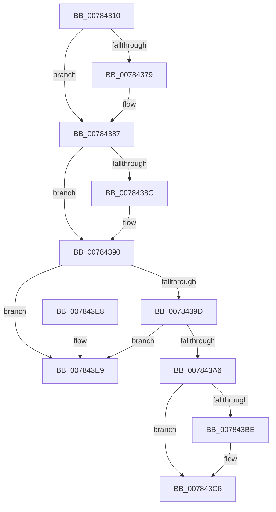

# PspDeleteCpuPartition

- RVA: `0x00784310`–`0x007843F0` (길이 `224` bytes)
- VA: `0x0000000140784310`
- 실행 섹션: `PAGE`
- PDB 이름 있음: `예`; PDB Function 태그: `아니요`
- unwind 정보 RVA: `0x00069AD0`
- 디코드: `59`개 명령, `224/224` bytes 표시
- 미해석 바이트: `0` (있으면 어셈블리에 `.byte`로 보존)

> 이 문서는 커널 이미지의 기계어와 PDB 기호를 분석해 생성했습니다. 4번과 5번은 함수 원형과 자료형을 바이너리 사용 방식에서 추정한 C 해석이며 원본 소스 복구 결과는 아닙니다.

## 1. Dependencies

- 직접 호출 지점: **7**; 고유 호출 대상: **7**
- 직접 호출자로 확인된 함수: **0**
- RIP 상대 이미지 참조: **2**

### Outgoing calls
- `0x00784331` → [KeDeleteCpuPartition](../74/KeDeleteCpuPartition_function_00747158.md) (function, `0x00747158`)
- `0x0078433F` → [ObfDereferenceObjectWithTag](../../text/2F/ObfDereferenceObjectWithTag_function_002F78E0.md) (function, `0x002F78E0`)
- `0x00784368` → [KeAbPreAcquire](../../text/21/KeAbPreAcquire_function_00210230.md) (function, `0x00210230`)
- `0x00784382` → [ExfAcquirePushLockExclusiveEx](../../text/20/ExfAcquirePushLockExclusiveEx_function_0020FC90.md) (function, `0x0020FC90`)
- `0x007843C1` → [ExfTryToWakePushLock](../../text/26/ExfTryToWakePushLock_function_00265DD0.md) (function, `0x00265DD0`)
- `0x007843C9` → [KeAbPostRelease](../../text/2E/KeAbPostRelease_function_002E1600.md) (function, `0x002E1600`)
- `0x007843CE` → [KeLeaveCriticalRegion](../../text/25/KeLeaveCriticalRegion_function_0025D8B0.md) (function, `0x0025D8B0`)

### Direct callers
- 이 함수 시작 RVA로 연결되는 직접 call은 확인되지 않았습니다. 간접 호출은 완전히 역산할 수 없습니다.

### Static image references
- `0x0078434D` → RVA `0x00FD9DC8` (`PAGEDATA`; read)
- `0x007843AD` → RVA `0x00FD9DC8` (`PAGEDATA`; read/write)

## 2. Other-region calls and transfers

- 다른 실행 섹션으로 향하는 call: **6**
  - `0x0078433F` → [ObfDereferenceObjectWithTag](../../text/2F/ObfDereferenceObjectWithTag_function_002F78E0.md) (`PAGE` → `.text`)
  - `0x00784368` → [KeAbPreAcquire](../../text/21/KeAbPreAcquire_function_00210230.md) (`PAGE` → `.text`)
  - `0x00784382` → [ExfAcquirePushLockExclusiveEx](../../text/20/ExfAcquirePushLockExclusiveEx_function_0020FC90.md) (`PAGE` → `.text`)
  - `0x007843C1` → [ExfTryToWakePushLock](../../text/26/ExfTryToWakePushLock_function_00265DD0.md) (`PAGE` → `.text`)
  - `0x007843C9` → [KeAbPostRelease](../../text/2E/KeAbPostRelease_function_002E1600.md) (`PAGE` → `.text`)
  - `0x007843CE` → [KeLeaveCriticalRegion](../../text/25/KeLeaveCriticalRegion_function_0025D8B0.md) (`PAGE` → `.text`)
- 별도 외부 분기/꼬리 이동을 확인하지 못했습니다.

## 3. Assembly (complete function range)

```asm
00784310  48 89 5C 24 08                  mov qword ptr [rsp + 8], rbx
00784315  48 89 6C 24 10                  mov qword ptr [rsp + 0x10], rbp
0078431A  48 89 74 24 18                  mov qword ptr [rsp + 0x18], rsi
0078431F  57                              push rdi
00784320  48 83 EC 20                     sub rsp, 0x20
00784324  48 8B 51 08                     mov rdx, qword ptr [rcx + 8]
00784328  48 8B F1                        mov rsi, rcx
0078432B  48 8B 09                        mov rcx, qword ptr [rcx]
0078432E  48 8B 12                        mov rdx, qword ptr [rdx]
00784331  E8 22 2E FC FF                  call 0x140747158
00784336  48 8B 4E 08                     mov rcx, qword ptr [rsi + 8]
0078433A  BA 50 73 70 50                  mov edx, 0x50707350
0078433F  E8 9C 35 B7 FF                  call 0x1402f78e0
00784344  65 48 8B 04 25 88 01 00 00      mov rax, qword ptr gs:[0x188]
0078434D  48 8D 2D 74 5A 85 00            lea rbp, [rip + 0x855a74]
00784354  48 83 CB FF                     or rbx, 0xffffffffffffffff
00784358  45 33 C0                        xor r8d, r8d
0078435B  33 D2                           xor edx, edx
0078435D  48 8B CD                        mov rcx, rbp
00784360  66 01 98 E4 01 00 00            add word ptr [rax + 0x1e4], bx
00784367  90                              nop
00784368  E8 C3 BE A8 FF                  call 0x140210230
0078436D  F0 48 0F BA 6D 00 00            lock bts qword ptr [rbp], 0
00784374  48 8B F8                        mov rdi, rax
00784377  73 0E                           jae 0x140784387
00784379  4C 8B C5                        mov r8, rbp
0078437C  48 8B D0                        mov rdx, rax
0078437F  48 8B CD                        mov rcx, rbp
00784382  E8 09 B9 A8 FF                  call 0x14020fc90
00784387  48 85 FF                        test rdi, rdi
0078438A  74 04                           je 0x140784390
0078438C  C6 47 0A 01                     mov byte ptr [rdi + 0xa], 1
00784390  48 8D 46 10                     lea rax, [rsi + 0x10]
00784394  4C 8B 00                        mov r8, qword ptr [rax]
00784397  49 39 40 08                     cmp qword ptr [r8 + 8], rax
0078439B  75 4C                           jne 0x1407843e9
0078439D  48 8B 50 08                     mov rdx, qword ptr [rax + 8]
007843A1  48 39 02                        cmp qword ptr [rdx], rax
007843A4  75 43                           jne 0x1407843e9
007843A6  4C 89 02                        mov qword ptr [rdx], r8
007843A9  49 89 50 08                     mov qword ptr [r8 + 8], rdx
007843AD  F0 48 0F C1 1D 12 5A 85 00      lock xadd qword ptr [rip + 0x855a12], rbx
007843B6  80 E3 06                        and bl, 6
007843B9  80 FB 02                        cmp bl, 2
007843BC  75 08                           jne 0x1407843c6
007843BE  48 8B CD                        mov rcx, rbp
007843C1  E8 0A 1A AE FF                  call 0x140265dd0
007843C6  48 8B CD                        mov rcx, rbp
007843C9  E8 32 D2 B5 FF                  call 0x1402e1600
007843CE  E8 DD 94 AD FF                  call 0x14025d8b0
007843D3  48 8B 5C 24 30                  mov rbx, qword ptr [rsp + 0x30]
007843D8  48 8B 6C 24 38                  mov rbp, qword ptr [rsp + 0x38]
007843DD  48 8B 74 24 40                  mov rsi, qword ptr [rsp + 0x40]
007843E2  48 83 C4 20                     add rsp, 0x20
007843E6  5F                              pop rdi
007843E7  C3                              ret
007843E8  CC                              int3
007843E9  B9 03 00 00 00                  mov ecx, 3
007843EE  CD 29                           int 0x29
```

## 4. C-style interpretation (structured pseudocode)

```c
__int64 __fastcall PspDeleteCpuPartition(__int64 a1, __int64 a2, int a3)
{
    __int64 result;
    __int64 v_rbx;
    __int64 v_rsp;
    unsigned __int64 v_stack_p10;
    unsigned __int64 v_stack_p18;
    unsigned __int64 v_stack_p8;

    v_stack_p8 = v_rbx;
    v_stack_p10 = v_rbp;
    v_stack_p18 = v_rsi;
    v_rsp = (v_rsp) - (32);
    result = KeDeleteCpuPartition(*(unsigned __int64 *)(a1), *(unsigned __int64 *)(*(unsigned __int64 *)(a1 + 8)), a3, a4);
    result = ObfDereferenceObjectWithTag(*(unsigned __int64 *)(a1 + 8), (unsigned int)(0x50707350ULL), a3, a4);
    v_rbx = (v_rbx) | (-1);
    a3 = 0;
    a2 = 0;
    result = KeAbPreAcquire(v_rip + 8739444, a2, a3, a4);
    if (!(condition_is_above_or_equal)) {
        a3 = v_rip + 8739444;
        a2 = result;
        a1 = v_rip + 8739444;
        result = ExfAcquirePushLockExclusiveEx(a1, a2, a3, a4);
    }
    if (result != 0) {
        *(unsigned __int8 *)(result + 10) = 1;
    }
    if ((*(unsigned __int64 *)(*(unsigned __int64 *)(a1 + 16) + 8)) != (a1 + 16)) goto loc_007843E9;
    if ((*(unsigned __int64 *)(*(unsigned __int64 *)(a1 + 16 + 8))) != (a1 + 16)) goto loc_007843E9;
    *(unsigned __int64 *)(*(unsigned __int64 *)(a1 + 16 + 8)) = *(unsigned __int64 *)(a1 + 16);
    *(unsigned __int64 *)(*(unsigned __int64 *)(a1 + 16) + 8) = *(unsigned __int64 *)(a1 + 16 + 8);
    v_rbx = (unsigned __int8)((v_rbx) & (6));
    result = a1 + 16;
    if (((unsigned __int8)(v_rbx)) == 2) {
        a1 = v_rip + 8739444;
        result = ExfTryToWakePushLock(a1, *(unsigned __int64 *)(a1 + 16 + 8), *(unsigned __int64 *)(a1 + 16), a4);
    }
    result = KeAbPostRelease(v_rip + 8739444, *(unsigned __int64 *)(a1 + 16 + 8), *(unsigned __int64 *)(a1 + 16), a4);
    result = KeLeaveCriticalRegion(v_rip + 8739444, *(unsigned __int64 *)(a1 + 16 + 8), *(unsigned __int64 *)(a1 + 16), a4);
    v_rsp = (v_rsp) + (32);
    return result;
loc_007843E9:
    return result;
}
```

## 5. (Beta) C Style

```c
int64_t PspDeleteCpuPartition(void *Arg1, int64_t Arg2, int32_t Arg3)
{
    uint8_t *arg1 = (uint8_t *)Arg1;

    int64_t result;
    int64_t local_rbx;
    int64_t local_rsp;
    uint64_t v_stack_p10;
    uint64_t v_stack_p18;
    uint64_t v_stack_p8;

    v_stack_p8 = local_rbx;
    v_stack_p10 = local_rbp;
    v_stack_p18 = local_rsi;
    local_rsp = (local_rsp) - (32);
    result = KeDeleteCpuPartition(*(uint64_t *)(arg1), *(uint64_t *)(*(uint64_t *)(arg1 + 0x8)), Arg3, a4);
    result = ObfDereferenceObjectWithTag(*(uint64_t *)(arg1 + 0x8), (uint32_t)(0x50707350ULL), Arg3, a4);
    local_rbx = (local_rbx) | (-1);
    Arg3 = 0;
    Arg2 = 0;
    result = KeAbPreAcquire(v_rip + 8739444, Arg2, Arg3, a4);
    if (!(condition_is_above_or_equal)) {
        Arg3 = v_rip + 8739444;
        Arg2 = result;
        Arg1 = v_rip + 8739444;
        result = ExfAcquirePushLockExclusiveEx(Arg1, Arg2, Arg3, a4);
    }
    if (result != 0) {
        *(uint8_t *)(result + 0xA) = 1;
    }
    if ((*(uint64_t *)(*(uint64_t *)(arg1 + 0x10) + 0x8)) != (Arg1 + 16)) goto loc_007843E9;
    if ((*(uint64_t *)(*(uint64_t *)(arg1 + 0x10 + 0x8))) != (Arg1 + 16)) goto loc_007843E9;
    *(uint64_t *)(*(uint64_t *)(arg1 + 0x10 + 0x8)) = *(uint64_t *)(arg1 + 0x10);
    *(uint64_t *)(*(uint64_t *)(arg1 + 0x10) + 0x8) = *(uint64_t *)(arg1 + 0x10 + 0x8);
    local_rbx = (uint8_t)((local_rbx) & (6));
    result = Arg1 + 16;
    if (((uint8_t)(local_rbx)) == 2) {
        Arg1 = v_rip + 8739444;
        result = ExfTryToWakePushLock(Arg1, *(uint64_t *)(arg1 + 0x10 + 0x8), *(uint64_t *)(arg1 + 0x10), a4);
    }
    result = KeAbPostRelease(v_rip + 8739444, *(uint64_t *)(arg1 + 0x10 + 0x8), *(uint64_t *)(arg1 + 0x10), a4);
    result = KeLeaveCriticalRegion(v_rip + 8739444, *(uint64_t *)(arg1 + 0x10 + 0x8), *(uint64_t *)(arg1 + 0x10), a4);
    local_rsp = (local_rsp) + (32);
    return result;
loc_007843E9:
    return result;
}
```

### 관측된 메모리 오프셋

구조체 형식이 확인되지 않은 접근은 인자 기준의 오프셋으로만 기록했습니다.

| 기준 인자 | 오프셋 표현 | 폭 (bit) | 접근 |
|---|---:|---:|---|
| `Arg1` | `+ 0x0` | `64` | `R` |
| `Arg1` | `+ 0x8` | `64` | `R` |
| `Arg1` | `+ 0x10` | `64` | `R` |

## 6. Execution-region graph

[열기: 2D/3D 그래프와 함수 탐색 컨트롤 패널](../../../control-panel.html?section=page&rva=0x00784310&view=graph)

- 2D 그래프는 위에서 아래로 흐르고, 3D 그래프는 빈 공간을 드래그해 회전합니다. Shift+드래그는 이동, 휠은 확대·축소, 함수 노드 선택은 대상 보고서 이동입니다.

### Static fallback


