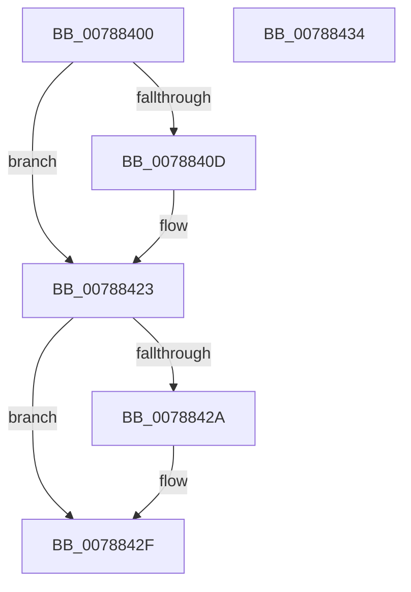

# PspDeletePartition

- RVA: `0x00788400`–`0x00788435` (길이 `53` bytes)
- VA: `0x0000000140788400`
- 실행 섹션: `PAGE`
- PDB 이름 있음: `예`; PDB Function 태그: `아니요`
- unwind 정보 RVA: `0x0005D2F4`
- 디코드: `16`개 명령, `53/53` bytes 표시
- 미해석 바이트: `0` (있으면 어셈블리에 `.byte`로 보존)

> 이 문서는 커널 이미지의 기계어와 PDB 기호를 분석해 생성했습니다. 4번과 5번은 함수 원형과 자료형을 바이너리 사용 방식에서 추정한 C 해석이며 원본 소스 복구 결과는 아닙니다.

## 1. Dependencies

- 직접 호출 지점: **2**; 고유 호출 대상: **2**
- 직접 호출자로 확인된 함수: **0**
- RIP 상대 이미지 참조: **0**

### Outgoing calls
- `0x0078841D` → [KeBugCheckEx](../../text/4F/KeBugCheckEx_function_004FD660.md) (function, `0x004FD660`)
- `0x0078842A` → [PspRemovePartitionFromGlobalList](../../text/5E/PspRemovePartitionFromGlobalList_function_005E4B84.md) (function, `0x005E4B84`)

### Direct callers
- 이 함수 시작 RVA로 연결되는 직접 call은 확인되지 않았습니다. 간접 호출은 완전히 역산할 수 없습니다.

### Static image references
- 디코드된 RIP-relative 메모리 참조가 없습니다.

## 2. Other-region calls and transfers

- 다른 실행 섹션으로 향하는 call: **2**
  - `0x0078841D` → [KeBugCheckEx](../../text/4F/KeBugCheckEx_function_004FD660.md) (`PAGE` → `.text`)
  - `0x0078842A` → [PspRemovePartitionFromGlobalList](../../text/5E/PspRemovePartitionFromGlobalList_function_005E4B84.md) (`PAGE` → `.text`)
- 별도 외부 분기/꼬리 이동을 확인하지 못했습니다.

## 3. Assembly (complete function range)

```asm
00788400  48 83 EC 38                     sub rsp, 0x38
00788404  4C 8B 49 28                     mov r9, qword ptr [rcx + 0x28]
00788408  4D 85 C9                        test r9, r9
0078840B  74 16                           je 0x140788423
0078840D  48 83 64 24 20 00               and qword ptr [rsp + 0x20], 0
00788413  4C 8B C1                        mov r8, rcx
00788416  B9 8E 01 00 00                  mov ecx, 0x18e
0078841B  33 D2                           xor edx, edx
0078841D  E8 3E 52 D7 FF                  call 0x1404fd660
00788422  CC                              int3
00788423  48 83 79 38 00                  cmp qword ptr [rcx + 0x38], 0
00788428  74 05                           je 0x14078842f
0078842A  E8 55 C7 E5 FF                  call 0x1405e4b84
0078842F  48 83 C4 38                     add rsp, 0x38
00788433  C3                              ret
00788434  CC                              int3
```

## 4. C-style interpretation (structured pseudocode)

```c
__int64 __fastcall PspDeletePartition(__int64 a1, int a2)
{
    __int64 result;
    __int64 v_rsp;
    unsigned __int64 v_stack_m18;

    v_rsp = (v_rsp) - (56);
    if (*(unsigned __int64 *)(a1 + 40) != 0) {
        a3 = a1;
        a1 = 398;
        a2 = 0;
        result = KeBugCheckEx(a1, a2, a3, *(unsigned __int64 *)(a1 + 40));
    }
    if ((*(unsigned __int64 *)(a1 + 56)) != 0) {
        result = PspRemovePartitionFromGlobalList(a1, a2, a3, *(unsigned __int64 *)(a1 + 40));
    }
    v_rsp = (v_rsp) + (56);
    return result;
}
```

## 5. (Beta) C Style

```c
int64_t PspDeletePartition(void *Arg1, int32_t Arg2)
{
    uint8_t *arg1 = (uint8_t *)Arg1;

    int64_t result;
    int64_t local_rsp;
    uint64_t v_stack_m18;

    local_rsp = (local_rsp) - (56);
    if (*(uint64_t *)(arg1 + 0x28) != 0) {
        a3 = Arg1;
        Arg1 = 398;
        Arg2 = 0;
        result = KeBugCheckEx(Arg1, Arg2, a3, *(uint64_t *)(arg1 + 0x28));
    }
    if ((*(uint64_t *)(arg1 + 0x38)) != 0) {
        result = PspRemovePartitionFromGlobalList(Arg1, Arg2, a3, *(uint64_t *)(arg1 + 0x28));
    }
    local_rsp = (local_rsp) + (56);
    return result;
}
```

### 관측된 메모리 오프셋

구조체 형식이 확인되지 않은 접근은 인자 기준의 오프셋으로만 기록했습니다.

| 기준 인자 | 오프셋 표현 | 폭 (bit) | 접근 |
|---|---:|---:|---|
| `Arg1` | `+ 0x28` | `64` | `R` |

## 6. Execution-region graph

[열기: 2D/3D 그래프와 함수 탐색 컨트롤 패널](../../../control-panel.html?section=page&rva=0x00788400&view=graph)

- 2D 그래프는 위에서 아래로 흐르고, 3D 그래프는 빈 공간을 드래그해 회전합니다. Shift+드래그는 이동, 휠은 확대·축소, 함수 노드 선택은 대상 보고서 이동입니다.

### Static fallback


