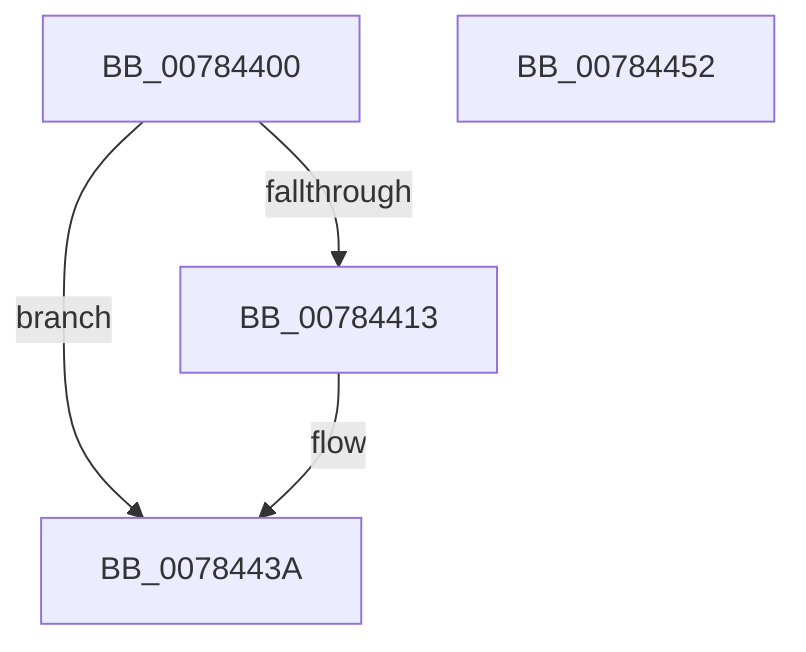

# PspDeleteProcessStateChange

- RVA: `0x00784400`–`0x00784453` (길이 `83` bytes)
- VA: `0x0000000140784400`
- 실행 섹션: `PAGE`
- PDB 이름 있음: `예`; PDB Function 태그: `아니요`
- unwind 정보 RVA: `0x0005CAAC`
- 디코드: `23`개 명령, `83/83` bytes 표시
- 미해석 바이트: `0` (있으면 어셈블리에 `.byte`로 보존)

> 이 문서는 커널 이미지의 기계어와 PDB 기호를 분석해 생성했습니다. 4번과 5번은 함수 원형과 자료형을 바이너리 사용 방식에서 추정한 C 해석이며 원본 소스 복구 결과는 아닙니다.

## 1. Dependencies

- 직접 호출 지점: **3**; 고유 호출 대상: **3**
- 직접 호출자로 확인된 함수: **0**
- RIP 상대 이미지 참조: **0**

### Outgoing calls
- `0x0078442D` → [PsThawMultiProcess](../../text/45/PsThawMultiProcess_function_0045FFE0.md) (function, `0x0045FFE0`)
- `0x00784435` → [KiLeaveCriticalRegionUnsafe](../../text/25/KiLeaveCriticalRegionUnsafe_function_0025F010.md) (function, `0x0025F010`)
- `0x00784442` → [ObfDereferenceObjectWithTag](../../text/2F/ObfDereferenceObjectWithTag_function_002F78E0.md) (function, `0x002F78E0`)

### Direct callers
- 이 함수 시작 RVA로 연결되는 직접 call은 확인되지 않았습니다. 간접 호출은 완전히 역산할 수 없습니다.

### Static image references
- 디코드된 RIP-relative 메모리 참조가 없습니다.

## 2. Other-region calls and transfers

- 다른 실행 섹션으로 향하는 call: **3**
  - `0x0078442D` → [PsThawMultiProcess](../../text/45/PsThawMultiProcess_function_0045FFE0.md) (`PAGE` → `.text`)
  - `0x00784435` → [KiLeaveCriticalRegionUnsafe](../../text/25/KiLeaveCriticalRegionUnsafe_function_0025F010.md) (`PAGE` → `.text`)
  - `0x00784442` → [ObfDereferenceObjectWithTag](../../text/2F/ObfDereferenceObjectWithTag_function_002F78E0.md) (`PAGE` → `.text`)
- 별도 외부 분기/꼬리 이동을 확인하지 못했습니다.

## 3. Assembly (complete function range)

```asm
00784400  48 89 5C 24 08                  mov qword ptr [rsp + 8], rbx
00784405  57                              push rdi
00784406  48 83 EC 20                     sub rsp, 0x20
0078440A  83 79 10 00                     cmp dword ptr [rcx + 0x10], 0
0078440E  48 8B F9                        mov rdi, rcx
00784411  74 27                           je 0x14078443a
00784413  65 48 8B 1C 25 88 01 00 00      mov rbx, qword ptr gs:[0x188]
0078441C  33 D2                           xor edx, edx
0078441E  66 FF 8B E4 01 00 00            dec word ptr [rbx + 0x1e4]
00784425  90                              nop
00784426  44 8B 41 10                     mov r8d, dword ptr [rcx + 0x10]
0078442A  48 8B 09                        mov rcx, qword ptr [rcx]
0078442D  E8 AE BB CD FF                  call 0x14045ffe0
00784432  48 8B CB                        mov rcx, rbx
00784435  E8 D6 AB AD FF                  call 0x14025f010
0078443A  48 8B 0F                        mov rcx, qword ptr [rdi]
0078443D  BA 50 73 50 63                  mov edx, 0x63507350
00784442  E8 99 34 B7 FF                  call 0x1402f78e0
00784447  48 8B 5C 24 30                  mov rbx, qword ptr [rsp + 0x30]
0078444C  48 83 C4 20                     add rsp, 0x20
00784450  5F                              pop rdi
00784451  C3                              ret
00784452  CC                              int3
```

## 4. C-style interpretation (structured pseudocode)

```c
__int64 __fastcall PspDeleteProcessStateChange(__int64 a1, int a2)
{
    __int64 result;
    __int64 v_rbx;
    __int64 v_rsp;
    unsigned __int64 v_stack_p8;

    v_stack_p8 = v_rbx;
    v_rsp = (v_rsp) - (32);
    if ((*(unsigned int *)(a1 + 16)) != 0) {
        v_rbx = *(unsigned __int64 *)(gs_base + (0 + 392));
        a2 = 0;
        a3 = *(unsigned int *)(a1 + 16);
        a1 = *(unsigned __int64 *)(a1);
        result = PsThawMultiProcess(a1, a2, a3, a4);
        a1 = v_rbx;
        result = KiLeaveCriticalRegionUnsafe(a1, a2, a3, a4);
    }
    result = ObfDereferenceObjectWithTag(*(unsigned __int64 *)(a1), (unsigned int)(0x63507350ULL), a3, a4);
    v_rsp = (v_rsp) + (32);
    return result;
}
```

## 5. (Beta) C Style

```c
int64_t PspDeleteProcessStateChange(void *Arg1, int32_t Arg2)
{
    uint8_t *arg1 = (uint8_t *)Arg1;

    int64_t result;
    int64_t local_rbx;
    int64_t local_rsp;
    uint64_t v_stack_p8;

    v_stack_p8 = local_rbx;
    local_rsp = (local_rsp) - (32);
    if ((*(uint32_t *)(arg1 + 0x10)) != 0) {
        local_rbx = *(uint64_t *)(gs_base + (0 + 0x188));
        Arg2 = 0;
        a3 = *(uint32_t *)(arg1 + 0x10);
        Arg1 = *(uint64_t *)(arg1);
        result = PsThawMultiProcess(Arg1, Arg2, a3, a4);
        Arg1 = local_rbx;
        result = KiLeaveCriticalRegionUnsafe(Arg1, Arg2, a3, a4);
    }
    result = ObfDereferenceObjectWithTag(*(uint64_t *)(arg1), (uint32_t)(0x63507350ULL), a3, a4);
    local_rsp = (local_rsp) + (32);
    return result;
}
```

### 관측된 메모리 오프셋

구조체 형식이 확인되지 않은 접근은 인자 기준의 오프셋으로만 기록했습니다.

| 기준 인자 | 오프셋 표현 | 폭 (bit) | 접근 |
|---|---:|---:|---|
| `Arg1` | `+ 0x0` | `64` | `R` |
| `Arg1` | `+ 0x10` | `32` | `R` |

## 6. Execution-region graph

[열기: 2D/3D 그래프와 함수 탐색 컨트롤 패널](../../../control-panel.html?section=page&rva=0x00784400&view=graph)

- 2D 그래프는 위에서 아래로 흐르고, 3D 그래프는 빈 공간을 드래그해 회전합니다. Shift+드래그는 이동, 휠은 확대·축소, 함수 노드 선택은 대상 보고서 이동입니다.

### Static fallback


