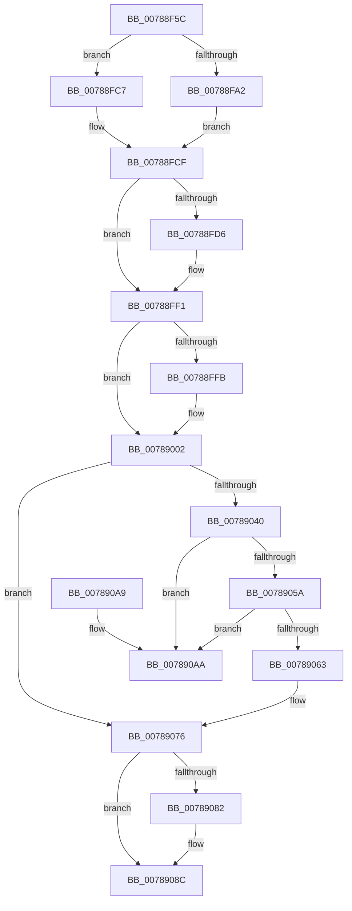

# PspDereferenceSessionFinal

- RVA: `0x00788F5C`–`0x007890B1` (길이 `341` bytes)
- VA: `0x0000000140788F5C`
- 실행 섹션: `PAGE`
- PDB 이름 있음: `예`; PDB Function 태그: `아니요`
- unwind 정보 RVA: `0x0006026C`
- 디코드: `82`개 명령, `341/341` bytes 표시
- 미해석 바이트: `0` (있으면 어셈블리에 `.byte`로 보존)

> 이 문서는 커널 이미지의 기계어와 PDB 기호를 분석해 생성했습니다. 4번과 5번은 함수 원형과 자료형을 바이너리 사용 방식에서 추정한 C 해석이며 원본 소스 복구 결과는 아닙니다.

## 1. Dependencies

- 직접 호출 지점: **13**; 고유 호출 대상: **10**
- 직접 호출자로 확인된 함수: **1**
- RIP 상대 이미지 참조: **0**

### Outgoing calls
- `0x00788F93` → [PspLockProcessListExclusive](../../text/22/PspLockProcessListExclusive_function_0022578C.md) (function, `0x0022578C`)
- `0x00788FA8` → [KeInitializeGate](../../text/49/KeInitializeGate_function_004953F8.md) (function, `0x004953F8`)
- `0x00788FB0` → [PspUnlockProcessListExclusive](../../text/2D/PspUnlockProcessListExclusive_function_002DFD18.md) (function, `0x002DFD18`)
- `0x00788FC0` → [KeWaitForGate](../../text/2C/KeWaitForGate_function_002CA794.md) (function, `0x002CA794`)
- `0x00788FCA` → [PspUnlockProcessListExclusive](../../text/2D/PspUnlockProcessListExclusive_function_002DFD18.md) (function, `0x002DFD18`)
- `0x00788FE1` → [KeSetEvent](../../text/33/KeSetEvent_function_0033F310.md) (function, `0x0033F310`)
- `0x00788FEC` → [ObCloseHandle](../8A/ObCloseHandle_function_008A1870.md) (function, `0x008A1870`)
- `0x00788FFD` → [guard_dispatch_icall](../../text/6B/guard_dispatch_icall_function_006BAAD0.md) (function, `0x006BAAD0`)
- `0x00789029` → [ExpWnfDeleteScopeById](../90/ExpWnfDeleteScopeById_function_00908168.md) (function, `0x00908168`)
- `0x0078902E` → [KeLeaveCriticalRegion](../../text/25/KeLeaveCriticalRegion_function_0025D8B0.md) (function, `0x0025D8B0`)
- `0x0078904C` → [PspLockProcessListExclusive](../../text/22/PspLockProcessListExclusive_function_0022578C.md) (function, `0x0022578C`)
- `0x0078906D` → [PspUnlockProcessListExclusive](../../text/2D/PspUnlockProcessListExclusive_function_002DFD18.md) (function, `0x002DFD18`)
- `0x00789087` → [ObfDereferenceObjectWithTag](../../text/2F/ObfDereferenceObjectWithTag_function_002F78E0.md) (function, `0x002F78E0`)

### Direct callers
- [PsDereferenceSession](../A1/PsDereferenceSession_function_00A1827C.md) at `0x00A182B7`

### Static image references
- 디코드된 RIP-relative 메모리 참조가 없습니다.

## 2. Other-region calls and transfers

- 다른 실행 섹션으로 향하는 call: **11**
  - `0x00788F93` → [PspLockProcessListExclusive](../../text/22/PspLockProcessListExclusive_function_0022578C.md) (`PAGE` → `.text`)
  - `0x00788FA8` → [KeInitializeGate](../../text/49/KeInitializeGate_function_004953F8.md) (`PAGE` → `.text`)
  - `0x00788FB0` → [PspUnlockProcessListExclusive](../../text/2D/PspUnlockProcessListExclusive_function_002DFD18.md) (`PAGE` → `.text`)
  - `0x00788FC0` → [KeWaitForGate](../../text/2C/KeWaitForGate_function_002CA794.md) (`PAGE` → `.text`)
  - `0x00788FCA` → [PspUnlockProcessListExclusive](../../text/2D/PspUnlockProcessListExclusive_function_002DFD18.md) (`PAGE` → `.text`)
  - `0x00788FE1` → [KeSetEvent](../../text/33/KeSetEvent_function_0033F310.md) (`PAGE` → `.text`)
  - `0x00788FFD` → [guard_dispatch_icall](../../text/6B/guard_dispatch_icall_function_006BAAD0.md) (`PAGE` → `.text`)
  - `0x0078902E` → [KeLeaveCriticalRegion](../../text/25/KeLeaveCriticalRegion_function_0025D8B0.md) (`PAGE` → `.text`)
  - `0x0078904C` → [PspLockProcessListExclusive](../../text/22/PspLockProcessListExclusive_function_0022578C.md) (`PAGE` → `.text`)
  - `0x0078906D` → [PspUnlockProcessListExclusive](../../text/2D/PspUnlockProcessListExclusive_function_002DFD18.md) (`PAGE` → `.text`)
  - `0x00789087` → [ObfDereferenceObjectWithTag](../../text/2F/ObfDereferenceObjectWithTag_function_002F78E0.md) (`PAGE` → `.text`)
- 별도 외부 분기/꼬리 이동을 확인하지 못했습니다.

## 3. Assembly (complete function range)

```asm
00788F5C  48 89 5C 24 10                  mov qword ptr [rsp + 0x10], rbx
00788F61  48 89 6C 24 18                  mov qword ptr [rsp + 0x18], rbp
00788F66  48 89 74 24 20                  mov qword ptr [rsp + 0x20], rsi
00788F6B  57                              push rdi
00788F6C  48 83 EC 20                     sub rsp, 0x20
00788F70  65 48 8B 04 25 88 01 00 00      mov rax, qword ptr gs:[0x188]
00788F79  65 48 8B 34 25 88 01 00 00      mov rsi, qword ptr gs:[0x188]
00788F82  48 8B CE                        mov rcx, rsi
00788F85  48 8B A8 B8 00 00 00            mov rbp, qword ptr [rax + 0xb8]
00788F8C  48 8B BD E8 02 00 00            mov rdi, qword ptr [rbp + 0x2e8]
00788F93  E8 F4 C7 A9 FF                  call 0x14022578c
00788F98  83 4F 04 02                     or dword ptr [rdi + 4], 2
00788F9C  83 7F 34 00                     cmp dword ptr [rdi + 0x34], 0
00788FA0  74 25                           je 0x140788fc7
00788FA2  33 D2                           xor edx, edx
00788FA4  48 8D 4F 38                     lea rcx, [rdi + 0x38]
00788FA8  E8 4B C4 D0 FF                  call 0x1404953f8
00788FAD  48 8B CE                        mov rcx, rsi
00788FB0  E8 63 6D B5 FF                  call 0x1402dfd18
00788FB5  45 33 C0                        xor r8d, r8d
00788FB8  48 8D 4F 38                     lea rcx, [rdi + 0x38]
00788FBC  41 8D 50 12                     lea edx, [r8 + 0x12]
00788FC0  E8 CF 17 B4 FF                  call 0x1402ca794
00788FC5  EB 08                           jmp 0x140788fcf
00788FC7  48 8B CE                        mov rcx, rsi
00788FCA  E8 49 6D B5 FF                  call 0x1402dfd18
00788FCF  48 83 7F 28 00                  cmp qword ptr [rdi + 0x28], 0
00788FD4  74 1B                           je 0x140788ff1
00788FD6  48 8B 4F 20                     mov rcx, qword ptr [rdi + 0x20]
00788FDA  45 33 C0                        xor r8d, r8d
00788FDD  41 8D 50 01                     lea edx, [r8 + 1]
00788FE1  E8 2A 63 BB FF                  call 0x14033f310
00788FE6  48 8B 4F 28                     mov rcx, qword ptr [rdi + 0x28]
00788FEA  33 D2                           xor edx, edx
00788FEC  E8 7F 88 11 00                  call 0x1408a1870
00788FF1  48 8B 47 78                     mov rax, qword ptr [rdi + 0x78]
00788FF5  48 83 F8 01                     cmp rax, 1
00788FF9  76 07                           jbe 0x140789002
00788FFB  33 C9                           xor ecx, ecx
00788FFD  E8 CE 1A F3 FF                  call 0x1406baad0
00789002  8B 47 08                        mov eax, dword ptr [rdi + 8]
00789005  48 8D 54 24 30                  lea rdx, [rsp + 0x30]
0078900A  89 44 24 30                     mov dword ptr [rsp + 0x30], eax
0078900E  41 B8 04 00 00 00               mov r8d, 4
00789014  65 48 8B 04 25 88 01 00 00      mov rax, qword ptr gs:[0x188]
0078901D  41 8D 48 FD                     lea ecx, [r8 - 3]
00789021  66 FF 88 E4 01 00 00            dec word ptr [rax + 0x1e4]
00789028  90                              nop
00789029  E8 3A F1 17 00                  call 0x140908168
0078902E  E8 7D 48 AD FF                  call 0x14025d8b0
00789033  48 8D 9D 30 02 00 00            lea rbx, [rbp + 0x230]
0078903A  48 83 3B 00                     cmp qword ptr [rbx], 0
0078903E  74 36                           je 0x140789076
00789040  65 48 8B 34 25 88 01 00 00      mov rsi, qword ptr gs:[0x188]
00789049  48 8B CE                        mov rcx, rsi
0078904C  E8 3B C7 A9 FF                  call 0x14022578c
00789051  48 8B 13                        mov rdx, qword ptr [rbx]
00789054  48 39 5A 08                     cmp qword ptr [rdx + 8], rbx
00789058  75 50                           jne 0x1407890aa
0078905A  48 8B 43 08                     mov rax, qword ptr [rbx + 8]
0078905E  48 39 18                        cmp qword ptr [rax], rbx
00789061  75 47                           jne 0x1407890aa
00789063  48 89 10                        mov qword ptr [rax], rdx
00789066  48 8B CE                        mov rcx, rsi
00789069  48 89 42 08                     mov qword ptr [rdx + 8], rax
0078906D  E8 A6 6C B5 FF                  call 0x1402dfd18
00789072  48 83 23 00                     and qword ptr [rbx], 0
00789076  48 8B 8F A0 00 00 00            mov rcx, qword ptr [rdi + 0xa0]
0078907D  48 85 C9                        test rcx, rcx
00789080  74 0A                           je 0x14078908c
00789082  BA 4D 6D 53 73                  mov edx, 0x73536d4d
00789087  E8 54 E8 B6 FF                  call 0x1402f78e0
0078908C  48 83 A7 A0 00 00 00 00         and qword ptr [rdi + 0xa0], 0
00789094  48 8B 5C 24 38                  mov rbx, qword ptr [rsp + 0x38]
00789099  48 8B 6C 24 40                  mov rbp, qword ptr [rsp + 0x40]
0078909E  48 8B 74 24 48                  mov rsi, qword ptr [rsp + 0x48]
007890A3  48 83 C4 20                     add rsp, 0x20
007890A7  5F                              pop rdi
007890A8  C3                              ret
007890A9  CC                              int3
007890AA  B9 03 00 00 00                  mov ecx, 3
007890AF  CD 29                           int 0x29
```

## 4. C-style interpretation (structured pseudocode)

```c
__int64 __fastcall PspDereferenceSessionFinal(__int64 a1, int a2, int a3)
{
    __int64 result;
    __int64 v_rsp;
    unsigned __int64 v_stack_p10;
    unsigned __int64 v_stack_p18;
    unsigned __int64 v_stack_p20;
    unsigned __int64 v_stack_p8;

    v_stack_p10 = v_rbx;
    v_stack_p18 = v_rbp;
    v_stack_p20 = v_rsi;
    v_rsp = (v_rsp) - (32);
    result = PspLockProcessListExclusive(*(unsigned __int64 *)(gs_base + (0 + 392)), a2, a3, a4);
    if ((*(unsigned int *)(*(unsigned __int64 *)(*(unsigned __int64 *)(*(unsigned __int64 *)(gs_base + (0 + 392)) + 184) + 744) + 52)) == 0) goto loc_00788FC7;
    a2 = 0;
    result = KeInitializeGate(*(unsigned __int64 *)(*(unsigned __int64 *)(*(unsigned __int64 *)(gs_base + (0 + 392)) + 184) + 744) + 56, a2, a3, a4);
    result = PspUnlockProcessListExclusive(*(unsigned __int64 *)(gs_base + (0 + 392)), a2, a3, a4);
    a3 = 0;
    result = KeWaitForGate(*(unsigned __int64 *)(*(unsigned __int64 *)(*(unsigned __int64 *)(gs_base + (0 + 392)) + 184) + 744) + 56, a3 + 18, a3, a4);
    goto loc_00788FCF;
loc_00788FC7:
    result = PspUnlockProcessListExclusive(*(unsigned __int64 *)(gs_base + (0 + 392)), a3 + 18, a3, a4);
loc_00788FCF:
    if ((*(unsigned __int64 *)(*(unsigned __int64 *)(*(unsigned __int64 *)(*(unsigned __int64 *)(gs_base + (0 + 392)) + 184) + 744) + 40)) != 0) {
        a1 = *(unsigned __int64 *)(*(unsigned __int64 *)(*(unsigned __int64 *)(*(unsigned __int64 *)(gs_base + (0 + 392)) + 184) + 744) + 32);
        a3 = 0;
        a2 = a3 + 1;
        result = KeSetEvent(a1, a2, a3, a4);
        a1 = *(unsigned __int64 *)(*(unsigned __int64 *)(*(unsigned __int64 *)(*(unsigned __int64 *)(gs_base + (0 + 392)) + 184) + 744) + 40);
        a2 = 0;
        result = ObCloseHandle(a1, a2, a3, a4);
    }
    result = *(unsigned __int64 *)(*(unsigned __int64 *)(*(unsigned __int64 *)(*(unsigned __int64 *)(gs_base + (0 + 392)) + 184) + 744) + 120);
    if ((*(unsigned __int64 *)(*(unsigned __int64 *)(*(unsigned __int64 *)(*(unsigned __int64 *)(gs_base + (0 + 392)) + 184) + 744) + 120)) >= = 1) {
        a1 = 0;
        result = guard_dispatch_icall(a1, a2, a3, a4);
    }
    v_stack_p8 = (unsigned int)((unsigned int)(*(unsigned int *)(*(unsigned __int64 *)(*(unsigned __int64 *)(*(unsigned __int64 *)(gs_base + (0 + 392)) + 184) + 744) + 8)));
    result = ExpWnfDeleteScopeById(4 - 3, v_stack_p8, 4, a4);
    result = KeLeaveCriticalRegion(4 - 3, v_stack_p8, 4, a4);
    if ((*(unsigned __int64 *)(*(unsigned __int64 *)(*(unsigned __int64 *)(gs_base + (0 + 392)) + 184) + 560)) == 0) goto loc_00789076;
    result = PspLockProcessListExclusive(*(unsigned __int64 *)(gs_base + (0 + 392)), v_stack_p8, 4, a4);
    if ((*(unsigned __int64 *)(*(unsigned __int64 *)(*(unsigned __int64 *)(*(unsigned __int64 *)(gs_base + (0 + 392)) + 184) + 560) + 8)) != (*(unsigned __int64 *)(*(unsigned __int64 *)(gs_base + (0 + 392)) + 184) + 560)) goto loc_007890AA;
    if ((*(unsigned __int64 *)(*(unsigned __int64 *)(*(unsigned __int64 *)(*(unsigned __int64 *)(gs_base + (0 + 392)) + 184) + 560 + 8))) != (*(unsigned __int64 *)(*(unsigned __int64 *)(gs_base + (0 + 392)) + 184) + 560)) goto loc_007890AA;
    *(unsigned __int64 *)(*(unsigned __int64 *)(*(unsigned __int64 *)(*(unsigned __int64 *)(gs_base + (0 + 392)) + 184) + 560 + 8)) = *(unsigned __int64 *)(*(unsigned __int64 *)(*(unsigned __int64 *)(gs_base + (0 + 392)) + 184) + 560);
    *(unsigned __int64 *)(*(unsigned __int64 *)(*(unsigned __int64 *)(*(unsigned __int64 *)(gs_base + (0 + 392)) + 184) + 560) + 8) = *(unsigned __int64 *)(*(unsigned __int64 *)(*(unsigned __int64 *)(gs_base + (0 + 392)) + 184) + 560 + 8);
    result = PspUnlockProcessListExclusive(*(unsigned __int64 *)(gs_base + (0 + 392)), *(unsigned __int64 *)(*(unsigned __int64 *)(*(unsigned __int64 *)(gs_base + (0 + 392)) + 184) + 560), 4, a4);
loc_00789076:
    if (*(unsigned __int64 *)(*(unsigned __int64 *)(*(unsigned __int64 *)(*(unsigned __int64 *)(gs_base + (0 + 392)) + 184) + 744) + 160) != 0) {
        a2 = 0x73536D4DULL;
        result = ObfDereferenceObjectWithTag(*(unsigned __int64 *)(*(unsigned __int64 *)(*(unsigned __int64 *)(*(unsigned __int64 *)(gs_base + (0 + 392)) + 184) + 744) + 160), a2, 4, a4);
    }
    v_rsp = (v_rsp) + (32);
    return result;
loc_007890AA:
    return result;
}
```

## 5. (Beta) C Style

```c
int64_t PspDereferenceSessionFinal(int64_t Arg1, int32_t Arg2, int32_t Arg3)
{
    int64_t result;
    int64_t local_rsp;
    uint64_t v_stack_p10;
    uint64_t v_stack_p18;
    uint64_t v_stack_p20;
    uint64_t v_stack_p8;

    v_stack_p10 = local_rbx;
    v_stack_p18 = local_rbp;
    v_stack_p20 = local_rsi;
    local_rsp = (local_rsp) - (32);
    result = PspLockProcessListExclusive(*(uint64_t *)(gs_base + (0 + 0x188)), Arg2, Arg3, a4);
    if ((*(uint32_t *)(*(uint64_t *)(*(uint64_t *)(*(uint64_t *)(gs_base + (0 + 0x188)) + 0xB8) + 0x2E8) + 0x34)) == 0) goto loc_00788FC7;
    Arg2 = 0;
    result = KeInitializeGate(*(uint64_t *)(*(uint64_t *)(*(uint64_t *)(gs_base + (0 + 0x188)) + 0xB8) + 0x2E8) + 56, Arg2, Arg3, a4);
    result = PspUnlockProcessListExclusive(*(uint64_t *)(gs_base + (0 + 0x188)), Arg2, Arg3, a4);
    Arg3 = 0;
    result = KeWaitForGate(*(uint64_t *)(*(uint64_t *)(*(uint64_t *)(gs_base + (0 + 0x188)) + 0xB8) + 0x2E8) + 56, Arg3 + 18, Arg3, a4);
    goto loc_00788FCF;
loc_00788FC7:
    result = PspUnlockProcessListExclusive(*(uint64_t *)(gs_base + (0 + 0x188)), Arg3 + 18, Arg3, a4);
loc_00788FCF:
    if ((*(uint64_t *)(*(uint64_t *)(*(uint64_t *)(*(uint64_t *)(gs_base + (0 + 0x188)) + 0xB8) + 0x2E8) + 0x28)) != 0) {
        Arg1 = *(uint64_t *)(*(uint64_t *)(*(uint64_t *)(*(uint64_t *)(gs_base + (0 + 0x188)) + 0xB8) + 0x2E8) + 0x20);
        Arg3 = 0;
        Arg2 = Arg3 + 1;
        result = KeSetEvent(Arg1, Arg2, Arg3, a4);
        Arg1 = *(uint64_t *)(*(uint64_t *)(*(uint64_t *)(*(uint64_t *)(gs_base + (0 + 0x188)) + 0xB8) + 0x2E8) + 0x28);
        Arg2 = 0;
        result = ObCloseHandle(Arg1, Arg2, Arg3, a4);
    }
    result = *(uint64_t *)(*(uint64_t *)(*(uint64_t *)(*(uint64_t *)(gs_base + (0 + 0x188)) + 0xB8) + 0x2E8) + 0x78);
    if ((*(uint64_t *)(*(uint64_t *)(*(uint64_t *)(*(uint64_t *)(gs_base + (0 + 0x188)) + 0xB8) + 0x2E8) + 0x78)) >= = 1) {
        Arg1 = 0;
        result = guard_dispatch_icall(Arg1, Arg2, Arg3, a4);
    }
    v_stack_p8 = (uint32_t)((uint32_t)(*(uint32_t *)(*(uint64_t *)(*(uint64_t *)(*(uint64_t *)(gs_base + (0 + 0x188)) + 0xB8) + 0x2E8) + 0x8)));
    result = ExpWnfDeleteScopeById(4 - 3, v_stack_p8, 4, a4);
    result = KeLeaveCriticalRegion(4 - 3, v_stack_p8, 4, a4);
    if ((*(uint64_t *)(*(uint64_t *)(*(uint64_t *)(gs_base + (0 + 0x188)) + 0xB8) + 0x230)) == 0) goto loc_00789076;
    result = PspLockProcessListExclusive(*(uint64_t *)(gs_base + (0 + 0x188)), v_stack_p8, 4, a4);
    if ((*(uint64_t *)(*(uint64_t *)(*(uint64_t *)(*(uint64_t *)(gs_base + (0 + 0x188)) + 0xB8) + 0x230) + 0x8)) != (*(uint64_t *)(*(uint64_t *)(gs_base + (0 + 0x188)) + 0xB8) + 560)) goto loc_007890AA;
    if ((*(uint64_t *)(*(uint64_t *)(*(uint64_t *)(*(uint64_t *)(gs_base + (0 + 0x188)) + 0xB8) + 0x230 + 0x8))) != (*(uint64_t *)(*(uint64_t *)(gs_base + (0 + 0x188)) + 0xB8) + 560)) goto loc_007890AA;
    *(uint64_t *)(*(uint64_t *)(*(uint64_t *)(*(uint64_t *)(gs_base + (0 + 0x188)) + 0xB8) + 0x230 + 0x8)) = *(uint64_t *)(*(uint64_t *)(*(uint64_t *)(gs_base + (0 + 0x188)) + 0xB8) + 0x230);
    *(uint64_t *)(*(uint64_t *)(*(uint64_t *)(*(uint64_t *)(gs_base + (0 + 0x188)) + 0xB8) + 0x230) + 0x8) = *(uint64_t *)(*(uint64_t *)(*(uint64_t *)(gs_base + (0 + 0x188)) + 0xB8) + 0x230 + 0x8);
    result = PspUnlockProcessListExclusive(*(uint64_t *)(gs_base + (0 + 0x188)), *(uint64_t *)(*(uint64_t *)(*(uint64_t *)(gs_base + (0 + 0x188)) + 0xB8) + 0x230), 4, a4);
loc_00789076:
    if (*(uint64_t *)(*(uint64_t *)(*(uint64_t *)(*(uint64_t *)(gs_base + (0 + 0x188)) + 0xB8) + 0x2E8) + 0xA0) != 0) {
        Arg2 = 0x73536D4DULL;
        result = ObfDereferenceObjectWithTag(*(uint64_t *)(*(uint64_t *)(*(uint64_t *)(*(uint64_t *)(gs_base + (0 + 0x188)) + 0xB8) + 0x2E8) + 0xA0), Arg2, 4, a4);
    }
    local_rsp = (local_rsp) + (32);
    return result;
loc_007890AA:
    return result;
}
```

## 6. Execution-region graph

[열기: 2D/3D 그래프와 함수 탐색 컨트롤 패널](../../../control-panel.html?section=page&rva=0x00788F5C&view=graph)

- 2D 그래프는 위에서 아래로 흐르고, 3D 그래프는 빈 공간을 드래그해 회전합니다. Shift+드래그는 이동, 휠은 확대·축소, 함수 노드 선택은 대상 보고서 이동입니다.

### Static fallback


