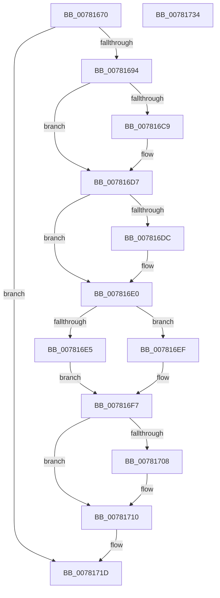

# PspDxgExtensionHostCallback

- RVA: `0x00781670`–`0x00781735` (길이 `197` bytes)
- VA: `0x0000000140781670`
- 실행 섹션: `PAGE`
- PDB 이름 있음: `예`; PDB Function 태그: `아니요`
- unwind 정보 RVA: `0x0005C954`
- 디코드: `50`개 명령, `197/197` bytes 표시
- 미해석 바이트: `0` (있으면 어셈블리에 `.byte`로 보존)

> 이 문서는 커널 이미지의 기계어와 PDB 기호를 분석해 생성했습니다. 4번과 5번은 함수 원형과 자료형을 바이너리 사용 방식에서 추정한 C 해석이며 원본 소스 복구 결과는 아닙니다.

## 1. Dependencies

- 직접 호출 지점: **5**; 고유 호출 대상: **5**
- 직접 호출자로 확인된 함수: **0**
- RIP 상대 이미지 참조: **3**

### Outgoing calls
- `0x007816B8` → [KeAbPreAcquire](../../text/21/KeAbPreAcquire_function_00210230.md) (function, `0x00210230`)
- `0x007816D2` → [ExfAcquirePushLockExclusiveEx](../../text/20/ExfAcquirePushLockExclusiveEx_function_0020FC90.md) (function, `0x0020FC90`)
- `0x0078170B` → [ExfTryToWakePushLock](../../text/26/ExfTryToWakePushLock_function_00265DD0.md) (function, `0x00265DD0`)
- `0x00781713` → [KeAbPostRelease](../../text/2E/KeAbPostRelease_function_002E1600.md) (function, `0x002E1600`)
- `0x00781718` → [KeLeaveCriticalRegion](../../text/25/KeLeaveCriticalRegion_function_0025D8B0.md) (function, `0x0025D8B0`)

### Direct callers
- 이 함수 시작 RVA로 연결되는 직접 call은 확인되지 않았습니다. 간접 호출은 완전히 역산할 수 없습니다.

### Static image references
- `0x0078169D` → RVA `0x00F06768` (`.data`; read)
- `0x007816E5` → RVA `0x00F06760` (`.data`; read/write)
- `0x007816F7` → RVA `0x00F06768` (`.data`; read/write)

## 2. Other-region calls and transfers

- 다른 실행 섹션으로 향하는 call: **5**
  - `0x007816B8` → [KeAbPreAcquire](../../text/21/KeAbPreAcquire_function_00210230.md) (`PAGE` → `.text`)
  - `0x007816D2` → [ExfAcquirePushLockExclusiveEx](../../text/20/ExfAcquirePushLockExclusiveEx_function_0020FC90.md) (`PAGE` → `.text`)
  - `0x0078170B` → [ExfTryToWakePushLock](../../text/26/ExfTryToWakePushLock_function_00265DD0.md) (`PAGE` → `.text`)
  - `0x00781713` → [KeAbPostRelease](../../text/2E/KeAbPostRelease_function_002E1600.md) (`PAGE` → `.text`)
  - `0x00781718` → [KeLeaveCriticalRegion](../../text/25/KeLeaveCriticalRegion_function_0025D8B0.md) (`PAGE` → `.text`)
- 별도 외부 분기/꼬리 이동을 확인하지 못했습니다.

## 3. Assembly (complete function range)

```asm
00781670  48 89 5C 24 08                  mov qword ptr [rsp + 8], rbx
00781675  48 89 6C 24 10                  mov qword ptr [rsp + 0x10], rbp
0078167A  48 89 74 24 18                  mov qword ptr [rsp + 0x18], rsi
0078167F  57                              push rdi
00781680  48 83 EC 20                     sub rsp, 0x20
00781684  8D 41 FF                        lea eax, [rcx - 1]
00781687  8B F1                           mov esi, ecx
00781689  A9 FD FF FF FF                  test eax, 0xfffffffd
0078168E  0F 85 89 00 00 00               jne 0x14078171d
00781694  65 48 8B 04 25 88 01 00 00      mov rax, qword ptr gs:[0x188]
0078169D  48 8D 2D C4 50 78 00            lea rbp, [rip + 0x7850c4]
007816A4  48 83 CB FF                     or rbx, 0xffffffffffffffff
007816A8  45 33 C0                        xor r8d, r8d
007816AB  33 D2                           xor edx, edx
007816AD  48 8B CD                        mov rcx, rbp
007816B0  66 01 98 E4 01 00 00            add word ptr [rax + 0x1e4], bx
007816B7  90                              nop
007816B8  E8 73 EB A8 FF                  call 0x140210230
007816BD  F0 48 0F BA 6D 00 00            lock bts qword ptr [rbp], 0
007816C4  48 8B F8                        mov rdi, rax
007816C7  73 0E                           jae 0x1407816d7
007816C9  4C 8B C5                        mov r8, rbp
007816CC  48 8B D0                        mov rdx, rax
007816CF  48 8B CD                        mov rcx, rbp
007816D2  E8 B9 E5 A8 FF                  call 0x14020fc90
007816D7  48 85 FF                        test rdi, rdi
007816DA  74 04                           je 0x1407816e0
007816DC  C6 47 0A 01                     mov byte ptr [rdi + 0xa], 1
007816E0  83 FE 01                        cmp esi, 1
007816E3  75 0A                           jne 0x1407816ef
007816E5  48 83 0D 73 50 78 00 02         or qword ptr [rip + 0x785073], 2
007816ED  EB 08                           jmp 0x1407816f7
007816EF  48 83 25 69 50 78 00 FD         and qword ptr [rip + 0x785069], 0xfffffffffffffffd
007816F7  F0 48 0F C1 1D 68 50 78 00      lock xadd qword ptr [rip + 0x785068], rbx
00781700  80 E3 06                        and bl, 6
00781703  80 FB 02                        cmp bl, 2
00781706  75 08                           jne 0x140781710
00781708  48 8B CD                        mov rcx, rbp
0078170B  E8 C0 46 AE FF                  call 0x140265dd0
00781710  48 8B CD                        mov rcx, rbp
00781713  E8 E8 FE B5 FF                  call 0x1402e1600
00781718  E8 93 C1 AD FF                  call 0x14025d8b0
0078171D  48 8B 5C 24 30                  mov rbx, qword ptr [rsp + 0x30]
00781722  33 C0                           xor eax, eax
00781724  48 8B 6C 24 38                  mov rbp, qword ptr [rsp + 0x38]
00781729  48 8B 74 24 40                  mov rsi, qword ptr [rsp + 0x40]
0078172E  48 83 C4 20                     add rsp, 0x20
00781732  5F                              pop rdi
00781733  C3                              ret
00781734  CC                              int3
```

## 4. C-style interpretation (structured pseudocode)

```c
__int64 __fastcall PspDxgExtensionHostCallback(__int64 a1, int a2, int a3)
{
    __int64 result;
    __int64 v_rbx;
    __int64 v_rsp;
    unsigned __int64 v_stack_p10;
    unsigned __int64 v_stack_p18;
    unsigned __int64 v_stack_p8;

    v_stack_p8 = v_rbx;
    v_stack_p10 = v_rbp;
    v_stack_p18 = v_rsi;
    v_rsp = (v_rsp) - (32);
    if ((((unsigned int)(a1 - 1)) & (0xFFFFFFFDULL)) != 0) goto loc_0078171D;
    v_rbx = (v_rbx) | (-1);
    a3 = 0;
    a2 = 0;
    result = KeAbPreAcquire(v_rip + 7884996, a2, a3, a4);
    if (!(condition_is_above_or_equal)) {
        a3 = v_rip + 7884996;
        a2 = result;
        a1 = v_rip + 7884996;
        result = ExfAcquirePushLockExclusiveEx(a1, a2, a3, a4);
    }
    if (result != 0) {
        *(unsigned __int8 *)(result + 10) = 1;
    }
    if (((unsigned int)((unsigned int)((unsigned int)(a1)))) != 1) goto loc_007816EF;
    goto loc_007816F7;
loc_007816EF:
loc_007816F7:
    v_rbx = (unsigned __int8)((v_rbx) & (6));
    if (((unsigned __int8)(v_rbx)) == 2) {
        a1 = v_rip + 7884996;
        result = ExfTryToWakePushLock(a1, a2, a3, a4);
    }
    result = KeAbPostRelease(v_rip + 7884996, a2, a3, a4);
    result = KeLeaveCriticalRegion(v_rip + 7884996, a2, a3, a4);
loc_0078171D:
    result = 0;
    v_rsp = (v_rsp) + (32);
    return result;
}
```

## 5. (Beta) C Style

```c
int64_t PspDxgExtensionHostCallback(void *Arg1, int32_t Arg2, int32_t Arg3)
{
    uint8_t *arg1 = (uint8_t *)Arg1;

    int64_t result;
    int64_t local_rbx;
    int64_t local_rsp;
    uint64_t v_stack_p10;
    uint64_t v_stack_p18;
    uint64_t v_stack_p8;

    v_stack_p8 = local_rbx;
    v_stack_p10 = local_rbp;
    v_stack_p18 = local_rsi;
    local_rsp = (local_rsp) - (32);
    if ((((uint32_t)(Arg1 - 1)) & (0xFFFFFFFDULL)) != 0) goto loc_0078171D;
    local_rbx = (local_rbx) | (-1);
    Arg3 = 0;
    Arg2 = 0;
    result = KeAbPreAcquire(v_rip + 7884996, Arg2, Arg3, a4);
    if (!(condition_is_above_or_equal)) {
        Arg3 = v_rip + 7884996;
        Arg2 = result;
        Arg1 = v_rip + 7884996;
        result = ExfAcquirePushLockExclusiveEx(Arg1, Arg2, Arg3, a4);
    }
    if (result != 0) {
        *(uint8_t *)(result + 0xA) = 1;
    }
    if (((uint32_t)((uint32_t)((uint32_t)(Arg1)))) != 1) goto loc_007816EF;
    goto loc_007816F7;
loc_007816EF:
loc_007816F7:
    local_rbx = (uint8_t)((local_rbx) & (6));
    if (((uint8_t)(local_rbx)) == 2) {
        Arg1 = v_rip + 7884996;
        result = ExfTryToWakePushLock(Arg1, Arg2, Arg3, a4);
    }
    result = KeAbPostRelease(v_rip + 7884996, Arg2, Arg3, a4);
    result = KeLeaveCriticalRegion(v_rip + 7884996, Arg2, Arg3, a4);
loc_0078171D:
    result = 0;
    local_rsp = (local_rsp) + (32);
    return result;
}
```

### 관측된 메모리 오프셋

구조체 형식이 확인되지 않은 접근은 인자 기준의 오프셋으로만 기록했습니다.

| 기준 인자 | 오프셋 표현 | 폭 (bit) | 접근 |
|---|---:|---:|---|
| `Arg1` | `- 0x1` | `32` | `R` |

## 6. Execution-region graph

[열기: 2D/3D 그래프와 함수 탐색 컨트롤 패널](../../../control-panel.html?section=page&rva=0x00781670&view=graph)

- 2D 그래프는 위에서 아래로 흐르고, 3D 그래프는 빈 공간을 드래그해 회전합니다. Shift+드래그는 이동, 휠은 확대·축소, 함수 노드 선택은 대상 보고서 이동입니다.

### Static fallback


