# PspEnableProcessOptionalXStateFeatures

- RVA: `0x00781EF0`–`0x00782341` (길이 `1,105` bytes)
- VA: `0x0000000140781EF0`
- 실행 섹션: `PAGE`
- PDB 이름 있음: `예`; PDB Function 태그: `아니요`
- unwind 정보 RVA: `0x000CE3B4`
- 디코드: `284`개 명령, `1,105/1,105` bytes 표시
- 미해석 바이트: `0` (있으면 어셈블리에 `.byte`로 보존)

> 이 문서는 커널 이미지의 기계어와 PDB 기호를 분석해 생성했습니다. 4번과 5번은 함수 원형과 자료형을 바이너리 사용 방식에서 추정한 C 해석이며 원본 소스 복구 결과는 아닙니다.

## 1. Dependencies

- 직접 호출 지점: **20**; 고유 호출 대상: **17**
- 직접 호출자로 확인된 함수: **1**
- RIP 상대 이미지 참조: **2**

### Outgoing calls
- `0x00781F65` → [KeAbPreAcquire](../../text/21/KeAbPreAcquire_function_00210230.md) (function, `0x00210230`)
- `0x00781F80` → [ExfAcquirePushLockExclusiveEx](../../text/20/ExfAcquirePushLockExclusiveEx_function_0020FC90.md) (function, `0x0020FC90`)
- `0x00781FB3` → [PspLockProcessThreadListShared](../../text/3E/PspLockProcessThreadListShared_function_003ECBA0.md) (function, `0x003ECBA0`)
- `0x0078201F` → [ExAllocatePool2](../../poolcode/B8/ExAllocatePool2_function_00B820F0.md) (function, `0x00B820F0`)
- `0x0078208F` → [KeGetProcessorNodeNumberByIndex](../../text/44/KeGetProcessorNodeNumberByIndex_function_004402A0.md) (function, `0x004402A0`)
- `0x007820B0` → [MmCreateKernelStack](../../text/33/MmCreateKernelStack_function_00337D20.md) (function, `0x00337D20`)
- `0x0078215B` → [MmDeleteKernelStack](../../text/33/MmDeleteKernelStack_function_0033A960.md) (function, `0x0033A960`)
- `0x0078217F` → [PspUnlockProcessThreadListShared](../../text/3E/PspUnlockProcessThreadListShared_function_003ECC10.md) (function, `0x003ECC10`)
- `0x00782202` → [KeInitializeApc](../../text/42/KeInitializeApc_function_00428510.md) (function, `0x00428510`)
- `0x00782212` → [KeInsertQueueApc](../../text/20/KeInsertQueueApc_function_00203F10.md) (function, `0x00203F10`)
- `0x00782250` → [MmDeleteKernelStack](../../text/33/MmDeleteKernelStack_function_0033A960.md) (function, `0x0033A960`)
- `0x00782269` → [ExFreePoolWithTag](../../poolcode/B8/ExFreePoolWithTag_function_00B82870.md) (function, `0x00B82870`)
- `0x00782299` → [PspUnlockProcessThreadListShared](../../text/3E/PspUnlockProcessThreadListShared_function_003ECC10.md) (function, `0x003ECC10`)
- `0x007822BE` → [KeEnableOptionalXStateFeaturesApc](../../text/5B/KeEnableOptionalXStateFeaturesApc_function_005B9B90.md) (function, `0x005B9B90`)
- `0x007822C5` → [KeFlushProcessWriteBuffers](../../text/2C/KeFlushProcessWriteBuffers_function_002CE4FC.md) (function, `0x002CE4FC`)
- `0x007822CD` → [KeCopyXfdMaskToPeb](../../text/4B/KeCopyXfdMaskToPeb_function_004B23C4.md) (function, `0x004B23C4`)
- `0x007822E9` → [ExfTryToWakePushLock](../../text/26/ExfTryToWakePushLock_function_00265DD0.md) (function, `0x00265DD0`)
- `0x007822F1` → [KeAbPostRelease](../../text/2E/KeAbPostRelease_function_002E1600.md) (function, `0x002E1600`)
- `0x007822F9` → [KiLeaveCriticalRegionUnsafe](../../text/25/KiLeaveCriticalRegionUnsafe_function_0025F010.md) (function, `0x0025F010`)
- `0x00782311` → [ExFreePoolWithTag](../../poolcode/B8/ExFreePoolWithTag_function_00B82870.md) (function, `0x00B82870`)

### Direct callers
- [NtSetInformationProcess](../AE/NtSetInformationProcess_function_00AE5370.md) at `0x00AE9DC5`

### Static image references
- `0x007820C3` → RVA `0x00FC6C54` (`ALMOSTRO`; read)
- `0x007821DA` → RVA `0x005B9B90` (`KeEnableOptionalXStateFeaturesApc`; read)

## 2. Other-region calls and transfers

- 다른 실행 섹션으로 향하는 call: **20**
  - `0x00781F65` → [KeAbPreAcquire](../../text/21/KeAbPreAcquire_function_00210230.md) (`PAGE` → `.text`)
  - `0x00781F80` → [ExfAcquirePushLockExclusiveEx](../../text/20/ExfAcquirePushLockExclusiveEx_function_0020FC90.md) (`PAGE` → `.text`)
  - `0x00781FB3` → [PspLockProcessThreadListShared](../../text/3E/PspLockProcessThreadListShared_function_003ECBA0.md) (`PAGE` → `.text`)
  - `0x0078201F` → [ExAllocatePool2](../../poolcode/B8/ExAllocatePool2_function_00B820F0.md) (`PAGE` → `POOLCODE`)
  - `0x0078208F` → [KeGetProcessorNodeNumberByIndex](../../text/44/KeGetProcessorNodeNumberByIndex_function_004402A0.md) (`PAGE` → `.text`)
  - `0x007820B0` → [MmCreateKernelStack](../../text/33/MmCreateKernelStack_function_00337D20.md) (`PAGE` → `.text`)
  - `0x0078215B` → [MmDeleteKernelStack](../../text/33/MmDeleteKernelStack_function_0033A960.md) (`PAGE` → `.text`)
  - `0x0078217F` → [PspUnlockProcessThreadListShared](../../text/3E/PspUnlockProcessThreadListShared_function_003ECC10.md) (`PAGE` → `.text`)
  - `0x00782202` → [KeInitializeApc](../../text/42/KeInitializeApc_function_00428510.md) (`PAGE` → `.text`)
  - `0x00782212` → [KeInsertQueueApc](../../text/20/KeInsertQueueApc_function_00203F10.md) (`PAGE` → `.text`)
  - `0x00782250` → [MmDeleteKernelStack](../../text/33/MmDeleteKernelStack_function_0033A960.md) (`PAGE` → `.text`)
  - `0x00782269` → [ExFreePoolWithTag](../../poolcode/B8/ExFreePoolWithTag_function_00B82870.md) (`PAGE` → `POOLCODE`)
  - `0x00782299` → [PspUnlockProcessThreadListShared](../../text/3E/PspUnlockProcessThreadListShared_function_003ECC10.md) (`PAGE` → `.text`)
  - `0x007822BE` → [KeEnableOptionalXStateFeaturesApc](../../text/5B/KeEnableOptionalXStateFeaturesApc_function_005B9B90.md) (`PAGE` → `.text`)
  - `0x007822C5` → [KeFlushProcessWriteBuffers](../../text/2C/KeFlushProcessWriteBuffers_function_002CE4FC.md) (`PAGE` → `.text`)
  - `0x007822CD` → [KeCopyXfdMaskToPeb](../../text/4B/KeCopyXfdMaskToPeb_function_004B23C4.md) (`PAGE` → `.text`)
  - `0x007822E9` → [ExfTryToWakePushLock](../../text/26/ExfTryToWakePushLock_function_00265DD0.md) (`PAGE` → `.text`)
  - `0x007822F1` → [KeAbPostRelease](../../text/2E/KeAbPostRelease_function_002E1600.md) (`PAGE` → `.text`)
  - `0x007822F9` → [KiLeaveCriticalRegionUnsafe](../../text/25/KiLeaveCriticalRegionUnsafe_function_0025F010.md) (`PAGE` → `.text`)
  - `0x00782311` → [ExFreePoolWithTag](../../poolcode/B8/ExFreePoolWithTag_function_00B82870.md) (`PAGE` → `POOLCODE`)
- 별도 외부 분기/꼬리 이동을 확인하지 못했습니다.

## 3. Assembly (complete function range)

```asm
00781EF0  48 89 5C 24 10                  mov qword ptr [rsp + 0x10], rbx
00781EF5  48 89 4C 24 08                  mov qword ptr [rsp + 8], rcx
00781EFA  55                              push rbp
00781EFB  56                              push rsi
00781EFC  57                              push rdi
00781EFD  41 54                           push r12
00781EFF  41 55                           push r13
00781F01  41 56                           push r14
00781F03  41 57                           push r15
00781F05  48 8D 6C 24 D9                  lea rbp, [rsp - 0x27]
00781F0A  48 81 EC F0 00 00 00            sub rsp, 0xf0
00781F11  48 83 64 24 48 00               and qword ptr [rsp + 0x48], 0
00781F17  4C 8D A9 A8 07 00 00            lea r13, [rcx + 0x7a8]
00781F1E  0F 57 C0                        xorps xmm0, xmm0
00781F21  48 8B FA                        mov rdi, rdx
00781F24  0F 11 45 97                     movups xmmword ptr [rbp - 0x69], xmm0
00781F28  4C 8B F9                        mov r15, rcx
00781F2B  48 83 CB FF                     or rbx, 0xffffffffffffffff
00781F2F  0F 11 45 A7                     movups xmmword ptr [rbp - 0x59], xmm0
00781F33  45 33 E4                        xor r12d, r12d
00781F36  45 33 F6                        xor r14d, r14d
00781F39  0F 11 45 B7                     movups xmmword ptr [rbp - 0x49], xmm0
00781F3D  65 48 8B 04 25 88 01 00 00      mov rax, qword ptr gs:[0x188]
00781F46  45 33 C0                        xor r8d, r8d
00781F49  33 D2                           xor edx, edx
00781F4B  48 89 44 24 40                  mov qword ptr [rsp + 0x40], rax
00781F50  49 8B CD                        mov rcx, r13
00781F53  4C 89 65 8F                     mov qword ptr [rbp - 0x71], r12
00781F57  33 F6                           xor esi, esi
00781F59  44 89 75 7F                     mov dword ptr [rbp + 0x7f], r14d
00781F5D  66 01 98 E4 01 00 00            add word ptr [rax + 0x1e4], bx
00781F64  90                              nop
00781F65  E8 C6 E2 A8 FF                  call 0x140210230
00781F6A  F0 49 0F BA 6D 00 00            lock bts qword ptr [r13], 0
00781F71  48 89 45 77                     mov qword ptr [rbp + 0x77], rax
00781F75  73 12                           jae 0x140781f89
00781F77  4D 8B C5                        mov r8, r13
00781F7A  48 8B D0                        mov rdx, rax
00781F7D  49 8B CD                        mov rcx, r13
00781F80  E8 0B DD A8 FF                  call 0x14020fc90
00781F85  48 8B 45 77                     mov rax, qword ptr [rbp + 0x77]
00781F89  48 85 C0                        test rax, rax
00781F8C  74 04                           je 0x140781f92
00781F8E  C6 40 0A 01                     mov byte ptr [rax + 0xa], 1
00781F92  81 E7 00 00 04 00               and edi, 0x40000
00781F98  49 85 BF 98 01 00 00            test qword ptr [r15 + 0x198], rdi
00781F9F  75 0A                           jne 0x140781fab
00781FA1  4C 8B 64 24 40                  mov r12, qword ptr [rsp + 0x40]
00781FA6  E9 27 03 00 00                  jmp 0x1407822d2
00781FAB  48 8B 54 24 40                  mov rdx, qword ptr [rsp + 0x40]
00781FB0  49 8B CF                        mov rcx, r15
00781FB3  E8 E8 AB C6 FF                  call 0x1403ecba0
00781FB8  4D 8D AF 70 03 00 00            lea r13, [r15 + 0x370]
00781FBF  41 B8 FF FF FF FF               mov r8d, 0xffffffff
00781FC5  49 8B 4D 00                     mov rcx, qword ptr [r13]
00781FC9  49 3B CD                        cmp rcx, r13
00781FCC  0F 84 B7 01 00 00               je 0x140782189
00781FD2  48 85 B9 B0 FE FF FF            test qword ptr [rcx - 0x150], rdi
00781FD9  74 09                           je 0x140781fe4
00781FDB  8B 41 28                        mov eax, dword ptr [rcx + 0x28]
00781FDE  A8 01                           test al, 1
00781FE0  75 02                           jne 0x140781fe4
00781FE2  FF C6                           inc esi
00781FE4  48 8B 09                        mov rcx, qword ptr [rcx]
00781FE7  49 3B CD                        cmp rcx, r13
00781FEA  75 E6                           jne 0x140781fd2
00781FEC  85 F6                           test esi, esi
00781FEE  0F 84 95 01 00 00               je 0x140782189
00781FF4  8B C6                           mov eax, esi
00781FF6  48 C1 E0 07                     shl rax, 7
00781FFA  49 3B C0                        cmp rax, r8
00781FFD  0F 87 6B 01 00 00               ja 0x14078216e
00782003  8D 48 08                        lea ecx, [rax + 8]
00782006  3B C8                           cmp ecx, eax
00782008  0F 82 60 01 00 00               jb 0x14078216e
0078200E  8B D1                           mov edx, ecx
00782010  41 B8 50 73 45 58               mov r8d, 0x58457350
00782016  B9 40 00 00 00                  mov ecx, 0x40
0078201B  44 89 75 7F                     mov dword ptr [rbp + 0x7f], r14d
0078201F  E8 CC 00 40 00                  call 0x140b820f0
00782024  48 89 44 24 48                  mov qword ptr [rsp + 0x48], rax
00782029  48 8B D0                        mov rdx, rax
0078202C  48 85 C0                        test rax, rax
0078202F  75 0B                           jne 0x14078203c
00782031  41 BE 17 00 00 C0               mov r14d, 0xc0000017
00782037  E9 38 01 00 00                  jmp 0x140782174
0078203C  49 8B 4D 00                     mov rcx, qword ptr [r13]
00782040  4C 8D 60 08                     lea r12, [rax + 8]
00782044  33 F6                           xor esi, esi
00782046  4C 89 65 8F                     mov qword ptr [rbp - 0x71], r12
0078204A  48 89 4D 77                     mov qword ptr [rbp + 0x77], rcx
0078204E  49 3B CD                        cmp rcx, r13
00782051  0F 84 C0 00 00 00               je 0x140782117
00782057  44 89 75 7F                     mov dword ptr [rbp + 0x7f], r14d
0078205B  4C 8D A9 88 FA FF FF            lea r13, [rcx - 0x578]
00782062  49 85 BD 28 04 00 00            test qword ptr [r13 + 0x428], rdi
00782069  0F 84 91 00 00 00               je 0x140782100
0078206F  41 8B 85 A0 05 00 00            mov eax, dword ptr [r13 + 0x5a0]
00782076  A8 01                           test al, 1
00782078  0F 85 82 00 00 00               jne 0x140782100
0078207E  41 F7 45 74 00 00 80 00         test dword ptr [r13 + 0x74], 0x800000
00782086  75 61                           jne 0x1407820e9
00782088  41 8B 8D 4C 02 00 00            mov ecx, dword ptr [r13 + 0x24c]
0078208F  E8 0C E2 CB FF                  call 0x1404402a0
00782094  0F B7 D0                        movzx edx, ax
00782097  48 8D 4D 97                     lea rcx, [rbp - 0x69]
0078209B  89 55 9F                        mov dword ptr [rbp - 0x61], edx
0078209E  C7 45 97 20 00 00 00            mov dword ptr [rbp - 0x69], 0x20
007820A5  C7 45 9B 05 00 00 00            mov dword ptr [rbp - 0x65], 5
007820AC  4C 89 6D A7                     mov qword ptr [rbp - 0x59], r13
007820B0  E8 6B 5C BB FF                  call 0x140337d20
007820B5  89 45 7F                        mov dword ptr [rbp + 0x7f], eax
007820B8  44 8B F0                        mov r14d, eax
007820BB  85 C0                           test eax, eax
007820BD  78 60                           js 0x14078211f
007820BF  4C 8B 4D AF                     mov r9, qword ptr [rbp - 0x51]
007820C3  8B 0D 8B 4B 84 00               mov ecx, dword ptr [rip + 0x844b8b]
007820C9  49 8B D1                        mov rdx, r9
007820CC  44 8B C6                        mov r8d, esi
007820CF  49 C1 E0 07                     shl r8, 7
007820D3  48 2B D1                        sub rdx, rcx
007820D6  48 8B 4D 77                     mov rcx, qword ptr [rbp + 0x77]
007820DA  4B 89 54 20 58                  mov qword ptr [r8 + r12 + 0x58], rdx
007820DF  48 8B 54 24 48                  mov rdx, qword ptr [rsp + 0x48]
007820E4  4F 89 4C 20 60                  mov qword ptr [r8 + r12 + 0x60], r9
007820E9  8B C6                           mov eax, esi
007820EB  48 C1 E0 07                     shl rax, 7
007820EF  FF C6                           inc esi
007820F1  4A 89 7C 20 68                  mov qword ptr [rax + r12 + 0x68], rdi
007820F6  4E 89 6C 20 70                  mov qword ptr [rax + r12 + 0x70], r13
007820FB  4A 89 54 20 78                  mov qword ptr [rax + r12 + 0x78], rdx
00782100  48 8B 09                        mov rcx, qword ptr [rcx]
00782103  49 8D 87 70 03 00 00            lea rax, [r15 + 0x370]
0078210A  48 89 4D 77                     mov qword ptr [rbp + 0x77], rcx
0078210E  48 3B C8                        cmp rcx, rax
00782111  0F 85 44 FF FF FF               jne 0x14078205b
00782117  41 B8 FF FF FF FF               mov r8d, 0xffffffff
0078211D  EB 6F                           jmp 0x14078218e
0078211F  85 F6                           test esi, esi
00782121  74 47                           je 0x14078216a
00782123  49 8D 7C 24 70                  lea rdi, [r12 + 0x70]
00782128  48 8B 4F F0                     mov rcx, qword ptr [rdi - 0x10]
0078212C  48 85 C9                        test rcx, rcx
0078212F  74 2F                           je 0x140782160
00782131  48 8B 07                        mov rax, qword ptr [rdi]
00782134  0F 57 C0                        xorps xmm0, xmm0
00782137  48 83 65 CF 00                  and qword ptr [rbp - 0x31], 0
0078213C  48 89 4D DF                     mov qword ptr [rbp - 0x21], rcx
00782140  48 8D 4D C7                     lea rcx, [rbp - 0x39]
00782144  F3 0F 7F 45 E7                  movdqu xmmword ptr [rbp - 0x19], xmm0
00782149  48 89 45 D7                     mov qword ptr [rbp - 0x29], rax
0078214D  C7 45 C7 08 00 00 00            mov dword ptr [rbp - 0x39], 8
00782154  C7 45 CB 05 00 00 00            mov dword ptr [rbp - 0x35], 5
0078215B  E8 00 88 BB FF                  call 0x14033a960
00782160  48 83 EF 80                     sub rdi, -0x80
00782164  48 83 EE 01                     sub rsi, 1
00782168  75 BE                           jne 0x140782128
0078216A  33 F6                           xor esi, esi
0078216C  EB 06                           jmp 0x140782174
0078216E  41 BE 95 00 00 C0               mov r14d, 0xc0000095
00782174  4C 8B 64 24 40                  mov r12, qword ptr [rsp + 0x40]
00782179  49 8B CF                        mov rcx, r15
0078217C  49 8B D4                        mov rdx, r12
0078217F  E8 8C AA C6 FF                  call 0x1403ecc10
00782184  E9 49 01 00 00                  jmp 0x1407822d2
00782189  48 8B 54 24 48                  mov rdx, qword ptr [rsp + 0x48]
0078218E  48 F7 D7                        not rdi
00782191  49 21 BF 98 01 00 00            and qword ptr [r15 + 0x198], rdi
00782198  85 F6                           test esi, esi
0078219A  74 02                           je 0x14078219e
0078219C  89 32                           mov dword ptr [rdx], esi
0078219E  83 65 87 00                     and dword ptr [rbp - 0x79], 0
007821A2  41 8B F8                        mov edi, r8d
007821A5  4C 8B 6D 8F                     mov r13, qword ptr [rbp - 0x71]
007821A9  44 89 45 77                     mov dword ptr [rbp + 0x77], r8d
007821AD  85 F6                           test esi, esi
007821AF  0F 84 D9 00 00 00               je 0x14078228e
007821B5  44 8B 7D 87                     mov r15d, dword ptr [rbp - 0x79]
007821B9  49 83 C4 70                     add r12, 0x70
007821BD  4C 8B 74 24 48                  mov r14, qword ptr [rsp + 0x48]
007821C2  48 8B 44 24 40                  mov rax, qword ptr [rsp + 0x40]
007821C7  49 8B 14 24                     mov rdx, qword ptr [r12]
007821CB  48 3B D0                        cmp rdx, rax
007821CE  0F 84 61 01 00 00               je 0x140782335
007821D4  48 83 64 24 38 00               and qword ptr [rsp + 0x38], 0
007821DA  4C 8D 0D AF 79 E3 FF            lea r9, [rip - 0x1c8651]
007821E1  C6 44 24 30 00                  mov byte ptr [rsp + 0x30], 0
007821E6  45 33 C0                        xor r8d, r8d
007821E9  48 83 64 24 28 00               and qword ptr [rsp + 0x28], 0
007821EF  48 83 64 24 20 00               and qword ptr [rsp + 0x20], 0
007821F5  41 8B FF                        mov edi, r15d
007821F8  48 C1 E7 07                     shl rdi, 7
007821FC  49 03 FD                        add rdi, r13
007821FF  48 8B CF                        mov rcx, rdi
00782202  E8 09 63 CA FF                  call 0x140428510
00782207  45 33 C9                        xor r9d, r9d
0078220A  45 33 C0                        xor r8d, r8d
0078220D  33 D2                           xor edx, edx
0078220F  48 8B CF                        mov rcx, rdi
00782212  E8 F9 1C A8 FF                  call 0x140203f10
00782217  84 C0                           test al, al
00782219  75 53                           jne 0x14078226e
0078221B  49 8B 44 24 F0                  mov rax, qword ptr [r12 - 0x10]
00782220  48 85 C0                        test rax, rax
00782223  74 30                           je 0x140782255
00782225  48 83 65 FF 00                  and qword ptr [rbp - 1], 0
0078222A  48 8D 4D F7                     lea rcx, [rbp - 9]
0078222E  48 89 45 0F                     mov qword ptr [rbp + 0xf], rax
00782232  0F 57 C0                        xorps xmm0, xmm0
00782235  49 8B 04 24                     mov rax, qword ptr [r12]
00782239  48 89 45 07                     mov qword ptr [rbp + 7], rax
0078223D  F3 0F 7F 45 17                  movdqu xmmword ptr [rbp + 0x17], xmm0
00782242  C7 45 F7 08 00 00 00            mov dword ptr [rbp - 9], 8
00782249  C7 45 FB 05 00 00 00            mov dword ptr [rbp - 5], 5
00782250  E8 0B 87 BB FF                  call 0x14033a960
00782255  49 8B 44 24 08                  mov rax, qword ptr [r12 + 8]
0078225A  8B CB                           mov ecx, ebx
0078225C  F0 0F C1 08                     lock xadd dword ptr [rax], ecx
00782260  03 CB                           add ecx, ebx
00782262  75 0A                           jne 0x14078226e
00782264  33 D2                           xor edx, edx
00782266  49 8B CE                        mov rcx, r14
00782269  E8 02 06 40 00                  call 0x140b82870
0078226E  8B 7D 77                        mov edi, dword ptr [rbp + 0x77]
00782271  48 8B 44 24 40                  mov rax, qword ptr [rsp + 0x40]
00782276  41 FF C7                        inc r15d
00782279  49 83 EC 80                     sub r12, -0x80
0078227D  44 3B FE                        cmp r15d, esi
00782280  0F 82 41 FF FF FF               jb 0x1407821c7
00782286  44 8B 75 7F                     mov r14d, dword ptr [rbp + 0x7f]
0078228A  4C 8B 7D 67                     mov r15, qword ptr [rbp + 0x67]
0078228E  4C 8B 64 24 40                  mov r12, qword ptr [rsp + 0x40]
00782293  49 8B CF                        mov rcx, r15
00782296  49 8B D4                        mov rdx, r12
00782299  E8 72 A9 C6 FF                  call 0x1403ecc10
0078229E  B8 FF FF FF FF                  mov eax, 0xffffffff
007822A3  3B F8                           cmp edi, eax
007822A5  74 1C                           je 0x1407822c3
007822A7  48 83 64 24 20 00               and qword ptr [rsp + 0x20], 0
007822AD  45 33 C9                        xor r9d, r9d
007822B0  8B CF                           mov ecx, edi
007822B2  45 33 C0                        xor r8d, r8d
007822B5  48 C1 E1 07                     shl rcx, 7
007822B9  33 D2                           xor edx, edx
007822BB  49 03 CD                        add rcx, r13
007822BE  E8 CD 78 E3 FF                  call 0x1405b9b90
007822C3  33 C9                           xor ecx, ecx
007822C5  E8 32 C2 B4 FF                  call 0x1402ce4fc
007822CA  49 8B CF                        mov rcx, r15
007822CD  E8 F2 00 D3 FF                  call 0x1404b23c4
007822D2  49 8D BF A8 07 00 00            lea rdi, [r15 + 0x7a8]
007822D9  F0 48 0F C1 1F                  lock xadd qword ptr [rdi], rbx
007822DE  80 E3 06                        and bl, 6
007822E1  80 FB 02                        cmp bl, 2
007822E4  75 08                           jne 0x1407822ee
007822E6  48 8B CF                        mov rcx, rdi
007822E9  E8 E2 3A AE FF                  call 0x140265dd0
007822EE  48 8B CF                        mov rcx, rdi
007822F1  E8 0A F3 B5 FF                  call 0x1402e1600
007822F6  49 8B CC                        mov rcx, r12
007822F9  E8 12 CD AD FF                  call 0x14025f010
007822FE  48 8B 44 24 48                  mov rax, qword ptr [rsp + 0x48]
00782303  48 85 C0                        test rax, rax
00782306  74 0E                           je 0x140782316
00782308  85 F6                           test esi, esi
0078230A  75 0A                           jne 0x140782316
0078230C  33 D2                           xor edx, edx
0078230E  48 8B C8                        mov rcx, rax
00782311  E8 5A 05 40 00                  call 0x140b82870
00782316  48 8B 9C 24 38 01 00 00         mov rbx, qword ptr [rsp + 0x138]
0078231E  41 8B C6                        mov eax, r14d
00782321  48 81 C4 F0 00 00 00            add rsp, 0xf0
00782328  41 5F                           pop r15
0078232A  41 5E                           pop r14
0078232C  41 5D                           pop r13
0078232E  41 5C                           pop r12
00782330  5F                              pop rdi
00782331  5E                              pop rsi
00782332  5D                              pop rbp
00782333  C3                              ret
00782334  CC                              int3
00782335  41 8B FF                        mov edi, r15d
00782338  44 89 7D 77                     mov dword ptr [rbp + 0x77], r15d
0078233C  E9 35 FF FF FF                  jmp 0x140782276
```

## 4. C-style interpretation (structured pseudocode)

```c
__int64 __fastcall PspEnableProcessOptionalXStateFeatures(__int64 a1, __int64 a2, int a3)
{
    __int64 result;
    __int64 v_r12;
    __int64 v_r14;
    __int64 v_r15;
    __int64 v_rbx;
    __int64 v_rdi;
    __int64 v_rsi;
    __int64 v_rsp;
    unsigned __int64 v_stack_m100;
    unsigned __int64 v_stack_m108;
    unsigned __int64 v_stack_m48;
    unsigned __int64 v_stack_m50;
    unsigned __int64 v_stack_m58;
    unsigned __int64 v_stack_m5F;
    unsigned __int64 v_stack_m60;
    unsigned int v_stack_m64;
    unsigned __int64 v_stack_m68;
    unsigned __int64 v_stack_m78;
    unsigned __int64 v_stack_m80;
    unsigned __int64 v_stack_m88;
    unsigned __int64 v_stack_m90;
    unsigned int v_stack_m94;
    unsigned __int64 v_stack_m98;
    unsigned __int64 v_stack_mA8;
    unsigned __int64 v_stack_mB0;
    unsigned __int64 v_stack_mB8;
    unsigned int v_stack_mC0;
    unsigned int v_stack_mC4;
    unsigned __int64 v_stack_mC8;
    unsigned __int64 v_stack_mD0;
    unsigned int v_stack_mD8;
    unsigned __int64 v_stack_mE0;
    unsigned __int64 v_stack_mE8;
    unsigned __int64 v_stack_mF0;
    unsigned __int8 v_stack_mF8;
    unsigned __int64 v_stack_p10;
    unsigned __int64 v_stack_p18;
    unsigned int v_stack_p20;
    unsigned __int64 v_stack_p8;

    v_stack_p10 = v_rbx;
    v_stack_p8 = a1;
    v_rsp = (v_rsp) - (240);
    v_stack_mC8 = v_xmm0;
    v_rbx = (v_rbx) | (-1);
    v_stack_mB8 = v_xmm0;
    v_r12 = 0;
    v_r14 = 0;
    v_stack_mA8 = v_xmm0;
    a3 = 0;
    a2 = 0;
    v_stack_mE8 = *(unsigned __int64 *)(gs_base + (0 + 392));
    v_stack_mD0 = 0;
    v_rsi = 0;
    v_stack_p20 = 0;
    result = KeAbPreAcquire(a1 + 1960, a2, a3, a4);
    v_stack_p18 = result;
    if (!(condition_is_above_or_equal)) {
        a3 = a1 + 1960;
        a2 = result;
        a1 = a1 + 1960;
        result = ExfAcquirePushLockExclusiveEx(a1, a2, a3, a4);
        result = v_stack_p18;
    }
    if (result != 0) {
        *(unsigned __int8 *)(result + 10) = 1;
    }
    v_rdi = (unsigned int)((a2) & (0x40000ULL));
    if (((*(unsigned __int64 *)(a1 + 408)) & (v_rdi)) != 0) goto loc_00781FAB;
    goto loc_007822D2;
loc_00781FAB:
    result = PspLockProcessThreadListShared(a1, v_stack_mE8, a3, a4);
    if ((*(unsigned __int64 *)(a1 + 880)) == (a1 + 880)) goto loc_00782189;
loc_00781FD2:
    if (((*(unsigned __int64 *)(*(unsigned __int64 *)(a1 + 880) - 336)) & (v_rdi)) == 0) goto loc_00781FE4;
    if ((((unsigned __int8)((unsigned int)(*(unsigned int *)(*(unsigned __int64 *)(a1 + 880) + 40)))) & (1)) == 0) {
        v_rsi = (unsigned int)((v_rsi) + 1);
    }
    if ((*(unsigned __int64 *)(*(unsigned __int64 *)(a1 + 880))) != (a1 + 880)) goto loc_00781FD2;
    if ((unsigned int)(v_rsi) == 0) goto loc_00782189;
    result = ((unsigned int)((unsigned int)(v_rsi))) << (7);
    if (result > ((unsigned int)(0xFFFFFFFFULL))) goto loc_0078216E;
    if (((unsigned int)(result + 8)) < ((unsigned int)(result))) goto loc_0078216E;
    v_stack_p20 = 0;
    result = ExAllocatePool2(64, (unsigned int)((unsigned int)(result + 8)), (unsigned int)(0x58457350ULL), a4);
    v_stack_mE0 = result;
    if (result != 0) goto loc_0078203C;
    goto loc_00782174;
loc_0078203C:
    v_rsi = 0;
    v_stack_mD0 = result + 8;
    v_stack_p18 = *(unsigned __int64 *)(a1 + 880);
    if ((*(unsigned __int64 *)(a1 + 880)) == (a1 + 880)) goto loc_00782117;
    v_stack_p20 = (unsigned int)((unsigned int)(0xC0000017ULL));
loc_0078205B:
    if (((*(unsigned __int64 *)(*(unsigned __int64 *)(a1 + 880) - 1400 + 1064)) & (v_rdi)) == 0) goto loc_00782100;
    if ((((unsigned __int8)((unsigned int)(*(unsigned int *)(*(unsigned __int64 *)(a1 + 880) - 1400 + 1440)))) & (1)) != 0) goto loc_00782100;
    if (((*(unsigned int *)(*(unsigned __int64 *)(a1 + 880) - 1400 + 116)) & (0x800000ULL)) != 0) goto loc_007820E9;
    result = KeGetProcessorNodeNumberByIndex((unsigned int)(*(unsigned int *)(*(unsigned __int64 *)(a1 + 880) - 1400 + 588)), result, (unsigned int)(0x58457350ULL), a4);
    v_stack_mC0 = (unsigned int)((unsigned __int16)(result));
    v_stack_mC8 = 32;
    v_stack_mC4 = 5;
    v_stack_mB8 = *(unsigned __int64 *)(a1 + 880) - 1400;
    result = MmCreateKernelStack(v_stack_mC8, (unsigned __int16)(result), (unsigned int)(0x58457350ULL), a4);
    v_stack_p20 = (unsigned int)(result);
    if (sign_flag) goto loc_0078211F;
    a3 = (0) << (7);
    a2 = (v_stack_mB0) - ((unsigned int)(*(unsigned int *)(v_rip + 8670091)));
    *(unsigned __int64 *)(a3 + result + 8 * 1 + 88) = a2;
    *(unsigned __int64 *)(a3 + result + 8 * 1 + 96) = v_stack_mB0;
loc_007820E9:
    result = (0) << (7);
    v_rsi = (unsigned int)((v_rsi) + 1);
    *(unsigned __int64 *)(result + result + 8 * 1 + 104) = v_rdi;
    *(unsigned __int64 *)(result + result + 8 * 1 + 112) = *(unsigned __int64 *)(a1 + 880) - 1400;
    *(unsigned __int64 *)(result + result + 8 * 1 + 120) = v_stack_mE0;
loc_00782100:
    v_stack_p18 = *(unsigned __int64 *)(v_stack_p18);
    if ((*(unsigned __int64 *)(v_stack_p18)) != (a1 + 880)) goto loc_0078205B;
loc_00782117:
    goto loc_0078218E;
loc_0078211F:
    if ((unsigned int)(v_rsi) == 0) goto loc_0078216A;
loc_00782128:
    result = a1 + 880;
    if (*(unsigned __int64 *)(result + 8 + 112 - 16) != 0) {
        result = *(unsigned __int64 *)(result + 8 + 112);
        v_stack_m80 = *(unsigned __int64 *)(result + 8 + 112 - 16);
        a1 = v_stack_m98;
        v_stack_m78 = v_xmm0;
        v_stack_m88 = result;
        v_stack_m98 = 8;
        v_stack_m94 = 5;
        result = MmDeleteKernelStack(a1, v_stack_mE0, (unsigned int)(0xFFFFFFFFULL), v_stack_mB0);
    }
    v_rdi = (result + 8 + 112) - (-128);
    v_rsi = (v_rsi) - (1);
    if (condition_is_not_equal) goto loc_00782128;
loc_0078216A:
    v_rsi = 0;
    goto loc_00782174;
loc_0078216E:
loc_00782174:
    result = PspUnlockProcessThreadListShared(a1, v_stack_mE8, (unsigned int)(0xFFFFFFFFULL), v_stack_mB0);
    goto loc_007822D2;
loc_00782189:
loc_0078218E:
    v_rdi = ~(v_rdi);
    if (0 != 0) {
        *(unsigned int *)(v_stack_mE0) = 0;
    }
    v_stack_p18 = (unsigned int)((unsigned int)(0xFFFFFFFFULL));
    if (0 == 0) goto loc_0078228E;
    v_r12 = (v_stack_mE8) + (112);
loc_007821C7:
    if ((*(unsigned __int64 *)(v_r12)) == v_stack_mE8) goto loc_00782335;
    v_stack_mF8 = 0;
    a3 = 0;
    v_rdi = ((unsigned int)((unsigned int)((unsigned int)(v_stack_mD8)))) << (7);
    v_rdi = (v_rdi) + (v_stack_mD0);
    result = KeInitializeApc(v_rdi, *(unsigned __int64 *)(v_r12), a3, v_rip - 1869393);
    a4 = 0;
    a3 = 0;
    a2 = 0;
    result = KeInsertQueueApc(v_rdi, a2, a3, a4);
    if ((unsigned __int8)(result) != 0) goto loc_0078226E;
    result = *(unsigned __int64 *)(v_r12 - 16);
    if (*(unsigned __int64 *)(v_r12 - 16) != 0) {
        a1 = v_stack_m68;
        v_stack_m50 = *(unsigned __int64 *)(v_r12 - 16);
        result = *(unsigned __int64 *)(v_r12);
        v_stack_m58 = result;
        v_stack_m48 = v_xmm0;
        v_stack_m68 = 8;
        v_stack_m64 = 5;
        result = MmDeleteKernelStack(a1, a2, a3, a4);
    }
    a1 = (unsigned int)(((unsigned int)((unsigned int)(v_rbx))) + ((unsigned int)(v_rbx)));
    result = *(unsigned __int64 *)(v_r12 + 8);
    if (!(condition_is_not_equal)) {
        a2 = 0;
        a1 = v_stack_mE0;
        result = ExFreePoolWithTag(a1, a2, a3, a4);
    }
loc_00782276:
    v_r15 = (unsigned int)(((unsigned int)(v_stack_mD8)) + 1);
    v_r12 = (v_r12) - (-128);
    if (((unsigned int)(v_r15)) < 0) goto loc_007821C7;
loc_0078228E:
    result = PspUnlockProcessThreadListShared(v_stack_p8, v_stack_mE8, a3, a4);
    result = (unsigned int)(0xFFFFFFFFULL);
    if (((unsigned int)((unsigned int)(v_stack_p18))) != ((unsigned int)((unsigned int)(0xFFFFFFFFULL)))) {
        a4 = 0;
        a1 = (unsigned int)((unsigned int)(v_stack_p18));
        a3 = 0;
        a1 = (a1) << (7);
        a2 = 0;
        a1 = (a1) + (v_stack_mD0);
        result = KeEnableOptionalXStateFeaturesApc(a1, a2, a3, a4);
    }
    a1 = 0;
    result = KeFlushProcessWriteBuffers(a1, a2, a3, a4);
    result = KeCopyXfdMaskToPeb(v_stack_p8, a2, a3, a4);
loc_007822D2:
    v_rbx = (unsigned __int8)((v_rbx) & (6));
    if (((unsigned __int8)(v_rbx)) == 2) {
        a1 = v_stack_p8 + 1960;
        result = ExfTryToWakePushLock(a1, a2, a3, a4);
    }
    result = KeAbPostRelease(v_stack_p8 + 1960, a2, a3, a4);
    result = KiLeaveCriticalRegionUnsafe(v_stack_mE8, a2, a3, a4);
    if (v_stack_mE0 == 0) goto loc_00782316;
    result = v_stack_mE0;
    if (0 == 0) {
        a2 = 0;
        a1 = v_stack_mE0;
        result = ExFreePoolWithTag(a1, a2, a3, a4);
    }
    v_rsp = (v_rsp) + (240);
    return (unsigned int)((unsigned int)((unsigned int)(v_stack_p20)));
loc_00782335:
    v_stack_p18 = (unsigned int)(v_stack_p8);
    goto loc_00782276;
}
```

## 5. (Beta) C Style

```c
int64_t PspEnableProcessOptionalXStateFeatures(void *Arg1, int64_t Arg2, int32_t Arg3)
{
    uint8_t *arg1 = (uint8_t *)Arg1;

    int64_t result;
    int64_t local_r12;
    int64_t local_r14;
    int64_t local_r15;
    int64_t local_rbx;
    int64_t local_rdi;
    int64_t local_rsi;
    int64_t local_rsp;
    uint64_t v_stack_m100;
    uint64_t v_stack_m108;
    uint64_t v_stack_m48;
    uint64_t v_stack_m50;
    uint64_t v_stack_m58;
    uint64_t v_stack_m5F;
    uint64_t v_stack_m60;
    uint32_t v_stack_m64;
    uint64_t v_stack_m68;
    uint64_t v_stack_m78;
    uint64_t v_stack_m80;
    uint64_t v_stack_m88;
    uint64_t v_stack_m90;
    uint32_t v_stack_m94;
    uint64_t v_stack_m98;
    uint64_t v_stack_mA8;
    uint64_t v_stack_mB0;
    uint64_t v_stack_mB8;
    uint32_t v_stack_mC0;
    uint32_t v_stack_mC4;
    uint64_t v_stack_mC8;
    uint64_t v_stack_mD0;
    uint32_t v_stack_mD8;
    uint64_t v_stack_mE0;
    uint64_t v_stack_mE8;
    uint64_t v_stack_mF0;
    uint8_t v_stack_mF8;
    uint64_t v_stack_p10;
    uint64_t v_stack_p18;
    uint32_t v_stack_p20;
    uint64_t v_stack_p8;

    v_stack_p10 = local_rbx;
    v_stack_p8 = Arg1;
    local_rsp = (local_rsp) - (240);
    v_stack_mC8 = v_xmm0;
    local_rbx = (local_rbx) | (-1);
    v_stack_mB8 = v_xmm0;
    local_r12 = 0;
    local_r14 = 0;
    v_stack_mA8 = v_xmm0;
    Arg3 = 0;
    Arg2 = 0;
    v_stack_mE8 = *(uint64_t *)(gs_base + (0 + 0x188));
    v_stack_mD0 = 0;
    local_rsi = 0;
    v_stack_p20 = 0;
    result = KeAbPreAcquire(Arg1 + 1960, Arg2, Arg3, a4);
    v_stack_p18 = result;
    if (!(condition_is_above_or_equal)) {
        Arg3 = Arg1 + 1960;
        Arg2 = result;
        Arg1 = Arg1 + 1960;
        result = ExfAcquirePushLockExclusiveEx(Arg1, Arg2, Arg3, a4);
        result = v_stack_p18;
    }
    if (result != 0) {
        *(uint8_t *)(result + 0xA) = 1;
    }
    local_rdi = (uint32_t)((Arg2) & (0x40000ULL));
    if (((*(uint64_t *)(arg1 + 0x198)) & (local_rdi)) != 0) goto loc_00781FAB;
    goto loc_007822D2;
loc_00781FAB:
    result = PspLockProcessThreadListShared(Arg1, v_stack_mE8, Arg3, a4);
    if ((*(uint64_t *)(arg1 + 0x370)) == (Arg1 + 880)) goto loc_00782189;
loc_00781FD2:
    if (((*(uint64_t *)(*(uint64_t *)(arg1 + 0x370) - 0x150)) & (local_rdi)) == 0) goto loc_00781FE4;
    if ((((uint8_t)((uint32_t)(*(uint32_t *)(*(uint64_t *)(arg1 + 0x370) + 0x28)))) & (1)) == 0) {
        local_rsi = (uint32_t)((local_rsi) + 1);
    }
    if ((*(uint64_t *)(*(uint64_t *)(arg1 + 0x370))) != (Arg1 + 880)) goto loc_00781FD2;
    if ((uint32_t)(local_rsi) == 0) goto loc_00782189;
    result = ((uint32_t)((uint32_t)(local_rsi))) << (7);
    if (result > ((uint32_t)(0xFFFFFFFFULL))) goto loc_0078216E;
    if (((uint32_t)(result + 8)) < ((uint32_t)(result))) goto loc_0078216E;
    v_stack_p20 = 0;
    result = ExAllocatePool2(64, (uint32_t)((uint32_t)(result + 8)), (uint32_t)(0x58457350ULL), a4);
    v_stack_mE0 = result;
    if (result != 0) goto loc_0078203C;
    goto loc_00782174;
loc_0078203C:
    local_rsi = 0;
    v_stack_mD0 = result + 8;
    v_stack_p18 = *(uint64_t *)(arg1 + 0x370);
    if ((*(uint64_t *)(arg1 + 0x370)) == (Arg1 + 880)) goto loc_00782117;
    v_stack_p20 = (uint32_t)((uint32_t)(0xC0000017ULL));
loc_0078205B:
    if (((*(uint64_t *)(*(uint64_t *)(arg1 + 0x370) - 0x578 + 0x428)) & (local_rdi)) == 0) goto loc_00782100;
    if ((((uint8_t)((uint32_t)(*(uint32_t *)(*(uint64_t *)(arg1 + 0x370) - 0x578 + 0x5A0)))) & (1)) != 0) goto loc_00782100;
    if (((*(uint32_t *)(*(uint64_t *)(arg1 + 0x370) - 0x578 + 0x74)) & (0x800000ULL)) != 0) goto loc_007820E9;
    result = KeGetProcessorNodeNumberByIndex((uint32_t)(*(uint32_t *)(*(uint64_t *)(arg1 + 0x370) - 0x578 + 0x24C)), result, (uint32_t)(0x58457350ULL), a4);
    v_stack_mC0 = (uint32_t)((uint16_t)(result));
    v_stack_mC8 = 32;
    v_stack_mC4 = 5;
    v_stack_mB8 = *(uint64_t *)(arg1 + 0x370) - 1400;
    result = MmCreateKernelStack(v_stack_mC8, (uint16_t)(result), (uint32_t)(0x58457350ULL), a4);
    v_stack_p20 = (uint32_t)(result);
    if (sign_flag) goto loc_0078211F;
    Arg3 = (0) << (7);
    Arg2 = (v_stack_mB0) - ((uint32_t)(*(uint32_t *)(v_rip + 0x844B8B)));
    *(uint64_t *)(Arg3 + result + 0x8 * 1 + 0x58) = Arg2;
    *(uint64_t *)(Arg3 + result + 0x8 * 1 + 0x60) = v_stack_mB0;
loc_007820E9:
    result = (0) << (7);
    local_rsi = (uint32_t)((local_rsi) + 1);
    *(uint64_t *)(result + result + 0x8 * 1 + 0x68) = local_rdi;
    *(uint64_t *)(result + result + 0x8 * 1 + 0x70) = *(uint64_t *)(arg1 + 0x370) - 1400;
    *(uint64_t *)(result + result + 0x8 * 1 + 0x78) = v_stack_mE0;
loc_00782100:
    v_stack_p18 = *(uint64_t *)(v_stack_p18);
    if ((*(uint64_t *)(v_stack_p18)) != (Arg1 + 880)) goto loc_0078205B;
loc_00782117:
    goto loc_0078218E;
loc_0078211F:
    if ((uint32_t)(local_rsi) == 0) goto loc_0078216A;
loc_00782128:
    result = Arg1 + 880;
    if (*(uint64_t *)(result + 0x8 + 0x70 - 0x10) != 0) {
        result = *(uint64_t *)(result + 0x8 + 0x70);
        v_stack_m80 = *(uint64_t *)(result + 0x8 + 0x70 - 0x10);
        Arg1 = v_stack_m98;
        v_stack_m78 = v_xmm0;
        v_stack_m88 = result;
        v_stack_m98 = 8;
        v_stack_m94 = 5;
        result = MmDeleteKernelStack(Arg1, v_stack_mE0, (uint32_t)(0xFFFFFFFFULL), v_stack_mB0);
    }
    local_rdi = (result + 8 + 112) - (-128);
    local_rsi = (local_rsi) - (1);
    if (condition_is_not_equal) goto loc_00782128;
loc_0078216A:
    local_rsi = 0;
    goto loc_00782174;
loc_0078216E:
loc_00782174:
    result = PspUnlockProcessThreadListShared(Arg1, v_stack_mE8, (uint32_t)(0xFFFFFFFFULL), v_stack_mB0);
    goto loc_007822D2;
loc_00782189:
loc_0078218E:
    local_rdi = ~(local_rdi);
    if (0 != 0) {
        *(uint32_t *)(v_stack_mE0) = 0;
    }
    v_stack_p18 = (uint32_t)((uint32_t)(0xFFFFFFFFULL));
    if (0 == 0) goto loc_0078228E;
    local_r12 = (v_stack_mE8) + (112);
loc_007821C7:
    if ((*(uint64_t *)(local_r12)) == v_stack_mE8) goto loc_00782335;
    v_stack_mF8 = 0;
    Arg3 = 0;
    local_rdi = ((uint32_t)((uint32_t)((uint32_t)(v_stack_mD8)))) << (7);
    local_rdi = (local_rdi) + (v_stack_mD0);
    result = KeInitializeApc(local_rdi, *(uint64_t *)(local_r12), Arg3, v_rip - 1869393);
    a4 = 0;
    Arg3 = 0;
    Arg2 = 0;
    result = KeInsertQueueApc(local_rdi, Arg2, Arg3, a4);
    if ((uint8_t)(result) != 0) goto loc_0078226E;
    result = *(uint64_t *)(local_r12 - 0x10);
    if (*(uint64_t *)(local_r12 - 0x10) != 0) {
        Arg1 = v_stack_m68;
        v_stack_m50 = *(uint64_t *)(local_r12 - 0x10);
        result = *(uint64_t *)(local_r12);
        v_stack_m58 = result;
        v_stack_m48 = v_xmm0;
        v_stack_m68 = 8;
        v_stack_m64 = 5;
        result = MmDeleteKernelStack(Arg1, Arg2, Arg3, a4);
    }
    Arg1 = (uint32_t)(((uint32_t)((uint32_t)(local_rbx))) + ((uint32_t)(local_rbx)));
    result = *(uint64_t *)(local_r12 + 0x8);
    if (!(condition_is_not_equal)) {
        Arg2 = 0;
        Arg1 = v_stack_mE0;
        result = ExFreePoolWithTag(Arg1, Arg2, Arg3, a4);
    }
loc_00782276:
    local_r15 = (uint32_t)(((uint32_t)(v_stack_mD8)) + 1);
    local_r12 = (local_r12) - (-128);
    if (((uint32_t)(local_r15)) < 0) goto loc_007821C7;
loc_0078228E:
    result = PspUnlockProcessThreadListShared(v_stack_p8, v_stack_mE8, Arg3, a4);
    result = (uint32_t)(0xFFFFFFFFULL);
    if (((uint32_t)((uint32_t)(v_stack_p18))) != ((uint32_t)((uint32_t)(0xFFFFFFFFULL)))) {
        a4 = 0;
        Arg1 = (uint32_t)((uint32_t)(v_stack_p18));
        Arg3 = 0;
        Arg1 = (Arg1) << (7);
        Arg2 = 0;
        Arg1 = (Arg1) + (v_stack_mD0);
        result = KeEnableOptionalXStateFeaturesApc(Arg1, Arg2, Arg3, a4);
    }
    Arg1 = 0;
    result = KeFlushProcessWriteBuffers(Arg1, Arg2, Arg3, a4);
    result = KeCopyXfdMaskToPeb(v_stack_p8, Arg2, Arg3, a4);
loc_007822D2:
    local_rbx = (uint8_t)((local_rbx) & (6));
    if (((uint8_t)(local_rbx)) == 2) {
        Arg1 = v_stack_p8 + 1960;
        result = ExfTryToWakePushLock(Arg1, Arg2, Arg3, a4);
    }
    result = KeAbPostRelease(v_stack_p8 + 1960, Arg2, Arg3, a4);
    result = KiLeaveCriticalRegionUnsafe(v_stack_mE8, Arg2, Arg3, a4);
    if (v_stack_mE0 == 0) goto loc_00782316;
    result = v_stack_mE0;
    if (0 == 0) {
        Arg2 = 0;
        Arg1 = v_stack_mE0;
        result = ExFreePoolWithTag(Arg1, Arg2, Arg3, a4);
    }
    local_rsp = (local_rsp) + (240);
    return (uint32_t)((uint32_t)((uint32_t)(v_stack_p20)));
loc_00782335:
    v_stack_p18 = (uint32_t)(v_stack_p8);
    goto loc_00782276;
}
```

### 관측된 메모리 오프셋

구조체 형식이 확인되지 않은 접근은 인자 기준의 오프셋으로만 기록했습니다.

| 기준 인자 | 오프셋 표현 | 폭 (bit) | 접근 |
|---|---:|---:|---|
| `Arg1` | `+ 0x0` | `64` | `R` |
| `Arg1` | `+ 0x0` | `64` | `R/W` |
| `Arg1` | `+ 0x198` | `64` | `R` |
| `Arg1` | `+ 0x198` | `64` | `R/W` |
| `Arg1` | `+ 0x370` | `64` | `R` |
| `Arg1` | `+ 0x7A8` | `64` | `R` |

## 6. Execution-region graph

[열기: 2D/3D 그래프와 함수 탐색 컨트롤 패널](../../../control-panel.html?section=page&rva=0x00781EF0&view=graph)

- 2D 그래프는 위에서 아래로 흐르고, 3D 그래프는 빈 공간을 드래그해 회전합니다. Shift+드래그는 이동, 휠은 확대·축소, 함수 노드 선택은 대상 보고서 이동입니다.

### Static fallback

```mermaid
flowchart TD
  bb_00781EF0[BB_00781EF0]
  bb_00781F77[BB_00781F77]
  bb_00781F89[BB_00781F89]
  bb_00781F8E[BB_00781F8E]
  bb_00781F92[BB_00781F92]
  bb_00781FA1[BB_00781FA1]
  bb_00781FAB[BB_00781FAB]
  bb_00781FD2[BB_00781FD2]
  bb_00781FDB[BB_00781FDB]
  bb_00781FE2[BB_00781FE2]
  bb_00781FE4[BB_00781FE4]
  bb_00781FEC[BB_00781FEC]
  bb_00781FF4[BB_00781FF4]
  bb_00782003[BB_00782003]
  bb_0078200E[BB_0078200E]
  bb_00782031[BB_00782031]
  bb_0078203C[BB_0078203C]
  bb_00782057[BB_00782057]
  bb_0078205B[BB_0078205B]
  bb_0078206F[BB_0078206F]
  bb_0078207E[BB_0078207E]
  bb_00782088[BB_00782088]
  bb_007820BF[BB_007820BF]
  bb_007820E9[BB_007820E9]
  bb_00782100[BB_00782100]
  bb_00782117[BB_00782117]
  bb_0078211F[BB_0078211F]
  bb_00782123[BB_00782123]
  bb_00782128[BB_00782128]
  bb_00782131[BB_00782131]
  bb_00782160[BB_00782160]
  bb_0078216A[BB_0078216A]
  bb_0078216E[BB_0078216E]
  bb_00782174[BB_00782174]
  bb_00782189[BB_00782189]
  bb_0078218E[BB_0078218E]
  bb_0078219C[BB_0078219C]
  bb_0078219E[BB_0078219E]
  bb_007821B5[BB_007821B5]
  bb_007821C7[BB_007821C7]
  bb_007821D4[BB_007821D4]
  bb_0078221B[BB_0078221B]
  bb_00782225[BB_00782225]
  bb_00782255[BB_00782255]
  bb_00782264[BB_00782264]
  bb_0078226E[BB_0078226E]
  bb_00782276[BB_00782276]
  bb_00782286[BB_00782286]
  bb_0078228E[BB_0078228E]
  bb_007822A7[BB_007822A7]
  bb_007822C3[BB_007822C3]
  bb_007822D2[BB_007822D2]
  bb_007822E6[BB_007822E6]
  bb_007822EE[BB_007822EE]
  bb_00782308[BB_00782308]
  bb_0078230C[BB_0078230C]
  bb_00782316[BB_00782316]
  bb_00782334[BB_00782334]
  bb_00782335[BB_00782335]
  bb_00781EF0 -->|branch| bb_00781F89
  bb_00781EF0 -->|fallthrough| bb_00781F77
  bb_00781F77 -->|flow| bb_00781F89
  bb_00781F89 -->|branch| bb_00781F92
  bb_00781F89 -->|fallthrough| bb_00781F8E
  bb_00781F8E -->|flow| bb_00781F92
  bb_00781F92 -->|branch| bb_00781FAB
  bb_00781F92 -->|fallthrough| bb_00781FA1
  bb_00781FA1 -->|branch| bb_007822D2
  bb_00781FAB -->|branch| bb_00782189
  bb_00781FAB -->|fallthrough| bb_00781FD2
  bb_00781FD2 -->|branch| bb_00781FE4
  bb_00781FD2 -->|fallthrough| bb_00781FDB
  bb_00781FDB -->|branch| bb_00781FE4
  bb_00781FDB -->|fallthrough| bb_00781FE2
  bb_00781FE2 -->|flow| bb_00781FE4
  bb_00781FE4 -->|branch| bb_00781FD2
  bb_00781FE4 -->|fallthrough| bb_00781FEC
  bb_00781FEC -->|branch| bb_00782189
  bb_00781FEC -->|fallthrough| bb_00781FF4
  bb_00781FF4 -->|branch| bb_0078216E
  bb_00781FF4 -->|fallthrough| bb_00782003
  bb_00782003 -->|branch| bb_0078216E
  bb_00782003 -->|fallthrough| bb_0078200E
  bb_0078200E -->|branch| bb_0078203C
  bb_0078200E -->|fallthrough| bb_00782031
  bb_00782031 -->|branch| bb_00782174
  bb_0078203C -->|branch| bb_00782117
  bb_0078203C -->|fallthrough| bb_00782057
  bb_00782057 -->|flow| bb_0078205B
  bb_0078205B -->|branch| bb_00782100
  bb_0078205B -->|fallthrough| bb_0078206F
  bb_0078206F -->|branch| bb_00782100
  bb_0078206F -->|fallthrough| bb_0078207E
  bb_0078207E -->|branch| bb_007820E9
  bb_0078207E -->|fallthrough| bb_00782088
  bb_00782088 -->|branch| bb_0078211F
  bb_00782088 -->|fallthrough| bb_007820BF
  bb_007820BF -->|flow| bb_007820E9
  bb_007820E9 -->|flow| bb_00782100
  bb_00782100 -->|branch| bb_0078205B
  bb_00782100 -->|fallthrough| bb_00782117
  bb_00782117 -->|branch| bb_0078218E
  bb_0078211F -->|branch| bb_0078216A
  bb_0078211F -->|fallthrough| bb_00782123
  bb_00782123 -->|flow| bb_00782128
  bb_00782128 -->|branch| bb_00782160
  bb_00782128 -->|fallthrough| bb_00782131
  bb_00782131 -->|flow| bb_00782160
  bb_00782160 -->|branch| bb_00782128
  bb_00782160 -->|fallthrough| bb_0078216A
  bb_0078216A -->|branch| bb_00782174
  bb_0078216E -->|flow| bb_00782174
  bb_00782174 -->|branch| bb_007822D2
  bb_00782189 -->|flow| bb_0078218E
  bb_0078218E -->|branch| bb_0078219E
  bb_0078218E -->|fallthrough| bb_0078219C
  bb_0078219C -->|flow| bb_0078219E
  bb_0078219E -->|branch| bb_0078228E
  bb_0078219E -->|fallthrough| bb_007821B5
  bb_007821B5 -->|flow| bb_007821C7
  bb_007821C7 -->|branch| bb_00782335
  bb_007821C7 -->|fallthrough| bb_007821D4
  bb_007821D4 -->|branch| bb_0078226E
  bb_007821D4 -->|fallthrough| bb_0078221B
  bb_0078221B -->|branch| bb_00782255
  bb_0078221B -->|fallthrough| bb_00782225
  bb_00782225 -->|flow| bb_00782255
  bb_00782255 -->|branch| bb_0078226E
  bb_00782255 -->|fallthrough| bb_00782264
  bb_00782264 -->|flow| bb_0078226E
  bb_0078226E -->|flow| bb_00782276
  bb_00782276 -->|branch| bb_007821C7
  bb_00782276 -->|fallthrough| bb_00782286
  bb_00782286 -->|flow| bb_0078228E
  bb_0078228E -->|branch| bb_007822C3
  bb_0078228E -->|fallthrough| bb_007822A7
  bb_007822A7 -->|flow| bb_007822C3
  bb_007822C3 -->|flow| bb_007822D2
  bb_007822D2 -->|branch| bb_007822EE
  bb_007822D2 -->|fallthrough| bb_007822E6
  bb_007822E6 -->|flow| bb_007822EE
  bb_007822EE -->|branch| bb_00782316
  bb_007822EE -->|fallthrough| bb_00782308
  bb_00782308 -->|branch| bb_00782316
  bb_00782308 -->|fallthrough| bb_0078230C
  bb_0078230C -->|flow| bb_00782316
  bb_00782334 -->|flow| bb_00782335
  bb_00782335 -->|branch| bb_00782276
```


