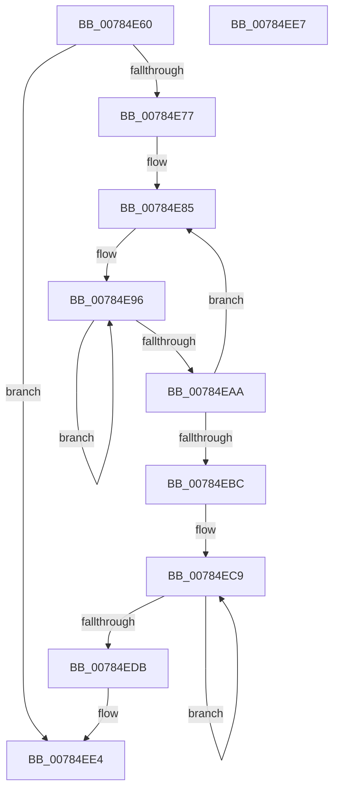

# PspEnableProcessWakeCounters

- RVA: `0x00784E60`–`0x00784EE8` (길이 `136` bytes)
- VA: `0x0000000140784E60`
- 실행 섹션: `PAGE`
- PDB 이름 있음: `예`; PDB Function 태그: `아니요`
- unwind 정보 RVA: `0x000DB714`
- 디코드: `30`개 명령, `136/136` bytes 표시
- 미해석 바이트: `0` (있으면 어셈블리에 `.byte`로 보존)

> 이 문서는 커널 이미지의 기계어와 PDB 기호를 분석해 생성했습니다. 4번과 5번은 함수 원형과 자료형을 바이너리 사용 방식에서 추정한 C 해석이며 원본 소스 복구 결과는 아닙니다.

## 1. Dependencies

- 직접 호출 지점: **0**; 고유 호출 대상: **0**
- 직접 호출자로 확인된 함수: **0**
- RIP 상대 이미지 참조: **0**

### Outgoing calls
- 직접 디코드된 call 명령이 없습니다.

### Direct callers
- 이 함수 시작 RVA로 연결되는 직접 call은 확인되지 않았습니다. 간접 호출은 완전히 역산할 수 없습니다.

### Static image references
- 디코드된 RIP-relative 메모리 참조가 없습니다.

## 2. Other-region calls and transfers

- 다른 실행 섹션으로 향하는 call: **0**
- 별도 외부 분기/꼬리 이동을 확인하지 못했습니다.

## 3. Assembly (complete function range)

```asm
00784E60  4C 8B 81 A0 02 00 00            mov r8, qword ptr [rcx + 0x2a0]
00784E67  48 8B D1                        mov rdx, rcx
00784E6A  41 F7 80 10 06 00 00 00 10 00 00  test dword ptr [r8 + 0x610], 0x1000
00784E75  75 6D                           jne 0x140784ee4
00784E77  45 33 C9                        xor r9d, r9d
00784E7A  4D 8D 90 60 04 00 00            lea r10, [r8 + 0x460]
00784E81  45 8D 59 07                     lea r11d, [r9 + 7]
00784E85  42 0F 0D 8C 8A 28 07 00 00      prefetchw byte ptr [rdx + r9*4 + 0x728]
00784E8E  42 8B 84 8A 28 07 00 00         mov eax, dword ptr [rdx + r9*4 + 0x728]
00784E96  8B C8                           mov ecx, eax
00784E98  81 C9 00 00 00 80               or ecx, 0x80000000
00784E9E  F0 42 0F B1 8C 8A 28 07 00 00   lock cmpxchg dword ptr [rdx + r9*4 + 0x728], ecx
00784EA8  75 EC                           jne 0x140784e96
00784EAA  8B C8                           mov ecx, eax
00784EAC  49 FF C1                        inc r9
00784EAF  49 01 0A                        add qword ptr [r10], rcx
00784EB2  49 83 C2 08                     add r10, 8
00784EB6  49 83 EB 01                     sub r11, 1
00784EBA  75 C9                           jne 0x140784e85
00784EBC  0F 0D 8A 4C 07 00 00            prefetchw byte ptr [rdx + 0x74c]
00784EC3  8B 82 4C 07 00 00               mov eax, dword ptr [rdx + 0x74c]
00784EC9  8B C8                           mov ecx, eax
00784ECB  81 C9 00 00 00 80               or ecx, 0x80000000
00784ED1  F0 0F B1 8A 4C 07 00 00         lock cmpxchg dword ptr [rdx + 0x74c], ecx
00784ED9  75 EE                           jne 0x140784ec9
00784EDB  8B C0                           mov eax, eax
00784EDD  49 01 80 98 04 00 00            add qword ptr [r8 + 0x498], rax
00784EE4  33 C0                           xor eax, eax
00784EE6  C3                              ret
00784EE7  CC                              int3
```

## 4. C-style interpretation (structured pseudocode)

```c
__int64 __fastcall PspEnableProcessWakeCounters(__int64 a1, __int64 a2, __int64 a3, int a4)
{
    __int64 result;
    __int64 v_r10;
    __int64 v_r11;

    if (((*(unsigned int *)(*(unsigned __int64 *)(a1 + 672) + 1552)) & (0x1000ULL)) != 0) goto loc_00784EE4;
    a4 = 0;
loc_00784E85:
loc_00784E96:
    a1 = (unsigned int)(((unsigned int)((unsigned int)((unsigned int)(*(unsigned int *)(a1 + a4 * 4 + 1832))))) | (0x80000000ULL));
    if (condition_is_not_equal) goto loc_00784E96;
    a4 = (a4) + 1;
    v_r10 = (*(unsigned __int64 *)(a1 + 672) + 1120) + (8);
    v_r11 = (a4 + 7) - (1);
    if (condition_is_not_equal) goto loc_00784E85;
loc_00784EC9:
    a1 = (unsigned int)(((unsigned int)((unsigned int)((unsigned int)(*(unsigned int *)(a1 + 1868))))) | (0x80000000ULL));
    if (condition_is_not_equal) goto loc_00784EC9;
loc_00784EE4:
    result = 0;
    return result;
}
```

## 5. (Beta) C Style

```c
int64_t PspEnableProcessWakeCounters(void *Arg1, int64_t Arg2, int64_t Arg3, int32_t Arg4)
{
    uint8_t *arg1 = (uint8_t *)Arg1;

    int64_t result;
    int64_t local_r10;
    int64_t local_r11;

    if (((*(uint32_t *)(*(uint64_t *)(arg1 + 0x2A0) + 0x610)) & (0x1000ULL)) != 0) goto loc_00784EE4;
    Arg4 = 0;
loc_00784E85:
loc_00784E96:
    Arg1 = (uint32_t)(((uint32_t)((uint32_t)((uint32_t)(*(uint32_t *)(arg1 + Arg4 * 4 + 0x728))))) | (0x80000000ULL));
    if (condition_is_not_equal) goto loc_00784E96;
    Arg4 = (Arg4) + 1;
    local_r10 = (*(uint64_t *)(arg1 + 0x2A0) + 1120) + (8);
    local_r11 = (Arg4 + 7) - (1);
    if (condition_is_not_equal) goto loc_00784E85;
loc_00784EC9:
    Arg1 = (uint32_t)(((uint32_t)((uint32_t)((uint32_t)(*(uint32_t *)(arg1 + 0x74C))))) | (0x80000000ULL));
    if (condition_is_not_equal) goto loc_00784EC9;
loc_00784EE4:
    result = 0;
    return result;
}
```

### 관측된 메모리 오프셋

구조체 형식이 확인되지 않은 접근은 인자 기준의 오프셋으로만 기록했습니다.

| 기준 인자 | 오프셋 표현 | 폭 (bit) | 접근 |
|---|---:|---:|---|
| `Arg1` | `+ 0x2A0` | `64` | `R` |
| `Arg1` | `+ 0x728 + r9*4` | `8` | `R` |
| `Arg1` | `+ 0x728 + r9*4` | `32` | `R` |
| `Arg1` | `+ 0x74C` | `8` | `R` |
| `Arg1` | `+ 0x74C` | `32` | `R` |

## 6. Execution-region graph

[열기: 2D/3D 그래프와 함수 탐색 컨트롤 패널](../../../control-panel.html?section=page&rva=0x00784E60&view=graph)

- 2D 그래프는 위에서 아래로 흐르고, 3D 그래프는 빈 공간을 드래그해 회전합니다. Shift+드래그는 이동, 휠은 확대·축소, 함수 노드 선택은 대상 보고서 이동입니다.

### Static fallback


