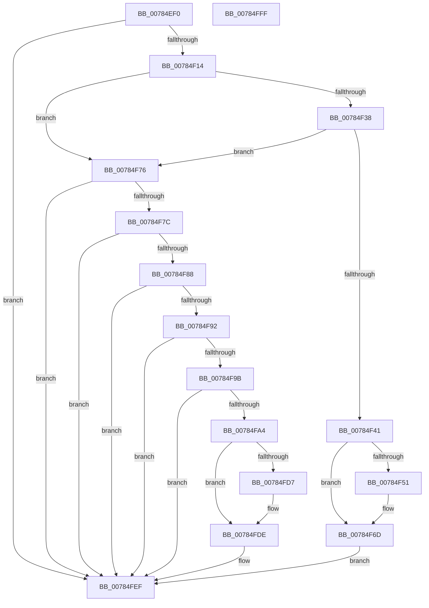

# PspEstablishDfssHierarchy

- RVA: `0x00784EF0`–`0x00785000` (길이 `272` bytes)
- VA: `0x0000000140784EF0`
- 실행 섹션: `PAGE`
- PDB 이름 있음: `예`; PDB Function 태그: `아니요`
- unwind 정보 RVA: `0x00060BC4`
- 디코드: `62`개 명령, `272/272` bytes 표시
- 미해석 바이트: `0` (있으면 어셈블리에 `.byte`로 보존)

> 이 문서는 커널 이미지의 기계어와 PDB 기호를 분석해 생성했습니다. 4번과 5번은 함수 원형과 자료형을 바이너리 사용 방식에서 추정한 C 해석이며 원본 소스 복구 결과는 아닙니다.

## 1. Dependencies

- 직접 호출 지점: **6**; 고유 호출 대상: **6**
- 직접 호출자로 확인된 함수: **1**
- RIP 상대 이미지 참조: **0**

### Outgoing calls
- `0x00784F17` → [PsGetSessionSchedulingGroupByProcess](../A6/PsGetSessionSchedulingGroupByProcess_function_00A6EC60.md) (function, `0x00A6EC60`)
- `0x00784F1F` → [PspGetSessionObjectByProcess](../../text/5E/PspGetSessionObjectByProcess_function_005E5098.md) (function, `0x005E5098`)
- `0x00784FAB` → [KeRemoveSchedulingGroup](../../text/4A/KeRemoveSchedulingGroup_function_004AD328.md) (function, `0x004AD328`)
- `0x00784FC1` → [KeInsertSchedulingGroup](../../text/46/KeInsertSchedulingGroup_function_0046D324.md) (function, `0x0046D324`)
- `0x00784FD9` → [ObfDereferenceObjectWithTag](../../text/2F/ObfDereferenceObjectWithTag_function_002F78E0.md) (function, `0x002F78E0`)
- `0x00784FEA` → [ObfReferenceObjectWithTag](../../text/21/ObfReferenceObjectWithTag_function_00210710.md) (function, `0x00210710`)

### Direct callers
- [PspEstablishJobHierarchy](../87/PspEstablishJobHierarchy_function_0087E17C.md) at `0x0087E650`

### Static image references
- 디코드된 RIP-relative 메모리 참조가 없습니다.

## 2. Other-region calls and transfers

- 다른 실행 섹션으로 향하는 call: **5**
  - `0x00784F1F` → [PspGetSessionObjectByProcess](../../text/5E/PspGetSessionObjectByProcess_function_005E5098.md) (`PAGE` → `.text`)
  - `0x00784FAB` → [KeRemoveSchedulingGroup](../../text/4A/KeRemoveSchedulingGroup_function_004AD328.md) (`PAGE` → `.text`)
  - `0x00784FC1` → [KeInsertSchedulingGroup](../../text/46/KeInsertSchedulingGroup_function_0046D324.md) (`PAGE` → `.text`)
  - `0x00784FD9` → [ObfDereferenceObjectWithTag](../../text/2F/ObfDereferenceObjectWithTag_function_002F78E0.md) (`PAGE` → `.text`)
  - `0x00784FEA` → [ObfReferenceObjectWithTag](../../text/21/ObfReferenceObjectWithTag_function_00210710.md) (`PAGE` → `.text`)
- 별도 외부 분기/꼬리 이동을 확인하지 못했습니다.

## 3. Assembly (complete function range)

```asm
00784EF0  48 89 5C 24 08                  mov qword ptr [rsp + 8], rbx
00784EF5  48 89 74 24 10                  mov qword ptr [rsp + 0x10], rsi
00784EFA  57                              push rdi
00784EFB  48 83 EC 20                     sub rsp, 0x20
00784EFF  41 8D 40 FF                     lea eax, [r8 - 1]
00784F03  4C 8B CA                        mov r9, rdx
00784F06  48 8B D9                        mov rbx, rcx
00784F09  A9 FD FF FF FF                  test eax, 0xfffffffd
00784F0E  0F 85 DB 00 00 00               jne 0x140784fef
00784F14  48 8B CA                        mov rcx, rdx
00784F17  E8 44 9D 2E 00                  call 0x140a6ec60
00784F1C  48 8B F8                        mov rdi, rax
00784F1F  E8 74 01 E6 FF                  call 0x1405e5098
00784F24  48 8B 93 20 05 00 00            mov rdx, qword ptr [rbx + 0x520]
00784F2B  48 8B F0                        mov rsi, rax
00784F2E  48 83 BA D8 04 00 00 00         cmp qword ptr [rdx + 0x4d8], 0
00784F36  75 3E                           jne 0x140784f76
00784F38  48 39 BB E0 04 00 00            cmp qword ptr [rbx + 0x4e0], rdi
00784F3F  74 35                           je 0x140784f76
00784F41  48 8B 8B 20 05 00 00            mov rcx, qword ptr [rbx + 0x520]
00784F48  48 39 B9 E0 04 00 00            cmp qword ptr [rcx + 0x4e0], rdi
00784F4F  74 1C                           je 0x140784f6d
00784F51  48 8B 83 20 05 00 00            mov rax, qword ptr [rbx + 0x520]
00784F58  48 89 B8 E0 04 00 00            mov qword ptr [rax + 0x4e0], rdi
00784F5F  48 8B 83 20 05 00 00            mov rax, qword ptr [rbx + 0x520]
00784F66  48 89 B0 40 05 00 00            mov qword ptr [rax + 0x540], rsi
00784F6D  48 89 BB E0 04 00 00            mov qword ptr [rbx + 0x4e0], rdi
00784F74  EB 79                           jmp 0x140784fef
00784F76  41 83 F8 01                     cmp r8d, 1
00784F7A  75 73                           jne 0x140784fef
00784F7C  48 8B 83 20 05 00 00            mov rax, qword ptr [rbx + 0x520]
00784F83  48 3B C3                        cmp rax, rbx
00784F86  75 67                           jne 0x140784fef
00784F88  48 83 BB D8 04 00 00 00         cmp qword ptr [rbx + 0x4d8], 0
00784F90  74 5D                           je 0x140784fef
00784F92  83 BB D8 00 00 00 00            cmp dword ptr [rbx + 0xd8], 0
00784F99  75 54                           jne 0x140784fef
00784F9B  48 39 B3 40 05 00 00            cmp qword ptr [rbx + 0x540], rsi
00784FA2  74 4B                           je 0x140784fef
00784FA4  48 8B 8B E0 04 00 00            mov rcx, qword ptr [rbx + 0x4e0]
00784FAB  E8 78 83 D2 FF                  call 0x1404ad328
00784FB0  48 8B 8B D8 04 00 00            mov rcx, qword ptr [rbx + 0x4d8]
00784FB7  4C 8B C7                        mov r8, rdi
00784FBA  48 83 E9 80                     sub rcx, -0x80
00784FBE  48 8B 11                        mov rdx, qword ptr [rcx]
00784FC1  E8 5E 83 CE FF                  call 0x14046d324
00784FC6  48 8B 8B 40 05 00 00            mov rcx, qword ptr [rbx + 0x540]
00784FCD  BF 50 73 4A 62                  mov edi, 0x624a7350
00784FD2  48 85 C9                        test rcx, rcx
00784FD5  74 07                           je 0x140784fde
00784FD7  8B D7                           mov edx, edi
00784FD9  E8 02 29 B7 FF                  call 0x1402f78e0
00784FDE  8B D7                           mov edx, edi
00784FE0  48 89 B3 40 05 00 00            mov qword ptr [rbx + 0x540], rsi
00784FE7  48 8B CE                        mov rcx, rsi
00784FEA  E8 21 B7 A8 FF                  call 0x140210710
00784FEF  48 8B 5C 24 30                  mov rbx, qword ptr [rsp + 0x30]
00784FF4  48 8B 74 24 38                  mov rsi, qword ptr [rsp + 0x38]
00784FF9  48 83 C4 20                     add rsp, 0x20
00784FFD  5F                              pop rdi
00784FFE  C3                              ret
00784FFF  CC                              int3
```

## 4. C-style interpretation (structured pseudocode)

```c
__int64 __fastcall PspEstablishDfssHierarchy(__int64 a1, __int64 a2, __int64 a3)
{
    __int64 result;
    __int64 v_rsp;
    unsigned __int64 v_stack_p10;
    unsigned __int64 v_stack_p8;

    v_stack_p8 = v_rbx;
    v_stack_p10 = v_rsi;
    v_rsp = (v_rsp) - (32);
    if ((((unsigned int)(a3 - 1)) & (0xFFFFFFFDULL)) != 0) goto loc_00784FEF;
    result = PsGetSessionSchedulingGroupByProcess(a2, a2, a3, a2);
    result = PspGetSessionObjectByProcess(a2, a2, a3, a2);
    if ((*(unsigned __int64 *)(*(unsigned __int64 *)(a1 + 1312) + 1240)) != 0) goto loc_00784F76;
    if ((*(unsigned __int64 *)(a1 + 1248)) == result) goto loc_00784F76;
    if ((*(unsigned __int64 *)(*(unsigned __int64 *)(a1 + 1312) + 1248)) != result) {
        result = *(unsigned __int64 *)(a1 + 1312);
        *(unsigned __int64 *)(result + 1248) = result;
        result = *(unsigned __int64 *)(a1 + 1312);
        *(unsigned __int64 *)(result + 1344) = result;
    }
    *(unsigned __int64 *)(a1 + 1248) = result;
    goto loc_00784FEF;
loc_00784F76:
    if (((unsigned int)(a3)) != 1) goto loc_00784FEF;
    if ((*(unsigned __int64 *)(a1 + 1312)) != a1) goto loc_00784FEF;
    if ((*(unsigned __int64 *)(a1 + 1240)) == 0) goto loc_00784FEF;
    if ((*(unsigned int *)(a1 + 216)) != 0) goto loc_00784FEF;
    if ((*(unsigned __int64 *)(a1 + 1344)) == result) goto loc_00784FEF;
    result = KeRemoveSchedulingGroup(*(unsigned __int64 *)(a1 + 1248), *(unsigned __int64 *)(a1 + 1312), a3, a2);
    a1 = (*(unsigned __int64 *)(a1 + 1240)) - (-128);
    result = KeInsertSchedulingGroup(a1, *(unsigned __int64 *)(a1), result, a2);
    if (*(unsigned __int64 *)(a1 + 1344) != 0) {
        a2 = (unsigned int)((unsigned int)(0x624A7350ULL));
        result = ObfDereferenceObjectWithTag(*(unsigned __int64 *)(a1 + 1344), a2, result, a2);
    }
    *(unsigned __int64 *)(a1 + 1344) = result;
    result = ObfReferenceObjectWithTag(result, (unsigned int)((unsigned int)((unsigned int)(0x624A7350ULL))), result, a2);
loc_00784FEF:
    v_rsp = (v_rsp) + (32);
    return result;
}
```

## 5. (Beta) C Style

```c
int64_t PspEstablishDfssHierarchy(void *Arg1, int64_t Arg2, void *Arg3)
{
    uint8_t *arg1 = (uint8_t *)Arg1;
    uint8_t *arg3 = (uint8_t *)Arg3;

    int64_t result;
    int64_t local_rsp;
    uint64_t v_stack_p10;
    uint64_t v_stack_p8;

    v_stack_p8 = local_rbx;
    v_stack_p10 = local_rsi;
    local_rsp = (local_rsp) - (32);
    if ((((uint32_t)(Arg3 - 1)) & (0xFFFFFFFDULL)) != 0) goto loc_00784FEF;
    result = PsGetSessionSchedulingGroupByProcess(Arg2, Arg2, Arg3, Arg2);
    result = PspGetSessionObjectByProcess(Arg2, Arg2, Arg3, Arg2);
    if ((*(uint64_t *)(*(uint64_t *)(arg1 + 0x520) + 0x4D8)) != 0) goto loc_00784F76;
    if ((*(uint64_t *)(arg1 + 0x4E0)) == result) goto loc_00784F76;
    if ((*(uint64_t *)(*(uint64_t *)(arg1 + 0x520) + 0x4E0)) != result) {
        result = *(uint64_t *)(arg1 + 0x520);
        *(uint64_t *)(result + 0x4E0) = result;
        result = *(uint64_t *)(arg1 + 0x520);
        *(uint64_t *)(result + 0x540) = result;
    }
    *(uint64_t *)(arg1 + 0x4E0) = result;
    goto loc_00784FEF;
loc_00784F76:
    if (((uint32_t)(Arg3)) != 1) goto loc_00784FEF;
    if ((*(uint64_t *)(arg1 + 0x520)) != Arg1) goto loc_00784FEF;
    if ((*(uint64_t *)(arg1 + 0x4D8)) == 0) goto loc_00784FEF;
    if ((*(uint32_t *)(arg1 + 0xD8)) != 0) goto loc_00784FEF;
    if ((*(uint64_t *)(arg1 + 0x540)) == result) goto loc_00784FEF;
    result = KeRemoveSchedulingGroup(*(uint64_t *)(arg1 + 0x4E0), *(uint64_t *)(arg1 + 0x520), Arg3, Arg2);
    Arg1 = (*(uint64_t *)(arg1 + 0x4D8)) - (-128);
    result = KeInsertSchedulingGroup(Arg1, *(uint64_t *)(arg1), result, Arg2);
    if (*(uint64_t *)(arg1 + 0x540) != 0) {
        Arg2 = (uint32_t)((uint32_t)(0x624A7350ULL));
        result = ObfDereferenceObjectWithTag(*(uint64_t *)(arg1 + 0x540), Arg2, result, Arg2);
    }
    *(uint64_t *)(arg1 + 0x540) = result;
    result = ObfReferenceObjectWithTag(result, (uint32_t)((uint32_t)((uint32_t)(0x624A7350ULL))), result, Arg2);
loc_00784FEF:
    local_rsp = (local_rsp) + (32);
    return result;
}
```

### 관측된 메모리 오프셋

구조체 형식이 확인되지 않은 접근은 인자 기준의 오프셋으로만 기록했습니다.

| 기준 인자 | 오프셋 표현 | 폭 (bit) | 접근 |
|---|---:|---:|---|
| `Arg1` | `+ 0xD8` | `32` | `R` |
| `Arg1` | `+ 0x4D8` | `64` | `R` |
| `Arg1` | `+ 0x4E0` | `64` | `R` |
| `Arg1` | `+ 0x4E0` | `64` | `W` |
| `Arg1` | `+ 0x520` | `64` | `R` |
| `Arg1` | `+ 0x540` | `64` | `R` |
| `Arg1` | `+ 0x540` | `64` | `W` |
| `Arg3` | `- 0x1` | `32` | `R` |

## 6. Execution-region graph

[열기: 2D/3D 그래프와 함수 탐색 컨트롤 패널](../../../control-panel.html?section=page&rva=0x00784EF0&view=graph)

- 2D 그래프는 위에서 아래로 흐르고, 3D 그래프는 빈 공간을 드래그해 회전합니다. Shift+드래그는 이동, 휠은 확대·축소, 함수 노드 선택은 대상 보고서 이동입니다.

### Static fallback


