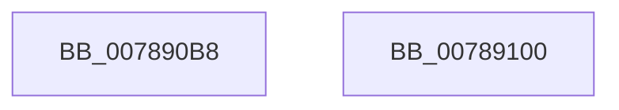

# PspFreeSessionId

- RVA: `0x007890B8`–`0x00789101` (길이 `73` bytes)
- VA: `0x00000001407890B8`
- 실행 섹션: `PAGE`
- PDB 이름 있음: `예`; PDB Function 태그: `아니요`
- unwind 정보 RVA: `0x0005CAAC`
- 디코드: `21`개 명령, `73/73` bytes 표시
- 미해석 바이트: `0` (있으면 어셈블리에 `.byte`로 보존)

> 이 문서는 커널 이미지의 기계어와 PDB 기호를 분석해 생성했습니다. 4번과 5번은 함수 원형과 자료형을 바이너리 사용 방식에서 추정한 C 해석이며 원본 소스 복구 결과는 아닙니다.

## 1. Dependencies

- 직접 호출 지점: **2**; 고유 호출 대상: **2**
- 직접 호출자로 확인된 함수: **2**
- RIP 상대 이미지 참조: **1**

### Outgoing calls
- `0x007890D0` → [PspLockProcessListExclusive](../../text/22/PspLockProcessListExclusive_function_0022578C.md) (function, `0x0022578C`)
- `0x007890F0` → [PspUnlockProcessListExclusive](../../text/2D/PspUnlockProcessListExclusive_function_002DFD18.md) (function, `0x002DFD18`)

### Direct callers
- [PsSessionCreate](../70/PsSessionCreate_function_00700438.md) at `0x007004A6`
- [sub_00B48FD4](../B4/Unknown_function_00B48FD4.md) at `0x00B49032`

### Static image references
- `0x007890E1` → RVA `0x00F05D48` (`.data`; read)

## 2. Other-region calls and transfers

- 다른 실행 섹션으로 향하는 call: **2**
  - `0x007890D0` → [PspLockProcessListExclusive](../../text/22/PspLockProcessListExclusive_function_0022578C.md) (`PAGE` → `.text`)
  - `0x007890F0` → [PspUnlockProcessListExclusive](../../text/2D/PspUnlockProcessListExclusive_function_002DFD18.md) (`PAGE` → `.text`)
- 별도 외부 분기/꼬리 이동을 확인하지 못했습니다.

## 3. Assembly (complete function range)

```asm
007890B8  48 89 5C 24 08                  mov qword ptr [rsp + 8], rbx
007890BD  57                              push rdi
007890BE  48 83 EC 20                     sub rsp, 0x20
007890C2  65 48 8B 3C 25 88 01 00 00      mov rdi, qword ptr gs:[0x188]
007890CB  8B D9                           mov ebx, ecx
007890CD  48 8B CF                        mov rcx, rdi
007890D0  E8 B7 C6 A9 FF                  call 0x14022578c
007890D5  8B D3                           mov edx, ebx
007890D7  48 8B CF                        mov rcx, rdi
007890DA  48 C1 EA 03                     shr rdx, 3
007890DE  83 E3 07                        and ebx, 7
007890E1  48 03 15 60 CC 77 00            add rdx, qword ptr [rip + 0x77cc60]
007890E8  0F BE 02                        movsx eax, byte ptr [rdx]
007890EB  0F B3 D8                        btr eax, ebx
007890EE  88 02                           mov byte ptr [rdx], al
007890F0  E8 23 6C B5 FF                  call 0x1402dfd18
007890F5  48 8B 5C 24 30                  mov rbx, qword ptr [rsp + 0x30]
007890FA  48 83 C4 20                     add rsp, 0x20
007890FE  5F                              pop rdi
007890FF  C3                              ret
00789100  CC                              int3
```

## 4. C-style interpretation (structured pseudocode)

```c
__int64 __fastcall PspFreeSessionId(int a1)
{
    __int64 result;
    __int64 v_rbx;
    __int64 v_rsp;
    unsigned __int64 v_stack_p8;

    v_stack_p8 = v_rbx;
    v_rsp = (v_rsp) - (32);
    result = PspLockProcessListExclusive(*(unsigned __int64 *)(gs_base + (0 + 392)), a2, a3, a4);
    a2 = ((unsigned int)((unsigned int)((unsigned int)(a1)))) >> (3);
    v_rbx = (unsigned int)(((unsigned int)(a1)) & (7));
    a2 = (a2) + (*(unsigned __int64 *)(v_rip + 7851104));
    *(unsigned __int8 *)(a2) = (unsigned __int8)((__int8)(*(unsigned __int8 *)(a2)));
    result = PspUnlockProcessListExclusive(*(unsigned __int64 *)(gs_base + (0 + 392)), a2, a3, a4);
    v_rsp = (v_rsp) + (32);
    return result;
}
```

## 5. (Beta) C Style

```c
int64_t PspFreeSessionId(int32_t Arg1)
{
    int64_t result;
    int64_t local_rbx;
    int64_t local_rsp;
    uint64_t v_stack_p8;

    v_stack_p8 = local_rbx;
    local_rsp = (local_rsp) - (32);
    result = PspLockProcessListExclusive(*(uint64_t *)(gs_base + (0 + 0x188)), a2, a3, a4);
    a2 = ((uint32_t)((uint32_t)((uint32_t)(Arg1)))) >> (3);
    local_rbx = (uint32_t)(((uint32_t)(Arg1)) & (7));
    a2 = (a2) + (*(uint64_t *)(v_rip + 0x77CC60));
    *(uint8_t *)(a2) = (uint8_t)((int8_t)(*(uint8_t *)(a2)));
    result = PspUnlockProcessListExclusive(*(uint64_t *)(gs_base + (0 + 0x188)), a2, a3, a4);
    local_rsp = (local_rsp) + (32);
    return result;
}
```

## 6. Execution-region graph

[열기: 2D/3D 그래프와 함수 탐색 컨트롤 패널](../../../control-panel.html?section=page&rva=0x007890B8&view=graph)

- 2D 그래프는 위에서 아래로 흐르고, 3D 그래프는 빈 공간을 드래그해 회전합니다. Shift+드래그는 이동, 휠은 확대·축소, 함수 노드 선택은 대상 보고서 이동입니다.

### Static fallback


