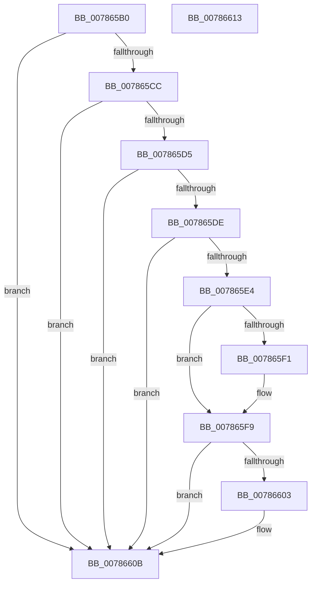

# PspFreezeProcessWorker

- RVA: `0x007865B0`–`0x00786614` (길이 `100` bytes)
- VA: `0x00000001407865B0`
- 실행 섹션: `PAGE`
- PDB 이름 있음: `예`; PDB Function 태그: `아니요`
- unwind 정보 RVA: `0x0005CF00`
- 디코드: `30`개 명령, `100/100` bytes 표시
- 미해석 바이트: `0` (있으면 어셈블리에 `.byte`로 보존)

> 이 문서는 커널 이미지의 기계어와 PDB 기호를 분석해 생성했습니다. 4번과 5번은 함수 원형과 자료형을 바이너리 사용 방식에서 추정한 C 해석이며 원본 소스 복구 결과는 아닙니다.

## 1. Dependencies

- 직접 호출 지점: **4**; 고유 호출 대상: **4**
- 직접 호출자로 확인된 함수: **0**
- RIP 상대 이미지 참조: **1**

### Outgoing calls
- `0x007865BB` → [PsGetServerSiloGlobals](../../text/22/PsGetServerSiloGlobals_function_002250A0.md) (function, `0x002250A0`)
- `0x007865E7` → [PsCaptureExceptionPort](../90/PsCaptureExceptionPort_function_00904CB0.md) (function, `0x00904CB0`)
- `0x007865F4` → [ObfDereferenceObject](../../text/2F/ObfDereferenceObject_function_002F9350.md) (function, `0x002F9350`)
- `0x00786606` → [PsSuspendProcess](../A1/PsSuspendProcess_function_00A10F30.md) (function, `0x00A10F30`)

### Direct callers
- 이 함수 시작 RVA로 연결되는 직접 call은 확인되지 않았습니다. 간접 호출은 완전히 역산할 수 없습니다.

### Static image references
- `0x007865CC` → RVA `0x00FC6B70` (`ALMOSTRO`; read)

## 2. Other-region calls and transfers

- 다른 실행 섹션으로 향하는 call: **2**
  - `0x007865BB` → [PsGetServerSiloGlobals](../../text/22/PsGetServerSiloGlobals_function_002250A0.md) (`PAGE` → `.text`)
  - `0x007865F4` → [ObfDereferenceObject](../../text/2F/ObfDereferenceObject_function_002F9350.md) (`PAGE` → `.text`)
- 별도 외부 분기/꼬리 이동을 확인하지 못했습니다.

## 3. Assembly (complete function range)

```asm
007865B0  40 53                           push rbx
007865B2  48 83 EC 20                     sub rsp, 0x20
007865B6  48 8B D9                        mov rbx, rcx
007865B9  33 C9                           xor ecx, ecx
007865BB  E8 E0 EA A9 FF                  call 0x1402250a0
007865C0  8B 8B FC 05 00 00               mov ecx, dword ptr [rbx + 0x5fc]
007865C6  0F BA E1 0C                     bt ecx, 0xc
007865CA  72 3F                           jb 0x14078660b
007865CC  48 3B 1D 9D 05 84 00            cmp rbx, qword ptr [rip + 0x84059d]
007865D3  74 36                           je 0x14078660b
007865D5  48 3B 98 50 03 00 00            cmp rbx, qword ptr [rax + 0x350]
007865DC  74 2D                           je 0x14078660b
007865DE  0F BA E1 1E                     bt ecx, 0x1e
007865E2  72 27                           jb 0x14078660b
007865E4  48 8B CB                        mov rcx, rbx
007865E7  E8 C4 E6 17 00                  call 0x140904cb0
007865EC  48 85 C0                        test rax, rax
007865EF  74 08                           je 0x1407865f9
007865F1  48 8B C8                        mov rcx, rax
007865F4  E8 57 2D B7 FF                  call 0x1402f9350
007865F9  8B 83 F4 01 00 00               mov eax, dword ptr [rbx + 0x1f4]
007865FF  A8 04                           test al, 4
00786601  75 08                           jne 0x14078660b
00786603  48 8B CB                        mov rcx, rbx
00786606  E8 25 A9 28 00                  call 0x140a10f30
0078660B  33 C0                           xor eax, eax
0078660D  48 83 C4 20                     add rsp, 0x20
00786611  5B                              pop rbx
00786612  C3                              ret
00786613  CC                              int3
```

## 4. C-style interpretation (structured pseudocode)

```c
__int64 __fastcall PspFreezeProcessWorker(__int64 a1)
{
    __int64 result;
    __int64 v_rsp;

    v_rsp = (v_rsp) - (32);
    a1 = 0;
    result = PsGetServerSiloGlobals(a1, a2, a3, a4);
    if (condition_is_below) goto loc_0078660B;
    if (0 == (*(unsigned __int64 *)(v_rip + 8652189))) goto loc_0078660B;
    if (0 == (*(unsigned __int64 *)(result + 848))) goto loc_0078660B;
    if (0 < (*(unsigned __int64 *)(result + 848))) goto loc_0078660B;
    result = PsCaptureExceptionPort(0, a2, a3, a4);
    if (result != 0) {
        a1 = result;
        result = ObfDereferenceObject(a1, a2, a3, a4);
    }
    result = (unsigned int)(*(unsigned int *)(a1 + 500));
    if ((((unsigned __int8)((unsigned int)(*(unsigned int *)(a1 + 500)))) & (4)) == 0) {
        a1 = a1;
        result = PsSuspendProcess(a1, a2, a3, a4);
    }
    result = 0;
    v_rsp = (v_rsp) + (32);
    return result;
}
```

## 5. (Beta) C Style

```c
int64_t PspFreezeProcessWorker(void *Arg1)
{
    uint8_t *arg1 = (uint8_t *)Arg1;

    int64_t result;
    int64_t local_rsp;

    local_rsp = (local_rsp) - (32);
    Arg1 = 0;
    result = PsGetServerSiloGlobals(Arg1, a2, a3, a4);
    if (condition_is_below) goto loc_0078660B;
    if (0 == (*(uint64_t *)(v_rip + 0x84059D))) goto loc_0078660B;
    if (0 == (*(uint64_t *)(result + 0x350))) goto loc_0078660B;
    if (0 < (*(uint64_t *)(result + 0x350))) goto loc_0078660B;
    result = PsCaptureExceptionPort(0, a2, a3, a4);
    if (result != 0) {
        Arg1 = result;
        result = ObfDereferenceObject(Arg1, a2, a3, a4);
    }
    result = (uint32_t)(*(uint32_t *)(arg1 + 0x1F4));
    if ((((uint8_t)((uint32_t)(*(uint32_t *)(arg1 + 0x1F4)))) & (4)) == 0) {
        Arg1 = Arg1;
        result = PsSuspendProcess(Arg1, a2, a3, a4);
    }
    result = 0;
    local_rsp = (local_rsp) + (32);
    return result;
}
```

### 관측된 메모리 오프셋

구조체 형식이 확인되지 않은 접근은 인자 기준의 오프셋으로만 기록했습니다.

| 기준 인자 | 오프셋 표현 | 폭 (bit) | 접근 |
|---|---:|---:|---|
| `Arg1` | `+ 0x5FC` | `32` | `R` |

## 6. Execution-region graph

[열기: 2D/3D 그래프와 함수 탐색 컨트롤 패널](../../../control-panel.html?section=page&rva=0x007865B0&view=graph)

- 2D 그래프는 위에서 아래로 흐르고, 3D 그래프는 빈 공간을 드래그해 회전합니다. Shift+드래그는 이동, 휠은 확대·축소, 함수 노드 선택은 대상 보고서 이동입니다.

### Static fallback


