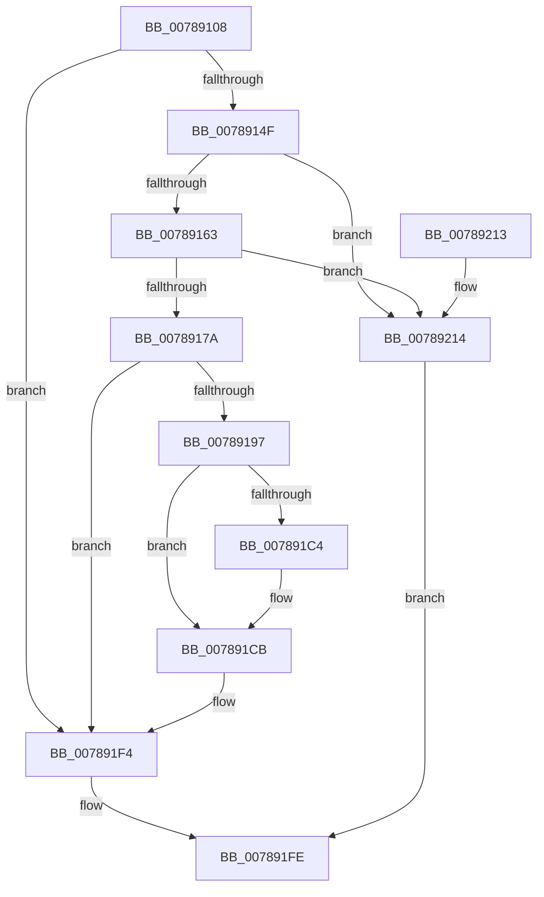

# PspGetNewSessionId

- RVA: `0x00789108`–`0x00789219` (길이 `273` bytes)
- VA: `0x0000000140789108`
- 실행 섹션: `PAGE`
- PDB 이름 있음: `예`; PDB Function 태그: `아니요`
- unwind 정보 RVA: `0x00091B44`
- 디코드: `66`개 명령, `273/273` bytes 표시
- 미해석 바이트: `0` (있으면 어셈블리에 `.byte`로 보존)

> 이 문서는 커널 이미지의 기계어와 PDB 기호를 분석해 생성했습니다. 4번과 5번은 함수 원형과 자료형을 바이너리 사용 방식에서 추정한 C 해석이며 원본 소스 복구 결과는 아닙니다.

## 1. Dependencies

- 직접 호출 지점: **8**; 고유 호출 대상: **7**
- 직접 호출자로 확인된 함수: **1**
- RIP 상대 이미지 참조: **5**

### Outgoing calls
- `0x00789128` → [PspLockProcessListExclusive](../../text/22/PspLockProcessListExclusive_function_0022578C.md) (function, `0x0022578C`)
- `0x0078913B` → [RtlFindClearBitsAndSet](../../text/3E/RtlFindClearBitsAndSet_function_003E0CD0.md) (function, `0x003E0CD0`)
- `0x00789163` → [MmMaximumUserSessionId](../../text/69/MmMaximumUserSessionId_function_006925C8.md) (function, `0x006925C8`)
- `0x0078918A` → [ExAllocatePool2](../../poolcode/B8/ExAllocatePool2_function_00B820F0.md) (function, `0x00B820F0`)
- `0x007891AC` → [memcpy](../../text/6C/memcpy_function_006C6840.md) (function, `0x006C6840`)
- `0x007891C6` → [ExFreePoolWithTag](../../poolcode/B8/ExFreePoolWithTag_function_00B82870.md) (function, `0x00B82870`)
- `0x007891ED` → [RtlFindClearBitsAndSet](../../text/3E/RtlFindClearBitsAndSet_function_003E0CD0.md) (function, `0x003E0CD0`)
- `0x007891F7` → [PspUnlockProcessListExclusive](../../text/2D/PspUnlockProcessListExclusive_function_002DFD18.md) (function, `0x002DFD18`)

### Direct callers
- [PsSessionCreate](../70/PsSessionCreate_function_00700438.md) at `0x00700473`

### Static image references
- `0x00789130` → RVA `0x00F05D40` (`.data`; read)
- `0x007891A1` → RVA `0x00F05D48` (`.data`; read)
- `0x007891B8` → RVA `0x00F05D30` (`.data`; read)
- `0x007891CE` → RVA `0x00F05D48` (`.data`; write)
- `0x007891E3` → RVA `0x00F05D40` (`.data`; write)

## 2. Other-region calls and transfers

- 다른 실행 섹션으로 향하는 call: **8**
  - `0x00789128` → [PspLockProcessListExclusive](../../text/22/PspLockProcessListExclusive_function_0022578C.md) (`PAGE` → `.text`)
  - `0x0078913B` → [RtlFindClearBitsAndSet](../../text/3E/RtlFindClearBitsAndSet_function_003E0CD0.md) (`PAGE` → `.text`)
  - `0x00789163` → [MmMaximumUserSessionId](../../text/69/MmMaximumUserSessionId_function_006925C8.md) (`PAGE` → `.text`)
  - `0x0078918A` → [ExAllocatePool2](../../poolcode/B8/ExAllocatePool2_function_00B820F0.md) (`PAGE` → `POOLCODE`)
  - `0x007891AC` → [memcpy](../../text/6C/memcpy_function_006C6840.md) (`PAGE` → `.text`)
  - `0x007891C6` → [ExFreePoolWithTag](../../poolcode/B8/ExFreePoolWithTag_function_00B82870.md) (`PAGE` → `POOLCODE`)
  - `0x007891ED` → [RtlFindClearBitsAndSet](../../text/3E/RtlFindClearBitsAndSet_function_003E0CD0.md) (`PAGE` → `.text`)
  - `0x007891F7` → [PspUnlockProcessListExclusive](../../text/2D/PspUnlockProcessListExclusive_function_002DFD18.md) (`PAGE` → `.text`)
- 별도 외부 분기/꼬리 이동을 확인하지 못했습니다.

## 3. Assembly (complete function range)

```asm
00789108  48 89 5C 24 08                  mov qword ptr [rsp + 8], rbx
0078910D  48 89 6C 24 10                  mov qword ptr [rsp + 0x10], rbp
00789112  48 89 74 24 18                  mov qword ptr [rsp + 0x18], rsi
00789117  57                              push rdi
00789118  48 83 EC 20                     sub rsp, 0x20
0078911C  65 48 8B 2C 25 88 01 00 00      mov rbp, qword ptr gs:[0x188]
00789125  48 8B CD                        mov rcx, rbp
00789128  E8 5F C6 A9 FF                  call 0x14022578c
0078912D  45 33 C0                        xor r8d, r8d
00789130  48 8D 0D 09 CC 77 00            lea rcx, [rip + 0x77cc09]
00789137  41 8D 50 01                     lea edx, [r8 + 1]
0078913B  E8 90 7B C5 FF                  call 0x1403e0cd0
00789140  41 83 C8 FF                     or r8d, 0xffffffff
00789144  8B F8                           mov edi, eax
00789146  41 3B C0                        cmp eax, r8d
00789149  0F 85 A5 00 00 00               jne 0x1407891f4
0078914F  8B 0D EB CB 77 00               mov ecx, dword ptr [rip + 0x77cbeb]
00789155  8D 91 80 00 00 00               lea edx, [rcx + 0x80]
0078915B  3B D1                           cmp edx, ecx
0078915D  0F 86 B1 00 00 00               jbe 0x140789214
00789163  E8 60 94 F0 FF                  call 0x1406925c8
00789168  8B D8                           mov ebx, eax
0078916A  83 E3 C0                        and ebx, 0xffffffc0
0078916D  3B D3                           cmp edx, ebx
0078916F  0F 46 DA                        cmovbe ebx, edx
00789172  3B D9                           cmp ebx, ecx
00789174  0F 86 9A 00 00 00               jbe 0x140789214
0078917A  C1 EB 03                        shr ebx, 3
0078917D  B9 00 01 00 00                  mov ecx, 0x100
00789182  8B D3                           mov edx, ebx
00789184  41 B8 50 73 53 73               mov r8d, 0x73537350
0078918A  E8 61 8F 3F 00                  call 0x140b820f0
0078918F  48 8B F0                        mov rsi, rax
00789192  48 85 C0                        test rax, rax
00789195  74 5D                           je 0x1407891f4
00789197  44 8B 05 A2 CB 77 00            mov r8d, dword ptr [rip + 0x77cba2]
0078919E  48 8B C8                        mov rcx, rax
007891A1  48 8B 15 A0 CB 77 00            mov rdx, qword ptr [rip + 0x77cba0]
007891A8  49 C1 E8 03                     shr r8, 3
007891AC  E8 8F D6 F3 FF                  call 0x1406c6840
007891B1  48 8B 0D 90 CB 77 00            mov rcx, qword ptr [rip + 0x77cb90]
007891B8  48 8D 05 71 CB 77 00            lea rax, [rip + 0x77cb71]
007891BF  48 3B C8                        cmp rcx, rax
007891C2  74 07                           je 0x1407891cb
007891C4  33 D2                           xor edx, edx
007891C6  E8 A5 96 3F 00                  call 0x140b82870
007891CB  45 33 C0                        xor r8d, r8d
007891CE  48 89 35 73 CB 77 00            mov qword ptr [rip + 0x77cb73], rsi
007891D5  8D 04 DD 00 00 00 00            lea eax, [rbx*8]
007891DC  48 8D 0D 5D CB 77 00            lea rcx, [rip + 0x77cb5d]
007891E3  89 05 57 CB 77 00               mov dword ptr [rip + 0x77cb57], eax
007891E9  41 8D 50 01                     lea edx, [r8 + 1]
007891ED  E8 DE 7A C5 FF                  call 0x1403e0cd0
007891F2  8B F8                           mov edi, eax
007891F4  48 8B CD                        mov rcx, rbp
007891F7  E8 1C 6B B5 FF                  call 0x1402dfd18
007891FC  8B C7                           mov eax, edi
007891FE  48 8B 5C 24 30                  mov rbx, qword ptr [rsp + 0x30]
00789203  48 8B 6C 24 38                  mov rbp, qword ptr [rsp + 0x38]
00789208  48 8B 74 24 40                  mov rsi, qword ptr [rsp + 0x40]
0078920D  48 83 C4 20                     add rsp, 0x20
00789211  5F                              pop rdi
00789212  C3                              ret
00789213  CC                              int3
00789214  41 8B C0                        mov eax, r8d
00789217  EB E5                           jmp 0x1407891fe
```

## 4. C-style interpretation (structured pseudocode)

```c
__int64 __fastcall PspGetNewSessionId(__int64 a1, __int64 a2, int a3)
{
    __int64 result;
    __int64 v_rbx;
    __int64 v_rsp;
    unsigned __int64 v_stack_p10;
    unsigned __int64 v_stack_p18;
    unsigned __int64 v_stack_p8;

    v_stack_p8 = v_rbx;
    v_stack_p10 = v_rbp;
    v_stack_p18 = v_rsi;
    v_rsp = (v_rsp) - (32);
    result = PspLockProcessListExclusive(*(unsigned __int64 *)(gs_base + (0 + 392)), a2, a3, a4);
    a3 = 0;
    result = RtlFindClearBitsAndSet(v_rip + 7851017, a3 + 1, a3, a4);
    a3 = (unsigned int)((a3) | (0xFFFFFFFFULL));
    if (((unsigned int)(result)) != a3) goto loc_007891F4;
    if (((unsigned int)((unsigned int)(*(unsigned int *)(v_rip + 7850987)) + 128)) <= ((unsigned int)((unsigned int)(*(unsigned int *)(v_rip + 7850987))))) goto loc_00789214;
    result = MmMaximumUserSessionId((unsigned int)(*(unsigned int *)(v_rip + 7850987)), (unsigned int)(*(unsigned int *)(v_rip + 7850987)) + 128, a3, a4);
    v_rbx = (unsigned int)(((unsigned int)((unsigned int)(result))) & (0xFFFFFFC0ULL));
    if (((unsigned int)((unsigned int)(*(unsigned int *)(v_rip + 7850987)) + 128)) <= ((unsigned int)(v_rbx))) { v_rbx = (unsigned int)((unsigned int)(*(unsigned int *)(v_rip + 7850987)) + 128); }
    if (((unsigned int)(v_rbx)) <= ((unsigned int)((unsigned int)(*(unsigned int *)(v_rip + 7850987))))) goto loc_00789214;
    v_rbx = (unsigned int)((v_rbx) >> (3));
    result = ExAllocatePool2(256, (unsigned int)((unsigned int)(v_rbx)), (unsigned int)(0x73537350ULL), a4);
    if (result == 0) goto loc_007891F4;
    a3 = ((unsigned int)(*(unsigned int *)(v_rip + 7850914))) >> (3);
    result = memcpy(result, *(unsigned __int64 *)(v_rip + 7850912), a3, a4);
    result = v_rip + 7850865;
    if ((*(unsigned __int64 *)(v_rip + 7850896)) != (v_rip + 7850865)) {
        a2 = 0;
        result = ExFreePoolWithTag(*(unsigned __int64 *)(v_rip + 7850896), a2, a3, a4);
    }
    a3 = 0;
    *(unsigned __int64 *)(v_rip + 7850867) = result;
    *(unsigned int *)(v_rip + 7850839) = (unsigned int)(v_rbx * 8);
    result = RtlFindClearBitsAndSet(v_rip + 7850845, a3 + 1, a3, a4);
loc_007891F4:
    result = PspUnlockProcessListExclusive(*(unsigned __int64 *)(gs_base + (0 + 392)), a3 + 1, a3, a4);
loc_007891FE:
    v_rsp = (v_rsp) + (32);
    return (unsigned int)((unsigned int)((unsigned int)((unsigned int)(result))));
loc_00789214:
    goto loc_007891FE;
}
```

## 5. (Beta) C Style

```c
int64_t PspGetNewSessionId(int64_t Arg1, int64_t Arg2, int32_t Arg3)
{
    int64_t result;
    int64_t local_rbx;
    int64_t local_rsp;
    uint64_t v_stack_p10;
    uint64_t v_stack_p18;
    uint64_t v_stack_p8;

    v_stack_p8 = local_rbx;
    v_stack_p10 = local_rbp;
    v_stack_p18 = local_rsi;
    local_rsp = (local_rsp) - (32);
    result = PspLockProcessListExclusive(*(uint64_t *)(gs_base + (0 + 0x188)), Arg2, Arg3, a4);
    Arg3 = 0;
    result = RtlFindClearBitsAndSet(v_rip + 7851017, Arg3 + 1, Arg3, a4);
    Arg3 = (uint32_t)((Arg3) | (0xFFFFFFFFULL));
    if (((uint32_t)(result)) != Arg3) goto loc_007891F4;
    if (((uint32_t)((uint32_t)(*(uint32_t *)(v_rip + 0x77CBEB)) + 128)) <= ((uint32_t)((uint32_t)(*(uint32_t *)(v_rip + 0x77CBEB))))) goto loc_00789214;
    result = MmMaximumUserSessionId((uint32_t)(*(uint32_t *)(v_rip + 0x77CBEB)), (uint32_t)(*(uint32_t *)(v_rip + 0x77CBEB)) + 128, Arg3, a4);
    local_rbx = (uint32_t)(((uint32_t)((uint32_t)(result))) & (0xFFFFFFC0ULL));
    if (((uint32_t)((uint32_t)(*(uint32_t *)(v_rip + 0x77CBEB)) + 128)) <= ((uint32_t)(local_rbx))) { local_rbx = (uint32_t)((uint32_t)(*(uint32_t *)(v_rip + 0x77CBEB)) + 128); }
    if (((uint32_t)(local_rbx)) <= ((uint32_t)((uint32_t)(*(uint32_t *)(v_rip + 0x77CBEB))))) goto loc_00789214;
    local_rbx = (uint32_t)((local_rbx) >> (3));
    result = ExAllocatePool2(256, (uint32_t)((uint32_t)(local_rbx)), (uint32_t)(0x73537350ULL), a4);
    if (result == 0) goto loc_007891F4;
    Arg3 = ((uint32_t)(*(uint32_t *)(v_rip + 0x77CBA2))) >> (3);
    result = memcpy(result, *(uint64_t *)(v_rip + 0x77CBA0), Arg3, a4);
    result = v_rip + 7850865;
    if ((*(uint64_t *)(v_rip + 0x77CB90)) != (v_rip + 7850865)) {
        Arg2 = 0;
        result = ExFreePoolWithTag(*(uint64_t *)(v_rip + 0x77CB90), Arg2, Arg3, a4);
    }
    Arg3 = 0;
    *(uint64_t *)(v_rip + 0x77CB73) = result;
    *(uint32_t *)(v_rip + 0x77CB57) = (uint32_t)(local_rbx * 8);
    result = RtlFindClearBitsAndSet(v_rip + 7850845, Arg3 + 1, Arg3, a4);
loc_007891F4:
    result = PspUnlockProcessListExclusive(*(uint64_t *)(gs_base + (0 + 0x188)), Arg3 + 1, Arg3, a4);
loc_007891FE:
    local_rsp = (local_rsp) + (32);
    return (uint32_t)((uint32_t)((uint32_t)((uint32_t)(result))));
loc_00789214:
    goto loc_007891FE;
}
```

## 6. Execution-region graph

[열기: 2D/3D 그래프와 함수 탐색 컨트롤 패널](../../../control-panel.html?section=page&rva=0x00789108&view=graph)

- 2D 그래프는 위에서 아래로 흐르고, 3D 그래프는 빈 공간을 드래그해 회전합니다. Shift+드래그는 이동, 휠은 확대·축소, 함수 노드 선택은 대상 보고서 이동입니다.

### Static fallback


