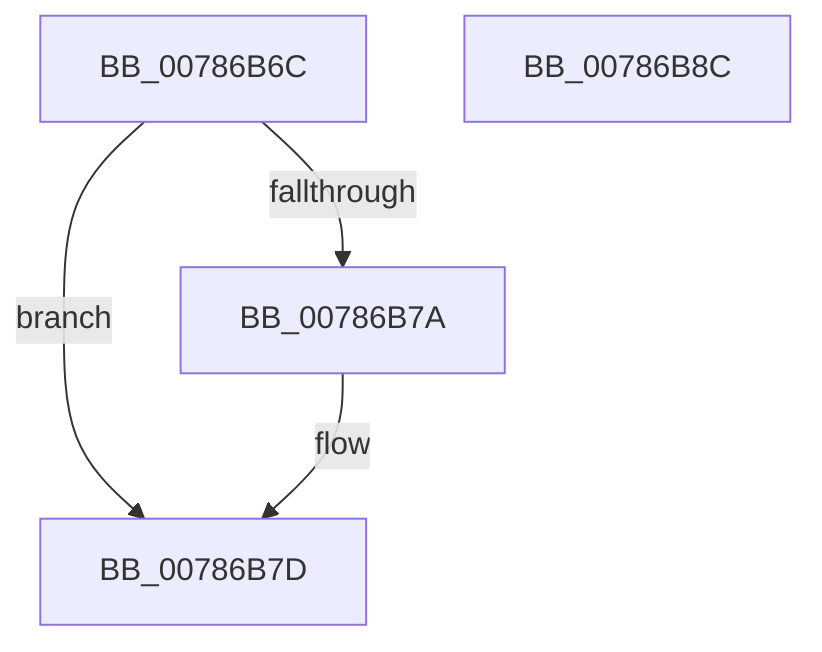

# PspGetNextMonitor

- RVA: `0x00786B6C`–`0x00786B8D` (길이 `33` bytes)
- VA: `0x0000000140786B6C`
- 실행 섹션: `PAGE`
- PDB 이름 있음: `예`; PDB Function 태그: `아니요`
- unwind 정보 RVA: `0x000DB714`
- 디코드: `10`개 명령, `33/33` bytes 표시
- 미해석 바이트: `0` (있으면 어셈블리에 `.byte`로 보존)

> 이 문서는 커널 이미지의 기계어와 PDB 기호를 분석해 생성했습니다. 4번과 5번은 함수 원형과 자료형을 바이너리 사용 방식에서 추정한 C 해석이며 원본 소스 복구 결과는 아닙니다.

## 1. Dependencies

- 직접 호출 지점: **0**; 고유 호출 대상: **0**
- 직접 호출자로 확인된 함수: **2**
- RIP 상대 이미지 참조: **1**

### Outgoing calls
- 직접 디코드된 call 명령이 없습니다.

### Direct callers
- [PspCompleteServerSiloShutdownDeferred](../77/PspCompleteServerSiloShutdownDeferred_function_0077F860.md) at `0x0077F8FB`
- [PspNotifyServerSiloCreation](PspNotifyServerSiloCreation_function_00786C58.md) at `0x00786C93`
- [PspNotifyServerSiloCreation](PspNotifyServerSiloCreation_function_00786C58.md) at `0x00786CC4`

### Static image references
- `0x00786B6C` → RVA `0x00FDA068` (`PAGEDATA`; read)

## 2. Other-region calls and transfers

- 다른 실행 섹션으로 향하는 call: **0**
- 별도 외부 분기/꼬리 이동을 확인하지 못했습니다.

## 3. Assembly (complete function range)

```asm
00786B6C  48 8B 05 F5 34 85 00            mov rax, qword ptr [rip + 0x8534f5]
00786B73  33 D2                           xor edx, edx
00786B75  48 85 C9                        test rcx, rcx
00786B78  74 03                           je 0x140786b7d
00786B7A  48 8B 01                        mov rax, qword ptr [rcx]
00786B7D  48 8D 0D E4 34 85 00            lea rcx, [rip + 0x8534e4]
00786B84  48 3B C1                        cmp rax, rcx
00786B87  48 0F 44 C2                     cmove rax, rdx
00786B8B  C3                              ret
00786B8C  CC                              int3
```

## 4. C-style interpretation (structured pseudocode)

```c
__int64 __fastcall PspGetNextMonitor(__int64 a1, int a2)
{
    __int64 result;

    a2 = 0;
    result = *(unsigned __int64 *)(v_rip + 8729845);
    if (a1 != 0) {
        result = *(unsigned __int64 *)(a1);
    }
    if (result == (v_rip + 8729828)) { result = 0; }
    return result;
}
```

## 5. (Beta) C Style

```c
int64_t PspGetNextMonitor(int64_t Arg1, int32_t Arg2)
{
    int64_t result;

    Arg2 = 0;
    result = *(uint64_t *)(v_rip + 0x8534F5);
    if (Arg1 != 0) {
        result = *(uint64_t *)(Arg1);
    }
    if (result == (v_rip + 8729828)) { result = 0; }
    return result;
}
```

## 6. Execution-region graph

[열기: 2D/3D 그래프와 함수 탐색 컨트롤 패널](../../../control-panel.html?section=page&rva=0x00786B6C&view=graph)

- 2D 그래프는 위에서 아래로 흐르고, 3D 그래프는 빈 공간을 드래그해 회전합니다. Shift+드래그는 이동, 휠은 확대·축소, 함수 노드 선택은 대상 보고서 이동입니다.

### Static fallback


