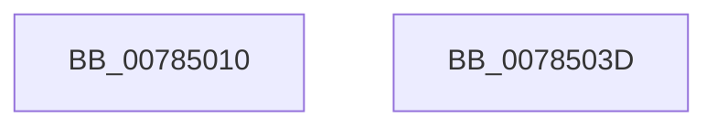

# PspGetProcessInJobHierarchyCallback

- RVA: `0x00785010`–`0x0078503E` (길이 `46` bytes)
- VA: `0x0000000140785010`
- 실행 섹션: `PAGE`
- PDB 이름 있음: `예`; PDB Function 태그: `아니요`
- unwind 정보 RVA: `0x0005CAAC`
- 디코드: `14`개 명령, `46/46` bytes 표시
- 미해석 바이트: `0` (있으면 어셈블리에 `.byte`로 보존)

> 이 문서는 커널 이미지의 기계어와 PDB 기호를 분석해 생성했습니다. 4번과 5번은 함수 원형과 자료형을 바이너리 사용 방식에서 추정한 C 해석이며 원본 소스 복구 결과는 아닙니다.

## 1. Dependencies

- 직접 호출 지점: **1**; 고유 호출 대상: **1**
- 직접 호출자로 확인된 함수: **0**
- RIP 상대 이미지 참조: **0**

### Outgoing calls
- `0x00785025` → [ObfReferenceObjectWithTag](../../text/21/ObfReferenceObjectWithTag_function_00210710.md) (function, `0x00210710`)

### Direct callers
- 이 함수 시작 RVA로 연결되는 직접 call은 확인되지 않았습니다. 간접 호출은 완전히 역산할 수 없습니다.

### Static image references
- 디코드된 RIP-relative 메모리 참조가 없습니다.

## 2. Other-region calls and transfers

- 다른 실행 섹션으로 향하는 call: **1**
  - `0x00785025` → [ObfReferenceObjectWithTag](../../text/21/ObfReferenceObjectWithTag_function_00210710.md) (`PAGE` → `.text`)
- 별도 외부 분기/꼬리 이동을 확인하지 못했습니다.

## 3. Assembly (complete function range)

```asm
00785010  48 89 5C 24 08                  mov qword ptr [rsp + 8], rbx
00785015  57                              push rdi
00785016  48 83 EC 20                     sub rsp, 0x20
0078501A  48 8B FA                        mov rdi, rdx
0078501D  48 8B D9                        mov rbx, rcx
00785020  BA 50 73 4A 62                  mov edx, 0x624a7350
00785025  E8 E6 B6 A8 FF                  call 0x140210710
0078502A  48 89 1F                        mov qword ptr [rdi], rbx
0078502D  B8 40 02 00 C0                  mov eax, 0xc0000240
00785032  48 8B 5C 24 30                  mov rbx, qword ptr [rsp + 0x30]
00785037  48 83 C4 20                     add rsp, 0x20
0078503B  5F                              pop rdi
0078503C  C3                              ret
0078503D  CC                              int3
```

## 4. C-style interpretation (structured pseudocode)

```c
__int64 __fastcall PspGetProcessInJobHierarchyCallback(__int64 a1, __int64 a2)
{
    __int64 result;
    __int64 v_rsp;
    unsigned __int64 v_stack_p8;

    v_stack_p8 = v_rbx;
    v_rsp = (v_rsp) - (32);
    result = ObfReferenceObjectWithTag(a1, (unsigned int)(0x624A7350ULL), a3, a4);
    *(unsigned __int64 *)(a2) = a1;
    v_rsp = (v_rsp) + (32);
    return (unsigned int)(0xC0000240ULL);
}
```

## 5. (Beta) C Style

```c
int64_t PspGetProcessInJobHierarchyCallback(int64_t Arg1, void *Arg2)
{
    uint8_t *arg2 = (uint8_t *)Arg2;

    int64_t result;
    int64_t local_rsp;
    uint64_t v_stack_p8;

    v_stack_p8 = local_rbx;
    local_rsp = (local_rsp) - (32);
    result = ObfReferenceObjectWithTag(Arg1, (uint32_t)(0x624A7350ULL), a3, a4);
    *(uint64_t *)(arg2) = Arg1;
    local_rsp = (local_rsp) + (32);
    return (uint32_t)(0xC0000240ULL);
}
```

### 관측된 메모리 오프셋

구조체 형식이 확인되지 않은 접근은 인자 기준의 오프셋으로만 기록했습니다.

| 기준 인자 | 오프셋 표현 | 폭 (bit) | 접근 |
|---|---:|---:|---|
| `Arg2` | `+ 0x0` | `64` | `W` |

## 6. Execution-region graph

[열기: 2D/3D 그래프와 함수 탐색 컨트롤 패널](../../../control-panel.html?section=page&rva=0x00785010&view=graph)

- 2D 그래프는 위에서 아래로 흐르고, 3D 그래프는 빈 공간을 드래그해 회전합니다. Shift+드래그는 이동, 휠은 확대·축소, 함수 노드 선택은 대상 보고서 이동입니다.

### Static fallback


