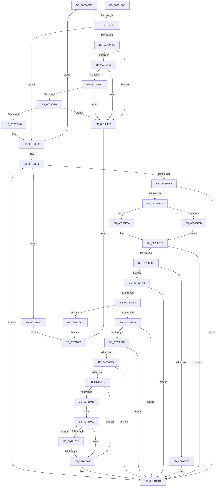

# PspInitializeQuotaBlock

- RVA: `0x00780EB0`–`0x00781083` (길이 `467` bytes)
- VA: `0x0000000140780EB0`
- 실행 섹션: `PAGE`
- PDB 이름 있음: `예`; PDB Function 태그: `아니요`
- unwind 정보 RVA: `0x000CE2E4`
- 디코드: `122`개 명령, `467/467` bytes 표시
- 미해석 바이트: `0` (있으면 어셈블리에 `.byte`로 보존)

> 이 문서는 커널 이미지의 기계어와 PDB 기호를 분석해 생성했습니다. 4번과 5번은 함수 원형과 자료형을 바이너리 사용 방식에서 추정한 C 해석이며 원본 소스 복구 결과는 아닙니다.

## 1. Dependencies

- 직접 호출 지점: **6**; 고유 호출 대상: **6**
- 직접 호출자로 확인된 함수: **1**
- RIP 상대 이미지 참조: **6**

### Outgoing calls
- `0x00780EE0` → [memset](../../text/6C/memset_function_006C6C40.md) (function, `0x006C6C40`)
- `0x00780FA1` → [PspInsertExpansionEntry](../../text/5E/PspInsertExpansionEntry_function_005E2BDC.md) (function, `0x005E2BDC`)
- `0x00780FC1` → [PspExpandLimit](../../text/5E/PspExpandLimit_function_005E2B20.md) (function, `0x005E2B20`)
- `0x00780FFC` → [IopQueryProcessorInitValues](../71/IopQueryProcessorInitValues_function_0071AB80.md) (function, `0x0071AB80`)
- `0x00781001` → [KeSynchronizeWithDynamicProcessors](../A1/KeSynchronizeWithDynamicProcessors_function_00A17094.md) (function, `0x00A17094`)
- `0x0078100B` → [KeQueryActiveProcessorCountEx](../../text/24/KeQueryActiveProcessorCountEx_function_00249EF0.md) (function, `0x00249EF0`)

### Direct callers
- [PspAssignProcessQuotaBlock](../AE/PspAssignProcessQuotaBlock_function_00AE3124.md) at `0x00AE329E`

### Static image references
- `0x00780F22` → RVA `0x00FD9DF8` (`PAGEDATA`; read)
- `0x00780F35` → RVA `0x00000000` (`image boundary/outside`; read)
- `0x00780F97` → RVA `0x00F06640` (`.data`; read)
- `0x00780FD2` → RVA `0x00E660C0` (`.data`; read)
- `0x0078101B` → RVA `0x00FC8C40` (`ALMOSTRO`; read)
- `0x00781044` → RVA `0x00E660C0` (`.data`; read/write)

## 2. Other-region calls and transfers

- 다른 실행 섹션으로 향하는 call: **4**
  - `0x00780EE0` → [memset](../../text/6C/memset_function_006C6C40.md) (`PAGE` → `.text`)
  - `0x00780FA1` → [PspInsertExpansionEntry](../../text/5E/PspInsertExpansionEntry_function_005E2BDC.md) (`PAGE` → `.text`)
  - `0x00780FC1` → [PspExpandLimit](../../text/5E/PspExpandLimit_function_005E2B20.md) (`PAGE` → `.text`)
  - `0x0078100B` → [KeQueryActiveProcessorCountEx](../../text/24/KeQueryActiveProcessorCountEx_function_00249EF0.md) (`PAGE` → `.text`)
- 별도 외부 분기/꼬리 이동을 확인하지 못했습니다.

## 3. Assembly (complete function range)

```asm
00780EB0  48 89 5C 24 10                  mov qword ptr [rsp + 0x10], rbx
00780EB5  48 89 6C 24 18                  mov qword ptr [rsp + 0x18], rbp
00780EBA  56                              push rsi
00780EBB  57                              push rdi
00780EBC  41 55                           push r13
00780EBE  41 56                           push r14
00780EC0  41 57                           push r15
00780EC2  48 83 EC 40                     sub rsp, 0x40
00780EC6  48 83 64 24 70 00               and qword ptr [rsp + 0x70], 0
00780ECC  49 8B F8                        mov rdi, r8
00780ECF  48 8B EA                        mov rbp, rdx
00780ED2  48 8B D9                        mov rbx, rcx
00780ED5  48 8B CF                        mov rcx, rdi
00780ED8  33 D2                           xor edx, edx
00780EDA  41 B8 40 02 00 00               mov r8d, 0x240
00780EE0  E8 5B 5D F4 FF                  call 0x1406c6c40
00780EE5  41 BD 01 00 00 00               mov r13d, 1
00780EEB  44 89 AF 04 02 00 00            mov dword ptr [rdi + 0x204], r13d
00780EF2  44 89 AF 00 02 00 00            mov dword ptr [rdi + 0x200], r13d
00780EF9  48 85 DB                        test rbx, rbx
00780EFC  74 2B                           je 0x140780f29
00780EFE  8B 43 50                        mov eax, dword ptr [rbx + 0x50]
00780F01  A8 10                           test al, 0x10
00780F03  74 24                           je 0x140780f29
00780F05  48 83 3B 00                     cmp qword ptr [rbx], 0
00780F09  75 55                           jne 0x140780f60
00780F0B  48 83 7B 20 00                  cmp qword ptr [rbx + 0x20], 0
00780F10  75 4E                           jne 0x140780f60
00780F12  48 83 7B 08 00                  cmp qword ptr [rbx + 8], 0
00780F17  75 47                           jne 0x140780f60
00780F19  48 83 7B 30 00                  cmp qword ptr [rbx + 0x30], 0
00780F1E  75 40                           jne 0x140780f60
00780F20  33 DB                           xor ebx, ebx
00780F22  48 8D 2D CF 8E 85 00            lea rbp, [rip + 0x858ecf]
00780F29  33 F6                           xor esi, esi
00780F2B  48 83 C7 40                     add rdi, 0x40
00780F2F  45 33 F6                        xor r14d, r14d
00780F32  4C 8B FD                        mov r15, rbp
00780F35  48 8D 05 C4 F0 87 FF            lea rax, [rip - 0x780f3c]
00780F3C  83 FE 04                        cmp esi, 4
00780F3F  0F 8D 22 01 00 00               jge 0x140781067
00780F45  41 8A 8C 06 50 73 FC 00         mov cl, byte ptr [r14 + rax + 0xfc7350]
00780F4D  F6 C1 02                        test cl, 2
00780F50  0F 85 F6 00 00 00               jne 0x14078104c
00780F56  48 85 ED                        test rbp, rbp
00780F59  74 0F                           je 0x140780f6a
00780F5B  4D 63 07                        movsxd r8, dword ptr [r15]
00780F5E  EB 16                           jmp 0x140780f76
00780F60  B8 0D 00 00 C0                  mov eax, 0xc000000d
00780F65  E9 FF 00 00 00                  jmp 0x140781069
00780F6A  49 8B 84 06 98 C9 B4 00         mov rax, qword ptr [r14 + rax + 0xb4c998]
00780F72  4C 8B 04 03                     mov r8, qword ptr [rbx + rax]
00780F76  4C 89 07                        mov qword ptr [rdi], r8
00780F79  41 84 CD                        test r13b, cl
00780F7C  0F 84 CA 00 00 00               je 0x14078104c
00780F82  49 83 F8 FF                     cmp r8, -1
00780F86  75 23                           jne 0x140780fab
00780F88  48 83 27 00                     and qword ptr [rdi], 0
00780F8C  48 8D 57 C0                     lea rdx, [rdi - 0x40]
00780F90  48 63 C6                        movsxd rax, esi
00780F93  48 6B C8 38                     imul rcx, rax, 0x38
00780F97  48 8D 05 A2 56 78 00            lea rax, [rip + 0x7856a2]
00780F9E  48 03 C8                        add rcx, rax
00780FA1  E8 36 1C E6 FF                  call 0x1405e2bdc
00780FA6  E9 A1 00 00 00                  jmp 0x14078104c
00780FAB  4D 85 C0                        test r8, r8
00780FAE  0F 84 98 00 00 00               je 0x14078104c
00780FB4  48 83 64 24 70 00               and qword ptr [rsp + 0x70], 0
00780FBA  4C 8D 4C 24 70                  lea r9, [rsp + 0x70]
00780FBF  8B CE                           mov ecx, esi
00780FC1  E8 5A 1B E6 FF                  call 0x1405e2b20
00780FC6  84 C0                           test al, al
00780FC8  0F 84 92 00 00 00               je 0x140781060
00780FCE  85 F6                           test esi, esi
00780FD0  75 7A                           jne 0x14078104c
00780FD2  8B 05 E8 50 6E 00               mov eax, dword ptr [rip + 0x6e50e8]
00780FD8  0F 57 C0                        xorps xmm0, xmm0
00780FDB  0F 11 44 24 20                  movups xmmword ptr [rsp + 0x20], xmm0
00780FE0  0F 11 44 24 30                  movups xmmword ptr [rsp + 0x30], xmm0
00780FE5  41 3B C5                        cmp eax, r13d
00780FE8  7D 62                           jge 0x14078104c
00780FEA  33 C0                           xor eax, eax
00780FEC  F0 44 0F B1 2D CB 50 6E 00      lock cmpxchg dword ptr [rip + 0x6e50cb], r13d
00780FF5  75 55                           jne 0x14078104c
00780FF7  48 8D 4C 24 20                  lea rcx, [rsp + 0x20]
00780FFC  E8 7F 9B F9 FF                  call 0x14071ab80
00781001  E8 8E 60 29 00                  call 0x140a17094
00781006  B9 FF FF 00 00                  mov ecx, 0xffff
0078100B  E8 E0 8E AC FF                  call 0x140249ef0
00781010  33 D2                           xor edx, edx
00781012  85 C0                           test eax, eax
00781014  74 2E                           je 0x140781044
00781016  44 8B 4C 24 3C                  mov r9d, dword ptr [rsp + 0x3c]
0078101B  48 8D 0D 1E 7C 84 00            lea rcx, [rip + 0x847c1e]
00781022  4C 8B 01                        mov r8, qword ptr [rcx]
00781025  41 81 B8 9C 2D 00 00 FF FF FF 7F  cmp dword ptr [r8 + 0x2d9c], 0x7fffffff
00781030  75 12                           jne 0x140781044
00781032  41 03 D5                        add edx, r13d
00781035  45 89 88 9C 2D 00 00            mov dword ptr [r8 + 0x2d9c], r9d
0078103C  48 83 C1 08                     add rcx, 8
00781040  3B D0                           cmp edx, eax
00781042  72 DE                           jb 0x140781022
00781044  F0 44 01 2D 74 50 6E 00         lock add dword ptr [rip + 0x6e5074], r13d
0078104C  41 03 F5                        add esi, r13d
0078104F  48 83 EF 80                     sub rdi, -0x80
00781053  49 83 C7 04                     add r15, 4
00781057  49 83 C6 08                     add r14, 8
0078105B  E9 D5 FE FF FF                  jmp 0x140780f35
00781060  B8 9A 00 00 C0                  mov eax, 0xc000009a
00781065  EB 02                           jmp 0x140781069
00781067  33 C0                           xor eax, eax
00781069  4C 8D 5C 24 40                  lea r11, [rsp + 0x40]
0078106E  49 8B 5B 38                     mov rbx, qword ptr [r11 + 0x38]
00781072  49 8B 6B 40                     mov rbp, qword ptr [r11 + 0x40]
00781076  49 8B E3                        mov rsp, r11
00781079  41 5F                           pop r15
0078107B  41 5E                           pop r14
0078107D  41 5D                           pop r13
0078107F  5F                              pop rdi
00781080  5E                              pop rsi
00781081  C3                              ret
00781082  CC                              int3
```

## 4. C-style interpretation (structured pseudocode)

```c
__int64 __fastcall PspInitializeQuotaBlock(__int64 a1, __int64 a2, __int64 a3)
{
    __int64 result;
    __int64 v_r14;
    __int64 v_r15;
    __int64 v_rbx;
    __int64 v_rdi;
    __int64 v_rsi;
    __int64 v_rsp;
    unsigned __int64 v_stack_m28;
    unsigned int v_stack_m2C;
    unsigned __int64 v_stack_m38;
    unsigned __int64 v_stack_m48;
    unsigned __int64 v_stack_p10;
    unsigned __int64 v_stack_p18;
    unsigned __int64 v_stack_p8;

    v_stack_p10 = v_rbx;
    v_stack_p18 = v_rbp;
    v_rsp = (v_rsp) - (64);
    a2 = 0;
    result = memset(a3, a2, 576, a4);
    *(unsigned int *)(a3 + 516) = 1;
    *(unsigned int *)(a3 + 512) = 1;
    if (a1 == 0) goto loc_00780F29;
    if ((((unsigned __int8)((unsigned int)(*(unsigned int *)(a1 + 80)))) & (16)) == 0) goto loc_00780F29;
    if ((*(unsigned __int64 *)(a1)) != 0) goto loc_00780F60;
    if ((*(unsigned __int64 *)(a1 + 32)) != 0) goto loc_00780F60;
    if ((*(unsigned __int64 *)(a1 + 8)) != 0) goto loc_00780F60;
    if ((*(unsigned __int64 *)(a1 + 48)) != 0) goto loc_00780F60;
    v_rbx = 0;
loc_00780F29:
    v_rsi = 0;
    v_rdi = (a3) + (64);
    v_r14 = 0;
loc_00780F35:
    if (0 >= 4) goto loc_00781067;
    if ((((unsigned __int8)(*(unsigned __int8 *)(v_r14 + v_rip - 7868220 * 1 + 16544592))) & (2)) != 0) goto loc_0078104C;
    if (v_rip + 8752847 == 0) goto loc_00780F6A;
    goto loc_00780F76;
loc_00780F60:
    goto loc_00781069;
loc_00780F6A:
loc_00780F76:
    *(unsigned __int64 *)(v_rdi) = *(unsigned __int64 *)(v_rbx + *(unsigned __int64 *)(v_r14 + (unsigned int)(0xC000000DULL) * 1 + 11848088) * 1);
    if (((1) & ((unsigned __int8)(*(unsigned __int8 *)(v_r14 + v_rip - 7868220 * 1 + 16544592)))) == 0) goto loc_0078104C;
    if ((*(unsigned __int64 *)(v_rbx + *(unsigned __int64 *)(v_r14 + (unsigned int)(0xC000000DULL) * 1 + 11848088) * 1)) != -1) goto loc_00780FAB;
    a1 = (*(unsigned __int8 *)(v_r14 + v_rip - 7868220 * 1 + 16544592)) * ((int)(0));
    a1 = (a1) + (v_rip + 7886498);
    result = PspInsertExpansionEntry(a1, v_rdi - 64, *(unsigned __int64 *)(v_rbx + *(unsigned __int64 *)(v_r14 + (unsigned int)(0xC000000DULL) * 1 + 11848088) * 1), a4);
    goto loc_0078104C;
loc_00780FAB:
    if (*(unsigned __int64 *)(v_rbx + *(unsigned __int64 *)(v_r14 + (unsigned int)(0xC000000DULL) * 1 + 11848088) * 1) == 0) goto loc_0078104C;
    result = PspExpandLimit(0, v_rdi - 64, *(unsigned __int64 *)(v_rbx + *(unsigned __int64 *)(v_r14 + (unsigned int)(0xC000000DULL) * 1 + 11848088) * 1), v_stack_p8);
    if ((unsigned __int8)(result) == 0) goto loc_00781060;
    if (0 != 0) goto loc_0078104C;
    v_stack_m48 = v_xmm0;
    v_stack_m38 = v_xmm0;
    if (((unsigned int)((unsigned int)(*(unsigned int *)(v_rip + 7229672)))) >= 1) goto loc_0078104C;
    result = 0;
    if (condition_is_not_equal) goto loc_0078104C;
    result = IopQueryProcessorInitValues(v_stack_m48, v_rdi - 64, *(unsigned __int64 *)(v_rbx + *(unsigned __int64 *)(v_r14 + (unsigned int)(0xC000000DULL) * 1 + 11848088) * 1), v_stack_p8);
    result = KeSynchronizeWithDynamicProcessors(v_stack_m48, v_rdi - 64, *(unsigned __int64 *)(v_rbx + *(unsigned __int64 *)(v_r14 + (unsigned int)(0xC000000DULL) * 1 + 11848088) * 1), v_stack_p8);
    result = KeQueryActiveProcessorCountEx((unsigned int)(0xFFFFULL), v_rdi - 64, *(unsigned __int64 *)(v_rbx + *(unsigned __int64 *)(v_r14 + (unsigned int)(0xC000000DULL) * 1 + 11848088) * 1), v_stack_p8);
    a2 = 0;
    if ((unsigned int)(result) == 0) goto loc_00781044;
loc_00781022:
    if ((*(unsigned int *)(*(unsigned __int64 *)(v_rip + 8682526) + 11676)) != 0x7FFFFFFFULL) goto loc_00781044;
    a2 = (unsigned int)((a2) + (1));
    *(unsigned int *)(*(unsigned __int64 *)(v_rip + 8682526) + 11676) = (unsigned int)((unsigned int)(v_stack_m2C));
    a1 = (v_rip + 8682526) + (8);
    if (((unsigned int)(a2)) < ((unsigned int)(result))) goto loc_00781022;
loc_00781044:
loc_0078104C:
    v_rsi = (unsigned int)((v_rsi) + (1));
    v_rdi = (v_rdi) - (-128);
    v_r15 = (v_rip + 8752847) + (4);
    v_r14 = (v_r14) + (8);
    goto loc_00780F35;
loc_00781060:
    goto loc_00781069;
loc_00781067:
    result = 0;
loc_00781069:
    return result;
}
```

## 5. (Beta) C Style

```c
int64_t PspInitializeQuotaBlock(int64_t Arg1, int64_t Arg2, void *Arg3)
{
    uint8_t *arg3 = (uint8_t *)Arg3;

    int64_t result;
    int64_t local_r14;
    int64_t local_r15;
    int64_t local_rbx;
    int64_t local_rdi;
    int64_t local_rsi;
    int64_t local_rsp;
    uint64_t v_stack_m28;
    uint32_t v_stack_m2C;
    uint64_t v_stack_m38;
    uint64_t v_stack_m48;
    uint64_t v_stack_p10;
    uint64_t v_stack_p18;
    uint64_t v_stack_p8;

    v_stack_p10 = local_rbx;
    v_stack_p18 = local_rbp;
    local_rsp = (local_rsp) - (64);
    Arg2 = 0;
    result = memset(Arg3, Arg2, 576, a4);
    *(uint32_t *)(arg3 + 0x204) = 1;
    *(uint32_t *)(arg3 + 0x200) = 1;
    if (Arg1 == 0) goto loc_00780F29;
    if ((((uint8_t)((uint32_t)(*(uint32_t *)(Arg1 + 0x50)))) & (16)) == 0) goto loc_00780F29;
    if ((*(uint64_t *)(Arg1)) != 0) goto loc_00780F60;
    if ((*(uint64_t *)(Arg1 + 0x20)) != 0) goto loc_00780F60;
    if ((*(uint64_t *)(Arg1 + 0x8)) != 0) goto loc_00780F60;
    if ((*(uint64_t *)(Arg1 + 0x30)) != 0) goto loc_00780F60;
    local_rbx = 0;
loc_00780F29:
    local_rsi = 0;
    local_rdi = (Arg3) + (64);
    local_r14 = 0;
loc_00780F35:
    if (0 >= 4) goto loc_00781067;
    if ((((uint8_t)(*(uint8_t *)(local_r14 + v_rip - 0x780F3C * 1 + 0xFC7350))) & (2)) != 0) goto loc_0078104C;
    if (v_rip + 8752847 == 0) goto loc_00780F6A;
    goto loc_00780F76;
loc_00780F60:
    goto loc_00781069;
loc_00780F6A:
loc_00780F76:
    *(uint64_t *)(local_rdi) = *(uint64_t *)(local_rbx + *(uint64_t *)(local_r14 + (uint32_t)(0xC000000DULL) * 1 + 0xB4C998) * 1);
    if (((1) & ((uint8_t)(*(uint8_t *)(local_r14 + v_rip - 0x780F3C * 1 + 0xFC7350)))) == 0) goto loc_0078104C;
    if ((*(uint64_t *)(local_rbx + *(uint64_t *)(local_r14 + (uint32_t)(0xC000000DULL) * 1 + 0xB4C998) * 1)) != -1) goto loc_00780FAB;
    Arg1 = (*(uint8_t *)(local_r14 + v_rip - 0x780F3C * 1 + 0xFC7350)) * ((int32_t)(0));
    Arg1 = (Arg1) + (v_rip + 7886498);
    result = PspInsertExpansionEntry(Arg1, local_rdi - 64, *(uint64_t *)(local_rbx + *(uint64_t *)(local_r14 + (uint32_t)(0xC000000DULL) * 1 + 0xB4C998) * 1), a4);
    goto loc_0078104C;
loc_00780FAB:
    if (*(uint64_t *)(local_rbx + *(uint64_t *)(local_r14 + (uint32_t)(0xC000000DULL) * 1 + 0xB4C998) * 1) == 0) goto loc_0078104C;
    result = PspExpandLimit(0, local_rdi - 64, *(uint64_t *)(local_rbx + *(uint64_t *)(local_r14 + (uint32_t)(0xC000000DULL) * 1 + 0xB4C998) * 1), v_stack_p8);
    if ((uint8_t)(result) == 0) goto loc_00781060;
    if (0 != 0) goto loc_0078104C;
    v_stack_m48 = v_xmm0;
    v_stack_m38 = v_xmm0;
    if (((uint32_t)((uint32_t)(*(uint32_t *)(v_rip + 0x6E50E8)))) >= 1) goto loc_0078104C;
    result = 0;
    if (condition_is_not_equal) goto loc_0078104C;
    result = IopQueryProcessorInitValues(v_stack_m48, local_rdi - 64, *(uint64_t *)(local_rbx + *(uint64_t *)(local_r14 + (uint32_t)(0xC000000DULL) * 1 + 0xB4C998) * 1), v_stack_p8);
    result = KeSynchronizeWithDynamicProcessors(v_stack_m48, local_rdi - 64, *(uint64_t *)(local_rbx + *(uint64_t *)(local_r14 + (uint32_t)(0xC000000DULL) * 1 + 0xB4C998) * 1), v_stack_p8);
    result = KeQueryActiveProcessorCountEx((uint32_t)(0xFFFFULL), local_rdi - 64, *(uint64_t *)(local_rbx + *(uint64_t *)(local_r14 + (uint32_t)(0xC000000DULL) * 1 + 0xB4C998) * 1), v_stack_p8);
    Arg2 = 0;
    if ((uint32_t)(result) == 0) goto loc_00781044;
loc_00781022:
    if ((*(uint32_t *)(*(uint64_t *)(v_rip + 0x847C1E) + 0x2D9C)) != 0x7FFFFFFFULL) goto loc_00781044;
    Arg2 = (uint32_t)((Arg2) + (1));
    *(uint32_t *)(*(uint64_t *)(v_rip + 0x847C1E) + 0x2D9C) = (uint32_t)((uint32_t)(v_stack_m2C));
    Arg1 = (v_rip + 8682526) + (8);
    if (((uint32_t)(Arg2)) < ((uint32_t)(result))) goto loc_00781022;
loc_00781044:
loc_0078104C:
    local_rsi = (uint32_t)((local_rsi) + (1));
    local_rdi = (local_rdi) - (-128);
    local_r15 = (v_rip + 8752847) + (4);
    local_r14 = (local_r14) + (8);
    goto loc_00780F35;
loc_00781060:
    goto loc_00781069;
loc_00781067:
    result = 0;
loc_00781069:
    return result;
}
```

### 관측된 메모리 오프셋

구조체 형식이 확인되지 않은 접근은 인자 기준의 오프셋으로만 기록했습니다.

| 기준 인자 | 오프셋 표현 | 폭 (bit) | 접근 |
|---|---:|---:|---|
| `Arg3` | `- 0x40` | `64` | `R` |
| `Arg3` | `+ 0x0` | `64` | `R/W` |
| `Arg3` | `+ 0x0` | `64` | `W` |
| `Arg3` | `+ 0x200` | `32` | `W` |
| `Arg3` | `+ 0x204` | `32` | `W` |

## 6. Execution-region graph

[열기: 2D/3D 그래프와 함수 탐색 컨트롤 패널](../../../control-panel.html?section=page&rva=0x00780EB0&view=graph)

- 2D 그래프는 위에서 아래로 흐르고, 3D 그래프는 빈 공간을 드래그해 회전합니다. Shift+드래그는 이동, 휠은 확대·축소, 함수 노드 선택은 대상 보고서 이동입니다.

### Static fallback


