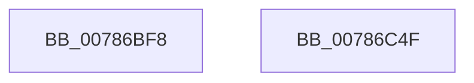

# PspInvokeTerminateCallback

- RVA: `0x00786BF8`–`0x00786C50` (길이 `88` bytes)
- VA: `0x0000000140786BF8`
- 실행 섹션: `PAGE`
- PDB 이름 있음: `예`; PDB Function 태그: `아니요`
- unwind 정보 RVA: `0x00060BC4`
- 디코드: `25`개 명령, `88/88` bytes 표시
- 미해석 바이트: `0` (있으면 어셈블리에 `.byte`로 보존)

> 이 문서는 커널 이미지의 기계어와 PDB 기호를 분석해 생성했습니다. 4번과 5번은 함수 원형과 자료형을 바이너리 사용 방식에서 추정한 C 해석이며 원본 소스 복구 결과는 아닙니다.

## 1. Dependencies

- 직접 호출 지점: **3**; 고유 호출 대상: **2**
- 직접 호출자로 확인된 함수: **2**
- RIP 상대 이미지 참조: **0**

### Outgoing calls
- `0x00786C1B` → [EtwTraceJobServerSiloMonitorCallback](../../text/64/EtwTraceJobServerSiloMonitorCallback_function_0064FB68.md) (function, `0x0064FB68`)
- `0x00786C27` → [guard_dispatch_icall](../../text/6B/guard_dispatch_icall_function_006BAAD0.md) (function, `0x006BAAD0`)
- `0x00786C3A` → [EtwTraceJobServerSiloMonitorCallback](../../text/64/EtwTraceJobServerSiloMonitorCallback_function_0064FB68.md) (function, `0x0064FB68`)

### Direct callers
- [PspCompleteServerSiloShutdownDeferred](../77/PspCompleteServerSiloShutdownDeferred_function_0077F860.md) at `0x0077F8F3`
- [PsStartSiloMonitor](PsStartSiloMonitor_function_007867C0.md) at `0x00786895`
- [PsStartSiloMonitor](PsStartSiloMonitor_function_007867C0.md) at `0x0078697D`

### Static image references
- 디코드된 RIP-relative 메모리 참조가 없습니다.

## 2. Other-region calls and transfers

- 다른 실행 섹션으로 향하는 call: **3**
  - `0x00786C1B` → [EtwTraceJobServerSiloMonitorCallback](../../text/64/EtwTraceJobServerSiloMonitorCallback_function_0064FB68.md) (`PAGE` → `.text`)
  - `0x00786C27` → [guard_dispatch_icall](../../text/6B/guard_dispatch_icall_function_006BAAD0.md) (`PAGE` → `.text`)
  - `0x00786C3A` → [EtwTraceJobServerSiloMonitorCallback](../../text/64/EtwTraceJobServerSiloMonitorCallback_function_0064FB68.md) (`PAGE` → `.text`)
- 별도 외부 분기/꼬리 이동을 확인하지 못했습니다.

## 3. Assembly (complete function range)

```asm
00786BF8  48 89 5C 24 08                  mov qword ptr [rsp + 8], rbx
00786BFD  48 89 74 24 10                  mov qword ptr [rsp + 0x10], rsi
00786C02  57                              push rdi
00786C03  48 83 EC 20                     sub rsp, 0x20
00786C07  45 33 C9                        xor r9d, r9d
00786C0A  4C 8D 42 28                     lea r8, [rdx + 0x28]
00786C0E  48 8B DA                        mov rbx, rdx
00786C11  48 8B F1                        mov rsi, rcx
00786C14  48 8B D1                        mov rdx, rcx
00786C17  41 8D 49 02                     lea ecx, [r9 + 2]
00786C1B  E8 48 8F EC FF                  call 0x14064fb68
00786C20  48 8B 43 20                     mov rax, qword ptr [rbx + 0x20]
00786C24  48 8B CE                        mov rcx, rsi
00786C27  E8 A4 3E F3 FF                  call 0x1406baad0
00786C2C  45 33 C9                        xor r9d, r9d
00786C2F  4C 8D 43 28                     lea r8, [rbx + 0x28]
00786C33  48 8B D6                        mov rdx, rsi
00786C36  41 8D 49 03                     lea ecx, [r9 + 3]
00786C3A  E8 29 8F EC FF                  call 0x14064fb68
00786C3F  48 8B 5C 24 30                  mov rbx, qword ptr [rsp + 0x30]
00786C44  48 8B 74 24 38                  mov rsi, qword ptr [rsp + 0x38]
00786C49  48 83 C4 20                     add rsp, 0x20
00786C4D  5F                              pop rdi
00786C4E  C3                              ret
00786C4F  CC                              int3
```

## 4. C-style interpretation (structured pseudocode)

```c
__int64 __fastcall PspInvokeTerminateCallback(__int64 a1, __int64 a2, __int64 a3, int a4)
{
    __int64 result;
    __int64 v_rsp;
    unsigned __int64 v_stack_p10;
    unsigned __int64 v_stack_p8;

    v_stack_p8 = v_rbx;
    v_stack_p10 = v_rsi;
    v_rsp = (v_rsp) - (32);
    a4 = 0;
    result = EtwTraceJobServerSiloMonitorCallback(a4 + 2, a1, a2 + 40, a4);
    result = guard_dispatch_icall(a1, a1, a2 + 40, a4);
    a4 = 0;
    result = EtwTraceJobServerSiloMonitorCallback(a4 + 3, a1, a2 + 40, a4);
    v_rsp = (v_rsp) + (32);
    return result;
}
```

## 5. (Beta) C Style

```c
int64_t PspInvokeTerminateCallback(int64_t Arg1, void *Arg2, int64_t Arg3, int32_t Arg4)
{
    uint8_t *arg2 = (uint8_t *)Arg2;

    int64_t result;
    int64_t local_rsp;
    uint64_t v_stack_p10;
    uint64_t v_stack_p8;

    v_stack_p8 = local_rbx;
    v_stack_p10 = local_rsi;
    local_rsp = (local_rsp) - (32);
    Arg4 = 0;
    result = EtwTraceJobServerSiloMonitorCallback(Arg4 + 2, Arg1, Arg2 + 40, Arg4);
    result = guard_dispatch_icall(Arg1, Arg1, Arg2 + 40, Arg4);
    Arg4 = 0;
    result = EtwTraceJobServerSiloMonitorCallback(Arg4 + 3, Arg1, Arg2 + 40, Arg4);
    local_rsp = (local_rsp) + (32);
    return result;
}
```

### 관측된 메모리 오프셋

구조체 형식이 확인되지 않은 접근은 인자 기준의 오프셋으로만 기록했습니다.

| 기준 인자 | 오프셋 표현 | 폭 (bit) | 접근 |
|---|---:|---:|---|
| `Arg2` | `+ 0x20` | `64` | `R` |
| `Arg2` | `+ 0x28` | `64` | `R` |

## 6. Execution-region graph

[열기: 2D/3D 그래프와 함수 탐색 컨트롤 패널](../../../control-panel.html?section=page&rva=0x00786BF8&view=graph)

- 2D 그래프는 위에서 아래로 흐르고, 3D 그래프는 빈 공간을 드래그해 회전합니다. Shift+드래그는 이동, 휠은 확대·축소, 함수 노드 선택은 대상 보고서 이동입니다.

### Static fallback


