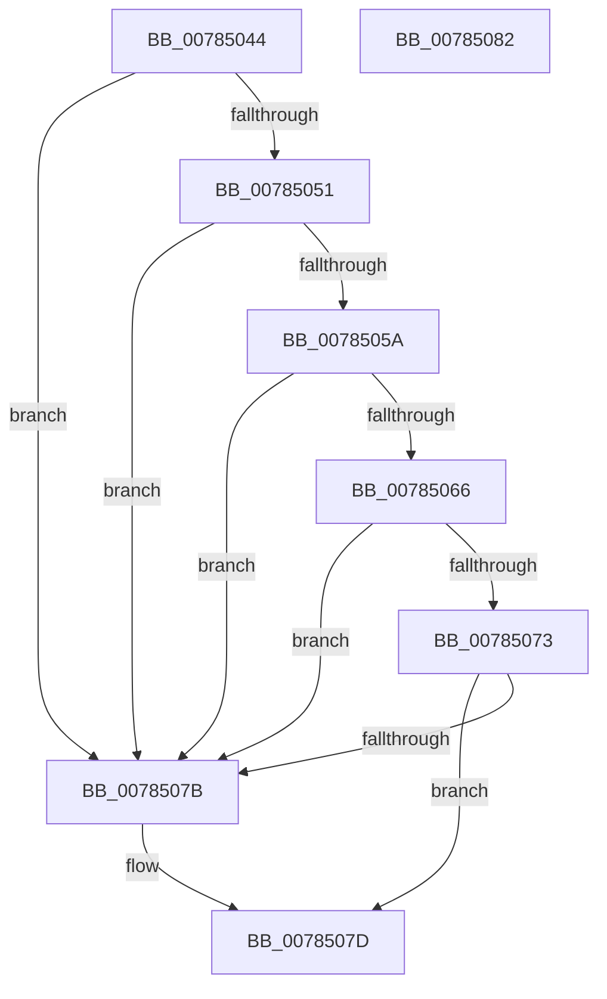

# PspIsJobMovable

- RVA: `0x00785044`–`0x00785083` (길이 `63` bytes)
- VA: `0x0000000140785044`
- 실행 섹션: `PAGE`
- PDB 이름 있음: `예`; PDB Function 태그: `아니요`
- unwind 정보 RVA: `0x0005C788`
- 디코드: `18`개 명령, `63/63` bytes 표시
- 미해석 바이트: `0` (있으면 어셈블리에 `.byte`로 보존)

> 이 문서는 커널 이미지의 기계어와 PDB 기호를 분석해 생성했습니다. 4번과 5번은 함수 원형과 자료형을 바이너리 사용 방식에서 추정한 C 해석이며 원본 소스 복구 결과는 아닙니다.

## 1. Dependencies

- 직접 호출 지점: **1**; 고유 호출 대상: **1**
- 직접 호출자로 확인된 함수: **2**
- RIP 상대 이미지 참조: **0**

### Outgoing calls
- `0x00785051` → [PsIsJobParentImmutable](../A2/PsIsJobParentImmutable_function_00A23A88.md) (function, `0x00A23A88`)

### Direct callers
- [PspGetJobAssignmentDisposition](../A2/PspGetJobAssignmentDisposition_function_00A23218.md) at `0x00A23323`
- [PspAssignProcessToJob](../A2/PspAssignProcessToJob_function_00A23370.md) at `0x00A23485`

### Static image references
- 디코드된 RIP-relative 메모리 참조가 없습니다.

## 2. Other-region calls and transfers

- 다른 실행 섹션으로 향하는 call: **0**
- 별도 외부 분기/꼬리 이동을 확인하지 못했습니다.

## 3. Assembly (complete function range)

```asm
00785044  48 83 EC 28                     sub rsp, 0x28
00785048  48 39 89 08 07 00 00            cmp qword ptr [rcx + 0x708], rcx
0078504F  75 2A                           jne 0x14078507b
00785051  E8 32 EA 29 00                  call 0x140a23a88
00785056  84 C0                           test al, al
00785058  75 21                           jne 0x14078507b
0078505A  48 8D 81 08 05 00 00            lea rax, [rcx + 0x508]
00785061  48 39 00                        cmp qword ptr [rax], rax
00785064  75 15                           jne 0x14078507b
00785066  B8 01 00 00 00                  mov eax, 1
0078506B  39 81 D8 00 00 00               cmp dword ptr [rcx + 0xd8], eax
00785071  75 08                           jne 0x14078507b
00785073  39 81 D4 00 00 00               cmp dword ptr [rcx + 0xd4], eax
00785079  74 02                           je 0x14078507d
0078507B  32 C0                           xor al, al
0078507D  48 83 C4 28                     add rsp, 0x28
00785081  C3                              ret
00785082  CC                              int3
```

## 4. C-style interpretation (structured pseudocode)

```c
__int64 __fastcall PspIsJobMovable(__int64 a1)
{
    __int64 result;
    __int64 v_rsp;

    v_rsp = (v_rsp) - (40);
    if ((*(unsigned __int64 *)(a1 + 1800)) != a1) goto loc_0078507B;
    result = PsIsJobParentImmutable(a1, a2, a3, a4);
    if ((unsigned __int8)(result) != 0) goto loc_0078507B;
    if ((*(unsigned __int64 *)(a1 + 1288)) != (a1 + 1288)) goto loc_0078507B;
    if ((*(unsigned int *)(a1 + 216)) != 1) goto loc_0078507B;
    result = 1;
    if ((*(unsigned int *)(a1 + 212)) != 1) {
        result = 0;
    }
    v_rsp = (v_rsp) + (40);
    return result;
}
```

## 5. (Beta) C Style

```c
int64_t PspIsJobMovable(void *Arg1)
{
    uint8_t *arg1 = (uint8_t *)Arg1;

    int64_t result;
    int64_t local_rsp;

    local_rsp = (local_rsp) - (40);
    if ((*(uint64_t *)(arg1 + 0x708)) != Arg1) goto loc_0078507B;
    result = PsIsJobParentImmutable(Arg1, a2, a3, a4);
    if ((uint8_t)(result) != 0) goto loc_0078507B;
    if ((*(uint64_t *)(arg1 + 0x508)) != (Arg1 + 1288)) goto loc_0078507B;
    if ((*(uint32_t *)(arg1 + 0xD8)) != 1) goto loc_0078507B;
    result = 1;
    if ((*(uint32_t *)(arg1 + 0xD4)) != 1) {
        result = 0;
    }
    local_rsp = (local_rsp) + (40);
    return result;
}
```

### 관측된 메모리 오프셋

구조체 형식이 확인되지 않은 접근은 인자 기준의 오프셋으로만 기록했습니다.

| 기준 인자 | 오프셋 표현 | 폭 (bit) | 접근 |
|---|---:|---:|---|
| `Arg1` | `+ 0x708` | `64` | `R` |

## 6. Execution-region graph

[열기: 2D/3D 그래프와 함수 탐색 컨트롤 패널](../../../control-panel.html?section=page&rva=0x00785044&view=graph)

- 2D 그래프는 위에서 아래로 흐르고, 3D 그래프는 빈 공간을 드래그해 회전합니다. Shift+드래그는 이동, 휠은 확대·축소, 함수 노드 선택은 대상 보고서 이동입니다.

### Static fallback


