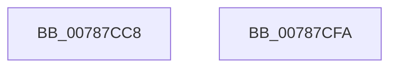

# PspIumGetSystemData

- RVA: `0x00787CC8`–`0x00787CFB` (길이 `51` bytes)
- VA: `0x0000000140787CC8`
- 실행 섹션: `PAGE`
- PDB 이름 있음: `예`; PDB Function 태그: `아니요`
- unwind 정보 RVA: `0x000DB714`
- 디코드: `13`개 명령, `51/51` bytes 표시
- 미해석 바이트: `0` (있으면 어셈블리에 `.byte`로 보존)

> 이 문서는 커널 이미지의 기계어와 PDB 기호를 분석해 생성했습니다. 4번과 5번은 함수 원형과 자료형을 바이너리 사용 방식에서 추정한 C 해석이며 원본 소스 복구 결과는 아닙니다.

## 1. Dependencies

- 직접 호출 지점: **0**; 고유 호출 대상: **0**
- 직접 호출자로 확인된 함수: **1**
- RIP 상대 이미지 참조: **5**

### Outgoing calls
- 직접 디코드된 call 명령이 없습니다.

### Direct callers
- [sub_006F88AE](../../text/6F/Unknown_function_006F88AE.md) at `0x006F88EC`

### Static image references
- `0x00787CCC` → RVA `0x00FC6FCC` (`ALMOSTRO`; read)
- `0x00787CD5` → RVA `0x00FC6CFC` (`ALMOSTRO`; read)
- `0x00787CDE` → RVA `0x00FC6D58` (`ALMOSTRO`; read)
- `0x00787CE7` → RVA `0x00FC6E60` (`ALMOSTRO`; read)
- `0x00787CF0` → RVA `0x00FC6E64` (`ALMOSTRO`; read)

## 2. Other-region calls and transfers

- 다른 실행 섹션으로 향하는 call: **0**
- 별도 외부 분기/꼬리 이동을 확인하지 못했습니다.

## 3. Assembly (complete function range)

```asm
00787CC8  83 61 08 00                     and dword ptr [rcx + 8], 0
00787CCC  8B 05 FA F2 83 00               mov eax, dword ptr [rip + 0x83f2fa]
00787CD2  89 41 0C                        mov dword ptr [rcx + 0xc], eax
00787CD5  8B 05 21 F0 83 00               mov eax, dword ptr [rip + 0x83f021]
00787CDB  89 41 10                        mov dword ptr [rcx + 0x10], eax
00787CDE  8B 05 74 F0 83 00               mov eax, dword ptr [rip + 0x83f074]
00787CE4  89 41 14                        mov dword ptr [rcx + 0x14], eax
00787CE7  8B 05 73 F1 83 00               mov eax, dword ptr [rip + 0x83f173]
00787CED  89 41 18                        mov dword ptr [rcx + 0x18], eax
00787CF0  8B 05 6E F1 83 00               mov eax, dword ptr [rip + 0x83f16e]
00787CF6  89 41 1C                        mov dword ptr [rcx + 0x1c], eax
00787CF9  C3                              ret
00787CFA  CC                              int3
```

## 4. C-style interpretation (structured pseudocode)

```c
__int64 __fastcall PspIumGetSystemData(__int64 a1)
{
    *(unsigned int *)(a1 + 12) = (unsigned int)((unsigned int)(*(unsigned int *)(v_rip + 8647418)));
    *(unsigned int *)(a1 + 16) = (unsigned int)((unsigned int)(*(unsigned int *)(v_rip + 8646689)));
    *(unsigned int *)(a1 + 20) = (unsigned int)((unsigned int)(*(unsigned int *)(v_rip + 8646772)));
    *(unsigned int *)(a1 + 24) = (unsigned int)((unsigned int)(*(unsigned int *)(v_rip + 8647027)));
    *(unsigned int *)(a1 + 28) = (unsigned int)((unsigned int)(*(unsigned int *)(v_rip + 8647022)));
    return (unsigned int)(*(unsigned int *)(v_rip + 8647022));
}
```

## 5. (Beta) C Style

```c
int64_t PspIumGetSystemData(void *Arg1)
{
    uint8_t *arg1 = (uint8_t *)Arg1;

    *(uint32_t *)(arg1 + 0xC) = (uint32_t)((uint32_t)(*(uint32_t *)(v_rip + 0x83F2FA)));
    *(uint32_t *)(arg1 + 0x10) = (uint32_t)((uint32_t)(*(uint32_t *)(v_rip + 0x83F021)));
    *(uint32_t *)(arg1 + 0x14) = (uint32_t)((uint32_t)(*(uint32_t *)(v_rip + 0x83F074)));
    *(uint32_t *)(arg1 + 0x18) = (uint32_t)((uint32_t)(*(uint32_t *)(v_rip + 0x83F173)));
    *(uint32_t *)(arg1 + 0x1C) = (uint32_t)((uint32_t)(*(uint32_t *)(v_rip + 0x83F16E)));
    return (uint32_t)(*(uint32_t *)(v_rip + 0x83F16E));
}
```

### 관측된 메모리 오프셋

구조체 형식이 확인되지 않은 접근은 인자 기준의 오프셋으로만 기록했습니다.

| 기준 인자 | 오프셋 표현 | 폭 (bit) | 접근 |
|---|---:|---:|---|
| `Arg1` | `+ 0x8` | `32` | `R/W` |
| `Arg1` | `+ 0xC` | `32` | `W` |
| `Arg1` | `+ 0x10` | `32` | `W` |
| `Arg1` | `+ 0x14` | `32` | `W` |
| `Arg1` | `+ 0x18` | `32` | `W` |
| `Arg1` | `+ 0x1C` | `32` | `W` |

## 6. Execution-region graph

[열기: 2D/3D 그래프와 함수 탐색 컨트롤 패널](../../../control-panel.html?section=page&rva=0x00787CC8&view=graph)

- 2D 그래프는 위에서 아래로 흐르고, 3D 그래프는 빈 공간을 드래그해 회전합니다. Shift+드래그는 이동, 휠은 확대·축소, 함수 노드 선택은 대상 보고서 이동입니다.

### Static fallback


