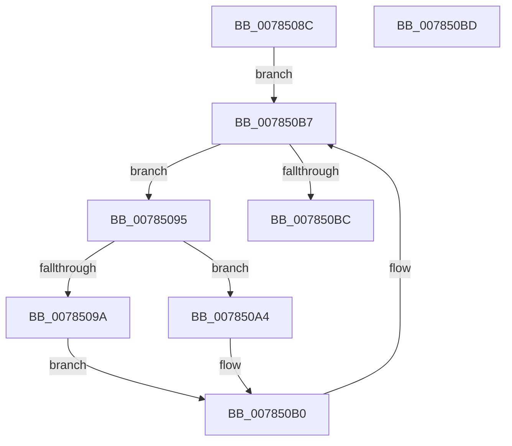

# PspModifyAncestorBits

- RVA: `0x0078508C`–`0x007850BE` (길이 `50` bytes)
- VA: `0x000000014078508C`
- 실행 섹션: `PAGE`
- PDB 이름 있음: `예`; PDB Function 태그: `아니요`
- unwind 정보 RVA: `0x000DB714`
- 디코드: `14`개 명령, `50/50` bytes 표시
- 미해석 바이트: `0` (있으면 어셈블리에 `.byte`로 보존)

> 이 문서는 커널 이미지의 기계어와 PDB 기호를 분석해 생성했습니다. 4번과 5번은 함수 원형과 자료형을 바이너리 사용 방식에서 추정한 C 해석이며 원본 소스 복구 결과는 아닙니다.

## 1. Dependencies

- 직접 호출 지점: **0**; 고유 호출 대상: **0**
- 직접 호출자로 확인된 함수: **2**
- RIP 상대 이미지 참조: **0**

### Outgoing calls
- 직접 디코드된 call 명령이 없습니다.

### Direct callers
- [PspRemoveRateControl](PspRemoveRateControl_function_00785318.md) at `0x00785384`
- [PspSetJobRateControl](PspSetJobRateControl_function_0078572C.md) at `0x007857C6`
- [PspSetJobRateControl](PspSetJobRateControl_function_0078572C.md) at `0x0078584A`

### Static image references
- 디코드된 RIP-relative 메모리 참조가 없습니다.

## 2. Other-region calls and transfers

- 다른 실행 섹션으로 향하는 call: **0**
- 별도 외부 분기/꼬리 이동을 확인하지 못했습니다.

## 3. Assembly (complete function range)

```asm
0078508C  4C 8B 89 18 05 00 00            mov r9, qword ptr [rcx + 0x518]
00785093  EB 22                           jmp 0x1407850b7
00785095  45 84 C0                        test r8b, r8b
00785098  74 0A                           je 0x1407850a4
0078509A  F0 41 09 91 10 06 00 00         lock or dword ptr [r9 + 0x610], edx
007850A2  EB 0C                           jmp 0x1407850b0
007850A4  8B C2                           mov eax, edx
007850A6  F7 D0                           not eax
007850A8  F0 41 21 81 10 06 00 00         lock and dword ptr [r9 + 0x610], eax
007850B0  4D 8B 89 18 05 00 00            mov r9, qword ptr [r9 + 0x518]
007850B7  4D 85 C9                        test r9, r9
007850BA  75 D9                           jne 0x140785095
007850BC  C3                              ret
007850BD  CC                              int3
```

## 4. C-style interpretation (structured pseudocode)

```c
__int64 __fastcall PspModifyAncestorBits(__int64 a1, int a2, unsigned __int8 a3)
{
    __int64 result;

    goto loc_007850B7;
loc_00785095:
    if (a3 == 0) goto loc_007850A4;
    goto loc_007850B0;
loc_007850A4:
    result = (unsigned int)(~((unsigned int)(a2)));
loc_007850B0:
loc_007850B7:
    if (*(unsigned __int64 *)(*(unsigned __int64 *)(a1 + 1304) + 1304) != 0) goto loc_00785095;
    return result;
}
```

## 5. (Beta) C Style

```c
int64_t PspModifyAncestorBits(void *Arg1, int32_t Arg2, uint8_t Arg3)
{
    uint8_t *arg1 = (uint8_t *)Arg1;

    int64_t result;

    goto loc_007850B7;
loc_00785095:
    if (Arg3 == 0) goto loc_007850A4;
    goto loc_007850B0;
loc_007850A4:
    result = (uint32_t)(~((uint32_t)(Arg2)));
loc_007850B0:
loc_007850B7:
    if (*(uint64_t *)(*(uint64_t *)(arg1 + 0x518) + 0x518) != 0) goto loc_00785095;
    return result;
}
```

### 관측된 메모리 오프셋

구조체 형식이 확인되지 않은 접근은 인자 기준의 오프셋으로만 기록했습니다.

| 기준 인자 | 오프셋 표현 | 폭 (bit) | 접근 |
|---|---:|---:|---|
| `Arg1` | `+ 0x518` | `64` | `R` |

## 6. Execution-region graph

[열기: 2D/3D 그래프와 함수 탐색 컨트롤 패널](../../../control-panel.html?section=page&rva=0x0078508C&view=graph)

- 2D 그래프는 위에서 아래로 흐르고, 3D 그래프는 빈 공간을 드래그해 회전합니다. Shift+드래그는 이동, 휠은 확대·축소, 함수 노드 선택은 대상 보고서 이동입니다.

### Static fallback


