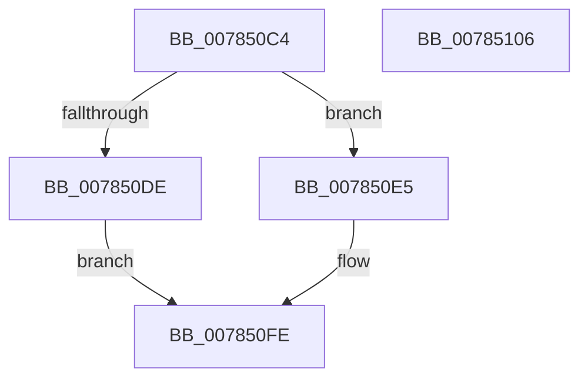

# PspNetRateControlDispatch

- RVA: `0x007850C4`–`0x00785107` (길이 `67` bytes)
- VA: `0x00000001407850C4`
- 실행 섹션: `PAGE`
- PDB 이름 있음: `예`; PDB Function 태그: `아니요`
- unwind 정보 RVA: `0x0005CF00`
- 디코드: `20`개 명령, `67/67` bytes 표시
- 미해석 바이트: `0` (있으면 어셈블리에 `.byte`로 보존)

> 이 문서는 커널 이미지의 기계어와 PDB 기호를 분석해 생성했습니다. 4번과 5번은 함수 원형과 자료형을 바이너리 사용 방식에서 추정한 C 해석이며 원본 소스 복구 결과는 아닙니다.

## 1. Dependencies

- 직접 호출 지점: **3**; 고유 호출 대상: **3**
- 직접 호출자로 확인된 함수: **3**
- RIP 상대 이미지 참조: **1**

### Outgoing calls
- `0x007850D4` → [ExGetExtensionTable](../../text/42/ExGetExtensionTable_function_00428814.md) (function, `0x00428814`)
- `0x007850EB` → [guard_dispatch_icall](../../text/6B/guard_dispatch_icall_function_006BAAD0.md) (function, `0x006BAAD0`)
- `0x007850F9` → [ExReleaseExtensionTable](../../text/45/ExReleaseExtensionTable_function_00456DC0.md) (function, `0x00456DC0`)

### Direct callers
- [PspJobDelete](../../text/4B/PspJobDelete_function_004BF8F0.md) at `0x004BF9C7`
- [PspSetNetRateControl](PspSetNetRateControl_function_00785944.md) at `0x00785AC2`
- [PspSetNetRateControl](PspSetNetRateControl_function_00785944.md) at `0x00785AD5`
- [PspQueryRateControlHistory](../91/PspQueryRateControlHistory_function_00918D1C.md) at `0x00918F8D`

### Static image references
- `0x007850CD` → RVA `0x00F065A0` (`.data`; read)

## 2. Other-region calls and transfers

- 다른 실행 섹션으로 향하는 call: **3**
  - `0x007850D4` → [ExGetExtensionTable](../../text/42/ExGetExtensionTable_function_00428814.md) (`PAGE` → `.text`)
  - `0x007850EB` → [guard_dispatch_icall](../../text/6B/guard_dispatch_icall_function_006BAAD0.md) (`PAGE` → `.text`)
  - `0x007850F9` → [ExReleaseExtensionTable](../../text/45/ExReleaseExtensionTable_function_00456DC0.md) (`PAGE` → `.text`)
- 별도 외부 분기/꼬리 이동을 확인하지 못했습니다.

## 3. Assembly (complete function range)

```asm
007850C4  40 53                           push rbx
007850C6  48 83 EC 20                     sub rsp, 0x20
007850CA  48 8B D9                        mov rbx, rcx
007850CD  48 8B 0D CC 14 78 00            mov rcx, qword ptr [rip + 0x7814cc]
007850D4  E8 3B 37 CA FF                  call 0x140428814
007850D9  48 85 C0                        test rax, rax
007850DC  75 07                           jne 0x1407850e5
007850DE  BB 02 00 00 C0                  mov ebx, 0xc0000002
007850E3  EB 19                           jmp 0x1407850fe
007850E5  48 8B 00                        mov rax, qword ptr [rax]
007850E8  48 8B CB                        mov rcx, rbx
007850EB  E8 E0 59 F3 FF                  call 0x1406baad0
007850F0  48 8B 0D A9 14 78 00            mov rcx, qword ptr [rip + 0x7814a9]
007850F7  8B D8                           mov ebx, eax
007850F9  E8 C2 1C CD FF                  call 0x140456dc0
007850FE  8B C3                           mov eax, ebx
00785100  48 83 C4 20                     add rsp, 0x20
00785104  5B                              pop rbx
00785105  C3                              ret
00785106  CC                              int3
```

## 4. C-style interpretation (structured pseudocode)

```c
__int64 __fastcall PspNetRateControlDispatch(__int64 a1)
{
    __int64 result;
    __int64 v_rsp;

    v_rsp = (v_rsp) - (32);
    result = ExGetExtensionTable(*(unsigned __int64 *)(v_rip + 7869644), a2, a3, a4);
    if (result != 0) goto loc_007850E5;
    goto loc_007850FE;
loc_007850E5:
    result = guard_dispatch_icall((unsigned int)(0xC0000002ULL), a2, a3, a4);
    result = ExReleaseExtensionTable(*(unsigned __int64 *)(v_rip + 7869609), a2, a3, a4);
loc_007850FE:
    v_rsp = (v_rsp) + (32);
    return (unsigned int)((unsigned int)((unsigned int)((unsigned int)(result))));
}
```

## 5. (Beta) C Style

```c
int64_t PspNetRateControlDispatch(int64_t Arg1)
{
    int64_t result;
    int64_t local_rsp;

    local_rsp = (local_rsp) - (32);
    result = ExGetExtensionTable(*(uint64_t *)(v_rip + 0x7814CC), a2, a3, a4);
    if (result != 0) goto loc_007850E5;
    goto loc_007850FE;
loc_007850E5:
    result = guard_dispatch_icall((uint32_t)(0xC0000002ULL), a2, a3, a4);
    result = ExReleaseExtensionTable(*(uint64_t *)(v_rip + 0x7814A9), a2, a3, a4);
loc_007850FE:
    local_rsp = (local_rsp) + (32);
    return (uint32_t)((uint32_t)((uint32_t)((uint32_t)(result))));
}
```

## 6. Execution-region graph

[열기: 2D/3D 그래프와 함수 탐색 컨트롤 패널](../../../control-panel.html?section=page&rva=0x007850C4&view=graph)

- 2D 그래프는 위에서 아래로 흐르고, 3D 그래프는 빈 공간을 드래그해 회전합니다. Shift+드래그는 이동, 휠은 확대·축소, 함수 노드 선택은 대상 보고서 이동입니다.

### Static fallback


