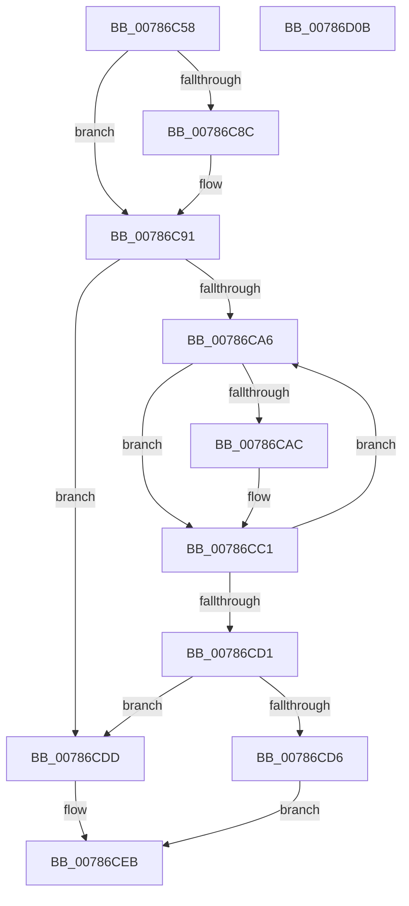

# PspNotifyServerSiloCreation

- RVA: `0x00786C58`–`0x00786D0C` (길이 `180` bytes)
- VA: `0x0000000140786C58`
- 실행 섹션: `PAGE`
- PDB 이름 있음: `예`; PDB Function 태그: `아니요`
- unwind 정보 RVA: `0x00060300`
- 디코드: `56`개 명령, `180/180` bytes 표시
- 미해석 바이트: `0` (있으면 어셈블리에 `.byte`로 보존)

> 이 문서는 커널 이미지의 기계어와 PDB 기호를 분석해 생성했습니다. 4번과 5번은 함수 원형과 자료형을 바이너리 사용 방식에서 추정한 C 해석이며 원본 소스 복구 결과는 아닙니다.

## 1. Dependencies

- 직접 호출 지점: **7**; 고유 호출 대상: **6**
- 직접 호출자로 확인된 함수: **1**
- RIP 상대 이미지 참조: **0**

### Outgoing calls
- `0x00786C78` → [PspGetServerSiloStatePointer](../../text/4F/PspGetServerSiloStatePointer_function_004FCDB8.md) (function, `0x004FCDB8`)
- `0x00786C80` → [PspAcquirePushLockShared](../../text/4F/PspAcquirePushLockShared_function_004F6134.md) (function, `0x004F6134`)
- `0x00786C93` → [PspGetNextMonitor](PspGetNextMonitor_function_00786B6C.md) (function, `0x00786B6C`)
- `0x00786CB2` → [PspInvokeCreateCallback](PspInvokeCreateCallback_function_00786B94.md) (function, `0x00786B94`)
- `0x00786CC4` → [PspGetNextMonitor](PspGetNextMonitor_function_00786B6C.md) (function, `0x00786B6C`)
- `0x00786CE6` → [EtwTraceJobServerSiloStateChange](../7B/EtwTraceJobServerSiloStateChange_function_007B7EB8.md) (function, `0x007B7EB8`)
- `0x00786CEB` → [PspReleasePushLockShared](../../text/4F/PspReleasePushLockShared_function_004F8D00.md) (function, `0x004F8D00`)

### Direct callers
- [PspInitializeServerSiloDeferred](../77/PspInitializeServerSiloDeferred_function_0077FEE0.md) at `0x007800E7`

### Static image references
- 디코드된 RIP-relative 메모리 참조가 없습니다.

## 2. Other-region calls and transfers

- 다른 실행 섹션으로 향하는 call: **3**
  - `0x00786C78` → [PspGetServerSiloStatePointer](../../text/4F/PspGetServerSiloStatePointer_function_004FCDB8.md) (`PAGE` → `.text`)
  - `0x00786C80` → [PspAcquirePushLockShared](../../text/4F/PspAcquirePushLockShared_function_004F6134.md) (`PAGE` → `.text`)
  - `0x00786CEB` → [PspReleasePushLockShared](../../text/4F/PspReleasePushLockShared_function_004F8D00.md) (`PAGE` → `.text`)
- 별도 외부 분기/꼬리 이동을 확인하지 못했습니다.

## 3. Assembly (complete function range)

```asm
00786C58  48 89 5C 24 08                  mov qword ptr [rsp + 8], rbx
00786C5D  48 89 6C 24 10                  mov qword ptr [rsp + 0x10], rbp
00786C62  48 89 74 24 18                  mov qword ptr [rsp + 0x18], rsi
00786C67  57                              push rdi
00786C68  41 56                           push r14
00786C6A  41 57                           push r15
00786C6C  48 83 EC 20                     sub rsp, 0x20
00786C70  33 DB                           xor ebx, ebx
00786C72  48 8B E9                        mov rbp, rcx
00786C75  40 8A F3                        mov sil, bl
00786C78  E8 3B 61 D7 FF                  call 0x1404fcdb8
00786C7D  4C 8B F0                        mov r14, rax
00786C80  E8 AF F4 D6 FF                  call 0x1404f6134
00786C85  41 8B 06                        mov eax, dword ptr [r14]
00786C88  85 C0                           test eax, eax
00786C8A  74 05                           je 0x140786c91
00786C8C  8D 4B 05                        lea ecx, [rbx + 5]
00786C8F  CD 29                           int 0x29
00786C91  33 C9                           xor ecx, ecx
00786C93  E8 D4 FE FF FF                  call 0x140786b6c
00786C98  48 8B F8                        mov rdi, rax
00786C9B  41 BF 01 00 00 00               mov r15d, 1
00786CA1  48 85 C0                        test rax, rax
00786CA4  74 37                           je 0x140786cdd
00786CA6  48 39 5F 18                     cmp qword ptr [rdi + 0x18], rbx
00786CAA  74 15                           je 0x140786cc1
00786CAC  48 8B D7                        mov rdx, rdi
00786CAF  48 8B CD                        mov rcx, rbp
00786CB2  E8 DD FE FF FF                  call 0x140786b94
00786CB7  85 C0                           test eax, eax
00786CB9  40 0F B6 F6                     movzx esi, sil
00786CBD  41 0F 48 F7                     cmovs esi, r15d
00786CC1  48 8B CF                        mov rcx, rdi
00786CC4  E8 A3 FE FF FF                  call 0x140786b6c
00786CC9  48 8B F8                        mov rdi, rax
00786CCC  48 85 C0                        test rax, rax
00786CCF  75 D5                           jne 0x140786ca6
00786CD1  40 84 F6                        test sil, sil
00786CD4  74 07                           je 0x140786cdd
00786CD6  BB 40 02 00 C0                  mov ebx, 0xc0000240
00786CDB  EB 0E                           jmp 0x140786ceb
00786CDD  41 8B D7                        mov edx, r15d
00786CE0  45 89 3E                        mov dword ptr [r14], r15d
00786CE3  48 8B CD                        mov rcx, rbp
00786CE6  E8 CD 11 03 00                  call 0x1407b7eb8
00786CEB  E8 10 20 D7 FF                  call 0x1404f8d00
00786CF0  48 8B 6C 24 48                  mov rbp, qword ptr [rsp + 0x48]
00786CF5  8B C3                           mov eax, ebx
00786CF7  48 8B 5C 24 40                  mov rbx, qword ptr [rsp + 0x40]
00786CFC  48 8B 74 24 50                  mov rsi, qword ptr [rsp + 0x50]
00786D01  48 83 C4 20                     add rsp, 0x20
00786D05  41 5F                           pop r15
00786D07  41 5E                           pop r14
00786D09  5F                              pop rdi
00786D0A  C3                              ret
00786D0B  CC                              int3
```

## 4. C-style interpretation (structured pseudocode)

```c
__int64 __fastcall PspNotifyServerSiloCreation(__int64 a1)
{
    __int64 result;
    __int64 v_rbx;
    __int64 v_rsi;
    __int64 v_rsp;
    unsigned __int64 v_stack_p10;
    unsigned __int64 v_stack_p18;
    unsigned __int64 v_stack_p8;

    v_stack_p8 = v_rbx;
    v_stack_p10 = v_rbp;
    v_stack_p18 = v_rsi;
    v_rsp = (v_rsp) - (32);
    v_rbx = 0;
    result = PspGetServerSiloStatePointer(a1, a2, a3, a4);
    result = PspAcquirePushLockShared(a1, a2, a3, a4);
    if ((unsigned int)((unsigned int)(*(unsigned int *)(result))) != 0) {
        a1 = v_rbx + 5;
    }
    a1 = 0;
    result = PspGetNextMonitor(a1, a2, a3, a4);
    if (result == 0) goto loc_00786CDD;
loc_00786CA6:
    v_rsi = 0;
    if ((*(unsigned __int64 *)(result + 24)) != 0) {
        a2 = result;
        a1 = 0;
        result = PspInvokeCreateCallback(a1, a2, a3, a4);
        v_rsi = 0;
        if (sign_flag) { v_rsi = 1; }
    }
    result = PspGetNextMonitor(result, a2, a3, a4);
    if (result != 0) goto loc_00786CA6;
    if ((unsigned __int8)(v_rsi) == 0) goto loc_00786CDD;
    goto loc_00786CEB;
loc_00786CDD:
    *(unsigned int *)(result) = 1;
    result = EtwTraceJobServerSiloStateChange(a1, 1, a3, a4);
loc_00786CEB:
    result = PspReleasePushLockShared(a1, 1, a3, a4);
    v_rsp = (v_rsp) + (32);
    return (unsigned int)((unsigned int)((unsigned int)(0xC0000240ULL)));
}
```

## 5. (Beta) C Style

```c
int64_t PspNotifyServerSiloCreation(int64_t Arg1)
{
    int64_t result;
    int64_t local_rbx;
    int64_t local_rsi;
    int64_t local_rsp;
    uint64_t v_stack_p10;
    uint64_t v_stack_p18;
    uint64_t v_stack_p8;

    v_stack_p8 = local_rbx;
    v_stack_p10 = local_rbp;
    v_stack_p18 = local_rsi;
    local_rsp = (local_rsp) - (32);
    local_rbx = 0;
    result = PspGetServerSiloStatePointer(Arg1, a2, a3, a4);
    result = PspAcquirePushLockShared(Arg1, a2, a3, a4);
    if ((uint32_t)((uint32_t)(*(uint32_t *)(result))) != 0) {
        Arg1 = local_rbx + 5;
    }
    Arg1 = 0;
    result = PspGetNextMonitor(Arg1, a2, a3, a4);
    if (result == 0) goto loc_00786CDD;
loc_00786CA6:
    local_rsi = 0;
    if ((*(uint64_t *)(result + 0x18)) != 0) {
        a2 = result;
        Arg1 = 0;
        result = PspInvokeCreateCallback(Arg1, a2, a3, a4);
        local_rsi = 0;
        if (sign_flag) { local_rsi = 1; }
    }
    result = PspGetNextMonitor(result, a2, a3, a4);
    if (result != 0) goto loc_00786CA6;
    if ((uint8_t)(local_rsi) == 0) goto loc_00786CDD;
    goto loc_00786CEB;
loc_00786CDD:
    *(uint32_t *)(result) = 1;
    result = EtwTraceJobServerSiloStateChange(Arg1, 1, a3, a4);
loc_00786CEB:
    result = PspReleasePushLockShared(Arg1, 1, a3, a4);
    local_rsp = (local_rsp) + (32);
    return (uint32_t)((uint32_t)((uint32_t)(0xC0000240ULL)));
}
```

## 6. Execution-region graph

[열기: 2D/3D 그래프와 함수 탐색 컨트롤 패널](../../../control-panel.html?section=page&rva=0x00786C58&view=graph)

- 2D 그래프는 위에서 아래로 흐르고, 3D 그래프는 빈 공간을 드래그해 회전합니다. Shift+드래그는 이동, 휠은 확대·축소, 함수 노드 선택은 대상 보고서 이동입니다.

### Static fallback


