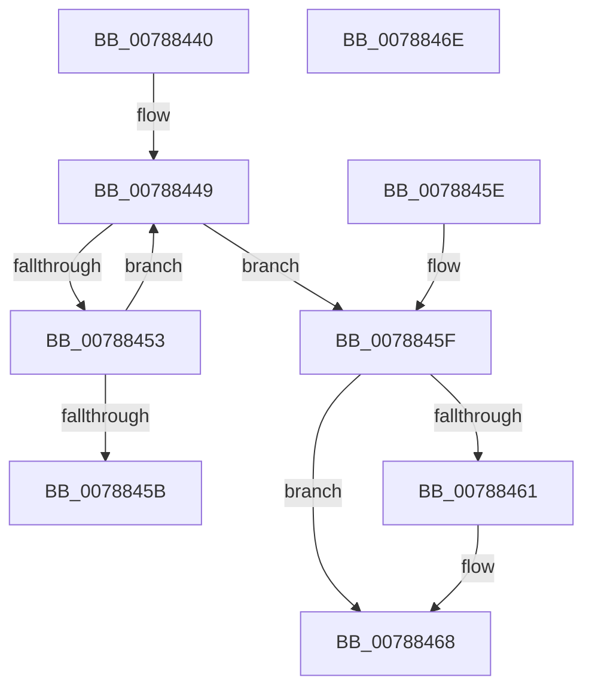

# PspOpenPartitionHandle

- RVA: `0x00788440`–`0x0078846F` (길이 `47` bytes)
- VA: `0x0000000140788440`
- 실행 섹션: `PAGE`
- PDB 이름 있음: `예`; PDB Function 태그: `아니요`
- unwind 정보 RVA: `0x000DB714`
- 디코드: `16`개 명령, `47/47` bytes 표시
- 미해석 바이트: `0` (있으면 어셈블리에 `.byte`로 보존)

> 이 문서는 커널 이미지의 기계어와 PDB 기호를 분석해 생성했습니다. 4번과 5번은 함수 원형과 자료형을 바이너리 사용 방식에서 추정한 C 해석이며 원본 소스 복구 결과는 아닙니다.

## 1. Dependencies

- 직접 호출 지점: **0**; 고유 호출 대상: **0**
- 직접 호출자로 확인된 함수: **0**
- RIP 상대 이미지 참조: **0**

### Outgoing calls
- 직접 디코드된 call 명령이 없습니다.

### Direct callers
- 이 함수 시작 RVA로 연결되는 직접 call은 확인되지 않았습니다. 간접 호출은 완전히 역산할 수 없습니다.

### Static image references
- 디코드된 RIP-relative 메모리 참조가 없습니다.

## 2. Other-region calls and transfers

- 다른 실행 섹션으로 향하는 call: **0**
- 별도 외부 분기/꼬리 이동을 확인하지 못했습니다.

## 3. Assembly (complete function range)

```asm
00788440  41 0F 0D 49 30                  prefetchw byte ptr [r9 + 0x30]
00788445  49 8B 41 30                     mov rax, qword ptr [r9 + 0x30]
00788449  48 8D 48 01                     lea rcx, [rax + 1]
0078844D  48 83 F9 01                     cmp rcx, 1
00788451  76 0C                           jbe 0x14078845f
00788453  F0 49 0F B1 49 30               lock cmpxchg qword ptr [r9 + 0x30], rcx
00788459  75 EE                           jne 0x140788449
0078845B  33 C0                           xor eax, eax
0078845D  C3                              ret
0078845E  CC                              int3
0078845F  74 07                           je 0x140788468
00788461  B9 0E 00 00 00                  mov ecx, 0xe
00788466  CD 29                           int 0x29
00788468  B8 01 00 00 C0                  mov eax, 0xc0000001
0078846D  C3                              ret
0078846E  CC                              int3
```

## 4. C-style interpretation (structured pseudocode)

```c
__int64 __fastcall PspOpenPartitionHandle(__int64 a1, __int64 a2, __int64 a3, __int64 a4)
{
    __int64 result;

loc_00788449:
    if ((*(unsigned __int64 *)(a4 + 48) + 1) <= 1) goto loc_0078845F;
    if ((*(unsigned __int64 *)(a4 + 48) + 1) != 1) goto loc_00788449;
    result = 0;
    return result;
loc_0078845F:
    if (!(condition_is_equal)) {
        a1 = 14;
    }
    return (unsigned int)(0xC0000001ULL);
}
```

## 5. (Beta) C Style

```c
int64_t PspOpenPartitionHandle(int64_t Arg1, int64_t Arg2, int64_t Arg3, void *Arg4)
{
    uint8_t *arg4 = (uint8_t *)Arg4;

    int64_t result;

loc_00788449:
    if ((*(uint64_t *)(arg4 + 0x30) + 1) <= 1) goto loc_0078845F;
    if ((*(uint64_t *)(arg4 + 0x30) + 1) != 1) goto loc_00788449;
    result = 0;
    return result;
loc_0078845F:
    if (!(condition_is_equal)) {
        Arg1 = 14;
    }
    return (uint32_t)(0xC0000001ULL);
}
```

### 관측된 메모리 오프셋

구조체 형식이 확인되지 않은 접근은 인자 기준의 오프셋으로만 기록했습니다.

| 기준 인자 | 오프셋 표현 | 폭 (bit) | 접근 |
|---|---:|---:|---|
| `Arg4` | `+ 0x30` | `8` | `R` |
| `Arg4` | `+ 0x30` | `64` | `R` |

## 6. Execution-region graph

[열기: 2D/3D 그래프와 함수 탐색 컨트롤 패널](../../../control-panel.html?section=page&rva=0x00788440&view=graph)

- 2D 그래프는 위에서 아래로 흐르고, 3D 그래프는 빈 공간을 드래그해 회전합니다. Shift+드래그는 이동, 휠은 확대·축소, 함수 노드 선택은 대상 보고서 이동입니다.

### Static fallback


