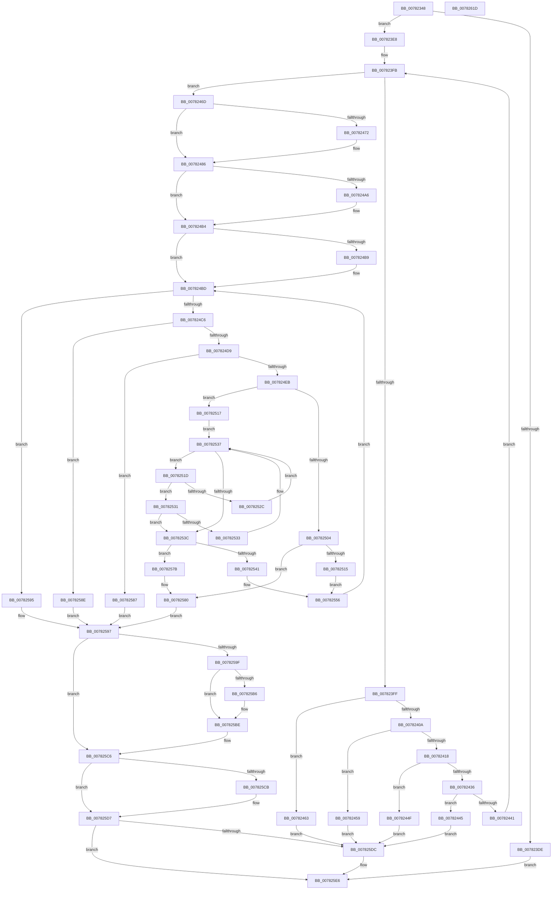

# PspProcessDynamicEHContinuationTargets

- RVA: `0x00782348`–`0x0078261E` (길이 `726` bytes)
- VA: `0x0000000140782348`
- 실행 섹션: `PAGE`
- PDB 이름 있음: `예`; PDB Function 태그: `아니요`
- unwind 정보 RVA: `0x000CE3FC`
- 디코드: `190`개 명령, `726/726` bytes 표시
- 미해석 바이트: `0` (있으면 어셈블리에 `.byte`로 보존)

> 이 문서는 커널 이미지의 기계어와 PDB 기호를 분석해 생성했습니다. 4번과 5번은 함수 원형과 자료형을 바이너리 사용 방식에서 추정한 C 해석이며 원본 소스 복구 결과는 아닙니다.

## 1. Dependencies

- 직접 호출 지점: **14**; 고유 호출 대상: **14**
- 직접 호출자로 확인된 함수: **1**
- RIP 상대 이미지 참조: **1**

### Outgoing calls
- `0x007823D5` → [ExAcquireRundownProtection](../../text/21/ExAcquireRundownProtection_function_00216620.md) (function, `0x00216620`)
- `0x0078247C` → [KiStackAttachProcess](../../text/21/KiStackAttachProcess_function_00216820.md) (function, `0x00216820`)
- `0x00782495` → [KeAbPreAcquire](../../text/21/KeAbPreAcquire_function_00210230.md) (function, `0x00210230`)
- `0x007824AF` → [ExfAcquirePushLockExclusiveEx](../../text/20/ExfAcquirePushLockExclusiveEx_function_0020FC90.md) (function, `0x0020FC90`)
- `0x0078250A` → [RtlAddDynamicEHContinuationTarget](../79/RtlAddDynamicEHContinuationTarget_function_00794DB8.md) (function, `0x00794DB8`)
- `0x00782523` → [RtlpDynamicEHContinuationTargetsTreeCompare](../A3/RtlpDynamicEHContinuationTargetsTreeCompare_function_00A3AC8C.md) (function, `0x00A3AC8C`)
- `0x00782547` → [RtlAvlRemoveNode](../../text/29/RtlAvlRemoveNode_function_00296650.md) (function, `0x00296650`)
- `0x00782551` → [ExFreePoolWithTag](../../poolcode/B8/ExFreePoolWithTag_function_00B82870.md) (function, `0x00B82870`)
- `0x007825B9` → [ExfTryToWakePushLock](../../text/26/ExfTryToWakePushLock_function_00265DD0.md) (function, `0x00265DD0`)
- `0x007825C1` → [KeAbPostRelease](../../text/2E/KeAbPostRelease_function_002E1600.md) (function, `0x002E1600`)
- `0x007825D2` → [KiUnstackDetachProcess](../../text/21/KiUnstackDetachProcess_function_00217D30.md) (function, `0x00217D30`)
- `0x007825E1` → [ExReleaseRundownProtection](../../text/34/ExReleaseRundownProtection_function_00349E80.md) (function, `0x00349E80`)
- `0x007825E6` → [KeLeaveCriticalRegion](../../text/25/KeLeaveCriticalRegion_function_0025D8B0.md) (function, `0x0025D8B0`)
- `0x007825FD` → [_security_check_cookie](../../text/6A/_security_check_cookie_function_006AC640.md) (function, `0x006AC640`)

### Direct callers
- [NtSetInformationProcess](../AE/NtSetInformationProcess_function_00AE5370.md) at `0x00AE9AA0`

### Static image references
- `0x0078235F` → RVA `0x00E0A740` (`.data`; read)

## 2. Other-region calls and transfers

- 다른 실행 섹션으로 향하는 call: **12**
  - `0x007823D5` → [ExAcquireRundownProtection](../../text/21/ExAcquireRundownProtection_function_00216620.md) (`PAGE` → `.text`)
  - `0x0078247C` → [KiStackAttachProcess](../../text/21/KiStackAttachProcess_function_00216820.md) (`PAGE` → `.text`)
  - `0x00782495` → [KeAbPreAcquire](../../text/21/KeAbPreAcquire_function_00210230.md) (`PAGE` → `.text`)
  - `0x007824AF` → [ExfAcquirePushLockExclusiveEx](../../text/20/ExfAcquirePushLockExclusiveEx_function_0020FC90.md) (`PAGE` → `.text`)
  - `0x00782547` → [RtlAvlRemoveNode](../../text/29/RtlAvlRemoveNode_function_00296650.md) (`PAGE` → `.text`)
  - `0x00782551` → [ExFreePoolWithTag](../../poolcode/B8/ExFreePoolWithTag_function_00B82870.md) (`PAGE` → `POOLCODE`)
  - `0x007825B9` → [ExfTryToWakePushLock](../../text/26/ExfTryToWakePushLock_function_00265DD0.md) (`PAGE` → `.text`)
  - `0x007825C1` → [KeAbPostRelease](../../text/2E/KeAbPostRelease_function_002E1600.md) (`PAGE` → `.text`)
  - `0x007825D2` → [KiUnstackDetachProcess](../../text/21/KiUnstackDetachProcess_function_00217D30.md) (`PAGE` → `.text`)
  - `0x007825E1` → [ExReleaseRundownProtection](../../text/34/ExReleaseRundownProtection_function_00349E80.md) (`PAGE` → `.text`)
  - `0x007825E6` → [KeLeaveCriticalRegion](../../text/25/KeLeaveCriticalRegion_function_0025D8B0.md) (`PAGE` → `.text`)
  - `0x007825FD` → [_security_check_cookie](../../text/6A/_security_check_cookie_function_006AC640.md) (`PAGE` → `.text`)
- 별도 외부 분기/꼬리 이동을 확인하지 못했습니다.

## 3. Assembly (complete function range)

```asm
00782348  48 89 5C 24 18                  mov qword ptr [rsp + 0x18], rbx
0078234D  55                              push rbp
0078234E  56                              push rsi
0078234F  57                              push rdi
00782350  41 54                           push r12
00782352  41 55                           push r13
00782354  41 56                           push r14
00782356  41 57                           push r15
00782358  48 81 EC 80 00 00 00            sub rsp, 0x80
0078235F  48 8B 05 DA 83 68 00            mov rax, qword ptr [rip + 0x6883da]
00782366  48 33 C4                        xor rax, rsp
00782369  48 89 44 24 78                  mov qword ptr [rsp + 0x78], rax
0078236E  0F 57 C0                        xorps xmm0, xmm0
00782371  4C 89 4C 24 40                  mov qword ptr [rsp + 0x40], r9
00782376  0F 11 44 24 48                  movups xmmword ptr [rsp + 0x48], xmm0
0078237B  4C 8B F9                        mov r15, rcx
0078237E  48 83 CF FF                     or rdi, 0xffffffffffffffff
00782382  0F 11 44 24 58                  movups xmmword ptr [rsp + 0x58], xmm0
00782387  45 33 F6                        xor r14d, r14d
0078238A  41 0F B7 F0                     movzx esi, r8w
0078238E  0F 11 44 24 68                  movups xmmword ptr [rsp + 0x68], xmm0
00782393  65 48 8B 04 25 88 01 00 00      mov rax, qword ptr gs:[0x188]
0078239C  4C 8B E2                        mov r12, rdx
0078239F  48 89 44 24 28                  mov qword ptr [rsp + 0x28], rax
007823A4  48 89 54 24 30                  mov qword ptr [rsp + 0x30], rdx
007823A9  44 89 74 24 20                  mov dword ptr [rsp + 0x20], r14d
007823AE  48 8B A8 B8 00 00 00            mov rbp, qword ptr [rax + 0xb8]
007823B5  65 48 8B 04 25 88 01 00 00      mov rax, qword ptr gs:[0x188]
007823BE  66 01 B8 E4 01 00 00            add word ptr [rax + 0x1e4], di
007823C5  48 8D 81 E8 01 00 00            lea rax, [rcx + 0x1e8]
007823CC  48 8B C8                        mov rcx, rax
007823CF  48 89 44 24 38                  mov qword ptr [rsp + 0x38], rax
007823D4  90                              nop
007823D5  E8 46 42 A9 FF                  call 0x140216620
007823DA  84 C0                           test al, al
007823DC  75 0A                           jne 0x1407823e8
007823DE  BE 0A 01 00 C0                  mov esi, 0xc000010a
007823E3  E9 FE 01 00 00                  jmp 0x1407825e6
007823E8  4C 8B 44 24 28                  mov r8, qword ptr [rsp + 0x28]
007823ED  BB 02 00 00 00                  mov ebx, 2
007823F2  33 C9                           xor ecx, ecx
007823F4  89 74 24 24                     mov dword ptr [rsp + 0x24], esi
007823F8  44 8B EE                        mov r13d, esi
007823FB  3B CE                           cmp ecx, esi
007823FD  73 6E                           jae 0x14078246d
007823FF  41 8B 80 A0 05 00 00            mov eax, dword ptr [r8 + 0x5a0]
00782406  A8 01                           test al, 1
00782408  75 59                           jne 0x140782463
0078240A  41 8B 87 F4 01 00 00            mov eax, dword ptr [r15 + 0x1f4]
00782411  A9 08 00 00 40                  test eax, 0x40000008
00782416  75 41                           jne 0x140782459
00782418  8B D1                           mov edx, ecx
0078241A  49 B9 FF FF FD FF FF 7F 00 00   movabs r9, 0x7ffffffdffff
00782424  48 03 D2                        add rdx, rdx
00782427  49 8B 04 D4                     mov rax, qword ptr [r12 + rdx*8]
0078242B  48 05 00 00 FF FF               add rax, -0x10000
00782431  49 3B C1                        cmp rax, r9
00782434  77 19                           ja 0x14078244f
00782436  49 F7 44 D4 08 FE FF FF FF      test qword ptr [r12 + rdx*8 + 8], -2
0078243F  75 04                           jne 0x140782445
00782441  FF C1                           inc ecx
00782443  EB B6                           jmp 0x1407823fb
00782445  BE 0D 00 00 C0                  mov esi, 0xc000000d
0078244A  E9 8D 01 00 00                  jmp 0x1407825dc
0078244F  BE 41 01 00 C0                  mov esi, 0xc0000141
00782454  E9 83 01 00 00                  jmp 0x1407825dc
00782459  BE 0A 01 00 C0                  mov esi, 0xc000010a
0078245E  E9 79 01 00 00                  jmp 0x1407825dc
00782463  BE 4B 00 00 C0                  mov esi, 0xc000004b
00782468  E9 6F 01 00 00                  jmp 0x1407825dc
0078246D  4C 3B FD                        cmp r15, rbp
00782470  74 14                           je 0x140782486
00782472  4C 8D 44 24 48                  lea r8, [rsp + 0x48]
00782477  33 D2                           xor edx, edx
00782479  49 8B CF                        mov rcx, r15
0078247C  E8 9F 43 A9 FF                  call 0x140216820
00782481  BB 03 00 00 00                  mov ebx, 3
00782486  49 8D AF 88 07 00 00            lea rbp, [r15 + 0x788]
0078248D  45 33 C0                        xor r8d, r8d
00782490  48 8B CD                        mov rcx, rbp
00782493  33 D2                           xor edx, edx
00782495  E8 96 DD A8 FF                  call 0x140210230
0078249A  F0 48 0F BA 6D 00 00            lock bts qword ptr [rbp], 0
007824A1  48 8B F0                        mov rsi, rax
007824A4  73 0E                           jae 0x1407824b4
007824A6  4C 8B C5                        mov r8, rbp
007824A9  48 8B D0                        mov rdx, rax
007824AC  48 8B CD                        mov rcx, rbp
007824AF  E8 DC D7 A8 FF                  call 0x14020fc90
007824B4  48 85 F6                        test rsi, rsi
007824B7  74 04                           je 0x1407824bd
007824B9  C6 46 0A 01                     mov byte ptr [rsi + 0xa], 1
007824BD  45 3B F5                        cmp r14d, r13d
007824C0  0F 83 CF 00 00 00               jae 0x140782595
007824C6  48 8B 44 24 28                  mov rax, qword ptr [rsp + 0x28]
007824CB  8B 80 A0 05 00 00               mov eax, dword ptr [rax + 0x5a0]
007824D1  A8 01                           test al, 1
007824D3  0F 85 B5 00 00 00               jne 0x14078258e
007824D9  41 8B 87 F4 01 00 00            mov eax, dword ptr [r15 + 0x1f4]
007824E0  A9 08 00 00 40                  test eax, 0x40000008
007824E5  0F 85 9C 00 00 00               jne 0x140782587
007824EB  4D 03 F6                        add r14, r14
007824EE  4B 8B 6C F4 08                  mov rbp, qword ptr [r12 + r14*8 + 8]
007824F3  4F 8B 2C F4                     mov r13, qword ptr [r12 + r14*8]
007824F7  4D 8D A7 80 07 00 00            lea r12, [r15 + 0x780]
007824FE  40 F6 C5 01                     test bpl, 1
00782502  74 13                           je 0x140782517
00782504  49 8B D5                        mov rdx, r13
00782507  49 8B CC                        mov rcx, r12
0078250A  E8 A9 28 01 00                  call 0x140794db8
0078250F  8B F0                           mov esi, eax
00782511  85 C0                           test eax, eax
00782513  78 6B                           js 0x140782580
00782515  EB 3F                           jmp 0x140782556
00782517  49 8B 34 24                     mov rsi, qword ptr [r12]
0078251B  EB 1A                           jmp 0x140782537
0078251D  48 8B D6                        mov rdx, rsi
00782520  49 8B CD                        mov rcx, r13
00782523  E8 64 87 2B 00                  call 0x140a3ac8c
00782528  85 C0                           test eax, eax
0078252A  79 05                           jns 0x140782531
0078252C  48 8B 36                        mov rsi, qword ptr [rsi]
0078252F  EB 06                           jmp 0x140782537
00782531  7E 09                           jle 0x14078253c
00782533  48 8B 76 08                     mov rsi, qword ptr [rsi + 8]
00782537  48 85 F6                        test rsi, rsi
0078253A  75 E1                           jne 0x14078251d
0078253C  48 85 F6                        test rsi, rsi
0078253F  74 3A                           je 0x14078257b
00782541  48 8B D6                        mov rdx, rsi
00782544  49 8B CC                        mov rcx, r12
00782547  E8 04 41 B1 FF                  call 0x140296650
0078254C  33 D2                           xor edx, edx
0078254E  48 8B CE                        mov rcx, rsi
00782551  E8 1A 03 40 00                  call 0x140b82870
00782556  4C 8B 64 24 30                  mov r12, qword ptr [rsp + 0x30]
0078255B  48 83 CD 02                     or rbp, 2
0078255F  44 8B 6C 24 24                  mov r13d, dword ptr [rsp + 0x24]
00782564  4B 89 6C F4 08                  mov qword ptr [r12 + r14*8 + 8], rbp
00782569  44 8B 74 24 20                  mov r14d, dword ptr [rsp + 0x20]
0078256E  41 FF C6                        inc r14d
00782571  44 89 74 24 20                  mov dword ptr [rsp + 0x20], r14d
00782576  E9 42 FF FF FF                  jmp 0x1407824bd
0078257B  BE 25 02 00 C0                  mov esi, 0xc0000225
00782580  44 8B 74 24 20                  mov r14d, dword ptr [rsp + 0x20]
00782585  EB 10                           jmp 0x140782597
00782587  BE 0A 01 00 C0                  mov esi, 0xc000010a
0078258C  EB 09                           jmp 0x140782597
0078258E  BE 4B 00 00 C0                  mov esi, 0xc000004b
00782593  EB 02                           jmp 0x140782597
00782595  33 F6                           xor esi, esi
00782597  83 CB 04                        or ebx, 4
0078259A  83 FB 04                        cmp ebx, 4
0078259D  72 27                           jb 0x1407825c6
0078259F  49 8D AF 88 07 00 00            lea rbp, [r15 + 0x788]
007825A6  F0 48 0F C1 7D 00               lock xadd qword ptr [rbp], rdi
007825AC  40 80 E7 06                     and dil, 6
007825B0  40 80 FF 02                     cmp dil, 2
007825B4  75 08                           jne 0x1407825be
007825B6  48 8B CD                        mov rcx, rbp
007825B9  E8 12 38 AE FF                  call 0x140265dd0
007825BE  48 8B CD                        mov rcx, rbp
007825C1  E8 3A F0 B5 FF                  call 0x1402e1600
007825C6  F6 C3 01                        test bl, 1
007825C9  74 0C                           je 0x1407825d7
007825CB  33 D2                           xor edx, edx
007825CD  48 8D 4C 24 48                  lea rcx, [rsp + 0x48]
007825D2  E8 59 57 A9 FF                  call 0x140217d30
007825D7  F6 C3 02                        test bl, 2
007825DA  74 0A                           je 0x1407825e6
007825DC  48 8B 4C 24 38                  mov rcx, qword ptr [rsp + 0x38]
007825E1  E8 9A 78 BC FF                  call 0x140349e80
007825E6  E8 C5 B2 AD FF                  call 0x14025d8b0
007825EB  48 8B 44 24 40                  mov rax, qword ptr [rsp + 0x40]
007825F0  44 89 30                        mov dword ptr [rax], r14d
007825F3  8B C6                           mov eax, esi
007825F5  48 8B 4C 24 78                  mov rcx, qword ptr [rsp + 0x78]
007825FA  48 33 CC                        xor rcx, rsp
007825FD  E8 3E A0 F2 FF                  call 0x1406ac640
00782602  48 8B 9C 24 D0 00 00 00         mov rbx, qword ptr [rsp + 0xd0]
0078260A  48 81 C4 80 00 00 00            add rsp, 0x80
00782611  41 5F                           pop r15
00782613  41 5E                           pop r14
00782615  41 5D                           pop r13
00782617  41 5C                           pop r12
00782619  5F                              pop rdi
0078261A  5E                              pop rsi
0078261B  5D                              pop rbp
0078261C  C3                              ret
0078261D  CC                              int3
```

## 4. C-style interpretation (structured pseudocode)

```c
__int64 __fastcall PspProcessDynamicEHContinuationTargets(__int64 a1, __int64 a2, unsigned __int16 a3, __int64 a4)
{
    __int64 result;
    __int64 v_r14;
    __int64 v_rbp;
    __int64 v_rbx;
    __int64 v_rdi;
    __int64 v_rsi;
    __int64 v_rsp;
    unsigned __int64 v_stack_m40;
    unsigned __int64 v_stack_m50;
    unsigned __int64 v_stack_m60;
    unsigned __int64 v_stack_m70;
    unsigned __int64 v_stack_m78;
    unsigned __int64 v_stack_m80;
    unsigned __int64 v_stack_m88;
    unsigned __int64 v_stack_m90;
    unsigned int v_stack_m94;
    unsigned int v_stack_m98;
    unsigned __int64 v_stack_p18;

    v_stack_p18 = v_rbx;
    v_rsp = (v_rsp) - (128);
    result = (*(unsigned __int64 *)(v_rip + 6849498)) ^ (v_rsp);
    v_stack_m40 = result;
    v_stack_m78 = a4;
    v_stack_m70 = v_xmm0;
    v_rdi = (v_rdi) | (-1);
    v_stack_m60 = v_xmm0;
    v_r14 = 0;
    v_stack_m50 = v_xmm0;
    v_stack_m90 = *(unsigned __int64 *)(gs_base + (0 + 392));
    v_stack_m88 = a2;
    v_stack_m98 = 0;
    v_stack_m80 = a1 + 488;
    result = ExAcquireRundownProtection(a1 + 488, a2, a3, a4);
    if ((unsigned __int8)(result) != 0) goto loc_007823E8;
    goto loc_007825E6;
loc_007823E8:
    a1 = 0;
    v_stack_m94 = (unsigned int)((unsigned int)(0xC000010AULL));
loc_007823FB:
    if (0 >= ((unsigned int)((unsigned int)(0xC000010AULL)))) goto loc_0078246D;
    if ((((unsigned __int8)((unsigned int)(*(unsigned int *)(v_stack_m90 + 1440)))) & (1)) != 0) goto loc_00782463;
    if ((((unsigned int)((unsigned int)(*(unsigned int *)(a1 + 500)))) & (0x40000008ULL)) != 0) goto loc_00782459;
    a2 = (0) + (0);
    result = (*(unsigned __int64 *)(a2 + a2 * 8)) + (0xFFFFFFFFFFFF0000ULL);
    if (result > a4) goto loc_0078244F;
    if (((*(unsigned __int64 *)(a2 + a2 * 8 + 8)) & (-2)) != 0) goto loc_00782445;
    a1 = (unsigned int)((a1) + 1);
    goto loc_007823FB;
loc_00782445:
    goto loc_007825DC;
loc_0078244F:
    goto loc_007825DC;
loc_00782459:
    goto loc_007825DC;
loc_00782463:
    goto loc_007825DC;
loc_0078246D:
    v_rbx = 2;
    if (a1 != (*(unsigned __int64 *)(*(unsigned __int64 *)(gs_base + (0 + 392)) + 184))) {
        a3 = v_stack_m70;
        a2 = 0;
        a1 = a1;
        result = KiStackAttachProcess(a1, a2, a3, a4);
        v_rbx = 3;
    }
    a3 = 0;
    a2 = 0;
    result = KeAbPreAcquire(a1 + 1928, a2, a3, a4);
    if (!(condition_is_above_or_equal)) {
        a3 = a1 + 1928;
        a2 = result;
        a1 = a1 + 1928;
        result = ExfAcquirePushLockExclusiveEx(a1, a2, a3, a4);
    }
    if (result != 0) {
        *(unsigned __int8 *)(result + 10) = 1;
    }
    if (0 >= ((unsigned int)((unsigned int)((unsigned int)((unsigned int)(0xC000010AULL)))))) goto loc_00782595;
    if ((((unsigned __int8)((unsigned int)(*(unsigned int *)(v_stack_m90 + 1440)))) & (1)) != 0) goto loc_0078258E;
    if ((((unsigned int)((unsigned int)(*(unsigned int *)(a1 + 500)))) & (0x40000008ULL)) != 0) goto loc_00782587;
    v_r14 = (v_r14) + (0);
    if ((((unsigned __int8)(*(unsigned __int64 *)(a2 + v_r14 * 8 + 8))) & (1)) == 0) goto loc_00782517;
    result = RtlAddDynamicEHContinuationTarget(a1 + 1920, *(unsigned __int64 *)(a2 + v_r14 * 8), a3, a4);
    if (sign_flag) goto loc_00782580;
    goto loc_00782556;
loc_00782517:
    goto loc_00782537;
loc_0078251D:
    result = RtlpDynamicEHContinuationTargetsTreeCompare(*(unsigned __int64 *)(a2 + v_r14 * 8), *(unsigned __int64 *)(a1 + 1920), a3, a4);
    if (!sign_flag) goto loc_00782531;
    goto loc_00782537;
loc_00782531:
    if (condition_is_less_or_equal) goto loc_0078253C;
loc_00782537:
    if (*(unsigned __int64 *)(*(unsigned __int64 *)(*(unsigned __int64 *)(a1 + 1920)) + 8) != 0) goto loc_0078251D;
loc_0078253C:
    if (*(unsigned __int64 *)(*(unsigned __int64 *)(*(unsigned __int64 *)(a1 + 1920)) + 8) == 0) goto loc_0078257B;
    result = RtlAvlRemoveNode(a1 + 1920, *(unsigned __int64 *)(*(unsigned __int64 *)(*(unsigned __int64 *)(a1 + 1920)) + 8), a3, a4);
    a2 = 0;
    result = ExFreePoolWithTag(*(unsigned __int64 *)(*(unsigned __int64 *)(*(unsigned __int64 *)(a1 + 1920)) + 8), a2, a3, a4);
loc_00782556:
    v_rbp = (*(unsigned __int64 *)(a2 + v_r14 * 8 + 8)) | (2);
    *(unsigned __int64 *)(v_stack_m88 + v_r14 * 8 + 8) = v_rbp;
    v_r14 = (unsigned int)(((unsigned int)(v_stack_m98)) + 1);
    v_stack_m98 = (unsigned int)(v_r14);
    goto loc_007824BD;
loc_0078257B:
loc_00782580:
    goto loc_00782597;
loc_00782587:
    goto loc_00782597;
loc_0078258E:
    goto loc_00782597;
loc_00782595:
    v_rsi = 0;
loc_00782597:
    v_rbx = (unsigned int)((v_rbx) | (4));
    if (((unsigned int)(v_rbx)) < 4) goto loc_007825C6;
    v_rdi = (unsigned __int8)((v_rdi) & (6));
    if (((unsigned __int8)(v_rdi)) == 2) {
        a1 = a1 + 1928;
        result = ExfTryToWakePushLock(a1, a2, a3, a4);
    }
    result = KeAbPostRelease(a1 + 1928, a2, a3, a4);
loc_007825C6:
    if ((((unsigned __int8)(v_rbx)) & (1)) != 0) {
        a2 = 0;
        a1 = v_stack_m70;
        result = KiUnstackDetachProcess(a1, a2, a3, a4);
    }
    if ((((unsigned __int8)(v_rbx)) & (2)) != 0) {
        a1 = v_stack_m80;
        result = ExReleaseRundownProtection(a1, a2, a3, a4);
    }
    result = KeLeaveCriticalRegion(a1, a2, a3, a4);
    *(unsigned int *)(v_stack_m78) = (unsigned int)((unsigned int)(v_stack_m98));
    a1 = (v_stack_m40) ^ (v_rsp);
    result = _security_check_cookie(a1, a2, a3, a4);
    v_rsp = (v_rsp) + (128);
    return result;
}
```

## 5. (Beta) C Style

```c
int64_t PspProcessDynamicEHContinuationTargets(void *Arg1, void *Arg2, uint16_t Arg3, int64_t Arg4)
{
    uint8_t *arg1 = (uint8_t *)Arg1;
    uint8_t *arg2 = (uint8_t *)Arg2;

    int64_t result;
    int64_t local_r14;
    int64_t local_rbp;
    int64_t local_rbx;
    int64_t local_rdi;
    int64_t local_rsi;
    int64_t local_rsp;
    uint64_t v_stack_m40;
    uint64_t v_stack_m50;
    uint64_t v_stack_m60;
    uint64_t v_stack_m70;
    uint64_t v_stack_m78;
    uint64_t v_stack_m80;
    uint64_t v_stack_m88;
    uint64_t v_stack_m90;
    uint32_t v_stack_m94;
    uint32_t v_stack_m98;
    uint64_t v_stack_p18;

    v_stack_p18 = local_rbx;
    local_rsp = (local_rsp) - (128);
    result = (*(uint64_t *)(v_rip + 0x6883DA)) ^ (local_rsp);
    v_stack_m40 = result;
    v_stack_m78 = Arg4;
    v_stack_m70 = v_xmm0;
    local_rdi = (local_rdi) | (-1);
    v_stack_m60 = v_xmm0;
    local_r14 = 0;
    v_stack_m50 = v_xmm0;
    v_stack_m90 = *(uint64_t *)(gs_base + (0 + 0x188));
    v_stack_m88 = Arg2;
    v_stack_m98 = 0;
    v_stack_m80 = Arg1 + 488;
    result = ExAcquireRundownProtection(Arg1 + 488, Arg2, Arg3, Arg4);
    if ((uint8_t)(result) != 0) goto loc_007823E8;
    goto loc_007825E6;
loc_007823E8:
    Arg1 = 0;
    v_stack_m94 = (uint32_t)((uint32_t)(0xC000010AULL));
loc_007823FB:
    if (0 >= ((uint32_t)((uint32_t)(0xC000010AULL)))) goto loc_0078246D;
    if ((((uint8_t)((uint32_t)(*(uint32_t *)(v_stack_m90 + 0x5A0)))) & (1)) != 0) goto loc_00782463;
    if ((((uint32_t)((uint32_t)(*(uint32_t *)(arg1 + 0x1F4)))) & (0x40000008ULL)) != 0) goto loc_00782459;
    Arg2 = (0) + (0);
    result = (*(uint64_t *)(arg2 + arg2 * 8)) + (0xFFFFFFFFFFFF0000ULL);
    if (result > Arg4) goto loc_0078244F;
    if (((*(uint64_t *)(arg2 + arg2 * 8 + 0x8)) & (-2)) != 0) goto loc_00782445;
    Arg1 = (uint32_t)((Arg1) + 1);
    goto loc_007823FB;
loc_00782445:
    goto loc_007825DC;
loc_0078244F:
    goto loc_007825DC;
loc_00782459:
    goto loc_007825DC;
loc_00782463:
    goto loc_007825DC;
loc_0078246D:
    local_rbx = 2;
    if (Arg1 != (*(uint64_t *)(*(uint64_t *)(gs_base + (0 + 0x188)) + 0xB8))) {
        Arg3 = v_stack_m70;
        Arg2 = 0;
        Arg1 = Arg1;
        result = KiStackAttachProcess(Arg1, Arg2, Arg3, Arg4);
        local_rbx = 3;
    }
    Arg3 = 0;
    Arg2 = 0;
    result = KeAbPreAcquire(Arg1 + 1928, Arg2, Arg3, Arg4);
    if (!(condition_is_above_or_equal)) {
        Arg3 = Arg1 + 1928;
        Arg2 = result;
        Arg1 = Arg1 + 1928;
        result = ExfAcquirePushLockExclusiveEx(Arg1, Arg2, Arg3, Arg4);
    }
    if (result != 0) {
        *(uint8_t *)(result + 0xA) = 1;
    }
    if (0 >= ((uint32_t)((uint32_t)((uint32_t)((uint32_t)(0xC000010AULL)))))) goto loc_00782595;
    if ((((uint8_t)((uint32_t)(*(uint32_t *)(v_stack_m90 + 0x5A0)))) & (1)) != 0) goto loc_0078258E;
    if ((((uint32_t)((uint32_t)(*(uint32_t *)(arg1 + 0x1F4)))) & (0x40000008ULL)) != 0) goto loc_00782587;
    local_r14 = (local_r14) + (0);
    if ((((uint8_t)(*(uint64_t *)(arg2 + local_r14 * 8 + 0x8))) & (1)) == 0) goto loc_00782517;
    result = RtlAddDynamicEHContinuationTarget(Arg1 + 1920, *(uint64_t *)(arg2 + local_r14 * 8), Arg3, Arg4);
    if (sign_flag) goto loc_00782580;
    goto loc_00782556;
loc_00782517:
    goto loc_00782537;
loc_0078251D:
    result = RtlpDynamicEHContinuationTargetsTreeCompare(*(uint64_t *)(arg2 + local_r14 * 8), *(uint64_t *)(arg1 + 0x780), Arg3, Arg4);
    if (!sign_flag) goto loc_00782531;
    goto loc_00782537;
loc_00782531:
    if (condition_is_less_or_equal) goto loc_0078253C;
loc_00782537:
    if (*(uint64_t *)(*(uint64_t *)(*(uint64_t *)(arg1 + 0x780)) + 0x8) != 0) goto loc_0078251D;
loc_0078253C:
    if (*(uint64_t *)(*(uint64_t *)(*(uint64_t *)(arg1 + 0x780)) + 0x8) == 0) goto loc_0078257B;
    result = RtlAvlRemoveNode(Arg1 + 1920, *(uint64_t *)(*(uint64_t *)(*(uint64_t *)(arg1 + 0x780)) + 0x8), Arg3, Arg4);
    Arg2 = 0;
    result = ExFreePoolWithTag(*(uint64_t *)(*(uint64_t *)(*(uint64_t *)(arg1 + 0x780)) + 0x8), Arg2, Arg3, Arg4);
loc_00782556:
    local_rbp = (*(uint64_t *)(arg2 + local_r14 * 8 + 0x8)) | (2);
    *(uint64_t *)(v_stack_m88 + local_r14 * 8 + 0x8) = local_rbp;
    local_r14 = (uint32_t)(((uint32_t)(v_stack_m98)) + 1);
    v_stack_m98 = (uint32_t)(local_r14);
    goto loc_007824BD;
loc_0078257B:
loc_00782580:
    goto loc_00782597;
loc_00782587:
    goto loc_00782597;
loc_0078258E:
    goto loc_00782597;
loc_00782595:
    local_rsi = 0;
loc_00782597:
    local_rbx = (uint32_t)((local_rbx) | (4));
    if (((uint32_t)(local_rbx)) < 4) goto loc_007825C6;
    local_rdi = (uint8_t)((local_rdi) & (6));
    if (((uint8_t)(local_rdi)) == 2) {
        Arg1 = Arg1 + 1928;
        result = ExfTryToWakePushLock(Arg1, Arg2, Arg3, Arg4);
    }
    result = KeAbPostRelease(Arg1 + 1928, Arg2, Arg3, Arg4);
loc_007825C6:
    if ((((uint8_t)(local_rbx)) & (1)) != 0) {
        Arg2 = 0;
        Arg1 = v_stack_m70;
        result = KiUnstackDetachProcess(Arg1, Arg2, Arg3, Arg4);
    }
    if ((((uint8_t)(local_rbx)) & (2)) != 0) {
        Arg1 = v_stack_m80;
        result = ExReleaseRundownProtection(Arg1, Arg2, Arg3, Arg4);
    }
    result = KeLeaveCriticalRegion(Arg1, Arg2, Arg3, Arg4);
    *(uint32_t *)(v_stack_m78) = (uint32_t)((uint32_t)(v_stack_m98));
    Arg1 = (v_stack_m40) ^ (local_rsp);
    result = _security_check_cookie(Arg1, Arg2, Arg3, Arg4);
    local_rsp = (local_rsp) + (128);
    return result;
}
```

### 관측된 메모리 오프셋

구조체 형식이 확인되지 않은 접근은 인자 기준의 오프셋으로만 기록했습니다.

| 기준 인자 | 오프셋 표현 | 폭 (bit) | 접근 |
|---|---:|---:|---|
| `Arg1` | `+ 0x1E8` | `64` | `R` |
| `Arg1` | `+ 0x1F4` | `32` | `R` |
| `Arg2` | `+ 0x0 + rdx*8` | `64` | `R` |
| `Arg2` | `+ 0x8 + rdx*8` | `64` | `R` |

## 6. Execution-region graph

[열기: 2D/3D 그래프와 함수 탐색 컨트롤 패널](../../../control-panel.html?section=page&rva=0x00782348&view=graph)

- 2D 그래프는 위에서 아래로 흐르고, 3D 그래프는 빈 공간을 드래그해 회전합니다. Shift+드래그는 이동, 휠은 확대·축소, 함수 노드 선택은 대상 보고서 이동입니다.

### Static fallback


