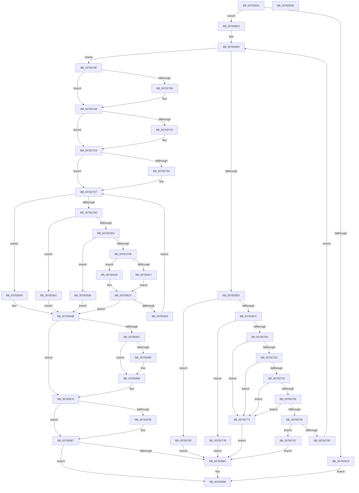

# PspProcessDynamicEnforcedAddressRanges

- RVA: `0x00782624`–`0x007828D1` (길이 `685` bytes)
- VA: `0x0000000140782624`
- 실행 섹션: `PAGE`
- PDB 이름 있음: `예`; PDB Function 태그: `아니요`
- unwind 정보 RVA: `0x000CE3D4`
- 디코드: `177`개 명령, `685/685` bytes 표시
- 미해석 바이트: `0` (있으면 어셈블리에 `.byte`로 보존)

> 이 문서는 커널 이미지의 기계어와 PDB 기호를 분석해 생성했습니다. 4번과 5번은 함수 원형과 자료형을 바이너리 사용 방식에서 추정한 C 해석이며 원본 소스 복구 결과는 아닙니다.

## 1. Dependencies

- 직접 호출 지점: **12**; 고유 호출 대상: **12**
- 직접 호출자로 확인된 함수: **1**
- RIP 상대 이미지 참조: **1**

### Outgoing calls
- `0x007826C0` → [ExAcquireRundownProtection](../../text/21/ExAcquireRundownProtection_function_00216620.md) (function, `0x00216620`)
- `0x0078279E` → [KiStackAttachProcess](../../text/21/KiStackAttachProcess_function_00216820.md) (function, `0x00216820`)
- `0x007827B0` → [KeAbPreAcquire](../../text/21/KeAbPreAcquire_function_00210230.md) (function, `0x00210230`)
- `0x007827C9` → [ExfAcquirePushLockExclusiveEx](../../text/20/ExfAcquirePushLockExclusiveEx_function_0020FC90.md) (function, `0x0020FC90`)
- `0x00782817` → [RtlAddDynamicEnforcedAddressRange](../79/RtlAddDynamicEnforcedAddressRange_function_00794E64.md) (function, `0x00794E64`)
- `0x0078281E` → [RtlRemoveDynamicEnforcedAddressRange](../79/RtlRemoveDynamicEnforcedAddressRange_function_00794F2C.md) (function, `0x00794F2C`)
- `0x00782869` → [ExfTryToWakePushLock](../../text/26/ExfTryToWakePushLock_function_00265DD0.md) (function, `0x00265DD0`)
- `0x00782871` → [KeAbPostRelease](../../text/2E/KeAbPostRelease_function_002E1600.md) (function, `0x002E1600`)
- `0x00782882` → [KiUnstackDetachProcess](../../text/21/KiUnstackDetachProcess_function_00217D30.md) (function, `0x00217D30`)
- `0x00782891` → [ExReleaseRundownProtection](../../text/34/ExReleaseRundownProtection_function_00349E80.md) (function, `0x00349E80`)
- `0x00782896` → [KeLeaveCriticalRegion](../../text/25/KeLeaveCriticalRegion_function_0025D8B0.md) (function, `0x0025D8B0`)
- `0x007828B0` → [_security_check_cookie](../../text/6A/_security_check_cookie_function_006AC640.md) (function, `0x006AC640`)

### Direct callers
- [NtSetInformationProcess](../AE/NtSetInformationProcess_function_00AE5370.md) at `0x00AE9C83`

### Static image references
- `0x0078263B` → RVA `0x00E0A740` (`.data`; read)

## 2. Other-region calls and transfers

- 다른 실행 섹션으로 향하는 call: **10**
  - `0x007826C0` → [ExAcquireRundownProtection](../../text/21/ExAcquireRundownProtection_function_00216620.md) (`PAGE` → `.text`)
  - `0x0078279E` → [KiStackAttachProcess](../../text/21/KiStackAttachProcess_function_00216820.md) (`PAGE` → `.text`)
  - `0x007827B0` → [KeAbPreAcquire](../../text/21/KeAbPreAcquire_function_00210230.md) (`PAGE` → `.text`)
  - `0x007827C9` → [ExfAcquirePushLockExclusiveEx](../../text/20/ExfAcquirePushLockExclusiveEx_function_0020FC90.md) (`PAGE` → `.text`)
  - `0x00782869` → [ExfTryToWakePushLock](../../text/26/ExfTryToWakePushLock_function_00265DD0.md) (`PAGE` → `.text`)
  - `0x00782871` → [KeAbPostRelease](../../text/2E/KeAbPostRelease_function_002E1600.md) (`PAGE` → `.text`)
  - `0x00782882` → [KiUnstackDetachProcess](../../text/21/KiUnstackDetachProcess_function_00217D30.md) (`PAGE` → `.text`)
  - `0x00782891` → [ExReleaseRundownProtection](../../text/34/ExReleaseRundownProtection_function_00349E80.md) (`PAGE` → `.text`)
  - `0x00782896` → [KeLeaveCriticalRegion](../../text/25/KeLeaveCriticalRegion_function_0025D8B0.md) (`PAGE` → `.text`)
  - `0x007828B0` → [_security_check_cookie](../../text/6A/_security_check_cookie_function_006AC640.md) (`PAGE` → `.text`)
- 별도 외부 분기/꼬리 이동을 확인하지 못했습니다.

## 3. Assembly (complete function range)

```asm
00782624  48 89 5C 24 20                  mov qword ptr [rsp + 0x20], rbx
00782629  55                              push rbp
0078262A  56                              push rsi
0078262B  57                              push rdi
0078262C  41 54                           push r12
0078262E  41 55                           push r13
00782630  41 56                           push r14
00782632  41 57                           push r15
00782634  48 81 EC 90 00 00 00            sub rsp, 0x90
0078263B  48 8B 05 FE 80 68 00            mov rax, qword ptr [rip + 0x6880fe]
00782642  48 33 C4                        xor rax, rsp
00782645  48 89 84 24 80 00 00 00         mov qword ptr [rsp + 0x80], rax
0078264D  48 8B 84 24 F0 00 00 00         mov rax, qword ptr [rsp + 0xf0]
00782655  4C 8D 72 08                     lea r14, [rdx + 8]
00782659  0F 57 C0                        xorps xmm0, xmm0
0078265C  48 89 44 24 48                  mov qword ptr [rsp + 0x48], rax
00782661  0F 11 44 24 50                  movups xmmword ptr [rsp + 0x50], xmm0
00782666  4C 8B E9                        mov r13, rcx
00782669  48 83 CF FF                     or rdi, 0xffffffffffffffff
0078266D  0F 11 44 24 60                  movups xmmword ptr [rsp + 0x60], xmm0
00782672  41 0F B7 D9                     movzx ebx, r9w
00782676  49 8B F0                        mov rsi, r8
00782679  0F 11 44 24 70                  movups xmmword ptr [rsp + 0x70], xmm0
0078267E  65 48 8B 04 25 88 01 00 00      mov rax, qword ptr gs:[0x188]
00782687  45 33 E4                        xor r12d, r12d
0078268A  48 89 44 24 28                  mov qword ptr [rsp + 0x28], rax
0078268F  4C 89 44 24 38                  mov qword ptr [rsp + 0x38], r8
00782694  48 89 54 24 30                  mov qword ptr [rsp + 0x30], rdx
00782699  4C 8B B8 B8 00 00 00            mov r15, qword ptr [rax + 0xb8]
007826A0  65 48 8B 04 25 88 01 00 00      mov rax, qword ptr gs:[0x188]
007826A9  66 01 B8 E4 01 00 00            add word ptr [rax + 0x1e4], di
007826B0  48 8D 81 E8 01 00 00            lea rax, [rcx + 0x1e8]
007826B7  48 8B C8                        mov rcx, rax
007826BA  48 89 44 24 40                  mov qword ptr [rsp + 0x40], rax
007826BF  90                              nop
007826C0  E8 5B 3F A9 FF                  call 0x140216620
007826C5  84 C0                           test al, al
007826C7  75 0A                           jne 0x1407826d3
007826C9  BE 0A 01 00 C0                  mov esi, 0xc000010a
007826CE  E9 C3 01 00 00                  jmp 0x140782896
007826D3  4C 8B 54 24 28                  mov r10, qword ptr [rsp + 0x28]
007826D8  BD 02 00 00 00                  mov ebp, 2
007826DD  33 C9                           xor ecx, ecx
007826DF  89 5C 24 20                     mov dword ptr [rsp + 0x20], ebx
007826E3  8B C3                           mov eax, ebx
007826E5  3B C8                           cmp ecx, eax
007826E7  0F 83 A2 00 00 00               jae 0x14078278f
007826ED  41 8B 82 A0 05 00 00            mov eax, dword ptr [r10 + 0x5a0]
007826F4  A8 01                           test al, 1
007826F6  0F 85 89 00 00 00               jne 0x140782785
007826FC  41 8B 85 F4 01 00 00            mov eax, dword ptr [r13 + 0x1f4]
00782703  A9 08 00 00 40                  test eax, 0x40000008
00782708  75 71                           jne 0x14078277b
0078270A  4C 8D 0C 49                     lea r9, [rcx + rcx*2]
0078270E  4E 8B 04 CE                     mov r8, qword ptr [rsi + r9*8]
00782712  4A 8B 54 CE 08                  mov rdx, qword ptr [rsi + r9*8 + 8]
00782717  49 81 F8 00 00 01 00            cmp r8, 0x10000
0078271E  72 51                           jb 0x140782771
00782720  48 8D 42 FF                     lea rax, [rdx - 1]
00782724  49 03 C0                        add rax, r8
00782727  48 85 D2                        test rdx, rdx
0078272A  49 0F 44 C0                     cmove rax, r8
0078272E  49 3B C0                        cmp rax, r8
00782731  72 3E                           jb 0x140782771
00782733  49 8D 40 FF                     lea rax, [r8 - 1]
00782737  48 03 C2                        add rax, rdx
0078273A  48 85 D2                        test rdx, rdx
0078273D  49 0F 44 C0                     cmove rax, r8
00782741  49 B8 FF FF FE FF FF 7F 00 00   movabs r8, 0x7ffffffeffff
0078274B  49 3B C0                        cmp rax, r8
0078274E  77 21                           ja 0x140782771
00782750  48 85 D2                        test rdx, rdx
00782753  74 1C                           je 0x140782771
00782755  42 F7 44 CE 10 FE FF FF FF      test dword ptr [rsi + r9*8 + 0x10], 0xfffffffe
0078275E  75 07                           jne 0x140782767
00782760  FF C1                           inc ecx
00782762  E9 7C FF FF FF                  jmp 0x1407826e3
00782767  BE 0D 00 00 C0                  mov esi, 0xc000000d
0078276C  E9 1B 01 00 00                  jmp 0x14078288c
00782771  BE 41 01 00 C0                  mov esi, 0xc0000141
00782776  E9 11 01 00 00                  jmp 0x14078288c
0078277B  BE 0A 01 00 C0                  mov esi, 0xc000010a
00782780  E9 07 01 00 00                  jmp 0x14078288c
00782785  BE 4B 00 00 C0                  mov esi, 0xc000004b
0078278A  E9 FD 00 00 00                  jmp 0x14078288c
0078278F  4D 3B EF                        cmp r13, r15
00782792  74 14                           je 0x1407827a8
00782794  4C 8D 44 24 50                  lea r8, [rsp + 0x50]
00782799  33 D2                           xor edx, edx
0078279B  49 8B CD                        mov rcx, r13
0078279E  E8 7D 40 A9 FF                  call 0x140216820
007827A3  BD 03 00 00 00                  mov ebp, 3
007827A8  45 33 C0                        xor r8d, r8d
007827AB  33 D2                           xor edx, edx
007827AD  49 8B CE                        mov rcx, r14
007827B0  E8 7B DA A8 FF                  call 0x140210230
007827B5  F0 49 0F BA 2E 00               lock bts qword ptr [r14], 0
007827BB  48 8B D8                        mov rbx, rax
007827BE  73 0E                           jae 0x1407827ce
007827C0  4D 8B C6                        mov r8, r14
007827C3  48 8B D0                        mov rdx, rax
007827C6  49 8B CE                        mov rcx, r14
007827C9  E8 C2 D4 A8 FF                  call 0x14020fc90
007827CE  48 85 DB                        test rbx, rbx
007827D1  74 04                           je 0x1407827d7
007827D3  C6 43 0A 01                     mov byte ptr [rbx + 0xa], 1
007827D7  44 3B 64 24 20                  cmp r12d, dword ptr [rsp + 0x20]
007827DC  73 6B                           jae 0x140782849
007827DE  48 8B 44 24 28                  mov rax, qword ptr [rsp + 0x28]
007827E3  8B 80 A0 05 00 00               mov eax, dword ptr [rax + 0x5a0]
007827E9  A8 01                           test al, 1
007827EB  75 55                           jne 0x140782842
007827ED  41 8B 85 F4 01 00 00            mov eax, dword ptr [r13 + 0x1f4]
007827F4  A9 08 00 00 40                  test eax, 0x40000008
007827F9  75 40                           jne 0x14078283b
007827FB  48 8B 4C 24 30                  mov rcx, qword ptr [rsp + 0x30]
00782800  4F 8D 3C 64                     lea r15, [r12 + r12*2]
00782804  42 8B 5C FE 10                  mov ebx, dword ptr [rsi + r15*8 + 0x10]
00782809  4A 8B 14 FE                     mov rdx, qword ptr [rsi + r15*8]
0078280D  4E 8B 44 FE 08                  mov r8, qword ptr [rsi + r15*8 + 8]
00782812  F6 C3 01                        test bl, 1
00782815  74 07                           je 0x14078281e
00782817  E8 48 26 01 00                  call 0x140794e64
0078281C  EB 05                           jmp 0x140782823
0078281E  E8 09 27 01 00                  call 0x140794f2c
00782823  8B F0                           mov esi, eax
00782825  85 C0                           test eax, eax
00782827  78 22                           js 0x14078284b
00782829  48 8B 74 24 38                  mov rsi, qword ptr [rsp + 0x38]
0078282E  83 CB 02                        or ebx, 2
00782831  41 FF C4                        inc r12d
00782834  42 89 5C FE 10                  mov dword ptr [rsi + r15*8 + 0x10], ebx
00782839  EB 9C                           jmp 0x1407827d7
0078283B  BE 0A 01 00 C0                  mov esi, 0xc000010a
00782840  EB 09                           jmp 0x14078284b
00782842  BE 4B 00 00 C0                  mov esi, 0xc000004b
00782847  EB 02                           jmp 0x14078284b
00782849  33 F6                           xor esi, esi
0078284B  BB 04 00 00 00                  mov ebx, 4
00782850  0B DD                           or ebx, ebp
00782852  83 FB 04                        cmp ebx, 4
00782855  72 1F                           jb 0x140782876
00782857  F0 49 0F C1 3E                  lock xadd qword ptr [r14], rdi
0078285C  40 80 E7 06                     and dil, 6
00782860  40 80 FF 02                     cmp dil, 2
00782864  75 08                           jne 0x14078286e
00782866  49 8B CE                        mov rcx, r14
00782869  E8 62 35 AE FF                  call 0x140265dd0
0078286E  49 8B CE                        mov rcx, r14
00782871  E8 8A ED B5 FF                  call 0x1402e1600
00782876  F6 C3 01                        test bl, 1
00782879  74 0C                           je 0x140782887
0078287B  33 D2                           xor edx, edx
0078287D  48 8D 4C 24 50                  lea rcx, [rsp + 0x50]
00782882  E8 A9 54 A9 FF                  call 0x140217d30
00782887  F6 C3 02                        test bl, 2
0078288A  74 0A                           je 0x140782896
0078288C  48 8B 4C 24 40                  mov rcx, qword ptr [rsp + 0x40]
00782891  E8 EA 75 BC FF                  call 0x140349e80
00782896  E8 15 B0 AD FF                  call 0x14025d8b0
0078289B  48 8B 44 24 48                  mov rax, qword ptr [rsp + 0x48]
007828A0  44 89 20                        mov dword ptr [rax], r12d
007828A3  8B C6                           mov eax, esi
007828A5  48 8B 8C 24 80 00 00 00         mov rcx, qword ptr [rsp + 0x80]
007828AD  48 33 CC                        xor rcx, rsp
007828B0  E8 8B 9D F2 FF                  call 0x1406ac640
007828B5  48 8B 9C 24 E8 00 00 00         mov rbx, qword ptr [rsp + 0xe8]
007828BD  48 81 C4 90 00 00 00            add rsp, 0x90
007828C4  41 5F                           pop r15
007828C6  41 5E                           pop r14
007828C8  41 5D                           pop r13
007828CA  41 5C                           pop r12
007828CC  5F                              pop rdi
007828CD  5E                              pop rsi
007828CE  5D                              pop rbp
007828CF  C3                              ret
007828D0  CC                              int3
```

## 4. C-style interpretation (structured pseudocode)

```c
__int64 __fastcall PspProcessDynamicEnforcedAddressRanges(__int64 a1, __int64 a2, __int64 a3, unsigned __int16 a4, __int64 a5)
{
    __int64 result;
    __int64 v_r12;
    __int64 v_rbp;
    __int64 v_rbx;
    __int64 v_rdi;
    __int64 v_rsi;
    __int64 v_rsp;
    unsigned __int64 v_stack_m48;
    unsigned __int64 v_stack_m58;
    unsigned __int64 v_stack_m68;
    unsigned __int64 v_stack_m78;
    unsigned __int64 v_stack_m80;
    unsigned __int64 v_stack_m88;
    unsigned __int64 v_stack_m90;
    unsigned __int64 v_stack_m98;
    unsigned __int64 v_stack_mA0;
    unsigned int v_stack_mA8;
    unsigned __int64 v_stack_p20;

    v_stack_p20 = v_rbx;
    v_rsp = (v_rsp) - (144);
    result = (*(unsigned __int64 *)(v_rip + 6848766)) ^ (v_rsp);
    v_stack_m48 = result;
    v_stack_m80 = a5;
    v_stack_m78 = v_xmm0;
    v_rdi = (v_rdi) | (-1);
    v_stack_m68 = v_xmm0;
    v_stack_m58 = v_xmm0;
    v_r12 = 0;
    v_stack_mA0 = *(unsigned __int64 *)(gs_base + (0 + 392));
    v_stack_m90 = a3;
    v_stack_m98 = a2;
    v_stack_m88 = a1 + 488;
    result = ExAcquireRundownProtection(a1 + 488, a2, a3, a4);
    if ((unsigned __int8)(result) != 0) goto loc_007826D3;
    goto loc_00782896;
loc_007826D3:
    a1 = 0;
    v_stack_mA8 = a4;
loc_007826E3:
    if (0 >= ((unsigned int)((unsigned int)(a4)))) goto loc_0078278F;
    if ((((unsigned __int8)((unsigned int)(*(unsigned int *)(v_stack_mA0 + 1440)))) & (1)) != 0) goto loc_00782785;
    if ((((unsigned int)((unsigned int)(*(unsigned int *)(a1 + 500)))) & (0x40000008ULL)) != 0) goto loc_0078277B;
    if ((*(unsigned __int64 *)((unsigned int)(0xC000010AULL) + a1 + a1 * 2 * 8)) < 0x10000ULL) goto loc_00782771;
    result = (*(unsigned __int64 *)((unsigned int)(0xC000010AULL) + a1 + a1 * 2 * 8 + 8) - 1) + (*(unsigned __int64 *)((unsigned int)(0xC000010AULL) + a1 + a1 * 2 * 8));
    if (*(unsigned __int64 *)((unsigned int)(0xC000010AULL) + a1 + a1 * 2 * 8 + 8) == 0) { result = *(unsigned __int64 *)((unsigned int)(0xC000010AULL) + a1 + a1 * 2 * 8); }
    if (result < (*(unsigned __int64 *)((unsigned int)(0xC000010AULL) + a1 + a1 * 2 * 8))) goto loc_00782771;
    result = (*(unsigned __int64 *)((unsigned int)(0xC000010AULL) + a1 + a1 * 2 * 8) - 1) + (*(unsigned __int64 *)((unsigned int)(0xC000010AULL) + a1 + a1 * 2 * 8 + 8));
    if (*(unsigned __int64 *)((unsigned int)(0xC000010AULL) + a1 + a1 * 2 * 8 + 8) == 0) { result = *(unsigned __int64 *)((unsigned int)(0xC000010AULL) + a1 + a1 * 2 * 8); }
    if (result > (*(unsigned __int64 *)((unsigned int)(0xC000010AULL) + a1 + a1 * 2 * 8))) goto loc_00782771;
    if (*(unsigned __int64 *)((unsigned int)(0xC000010AULL) + a1 + a1 * 2 * 8 + 8) == 0) goto loc_00782771;
    if (((*(unsigned int *)((unsigned int)(0xC000010AULL) + a1 + a1 * 2 * 8 + 16)) & (0xFFFFFFFEULL)) != 0) goto loc_00782767;
    a1 = (unsigned int)((a1) + 1);
    goto loc_007826E3;
loc_00782767:
    goto loc_0078288C;
loc_00782771:
    goto loc_0078288C;
loc_0078277B:
    goto loc_0078288C;
loc_00782785:
    goto loc_0078288C;
loc_0078278F:
    v_rbp = 2;
    if (a1 != (*(unsigned __int64 *)(*(unsigned __int64 *)(gs_base + (0 + 392)) + 184))) {
        a3 = v_stack_m78;
        a2 = 0;
        a1 = a1;
        result = KiStackAttachProcess(a1, a2, a3, a1 + a1 * 2);
        v_rbp = 3;
    }
    a3 = 0;
    a2 = 0;
    result = KeAbPreAcquire(a2 + 8, a2, a3, a1 + a1 * 2);
    if (!(condition_is_above_or_equal)) {
        a3 = a2 + 8;
        a2 = result;
        a1 = a2 + 8;
        result = ExfAcquirePushLockExclusiveEx(a1, a2, a3, a1 + a1 * 2);
    }
    if (result != 0) {
        *(unsigned __int8 *)(result + 10) = 1;
    }
    if (0 >= v_stack_mA8) goto loc_00782849;
    if ((((unsigned __int8)((unsigned int)(*(unsigned int *)(v_stack_mA0 + 1440)))) & (1)) != 0) goto loc_00782842;
    if ((((unsigned int)((unsigned int)(*(unsigned int *)(a1 + 500)))) & (0x40000008ULL)) != 0) goto loc_0078283B;
    if ((((unsigned __int8)((unsigned int)(*(unsigned int *)((unsigned int)(0xC000004BULL) + v_r12 + v_r12 * 2 * 8 + 16)))) & (1)) == 0) goto loc_0078281E;
    result = RtlAddDynamicEnforcedAddressRange(v_stack_m98, *(unsigned __int64 *)((unsigned int)(0xC000004BULL) + v_r12 + v_r12 * 2 * 8), *(unsigned __int64 *)((unsigned int)(0xC000004BULL) + v_r12 + v_r12 * 2 * 8 + 8), a1 + a1 * 2);
    goto loc_00782823;
loc_0078281E:
    result = RtlRemoveDynamicEnforcedAddressRange(v_stack_m98, *(unsigned __int64 *)((unsigned int)(0xC000004BULL) + v_r12 + v_r12 * 2 * 8), *(unsigned __int64 *)((unsigned int)(0xC000004BULL) + v_r12 + v_r12 * 2 * 8 + 8), a1 + a1 * 2);
loc_00782823:
    if (sign_flag) goto loc_0078284B;
    v_rbx = (unsigned int)(((unsigned int)(*(unsigned int *)((unsigned int)(0xC000004BULL) + v_r12 + v_r12 * 2 * 8 + 16))) | (2));
    v_r12 = (unsigned int)((v_r12) + 1);
    *(unsigned int *)(v_stack_m90 + v_r12 + v_r12 * 2 * 8 + 16) = (unsigned int)(v_rbx);
    goto loc_007827D7;
loc_0078283B:
    goto loc_0078284B;
loc_00782842:
    goto loc_0078284B;
loc_00782849:
    v_rsi = 0;
loc_0078284B:
    v_rbx = (unsigned int)((4) | ((unsigned int)(v_rbp)));
    if (((unsigned int)(v_rbx)) < 4) goto loc_00782876;
    v_rdi = (unsigned __int8)((v_rdi) & (6));
    if (((unsigned __int8)(v_rdi)) == 2) {
        a1 = a2 + 8;
        result = ExfTryToWakePushLock(a1, *(unsigned __int64 *)((unsigned int)(0xC000004BULL) + v_r12 + v_r12 * 2 * 8), *(unsigned __int64 *)((unsigned int)(0xC000004BULL) + v_r12 + v_r12 * 2 * 8 + 8), a1 + a1 * 2);
    }
    result = KeAbPostRelease(a2 + 8, *(unsigned __int64 *)((unsigned int)(0xC000004BULL) + v_r12 + v_r12 * 2 * 8), *(unsigned __int64 *)((unsigned int)(0xC000004BULL) + v_r12 + v_r12 * 2 * 8 + 8), a1 + a1 * 2);
loc_00782876:
    if ((((unsigned __int8)(v_rbx)) & (1)) != 0) {
        a2 = 0;
        a1 = v_stack_m78;
        result = KiUnstackDetachProcess(a1, a2, *(unsigned __int64 *)((unsigned int)(0xC000004BULL) + v_r12 + v_r12 * 2 * 8 + 8), a1 + a1 * 2);
    }
    if ((((unsigned __int8)(v_rbx)) & (2)) != 0) {
        a1 = v_stack_m88;
        result = ExReleaseRundownProtection(a1, a2, *(unsigned __int64 *)((unsigned int)(0xC000004BULL) + v_r12 + v_r12 * 2 * 8 + 8), a1 + a1 * 2);
    }
    result = KeLeaveCriticalRegion(a1, a2, *(unsigned __int64 *)((unsigned int)(0xC000004BULL) + v_r12 + v_r12 * 2 * 8 + 8), a1 + a1 * 2);
    *(unsigned int *)(v_stack_m80) = (unsigned int)(v_r12);
    a1 = (v_stack_m48) ^ (v_rsp);
    result = _security_check_cookie(a1, a2, *(unsigned __int64 *)((unsigned int)(0xC000004BULL) + v_r12 + v_r12 * 2 * 8 + 8), a1 + a1 * 2);
    v_rsp = (v_rsp) + (144);
    return result;
}
```

## 5. (Beta) C Style

```c
int64_t PspProcessDynamicEnforcedAddressRanges(void *Arg1, void *Arg2, void *Arg3, uint16_t Arg4, int64_t Arg5)
{
    uint8_t *arg1 = (uint8_t *)Arg1;
    uint8_t *arg2 = (uint8_t *)Arg2;
    uint8_t *arg3 = (uint8_t *)Arg3;

    int64_t result;
    int64_t local_r12;
    int64_t local_rbp;
    int64_t local_rbx;
    int64_t local_rdi;
    int64_t local_rsi;
    int64_t local_rsp;
    uint64_t v_stack_m48;
    uint64_t v_stack_m58;
    uint64_t v_stack_m68;
    uint64_t v_stack_m78;
    uint64_t v_stack_m80;
    uint64_t v_stack_m88;
    uint64_t v_stack_m90;
    uint64_t v_stack_m98;
    uint64_t v_stack_mA0;
    uint32_t v_stack_mA8;
    uint64_t v_stack_p20;

    v_stack_p20 = local_rbx;
    local_rsp = (local_rsp) - (144);
    result = (*(uint64_t *)(v_rip + 0x6880FE)) ^ (local_rsp);
    v_stack_m48 = result;
    v_stack_m80 = Arg5;
    v_stack_m78 = v_xmm0;
    local_rdi = (local_rdi) | (-1);
    v_stack_m68 = v_xmm0;
    v_stack_m58 = v_xmm0;
    local_r12 = 0;
    v_stack_mA0 = *(uint64_t *)(gs_base + (0 + 0x188));
    v_stack_m90 = Arg3;
    v_stack_m98 = Arg2;
    v_stack_m88 = Arg1 + 488;
    result = ExAcquireRundownProtection(Arg1 + 488, Arg2, Arg3, Arg4);
    if ((uint8_t)(result) != 0) goto loc_007826D3;
    goto loc_00782896;
loc_007826D3:
    Arg1 = 0;
    v_stack_mA8 = Arg4;
loc_007826E3:
    if (0 >= ((uint32_t)((uint32_t)(Arg4)))) goto loc_0078278F;
    if ((((uint8_t)((uint32_t)(*(uint32_t *)(v_stack_mA0 + 0x5A0)))) & (1)) != 0) goto loc_00782785;
    if ((((uint32_t)((uint32_t)(*(uint32_t *)(arg1 + 0x1F4)))) & (0x40000008ULL)) != 0) goto loc_0078277B;
    if ((*(uint64_t *)((uint32_t)(0xC000010AULL) + arg1 + arg1 * 2 * 8)) < 0x10000ULL) goto loc_00782771;
    result = (*(uint64_t *)((uint32_t)(0xC000010AULL) + arg1 + arg1 * 2 * 8 + 0x8) - 1) + (*(uint64_t *)((uint32_t)(0xC000010AULL) + arg1 + arg1 * 2 * 8));
    if (*(uint64_t *)((uint32_t)(0xC000010AULL) + arg1 + arg1 * 2 * 8 + 0x8) == 0) { result = *(uint64_t *)((uint32_t)(0xC000010AULL) + arg1 + arg1 * 2 * 8); }
    if (result < (*(uint64_t *)((uint32_t)(0xC000010AULL) + arg1 + arg1 * 2 * 8))) goto loc_00782771;
    result = (*(uint64_t *)((uint32_t)(0xC000010AULL) + arg1 + arg1 * 2 * 8) - 1) + (*(uint64_t *)((uint32_t)(0xC000010AULL) + arg1 + arg1 * 2 * 8 + 0x8));
    if (*(uint64_t *)((uint32_t)(0xC000010AULL) + arg1 + arg1 * 2 * 8 + 0x8) == 0) { result = *(uint64_t *)((uint32_t)(0xC000010AULL) + arg1 + arg1 * 2 * 8); }
    if (result > (*(uint64_t *)((uint32_t)(0xC000010AULL) + arg1 + arg1 * 2 * 8))) goto loc_00782771;
    if (*(uint64_t *)((uint32_t)(0xC000010AULL) + arg1 + arg1 * 2 * 8 + 0x8) == 0) goto loc_00782771;
    if (((*(uint32_t *)((uint32_t)(0xC000010AULL) + arg1 + arg1 * 2 * 8 + 0x10)) & (0xFFFFFFFEULL)) != 0) goto loc_00782767;
    Arg1 = (uint32_t)((Arg1) + 1);
    goto loc_007826E3;
loc_00782767:
    goto loc_0078288C;
loc_00782771:
    goto loc_0078288C;
loc_0078277B:
    goto loc_0078288C;
loc_00782785:
    goto loc_0078288C;
loc_0078278F:
    local_rbp = 2;
    if (Arg1 != (*(uint64_t *)(*(uint64_t *)(gs_base + (0 + 0x188)) + 0xB8))) {
        Arg3 = v_stack_m78;
        Arg2 = 0;
        Arg1 = Arg1;
        result = KiStackAttachProcess(Arg1, Arg2, Arg3, Arg1 + Arg1 * 2);
        local_rbp = 3;
    }
    Arg3 = 0;
    Arg2 = 0;
    result = KeAbPreAcquire(Arg2 + 8, Arg2, Arg3, Arg1 + Arg1 * 2);
    if (!(condition_is_above_or_equal)) {
        Arg3 = Arg2 + 8;
        Arg2 = result;
        Arg1 = Arg2 + 8;
        result = ExfAcquirePushLockExclusiveEx(Arg1, Arg2, Arg3, Arg1 + Arg1 * 2);
    }
    if (result != 0) {
        *(uint8_t *)(result + 0xA) = 1;
    }
    if (0 >= v_stack_mA8) goto loc_00782849;
    if ((((uint8_t)((uint32_t)(*(uint32_t *)(v_stack_mA0 + 0x5A0)))) & (1)) != 0) goto loc_00782842;
    if ((((uint32_t)((uint32_t)(*(uint32_t *)(arg1 + 0x1F4)))) & (0x40000008ULL)) != 0) goto loc_0078283B;
    if ((((uint8_t)((uint32_t)(*(uint32_t *)((uint32_t)(0xC000004BULL) + local_r12 + local_r12 * 2 * 8 + 0x10)))) & (1)) == 0) goto loc_0078281E;
    result = RtlAddDynamicEnforcedAddressRange(v_stack_m98, *(uint64_t *)((uint32_t)(0xC000004BULL) + local_r12 + local_r12 * 2 * 8), *(uint64_t *)((uint32_t)(0xC000004BULL) + local_r12 + local_r12 * 2 * 8 + 0x8), Arg1 + Arg1 * 2);
    goto loc_00782823;
loc_0078281E:
    result = RtlRemoveDynamicEnforcedAddressRange(v_stack_m98, *(uint64_t *)((uint32_t)(0xC000004BULL) + local_r12 + local_r12 * 2 * 8), *(uint64_t *)((uint32_t)(0xC000004BULL) + local_r12 + local_r12 * 2 * 8 + 0x8), Arg1 + Arg1 * 2);
loc_00782823:
    if (sign_flag) goto loc_0078284B;
    local_rbx = (uint32_t)(((uint32_t)(*(uint32_t *)((uint32_t)(0xC000004BULL) + local_r12 + local_r12 * 2 * 8 + 0x10))) | (2));
    local_r12 = (uint32_t)((local_r12) + 1);
    *(uint32_t *)(v_stack_m90 + local_r12 + local_r12 * 2 * 8 + 0x10) = (uint32_t)(local_rbx);
    goto loc_007827D7;
loc_0078283B:
    goto loc_0078284B;
loc_00782842:
    goto loc_0078284B;
loc_00782849:
    local_rsi = 0;
loc_0078284B:
    local_rbx = (uint32_t)((4) | ((uint32_t)(local_rbp)));
    if (((uint32_t)(local_rbx)) < 4) goto loc_00782876;
    local_rdi = (uint8_t)((local_rdi) & (6));
    if (((uint8_t)(local_rdi)) == 2) {
        Arg1 = Arg2 + 8;
        result = ExfTryToWakePushLock(Arg1, *(uint64_t *)((uint32_t)(0xC000004BULL) + local_r12 + local_r12 * 2 * 8), *(uint64_t *)((uint32_t)(0xC000004BULL) + local_r12 + local_r12 * 2 * 8 + 0x8), Arg1 + Arg1 * 2);
    }
    result = KeAbPostRelease(Arg2 + 8, *(uint64_t *)((uint32_t)(0xC000004BULL) + local_r12 + local_r12 * 2 * 8), *(uint64_t *)((uint32_t)(0xC000004BULL) + local_r12 + local_r12 * 2 * 8 + 0x8), Arg1 + Arg1 * 2);
loc_00782876:
    if ((((uint8_t)(local_rbx)) & (1)) != 0) {
        Arg2 = 0;
        Arg1 = v_stack_m78;
        result = KiUnstackDetachProcess(Arg1, Arg2, *(uint64_t *)((uint32_t)(0xC000004BULL) + local_r12 + local_r12 * 2 * 8 + 0x8), Arg1 + Arg1 * 2);
    }
    if ((((uint8_t)(local_rbx)) & (2)) != 0) {
        Arg1 = v_stack_m88;
        result = ExReleaseRundownProtection(Arg1, Arg2, *(uint64_t *)((uint32_t)(0xC000004BULL) + local_r12 + local_r12 * 2 * 8 + 0x8), Arg1 + Arg1 * 2);
    }
    result = KeLeaveCriticalRegion(Arg1, Arg2, *(uint64_t *)((uint32_t)(0xC000004BULL) + local_r12 + local_r12 * 2 * 8 + 0x8), Arg1 + Arg1 * 2);
    *(uint32_t *)(v_stack_m80) = (uint32_t)(local_r12);
    Arg1 = (v_stack_m48) ^ (local_rsp);
    result = _security_check_cookie(Arg1, Arg2, *(uint64_t *)((uint32_t)(0xC000004BULL) + local_r12 + local_r12 * 2 * 8 + 0x8), Arg1 + Arg1 * 2);
    local_rsp = (local_rsp) + (144);
    return result;
}
```

### 관측된 메모리 오프셋

구조체 형식이 확인되지 않은 접근은 인자 기준의 오프셋으로만 기록했습니다.

| 기준 인자 | 오프셋 표현 | 폭 (bit) | 접근 |
|---|---:|---:|---|
| `Arg1` | `+ 0x1E8` | `64` | `R` |
| `Arg1` | `+ 0x1F4` | `32` | `R` |
| `Arg2` | `+ 0x0` | `64` | `R/W` |
| `Arg2` | `+ 0x8` | `64` | `R` |
| `Arg3` | `+ 0x0 + r9*8` | `64` | `R` |
| `Arg3` | `+ 0x8 + r9*8` | `64` | `R` |
| `Arg3` | `+ 0x10 + r9*8` | `32` | `R` |

## 6. Execution-region graph

[열기: 2D/3D 그래프와 함수 탐색 컨트롤 패널](../../../control-panel.html?section=page&rva=0x00782624&view=graph)

- 2D 그래프는 위에서 아래로 흐르고, 3D 그래프는 빈 공간을 드래그해 회전합니다. Shift+드래그는 이동, 휠은 확대·축소, 함수 노드 선택은 대상 보고서 이동입니다.

### Static fallback


