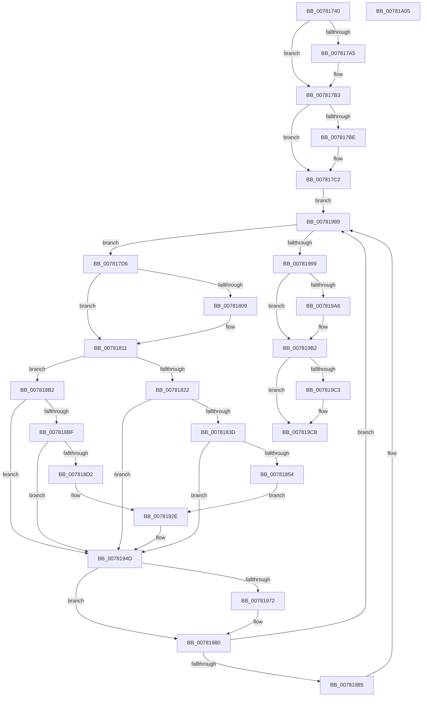

# PspProcessQosChangeNotificationWorker

- RVA: `0x00781740`–`0x00781A06` (길이 `710` bytes)
- VA: `0x0000000140781740`
- 실행 섹션: `PAGE`
- PDB 이름 있음: `예`; PDB Function 태그: `아니요`
- unwind 정보 RVA: `0x000CE374`
- 디코드: `166`개 명령, `710/710` bytes 표시
- 미해석 바이트: `0` (있으면 어셈블리에 `.byte`로 보존)

> 이 문서는 커널 이미지의 기계어와 PDB 기호를 분석해 생성했습니다. 4번과 5번은 함수 원형과 자료형을 바이너리 사용 방식에서 추정한 C 해석이며 원본 소스 복구 결과는 아닙니다.

## 1. Dependencies

- 직접 호출 지점: **20**; 고유 호출 대상: **14**
- 직접 호출자로 확인된 함수: **0**
- RIP 상대 이미지 참조: **10**

### Outgoing calls
- `0x00781795` → [KeAbPreAcquire](../../text/21/KeAbPreAcquire_function_00210230.md) (function, `0x00210230`)
- `0x007817AE` → [ExfAcquirePushLockExclusiveEx](../../text/20/ExfAcquirePushLockExclusiveEx_function_0020FC90.md) (function, `0x0020FC90`)
- `0x007817C9` → [ExGetExtensionTable](../../text/42/ExGetExtensionTable_function_00428814.md) (function, `0x00428814`)
- `0x007817ED` → [KeCalculateProcessDefaultQos](../../text/5C/KeCalculateProcessDefaultQos_function_005CA5A0.md) (function, `0x005CA5A0`)
- `0x0078180C` → [ExfTryToWakePushLock](../../text/26/ExfTryToWakePushLock_function_00265DD0.md) (function, `0x00265DD0`)
- `0x00781814` → [KeAbPostRelease](../../text/2E/KeAbPostRelease_function_002E1600.md) (function, `0x002E1600`)
- `0x0078182B` → [guard_dispatch_icall](../../text/6B/guard_dispatch_icall_function_006BAAD0.md) (function, `0x006BAAD0`)
- `0x00781847` → [tlgKeywordOn](../../text/42/tlgKeywordOn_function_0042EAA0.md) (function, `0x0042EAA0`)
- `0x00781857` → [PsGetProcessId](../../text/43/PsGetProcessId_function_0043D910.md) (function, `0x0043D910`)
- `0x007818C9` → [tlgKeywordOn](../../text/42/tlgKeywordOn_function_0042EAA0.md) (function, `0x0042EAA0`)
- `0x007818D5` → [PsGetProcessId](../../text/43/PsGetProcessId_function_0043D910.md) (function, `0x0043D910`)
- `0x00781948` → [tlgWriteTransfer_EtwWriteTransfer](../../text/42/tlgWriteTransfer_EtwWriteTransfer_function_004260E0.md) (function, `0x004260E0`)
- `0x00781955` → [ObfDereferenceObjectWithTag](../../text/2F/ObfDereferenceObjectWithTag_function_002F78E0.md) (function, `0x002F78E0`)
- `0x00781962` → [KeAbPreAcquire](../../text/21/KeAbPreAcquire_function_00210230.md) (function, `0x00210230`)
- `0x0078197B` → [ExfAcquirePushLockExclusiveEx](../../text/20/ExfAcquirePushLockExclusiveEx_function_0020FC90.md) (function, `0x0020FC90`)
- `0x007819AD` → [ExReleaseExtensionTable](../../text/45/ExReleaseExtensionTable_function_00456DC0.md) (function, `0x00456DC0`)
- `0x007819C6` → [ExfTryToWakePushLock](../../text/26/ExfTryToWakePushLock_function_00265DD0.md) (function, `0x00265DD0`)
- `0x007819CE` → [KeAbPostRelease](../../text/2E/KeAbPostRelease_function_002E1600.md) (function, `0x002E1600`)
- `0x007819D3` → [KeLeaveCriticalRegion](../../text/25/KeLeaveCriticalRegion_function_0025D8B0.md) (function, `0x0025D8B0`)
- `0x007819DF` → [_security_check_cookie](../../text/6A/_security_check_cookie_function_006AC640.md) (function, `0x006AC640`)

### Direct callers
- 이 함수 시작 RVA로 연결되는 직접 call은 확인되지 않았습니다. 간접 호출은 완전히 역산할 수 없습니다.

### Static image references
- `0x00781763` → RVA `0x00E0A740` (`.data`; read)
- `0x0078177A` → RVA `0x00F06768` (`.data`; read)
- `0x007817C2` → RVA `0x00FC7038` (`ALMOSTRO`; read)
- `0x007817E0` → RVA `0x00F06770` (`.data`; write)
- `0x007817F8` → RVA `0x00F06768` (`.data`; read/write)
- `0x00781830` → RVA `0x00E08640` (`.data`; read)
- `0x00781860` → RVA `0x000529C5` (`.rdata`; read)
- `0x007818DE` → RVA `0x00052959` (`.rdata`; read)
- `0x00781989` → RVA `0x00F06770` (`.data`; read)
- `0x00781999` → RVA `0x00F06760` (`.data`; read/write)

## 2. Other-region calls and transfers

- 다른 실행 섹션으로 향하는 call: **20**
  - `0x00781795` → [KeAbPreAcquire](../../text/21/KeAbPreAcquire_function_00210230.md) (`PAGE` → `.text`)
  - `0x007817AE` → [ExfAcquirePushLockExclusiveEx](../../text/20/ExfAcquirePushLockExclusiveEx_function_0020FC90.md) (`PAGE` → `.text`)
  - `0x007817C9` → [ExGetExtensionTable](../../text/42/ExGetExtensionTable_function_00428814.md) (`PAGE` → `.text`)
  - `0x007817ED` → [KeCalculateProcessDefaultQos](../../text/5C/KeCalculateProcessDefaultQos_function_005CA5A0.md) (`PAGE` → `.text`)
  - `0x0078180C` → [ExfTryToWakePushLock](../../text/26/ExfTryToWakePushLock_function_00265DD0.md) (`PAGE` → `.text`)
  - `0x00781814` → [KeAbPostRelease](../../text/2E/KeAbPostRelease_function_002E1600.md) (`PAGE` → `.text`)
  - `0x0078182B` → [guard_dispatch_icall](../../text/6B/guard_dispatch_icall_function_006BAAD0.md) (`PAGE` → `.text`)
  - `0x00781847` → [tlgKeywordOn](../../text/42/tlgKeywordOn_function_0042EAA0.md) (`PAGE` → `.text`)
  - `0x00781857` → [PsGetProcessId](../../text/43/PsGetProcessId_function_0043D910.md) (`PAGE` → `.text`)
  - `0x007818C9` → [tlgKeywordOn](../../text/42/tlgKeywordOn_function_0042EAA0.md) (`PAGE` → `.text`)
  - `0x007818D5` → [PsGetProcessId](../../text/43/PsGetProcessId_function_0043D910.md) (`PAGE` → `.text`)
  - `0x00781948` → [tlgWriteTransfer_EtwWriteTransfer](../../text/42/tlgWriteTransfer_EtwWriteTransfer_function_004260E0.md) (`PAGE` → `.text`)
  - `0x00781955` → [ObfDereferenceObjectWithTag](../../text/2F/ObfDereferenceObjectWithTag_function_002F78E0.md) (`PAGE` → `.text`)
  - `0x00781962` → [KeAbPreAcquire](../../text/21/KeAbPreAcquire_function_00210230.md) (`PAGE` → `.text`)
  - `0x0078197B` → [ExfAcquirePushLockExclusiveEx](../../text/20/ExfAcquirePushLockExclusiveEx_function_0020FC90.md) (`PAGE` → `.text`)
  - `0x007819AD` → [ExReleaseExtensionTable](../../text/45/ExReleaseExtensionTable_function_00456DC0.md) (`PAGE` → `.text`)
  - `0x007819C6` → [ExfTryToWakePushLock](../../text/26/ExfTryToWakePushLock_function_00265DD0.md) (`PAGE` → `.text`)
  - `0x007819CE` → [KeAbPostRelease](../../text/2E/KeAbPostRelease_function_002E1600.md) (`PAGE` → `.text`)
  - `0x007819D3` → [KeLeaveCriticalRegion](../../text/25/KeLeaveCriticalRegion_function_0025D8B0.md) (`PAGE` → `.text`)
  - `0x007819DF` → [_security_check_cookie](../../text/6A/_security_check_cookie_function_006AC640.md) (`PAGE` → `.text`)
- 별도 외부 분기/꼬리 이동을 확인하지 못했습니다.

## 3. Assembly (complete function range)

```asm
00781740  48 8B C4                        mov rax, rsp
00781743  48 89 58 08                     mov qword ptr [rax + 8], rbx
00781747  48 89 70 10                     mov qword ptr [rax + 0x10], rsi
0078174B  48 89 78 18                     mov qword ptr [rax + 0x18], rdi
0078174F  4C 89 68 20                     mov qword ptr [rax + 0x20], r13
00781753  55                              push rbp
00781754  41 56                           push r14
00781756  41 57                           push r15
00781758  48 8D 68 A1                     lea rbp, [rax - 0x5f]
0078175C  48 81 EC 00 01 00 00            sub rsp, 0x100
00781763  48 8B 05 D6 8F 68 00            mov rax, qword ptr [rip + 0x688fd6]
0078176A  48 33 C4                        xor rax, rsp
0078176D  48 89 45 37                     mov qword ptr [rbp + 0x37], rax
00781771  65 48 8B 04 25 88 01 00 00      mov rax, qword ptr gs:[0x188]
0078177A  4C 8D 3D E7 4F 78 00            lea r15, [rip + 0x784fe7]
00781781  48 83 CB FF                     or rbx, 0xffffffffffffffff
00781785  45 33 C0                        xor r8d, r8d
00781788  33 D2                           xor edx, edx
0078178A  49 8B CF                        mov rcx, r15
0078178D  66 01 98 E4 01 00 00            add word ptr [rax + 0x1e4], bx
00781794  90                              nop
00781795  E8 96 EA A8 FF                  call 0x140210230
0078179A  F0 49 0F BA 2F 00               lock bts qword ptr [r15], 0
007817A0  48 8B F8                        mov rdi, rax
007817A3  73 0E                           jae 0x1407817b3
007817A5  4D 8B C7                        mov r8, r15
007817A8  48 8B D0                        mov rdx, rax
007817AB  49 8B CF                        mov rcx, r15
007817AE  E8 DD E4 A8 FF                  call 0x14020fc90
007817B3  41 BD 01 00 00 00               mov r13d, 1
007817B9  48 85 FF                        test rdi, rdi
007817BC  74 04                           je 0x1407817c2
007817BE  44 88 6F 0A                     mov byte ptr [rdi + 0xa], r13b
007817C2  48 8B 0D 6F 58 84 00            mov rcx, qword ptr [rip + 0x84586f]
007817C9  E8 46 70 CA FF                  call 0x140428814
007817CE  48 8B F0                        mov rsi, rax
007817D1  E9 B3 01 00 00                  jmp 0x140781989
007817D6  48 8B 01                        mov rax, qword ptr [rcx]
007817D9  48 8D B9 D8 F7 FF FF            lea rdi, [rcx - 0x828]
007817E0  48 89 05 89 4F 78 00            mov qword ptr [rip + 0x784f89], rax
007817E7  4C 89 29                        mov qword ptr [rcx], r13
007817EA  48 8B CF                        mov rcx, rdi
007817ED  E8 AE 8D E4 FF                  call 0x1405ca5a0
007817F2  44 8B F0                        mov r14d, eax
007817F5  48 8B CB                        mov rcx, rbx
007817F8  F0 48 0F C1 0D 67 4F 78 00      lock xadd qword ptr [rip + 0x784f67], rcx
00781801  80 E1 06                        and cl, 6
00781804  80 F9 02                        cmp cl, 2
00781807  75 08                           jne 0x140781811
00781809  49 8B CF                        mov rcx, r15
0078180C  E8 BF 45 AE FF                  call 0x140265dd0
00781811  49 8B CF                        mov rcx, r15
00781814  E8 E7 FD B5 FF                  call 0x1402e1600
00781819  48 85 F6                        test rsi, rsi
0078181C  0F 84 90 00 00 00               je 0x1407818b2
00781822  48 8B 06                        mov rax, qword ptr [rsi]
00781825  41 8A D6                        mov dl, r14b
00781828  48 8B CF                        mov rcx, rdi
0078182B  E8 A0 92 F3 FF                  call 0x1406baad0
00781830  83 3D 09 6E 68 00 05            cmp dword ptr [rip + 0x686e09], 5
00781837  0F 86 10 01 00 00               jbe 0x14078194d
0078183D  49 8B D5                        mov rdx, r13
00781840  48 8D 0D F9 6D 68 00            lea rcx, [rip + 0x686df9]
00781847  E8 54 D2 CA FF                  call 0x14042eaa0
0078184C  84 C0                           test al, al
0078184E  0F 84 F9 00 00 00               je 0x14078194d
00781854  48 8B CF                        mov rcx, rdi
00781857  E8 B4 C0 CB FF                  call 0x14043d910
0078185C  83 65 C3 00                     and dword ptr [rbp - 0x3d], 0
00781860  48 8D 15 5E 11 8D FF            lea rdx, [rip - 0x72eea2]
00781867  83 65 D3 00                     and dword ptr [rbp - 0x2d], 0
0078186B  83 65 E3 00                     and dword ptr [rbp - 0x1d], 0
0078186F  89 44 24 34                     mov dword ptr [rsp + 0x34], eax
00781873  48 8D 44 24 34                  lea rax, [rsp + 0x34]
00781878  48 89 45 B7                     mov qword ptr [rbp - 0x49], rax
0078187C  48 8D 44 24 30                  lea rax, [rsp + 0x30]
00781881  48 89 45 C7                     mov qword ptr [rbp - 0x39], rax
00781885  48 8D 45 87                     lea rax, [rbp - 0x79]
00781889  48 89 45 D7                     mov qword ptr [rbp - 0x29], rax
0078188D  48 8D 45 97                     lea rax, [rbp - 0x69]
00781891  C7 45 BF 04 00 00 00            mov dword ptr [rbp - 0x41], 4
00781898  44 88 74 24 30                  mov byte ptr [rsp + 0x30], r14b
0078189D  44 89 6D CF                     mov dword ptr [rbp - 0x31], r13d
007818A1  48 C7 45 87 00 00 00 01         mov qword ptr [rbp - 0x79], 0x1000000
007818A9  C7 45 DF 08 00 00 00            mov dword ptr [rbp - 0x21], 8
007818B0  EB 7C                           jmp 0x14078192e
007818B2  83 3D 87 6D 68 00 05            cmp dword ptr [rip + 0x686d87], 5
007818B9  0F 86 8E 00 00 00               jbe 0x14078194d
007818BF  49 8B D5                        mov rdx, r13
007818C2  48 8D 0D 77 6D 68 00            lea rcx, [rip + 0x686d77]
007818C9  E8 D2 D1 CA FF                  call 0x14042eaa0
007818CE  84 C0                           test al, al
007818D0  74 7B                           je 0x14078194d
007818D2  48 8B CF                        mov rcx, rdi
007818D5  E8 36 C0 CB FF                  call 0x14043d910
007818DA  83 65 13 00                     and dword ptr [rbp + 0x13], 0
007818DE  48 8D 15 74 10 8D FF            lea rdx, [rip - 0x72ef8c]
007818E5  83 65 23 00                     and dword ptr [rbp + 0x23], 0
007818E9  83 65 33 00                     and dword ptr [rbp + 0x33], 0
007818ED  89 44 24 38                     mov dword ptr [rsp + 0x38], eax
007818F1  48 8D 44 24 38                  lea rax, [rsp + 0x38]
007818F6  48 89 45 07                     mov qword ptr [rbp + 7], rax
007818FA  48 8D 44 24 31                  lea rax, [rsp + 0x31]
007818FF  48 89 45 17                     mov qword ptr [rbp + 0x17], rax
00781903  48 8D 45 8F                     lea rax, [rbp - 0x71]
00781907  48 89 45 27                     mov qword ptr [rbp + 0x27], rax
0078190B  48 8D 45 E7                     lea rax, [rbp - 0x19]
0078190F  C7 45 0F 04 00 00 00            mov dword ptr [rbp + 0xf], 4
00781916  44 88 74 24 31                  mov byte ptr [rsp + 0x31], r14b
0078191B  44 89 6D 1F                     mov dword ptr [rbp + 0x1f], r13d
0078191F  48 C7 45 8F 00 00 00 01         mov qword ptr [rbp - 0x71], 0x1000000
00781927  C7 45 2F 08 00 00 00            mov dword ptr [rbp + 0x2f], 8
0078192E  48 89 44 24 28                  mov qword ptr [rsp + 0x28], rax
00781933  48 8D 0D 06 6D 68 00            lea rcx, [rip + 0x686d06]
0078193A  45 33 C9                        xor r9d, r9d
0078193D  C7 44 24 20 05 00 00 00         mov dword ptr [rsp + 0x20], 5
00781945  45 33 C0                        xor r8d, r8d
00781948  E8 93 47 CA FF                  call 0x1404260e0
0078194D  BA 50 73 44 71                  mov edx, 0x71447350
00781952  48 8B CF                        mov rcx, rdi
00781955  E8 86 5F B7 FF                  call 0x1402f78e0
0078195A  45 33 C0                        xor r8d, r8d
0078195D  33 D2                           xor edx, edx
0078195F  49 8B CF                        mov rcx, r15
00781962  E8 C9 E8 A8 FF                  call 0x140210230
00781967  F0 49 0F BA 2F 00               lock bts qword ptr [r15], 0
0078196D  48 8B F8                        mov rdi, rax
00781970  73 0E                           jae 0x140781980
00781972  4D 8B C7                        mov r8, r15
00781975  48 8B D0                        mov rdx, rax
00781978  49 8B CF                        mov rcx, r15
0078197B  E8 10 E3 A8 FF                  call 0x14020fc90
00781980  48 85 FF                        test rdi, rdi
00781983  74 04                           je 0x140781989
00781985  44 88 6F 0A                     mov byte ptr [rdi + 0xa], r13b
00781989  48 8B 0D E0 4D 78 00            mov rcx, qword ptr [rip + 0x784de0]
00781990  48 85 C9                        test rcx, rcx
00781993  0F 85 3D FE FF FF               jne 0x1407817d6
00781999  48 83 25 BF 4D 78 00 FE         and qword ptr [rip + 0x784dbf], 0xfffffffffffffffe
007819A1  48 85 F6                        test rsi, rsi
007819A4  74 0C                           je 0x1407819b2
007819A6  48 8B 0D 8B 56 84 00            mov rcx, qword ptr [rip + 0x84568b]
007819AD  E8 0E 54 CD FF                  call 0x140456dc0
007819B2  F0 48 0F C1 1D AD 4D 78 00      lock xadd qword ptr [rip + 0x784dad], rbx
007819BB  80 E3 06                        and bl, 6
007819BE  80 FB 02                        cmp bl, 2
007819C1  75 08                           jne 0x1407819cb
007819C3  49 8B CF                        mov rcx, r15
007819C6  E8 05 44 AE FF                  call 0x140265dd0
007819CB  49 8B CF                        mov rcx, r15
007819CE  E8 2D FC B5 FF                  call 0x1402e1600
007819D3  E8 D8 BE AD FF                  call 0x14025d8b0
007819D8  48 8B 4D 37                     mov rcx, qword ptr [rbp + 0x37]
007819DC  48 33 CC                        xor rcx, rsp
007819DF  E8 5C AC F2 FF                  call 0x1406ac640
007819E4  4C 8D 9C 24 00 01 00 00         lea r11, [rsp + 0x100]
007819EC  49 8B 5B 20                     mov rbx, qword ptr [r11 + 0x20]
007819F0  49 8B 73 28                     mov rsi, qword ptr [r11 + 0x28]
007819F4  49 8B 7B 30                     mov rdi, qword ptr [r11 + 0x30]
007819F8  4D 8B 6B 38                     mov r13, qword ptr [r11 + 0x38]
007819FC  49 8B E3                        mov rsp, r11
007819FF  41 5F                           pop r15
00781A01  41 5E                           pop r14
00781A03  5D                              pop rbp
00781A04  C3                              ret
00781A05  CC                              int3
```

## 4. C-style interpretation (structured pseudocode)

```c
__int64 __fastcall PspProcessQosChangeNotificationWorker(__int64 a1, int a2, int a3, int a4)
{
    __int64 result;
    __int64 v_rbx;
    __int64 v_rsp;
    unsigned __int64 v_stack_m18;
    unsigned int v_stack_mE0;
    unsigned int v_stack_mE4;
    unsigned __int64 v_stack_mE7;
    unsigned __int64 v_stack_mE8;
    unsigned __int64 v_stack_mF0;
    unsigned int v_stack_mF8;

    *(unsigned __int64 *)(v_rsp + 8) = v_rbx;
    *(unsigned __int64 *)(v_rsp + 16) = v_rsi;
    *(unsigned __int64 *)(v_rsp + 24) = v_rdi;
    *(unsigned __int64 *)(v_rsp + 32) = v_r13;
    v_rsp = (v_rsp) - (256);
    result = (*(unsigned __int64 *)(v_rip + 6852566)) ^ (v_rsp);
    *(unsigned __int64 *)(v_rsp - 95 + 55) = result;
    v_rbx = (v_rbx) | (-1);
    a3 = 0;
    a2 = 0;
    result = KeAbPreAcquire(v_rip + 7884775, a2, a3, a4);
    if (!(condition_is_above_or_equal)) {
        a3 = v_rip + 7884775;
        a2 = result;
        a1 = v_rip + 7884775;
        result = ExfAcquirePushLockExclusiveEx(a1, a2, a3, a4);
    }
    if (result != 0) {
        *(unsigned __int8 *)(result + 10) = 1;
    }
    result = ExGetExtensionTable(*(unsigned __int64 *)(v_rip + 8673391), a2, a3, a4);
    goto loc_00781989;
loc_007817D6:
    *(unsigned __int64 *)(v_rip + 7884681) = *(unsigned __int64 *)(*(unsigned __int64 *)(v_rip + 8673391));
    *(unsigned __int64 *)(*(unsigned __int64 *)(v_rip + 8673391)) = 1;
    result = KeCalculateProcessDefaultQos(*(unsigned __int64 *)(v_rip + 8673391) - 2088, a2, a3, a4);
    a1 = (unsigned __int8)((v_rbx) & (6));
    if (((unsigned __int8)(a1)) == 2) {
        a1 = v_rip + 7884775;
        result = ExfTryToWakePushLock(a1, a2, a3, a4);
    }
    result = KeAbPostRelease(v_rip + 7884775, a2, a3, a4);
    if (result == 0) goto loc_007818B2;
    result = guard_dispatch_icall(*(unsigned __int64 *)(v_rip + 8673391) - 2088, (unsigned __int8)((unsigned int)((unsigned int)(result))), a3, a4);
    if ((*(unsigned int *)(v_rip + 6843913)) <= 5) goto loc_0078194D;
    result = tlgKeywordOn(v_rip + 6843897, 1, a3, a4);
    if ((unsigned __int8)(result) == 0) goto loc_0078194D;
    result = PsGetProcessId(*(unsigned __int64 *)(v_rip + 8673391) - 2088, 1, a3, a4);
    v_stack_mE4 = (unsigned int)(result);
    *(unsigned __int64 *)(v_rsp - 95 - 73) = v_stack_mE4;
    *(unsigned __int64 *)(v_rsp - 95 - 57) = v_stack_mE8;
    *(unsigned __int64 *)(v_rsp - 95 - 41) = v_rsp - 95 - 121;
    *(unsigned int *)(v_rsp - 95 - 65) = 4;
    v_stack_mE8 = (unsigned __int8)((unsigned int)((unsigned int)(result)));
    *(unsigned int *)(v_rsp - 95 - 49) = 1;
    *(unsigned __int64 *)(v_rsp - 95 - 121) = 0x1000000ULL;
    *(unsigned int *)(v_rsp - 95 - 33) = 8;
    goto loc_0078192E;
loc_007818B2:
    if ((*(unsigned int *)(v_rip + 6843783)) <= 5) goto loc_0078194D;
    result = tlgKeywordOn(v_rip + 6843767, 1, a3, a4);
    if ((unsigned __int8)(result) == 0) goto loc_0078194D;
    result = PsGetProcessId(*(unsigned __int64 *)(v_rip + 8673391) - 2088, 1, a3, a4);
    v_stack_mE0 = (unsigned int)(result);
    *(unsigned __int64 *)(v_rsp - 95 + 7) = v_stack_mE0;
    *(unsigned __int64 *)(v_rsp - 95 + 23) = v_stack_mE7;
    *(unsigned __int64 *)(v_rsp - 95 + 39) = v_rsp - 95 - 113;
    *(unsigned int *)(v_rsp - 95 + 15) = 4;
    v_stack_mE7 = (unsigned __int8)((unsigned int)((unsigned int)(result)));
    *(unsigned int *)(v_rsp - 95 + 31) = 1;
    *(unsigned __int64 *)(v_rsp - 95 - 113) = 0x1000000ULL;
    *(unsigned int *)(v_rsp - 95 + 47) = 8;
loc_0078192E:
    v_stack_mF0 = v_rsp - 95 - 25;
    a4 = 0;
    v_stack_mF8 = 5;
    a3 = 0;
    result = tlgWriteTransfer_EtwWriteTransfer(v_rip + 6843654, v_rip - 7532428, a3, a4);
loc_0078194D:
    result = ObfDereferenceObjectWithTag(*(unsigned __int64 *)(v_rip + 8673391) - 2088, (unsigned int)(0x71447350ULL), a3, a4);
    a3 = 0;
    a2 = 0;
    result = KeAbPreAcquire(v_rip + 7884775, a2, a3, a4);
    if (!(condition_is_above_or_equal)) {
        a3 = v_rip + 7884775;
        a2 = result;
        a1 = v_rip + 7884775;
        result = ExfAcquirePushLockExclusiveEx(a1, a2, a3, a4);
    }
    if (result != 0) {
        *(unsigned __int8 *)(result + 10) = 1;
    }
    if (*(unsigned __int64 *)(v_rip + 7884256) != 0) goto loc_007817D6;
    if (result != 0) {
        a1 = *(unsigned __int64 *)(v_rip + 8672907);
        result = ExReleaseExtensionTable(a1, a2, a3, a4);
    }
    v_rbx = (unsigned __int8)((v_rbx) & (6));
    if (((unsigned __int8)(v_rbx)) == 2) {
        a1 = v_rip + 7884775;
        result = ExfTryToWakePushLock(a1, a2, a3, a4);
    }
    result = KeAbPostRelease(v_rip + 7884775, a2, a3, a4);
    result = KeLeaveCriticalRegion(v_rip + 7884775, a2, a3, a4);
    a1 = (*(unsigned __int64 *)(v_rsp - 95 + 55)) ^ (v_rsp);
    result = _security_check_cookie(a1, a2, a3, a4);
    return result;
}
```

## 5. (Beta) C Style

```c
int64_t PspProcessQosChangeNotificationWorker(int64_t Arg1, int32_t Arg2, int32_t Arg3, int32_t Arg4)
{
    int64_t result;
    int64_t local_rbx;
    int64_t local_rsp;
    uint64_t v_stack_m18;
    uint32_t v_stack_mE0;
    uint32_t v_stack_mE4;
    uint64_t v_stack_mE7;
    uint64_t v_stack_mE8;
    uint64_t v_stack_mF0;
    uint32_t v_stack_mF8;

    *(uint64_t *)(local_rsp + 0x8) = local_rbx;
    *(uint64_t *)(local_rsp + 0x10) = local_rsi;
    *(uint64_t *)(local_rsp + 0x18) = local_rdi;
    *(uint64_t *)(local_rsp + 0x20) = local_r13;
    local_rsp = (local_rsp) - (256);
    result = (*(uint64_t *)(v_rip + 0x688FD6)) ^ (local_rsp);
    *(uint64_t *)(local_rsp - 0x5F + 0x37) = result;
    local_rbx = (local_rbx) | (-1);
    Arg3 = 0;
    Arg2 = 0;
    result = KeAbPreAcquire(v_rip + 7884775, Arg2, Arg3, Arg4);
    if (!(condition_is_above_or_equal)) {
        Arg3 = v_rip + 7884775;
        Arg2 = result;
        Arg1 = v_rip + 7884775;
        result = ExfAcquirePushLockExclusiveEx(Arg1, Arg2, Arg3, Arg4);
    }
    if (result != 0) {
        *(uint8_t *)(result + 0xA) = 1;
    }
    result = ExGetExtensionTable(*(uint64_t *)(v_rip + 0x84586F), Arg2, Arg3, Arg4);
    goto loc_00781989;
loc_007817D6:
    *(uint64_t *)(v_rip + 0x784F89) = *(uint64_t *)(*(uint64_t *)(v_rip + 0x84586F));
    *(uint64_t *)(*(uint64_t *)(v_rip + 0x84586F)) = 1;
    result = KeCalculateProcessDefaultQos(*(uint64_t *)(v_rip + 0x84586F) - 2088, Arg2, Arg3, Arg4);
    Arg1 = (uint8_t)((local_rbx) & (6));
    if (((uint8_t)(Arg1)) == 2) {
        Arg1 = v_rip + 7884775;
        result = ExfTryToWakePushLock(Arg1, Arg2, Arg3, Arg4);
    }
    result = KeAbPostRelease(v_rip + 7884775, Arg2, Arg3, Arg4);
    if (result == 0) goto loc_007818B2;
    result = guard_dispatch_icall(*(uint64_t *)(v_rip + 0x84586F) - 2088, (uint8_t)((uint32_t)((uint32_t)(result))), Arg3, Arg4);
    if ((*(uint32_t *)(v_rip + 0x686E09)) <= 5) goto loc_0078194D;
    result = tlgKeywordOn(v_rip + 6843897, 1, Arg3, Arg4);
    if ((uint8_t)(result) == 0) goto loc_0078194D;
    result = PsGetProcessId(*(uint64_t *)(v_rip + 0x84586F) - 2088, 1, Arg3, Arg4);
    v_stack_mE4 = (uint32_t)(result);
    *(uint64_t *)(local_rsp - 0x5F - 0x49) = v_stack_mE4;
    *(uint64_t *)(local_rsp - 0x5F - 0x39) = v_stack_mE8;
    *(uint64_t *)(local_rsp - 0x5F - 0x29) = local_rsp - 95 - 121;
    *(uint32_t *)(local_rsp - 0x5F - 0x41) = 4;
    v_stack_mE8 = (uint8_t)((uint32_t)((uint32_t)(result)));
    *(uint32_t *)(local_rsp - 0x5F - 0x31) = 1;
    *(uint64_t *)(local_rsp - 0x5F - 0x79) = 0x1000000ULL;
    *(uint32_t *)(local_rsp - 0x5F - 0x21) = 8;
    goto loc_0078192E;
loc_007818B2:
    if ((*(uint32_t *)(v_rip + 0x686D87)) <= 5) goto loc_0078194D;
    result = tlgKeywordOn(v_rip + 6843767, 1, Arg3, Arg4);
    if ((uint8_t)(result) == 0) goto loc_0078194D;
    result = PsGetProcessId(*(uint64_t *)(v_rip + 0x84586F) - 2088, 1, Arg3, Arg4);
    v_stack_mE0 = (uint32_t)(result);
    *(uint64_t *)(local_rsp - 0x5F + 0x7) = v_stack_mE0;
    *(uint64_t *)(local_rsp - 0x5F + 0x17) = v_stack_mE7;
    *(uint64_t *)(local_rsp - 0x5F + 0x27) = local_rsp - 95 - 113;
    *(uint32_t *)(local_rsp - 0x5F + 0xF) = 4;
    v_stack_mE7 = (uint8_t)((uint32_t)((uint32_t)(result)));
    *(uint32_t *)(local_rsp - 0x5F + 0x1F) = 1;
    *(uint64_t *)(local_rsp - 0x5F - 0x71) = 0x1000000ULL;
    *(uint32_t *)(local_rsp - 0x5F + 0x2F) = 8;
loc_0078192E:
    v_stack_mF0 = local_rsp - 95 - 25;
    Arg4 = 0;
    v_stack_mF8 = 5;
    Arg3 = 0;
    result = tlgWriteTransfer_EtwWriteTransfer(v_rip + 6843654, v_rip - 7532428, Arg3, Arg4);
loc_0078194D:
    result = ObfDereferenceObjectWithTag(*(uint64_t *)(v_rip + 0x84586F) - 2088, (uint32_t)(0x71447350ULL), Arg3, Arg4);
    Arg3 = 0;
    Arg2 = 0;
    result = KeAbPreAcquire(v_rip + 7884775, Arg2, Arg3, Arg4);
    if (!(condition_is_above_or_equal)) {
        Arg3 = v_rip + 7884775;
        Arg2 = result;
        Arg1 = v_rip + 7884775;
        result = ExfAcquirePushLockExclusiveEx(Arg1, Arg2, Arg3, Arg4);
    }
    if (result != 0) {
        *(uint8_t *)(result + 0xA) = 1;
    }
    if (*(uint64_t *)(v_rip + 0x784DE0) != 0) goto loc_007817D6;
    if (result != 0) {
        Arg1 = *(uint64_t *)(v_rip + 0x84568B);
        result = ExReleaseExtensionTable(Arg1, Arg2, Arg3, Arg4);
    }
    local_rbx = (uint8_t)((local_rbx) & (6));
    if (((uint8_t)(local_rbx)) == 2) {
        Arg1 = v_rip + 7884775;
        result = ExfTryToWakePushLock(Arg1, Arg2, Arg3, Arg4);
    }
    result = KeAbPostRelease(v_rip + 7884775, Arg2, Arg3, Arg4);
    result = KeLeaveCriticalRegion(v_rip + 7884775, Arg2, Arg3, Arg4);
    Arg1 = (*(uint64_t *)(local_rsp - 0x5F + 0x37)) ^ (local_rsp);
    result = _security_check_cookie(Arg1, Arg2, Arg3, Arg4);
    return result;
}
```

## 6. Execution-region graph

[열기: 2D/3D 그래프와 함수 탐색 컨트롤 패널](../../../control-panel.html?section=page&rva=0x00781740&view=graph)

- 2D 그래프는 위에서 아래로 흐르고, 3D 그래프는 빈 공간을 드래그해 회전합니다. Shift+드래그는 이동, 휠은 확대·축소, 함수 노드 선택은 대상 보고서 이동입니다.

### Static fallback


