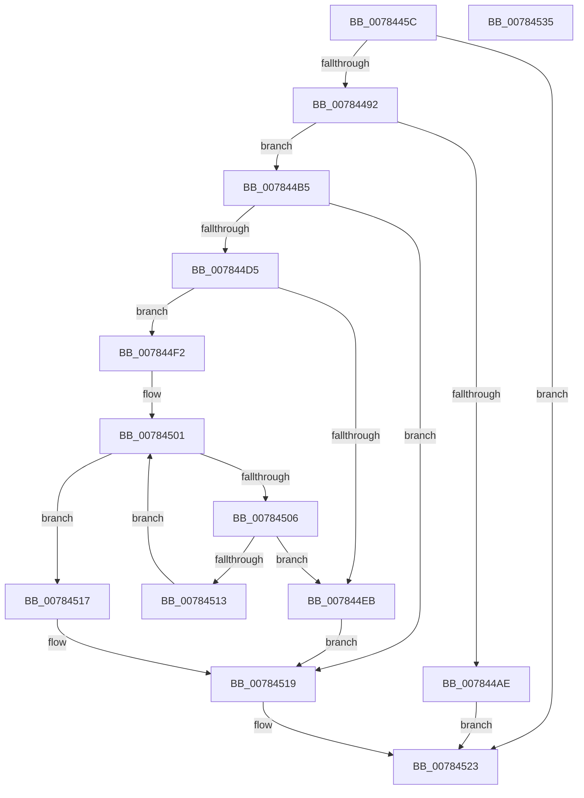

# PspQueryAndCheckCpuPartitionName

- RVA: `0x0078445C`–`0x00784536` (길이 `218` bytes)
- VA: `0x000000014078445C`
- 실행 섹션: `PAGE`
- PDB 이름 있음: `예`; PDB Function 태그: `아니요`
- unwind 정보 RVA: `0x000CE124`
- 디코드: `64`개 명령, `218/218` bytes 표시
- 미해석 바이트: `0` (있으면 어셈블리에 `.byte`로 보존)

> 이 문서는 커널 이미지의 기계어와 PDB 기호를 분석해 생성했습니다. 4번과 5번은 함수 원형과 자료형을 바이너리 사용 방식에서 추정한 C 해석이며 원본 소스 복구 결과는 아닙니다.

## 1. Dependencies

- 직접 호출 지점: **5**; 고유 호출 대상: **4**
- 직접 호출자로 확인된 함수: **1**
- RIP 상대 이미지 참조: **1**

### Outgoing calls
- `0x00784480` → [ObQueryNameStringMode](../8A/ObQueryNameStringMode_function_008A7ED0.md) (function, `0x008A7ED0`)
- `0x007844A1` → [ExAllocatePool2](../../poolcode/B8/ExAllocatePool2_function_00B820F0.md) (function, `0x00B820F0`)
- `0x007844CA` → [ObQueryNameStringMode](../8A/ObQueryNameStringMode_function_008A7ED0.md) (function, `0x008A7ED0`)
- `0x007844E2` → [RtlPrefixUnicodeString](../8F/RtlPrefixUnicodeString_function_008F4F70.md) (function, `0x008F4F70`)
- `0x0078451E` → [ExFreePoolWithTag](../../poolcode/B8/ExFreePoolWithTag_function_00B82870.md) (function, `0x00B82870`)

### Direct callers
- [NtCreateCpuPartition](NtCreateCpuPartition_function_00782E30.md) at `0x00782FB7`

### Static image references
- `0x007844D8` → RVA `0x00B4B0E0` (`PspCpuPartitionDirectoryPathString`; read)

## 2. Other-region calls and transfers

- 다른 실행 섹션으로 향하는 call: **2**
  - `0x007844A1` → [ExAllocatePool2](../../poolcode/B8/ExAllocatePool2_function_00B820F0.md) (`PAGE` → `POOLCODE`)
  - `0x0078451E` → [ExFreePoolWithTag](../../poolcode/B8/ExFreePoolWithTag_function_00B82870.md) (`PAGE` → `POOLCODE`)
- 별도 외부 분기/꼬리 이동을 확인하지 못했습니다.

## 3. Assembly (complete function range)

```asm
0078445C  48 8B C4                        mov rax, rsp
0078445F  48 89 58 08                     mov qword ptr [rax + 8], rbx
00784463  48 89 70 18                     mov qword ptr [rax + 0x18], rsi
00784467  57                              push rdi
00784468  48 83 EC 30                     sub rsp, 0x30
0078446C  83 60 10 00                     and dword ptr [rax + 0x10], 0
00784470  4C 8D 48 10                     lea r9, [rax + 0x10]
00784474  45 33 C0                        xor r8d, r8d
00784477  C6 40 E8 00                     mov byte ptr [rax - 0x18], 0
0078447B  33 D2                           xor edx, edx
0078447D  48 8B F1                        mov rsi, rcx
00784480  E8 4B 3A 12 00                  call 0x1408a7ed0
00784485  8B D8                           mov ebx, eax
00784487  3D 04 00 00 C0                  cmp eax, 0xc0000004
0078448C  0F 85 91 00 00 00               jne 0x140784523
00784492  8B 54 24 48                     mov edx, dword ptr [rsp + 0x48]
00784496  B9 00 01 00 00                  mov ecx, 0x100
0078449B  41 B8 50 73 70 50               mov r8d, 0x50707350
007844A1  E8 4A DC 3F 00                  call 0x140b820f0
007844A6  48 8B F8                        mov rdi, rax
007844A9  48 85 C0                        test rax, rax
007844AC  75 07                           jne 0x1407844b5
007844AE  BB 9A 00 00 C0                  mov ebx, 0xc000009a
007844B3  EB 6E                           jmp 0x140784523
007844B5  44 8B 44 24 48                  mov r8d, dword ptr [rsp + 0x48]
007844BA  4C 8D 4C 24 48                  lea r9, [rsp + 0x48]
007844BF  48 8B D7                        mov rdx, rdi
007844C2  C6 44 24 20 00                  mov byte ptr [rsp + 0x20], 0
007844C7  48 8B CE                        mov rcx, rsi
007844CA  E8 01 3A 12 00                  call 0x1408a7ed0
007844CF  8B D8                           mov ebx, eax
007844D1  85 C0                           test eax, eax
007844D3  78 44                           js 0x140784519
007844D5  41 B0 01                        mov r8b, 1
007844D8  48 8D 0D 01 6C 3C 00            lea rcx, [rip + 0x3c6c01]
007844DF  48 8B D7                        mov rdx, rdi
007844E2  E8 89 0A 17 00                  call 0x1408f4f70
007844E7  84 C0                           test al, al
007844E9  75 07                           jne 0x1407844f2
007844EB  BB 0D 00 00 C0                  mov ebx, 0xc000000d
007844F0  EB 27                           jmp 0x140784519
007844F2  0F B7 07                        movzx eax, word ptr [rdi]
007844F5  BA 1D 00 00 00                  mov edx, 0x1d
007844FA  66 D1 E8                        shr ax, 1
007844FD  44 0F B7 C0                     movzx r8d, ax
00784501  41 3B D0                        cmp edx, r8d
00784504  73 11                           jae 0x140784517
00784506  48 8B 47 08                     mov rax, qword ptr [rdi + 8]
0078450A  8B CA                           mov ecx, edx
0078450C  66 83 3C 48 5C                  cmp word ptr [rax + rcx*2], 0x5c
00784511  74 D8                           je 0x1407844eb
00784513  FF C2                           inc edx
00784515  EB EA                           jmp 0x140784501
00784517  33 DB                           xor ebx, ebx
00784519  33 D2                           xor edx, edx
0078451B  48 8B CF                        mov rcx, rdi
0078451E  E8 4D E3 3F 00                  call 0x140b82870
00784523  48 8B 74 24 50                  mov rsi, qword ptr [rsp + 0x50]
00784528  8B C3                           mov eax, ebx
0078452A  48 8B 5C 24 40                  mov rbx, qword ptr [rsp + 0x40]
0078452F  48 83 C4 30                     add rsp, 0x30
00784533  5F                              pop rdi
00784534  C3                              ret
00784535  CC                              int3
```

## 4. C-style interpretation (structured pseudocode)

```c
__int64 __fastcall PspQueryAndCheckCpuPartitionName(__int64 a1, int a2, int a3)
{
    __int64 result;
    __int64 v_rbx;
    __int64 v_rsp;
    unsigned __int8 v_stack_m18;
    unsigned int v_stack_p10;
    unsigned __int64 v_stack_p18;
    unsigned __int64 v_stack_p8;

    *(unsigned __int64 *)(v_rsp + 8) = v_rbx;
    *(unsigned __int64 *)(v_rsp + 24) = v_rsi;
    v_rsp = (v_rsp) - (48);
    a3 = 0;
    *(unsigned __int8 *)(v_rsp - 24) = 0;
    a2 = 0;
    result = ObQueryNameStringMode(a1, a2, a3, v_rsp + 16);
    if (((unsigned int)(result)) != 0xC0000004ULL) goto loc_00784523;
    result = ExAllocatePool2(256, (unsigned int)(v_stack_p10), (unsigned int)(0x50707350ULL), v_rsp + 16);
    if (result != 0) goto loc_007844B5;
    goto loc_00784523;
loc_007844B5:
    v_stack_m18 = 0;
    result = ObQueryNameStringMode(a1, result, (unsigned int)(v_stack_p10), v_stack_p10);
    if (sign_flag) goto loc_00784519;
    result = RtlPrefixUnicodeString(v_rip + 3959809, result, 1, v_stack_p10);
    if ((unsigned __int8)(result) != 0) goto loc_007844F2;
loc_007844EB:
    goto loc_00784519;
loc_007844F2:
    result = (unsigned __int16)((*(unsigned __int16 *)(result)) >> (1));
loc_00784501:
    if (29 >= ((unsigned int)((unsigned __int16)(result)))) goto loc_00784517;
    if ((*(unsigned __int16 *)(*(unsigned __int64 *)(result + 8) + 29 * 2)) == 92) goto loc_007844EB;
    a2 = (unsigned int)((29) + 1);
    goto loc_00784501;
loc_00784517:
    v_rbx = 0;
loc_00784519:
    a2 = 0;
    result = ExFreePoolWithTag(result, a2, (unsigned __int16)(result), v_stack_p10);
loc_00784523:
    v_rsp = (v_rsp) + (48);
    return 0;
}
```

## 5. (Beta) C Style

```c
int64_t PspQueryAndCheckCpuPartitionName(int64_t Arg1, int32_t Arg2, int32_t Arg3)
{
    int64_t result;
    int64_t local_rbx;
    int64_t local_rsp;
    uint8_t v_stack_m18;
    uint32_t v_stack_p10;
    uint64_t v_stack_p18;
    uint64_t v_stack_p8;

    *(uint64_t *)(local_rsp + 0x8) = local_rbx;
    *(uint64_t *)(local_rsp + 0x18) = local_rsi;
    local_rsp = (local_rsp) - (48);
    Arg3 = 0;
    *(uint8_t *)(local_rsp - 0x18) = 0;
    Arg2 = 0;
    result = ObQueryNameStringMode(Arg1, Arg2, Arg3, local_rsp + 16);
    if (((uint32_t)(result)) != 0xC0000004ULL) goto loc_00784523;
    result = ExAllocatePool2(256, (uint32_t)(v_stack_p10), (uint32_t)(0x50707350ULL), local_rsp + 16);
    if (result != 0) goto loc_007844B5;
    goto loc_00784523;
loc_007844B5:
    v_stack_m18 = 0;
    result = ObQueryNameStringMode(Arg1, result, (uint32_t)(v_stack_p10), v_stack_p10);
    if (sign_flag) goto loc_00784519;
    result = RtlPrefixUnicodeString(v_rip + 3959809, result, 1, v_stack_p10);
    if ((uint8_t)(result) != 0) goto loc_007844F2;
loc_007844EB:
    goto loc_00784519;
loc_007844F2:
    result = (uint16_t)((*(uint16_t *)(result)) >> (1));
loc_00784501:
    if (29 >= ((uint32_t)((uint16_t)(result)))) goto loc_00784517;
    if ((*(uint16_t *)(*(uint64_t *)(result + 0x8) + 0x1D * 2)) == 92) goto loc_007844EB;
    Arg2 = (uint32_t)((29) + 1);
    goto loc_00784501;
loc_00784517:
    local_rbx = 0;
loc_00784519:
    Arg2 = 0;
    result = ExFreePoolWithTag(result, Arg2, (uint16_t)(result), v_stack_p10);
loc_00784523:
    local_rsp = (local_rsp) + (48);
    return 0;
}
```

## 6. Execution-region graph

[열기: 2D/3D 그래프와 함수 탐색 컨트롤 패널](../../../control-panel.html?section=page&rva=0x0078445C&view=graph)

- 2D 그래프는 위에서 아래로 흐르고, 3D 그래프는 빈 공간을 드래그해 회전합니다. Shift+드래그는 이동, 휠은 확대·축소, 함수 노드 선택은 대상 보고서 이동입니다.

### Static fallback


