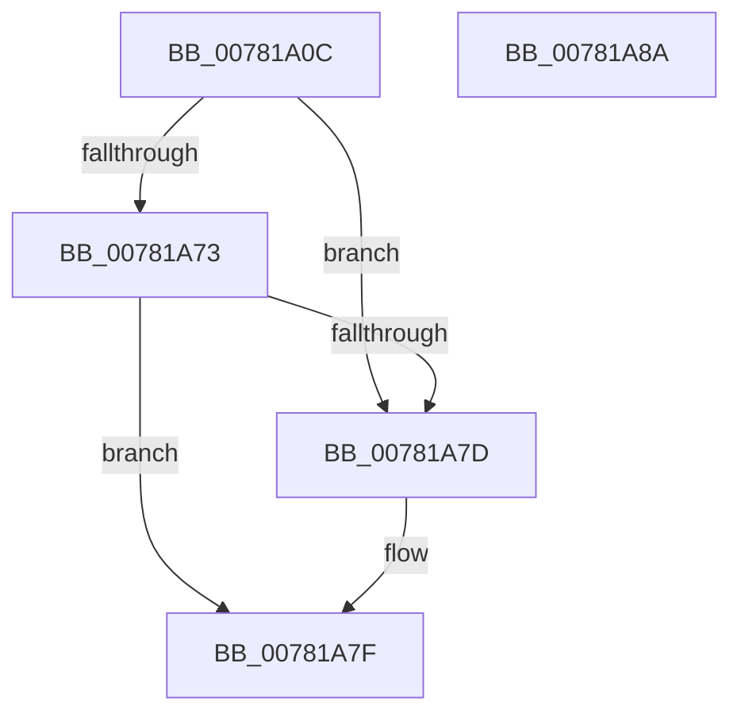

# PspQueryForwardersEnabled

- RVA: `0x00781A0C`–`0x00781A8B` (길이 `127` bytes)
- VA: `0x0000000140781A0C`
- 실행 섹션: `PAGE`
- PDB 이름 있음: `예`; PDB Function 태그: `아니요`
- unwind 정보 RVA: `0x000CE364`
- 디코드: `31`개 명령, `127/127` bytes 표시
- 미해석 바이트: `0` (있으면 어셈블리에 `.byte`로 보존)

> 이 문서는 커널 이미지의 기계어와 PDB 기호를 분석해 생성했습니다. 4번과 5번은 함수 원형과 자료형을 바이너리 사용 방식에서 추정한 C 해석이며 원본 소스 복구 결과는 아닙니다.

## 1. Dependencies

- 직접 호출 지점: **2**; 고유 호출 대상: **2**
- 직접 호출자로 확인된 함수: **2**
- RIP 상대 이미지 참조: **2**

### Outgoing calls
- `0x00781A25` → [memset](../../text/6C/memset_function_006C6C40.md) (function, `0x006C6C40`)
- `0x00781A6A` → [RtlpQueryRegistryValues](../8C/RtlpQueryRegistryValues_function_008C9050.md) (function, `0x008C9050`)

### Direct callers
- [PsBootPhaseComplete](../77/PsBootPhaseComplete_function_0077EA18.md) at `0x0077ED42`
- [PspSiloLoadApiSets](PspSiloLoadApiSets_function_00780848.md) at `0x007808DD`

### Static image references
- `0x00781A2A` → RVA `0x00B04C70` (` ?? ::NNGAKEGL::`string'`; read)
- `0x00781A61` → RVA `0x00B04BF0` (` ?? ::NNGAKEGL::`string'`; read)

## 2. Other-region calls and transfers

- 다른 실행 섹션으로 향하는 call: **1**
  - `0x00781A25` → [memset](../../text/6C/memset_function_006C6C40.md) (`PAGE` → `.text`)
- 별도 외부 분기/꼬리 이동을 확인하지 못했습니다.

## 3. Assembly (complete function range)

```asm
00781A0C  48 8B C4                        mov rax, rsp
00781A0F  53                              push rbx
00781A10  48 81 EC A0 00 00 00            sub rsp, 0xa0
00781A17  83 60 08 00                     and dword ptr [rax + 8], 0
00781A1B  48 8D 48 88                     lea rcx, [rax - 0x78]
00781A1F  33 D2                           xor edx, edx
00781A21  44 8D 42 70                     lea r8d, [rdx + 0x70]
00781A25  E8 16 52 F4 FF                  call 0x1406c6c40
00781A2A  48 8D 05 3F 32 38 00            lea rax, [rip + 0x38323f]
00781A31  C7 44 24 38 24 01 00 00         mov dword ptr [rsp + 0x38], 0x124
00781A39  48 89 44 24 40                  mov qword ptr [rsp + 0x40], rax
00781A3E  4C 8D 44 24 30                  lea r8, [rsp + 0x30]
00781A43  48 8D 84 24 B0 00 00 00         lea rax, [rsp + 0xb0]
00781A4B  C7 44 24 50 00 00 00 04         mov dword ptr [rsp + 0x50], 0x4000000
00781A53  B3 01                           mov bl, 1
00781A55  48 89 44 24 48                  mov qword ptr [rsp + 0x48], rax
00781A5A  45 33 C9                        xor r9d, r9d
00781A5D  88 5C 24 28                     mov byte ptr [rsp + 0x28], bl
00781A61  48 8D 15 88 31 38 00            lea rdx, [rip + 0x383188]
00781A68  33 C9                           xor ecx, ecx
00781A6A  E8 E1 75 14 00                  call 0x1408c9050
00781A6F  85 C0                           test eax, eax
00781A71  78 0A                           js 0x140781a7d
00781A73  83 BC 24 B0 00 00 00 00         cmp dword ptr [rsp + 0xb0], 0
00781A7B  75 02                           jne 0x140781a7f
00781A7D  32 DB                           xor bl, bl
00781A7F  8A C3                           mov al, bl
00781A81  48 81 C4 A0 00 00 00            add rsp, 0xa0
00781A88  5B                              pop rbx
00781A89  C3                              ret
00781A8A  CC                              int3
```

## 4. C-style interpretation (structured pseudocode)

```c
__int64 __fastcall PspQueryForwardersEnabled(__int64 a1, int a2, __int64 a3, int a4)
{
    __int64 result;
    __int64 v_rbx;
    __int64 v_rsp;
    unsigned int v_stack_m58;
    unsigned __int64 v_stack_m60;
    unsigned __int64 v_stack_m68;
    unsigned int v_stack_m70;
    unsigned __int64 v_stack_m78;
    unsigned __int8 v_stack_m80;
    unsigned __int64 v_stack_p8;

    v_rsp = (v_rsp) - (160);
    a2 = 0;
    result = memset(v_rsp - 120, a2, a2 + 112, a4);
    v_stack_m70 = 292;
    v_stack_m68 = v_rip + 3682879;
    v_stack_m58 = 0x4000000ULL;
    v_stack_m60 = v_stack_p8;
    a4 = 0;
    v_stack_m80 = 1;
    a1 = 0;
    result = RtlpQueryRegistryValues(a1, v_rip + 3682696, v_stack_m78, a4);
    if (sign_flag) goto loc_00781A7D;
    v_rbx = 1;
    if (v_stack_p8 == 0) {
        v_rbx = 0;
    }
    v_rsp = (v_rsp) + (160);
    return 0;
}
```

## 5. (Beta) C Style

```c
int64_t PspQueryForwardersEnabled(int64_t Arg1, int32_t Arg2, int64_t Arg3, int32_t Arg4)
{
    int64_t result;
    int64_t local_rbx;
    int64_t local_rsp;
    uint32_t v_stack_m58;
    uint64_t v_stack_m60;
    uint64_t v_stack_m68;
    uint32_t v_stack_m70;
    uint64_t v_stack_m78;
    uint8_t v_stack_m80;
    uint64_t v_stack_p8;

    local_rsp = (local_rsp) - (160);
    Arg2 = 0;
    result = memset(local_rsp - 120, Arg2, Arg2 + 112, Arg4);
    v_stack_m70 = 292;
    v_stack_m68 = v_rip + 3682879;
    v_stack_m58 = 0x4000000ULL;
    v_stack_m60 = v_stack_p8;
    Arg4 = 0;
    v_stack_m80 = 1;
    Arg1 = 0;
    result = RtlpQueryRegistryValues(Arg1, v_rip + 3682696, v_stack_m78, Arg4);
    if (sign_flag) goto loc_00781A7D;
    local_rbx = 1;
    if (v_stack_p8 == 0) {
        local_rbx = 0;
    }
    local_rsp = (local_rsp) + (160);
    return 0;
}
```

## 6. Execution-region graph

[열기: 2D/3D 그래프와 함수 탐색 컨트롤 패널](../../../control-panel.html?section=page&rva=0x00781A0C&view=graph)

- 2D 그래프는 위에서 아래로 흐르고, 3D 그래프는 빈 공간을 드래그해 회전합니다. Shift+드래그는 이동, 휠은 확대·축소, 함수 노드 선택은 대상 보고서 이동입니다.

### Static fallback


