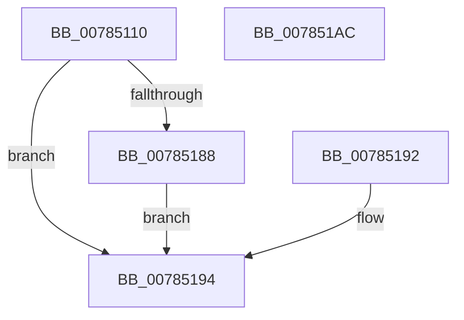

# PspQueryJobHierarchyInterferenceCount

- RVA: `0x00785110`–`0x007851AD` (길이 `157` bytes)
- VA: `0x0000000140785110`
- 실행 섹션: `PAGE`
- PDB 이름 있음: `예`; PDB Function 태그: `아니요`
- unwind 정보 RVA: `0x000CF208`
- 디코드: `40`개 명령, `157/157` bytes 표시
- 미해석 바이트: `0` (있으면 어셈블리에 `.byte`로 보존)

> 이 문서는 커널 이미지의 기계어와 PDB 기호를 분석해 생성했습니다. 4번과 5번은 함수 원형과 자료형을 바이너리 사용 방식에서 추정한 C 해석이며 원본 소스 복구 결과는 아닙니다.

## 1. Dependencies

- 직접 호출 지점: **3**; 고유 호출 대상: **3**
- 직접 호출자로 확인된 함수: **1**
- RIP 상대 이미지 참조: **1**

### Outgoing calls
- `0x00785137` → [PspLockJobShared](../91/PspLockJobShared_function_0091A490.md) (function, `0x0091A490`)
- `0x00785172` → [PspEnumJobsAndProcessesInJobHierarchy](../91/PspEnumJobsAndProcessesInJobHierarchy_function_0091A1EC.md) (function, `0x0091A1EC`)
- `0x0078517F` → [PspUnlockJob](../91/PspUnlockJob_function_00919E00.md) (function, `0x00919E00`)

### Direct callers
- [NtQueryInformationJobObject](../9F/NtQueryInformationJobObject_function_009FB860.md) at `0x009FC4E4`

### Static image references
- `0x00785163` → RVA `0x007851C0` (`PspQueryProcessInterferenceCountCallback`; read)

## 2. Other-region calls and transfers

- 다른 실행 섹션으로 향하는 call: **0**
- 별도 외부 분기/꼬리 이동을 확인하지 못했습니다.

## 3. Assembly (complete function range)

```asm
00785110  48 89 5C 24 10                  mov qword ptr [rsp + 0x10], rbx
00785115  48 89 74 24 18                  mov qword ptr [rsp + 0x18], rsi
0078511A  48 89 7C 24 20                  mov qword ptr [rsp + 0x20], rdi
0078511F  41 56                           push r14
00785121  48 83 EC 50                     sub rsp, 0x50
00785125  4C 8B F2                        mov r14, rdx
00785128  48 8B F9                        mov rdi, rcx
0078512B  65 48 8B 1C 25 88 01 00 00      mov rbx, qword ptr gs:[0x188]
00785134  48 8B D3                        mov rdx, rbx
00785137  E8 54 53 19 00                  call 0x14091a490
0078513C  48 83 64 24 60 00               and qword ptr [rsp + 0x60], 0
00785142  48 8D 44 24 60                  lea rax, [rsp + 0x60]
00785147  48 89 44 24 40                  mov qword ptr [rsp + 0x40], rax
0078514C  48 89 7C 24 48                  mov qword ptr [rsp + 0x48], rdi
00785151  C7 44 24 28 01 00 00 00         mov dword ptr [rsp + 0x28], 1
00785159  48 8D 44 24 40                  lea rax, [rsp + 0x40]
0078515E  48 89 44 24 20                  mov qword ptr [rsp + 0x20], rax
00785163  4C 8D 0D 56 00 00 00            lea r9, [rip + 0x56]
0078516A  45 33 C0                        xor r8d, r8d
0078516D  33 D2                           xor edx, edx
0078516F  48 8B CF                        mov rcx, rdi
00785172  E8 75 50 19 00                  call 0x14091a1ec
00785177  8B F0                           mov esi, eax
00785179  48 8B D3                        mov rdx, rbx
0078517C  48 8B CF                        mov rcx, rdi
0078517F  E8 7C 4C 19 00                  call 0x140919e00
00785184  85 F6                           test esi, esi
00785186  78 0C                           js 0x140785194
00785188  48 8B 4C 24 60                  mov rcx, qword ptr [rsp + 0x60]
0078518D  49 89 0E                        mov qword ptr [r14], rcx
00785190  EB 02                           jmp 0x140785194
00785192  8B F0                           mov esi, eax
00785194  8B C6                           mov eax, esi
00785196  48 8B 5C 24 68                  mov rbx, qword ptr [rsp + 0x68]
0078519B  48 8B 74 24 70                  mov rsi, qword ptr [rsp + 0x70]
007851A0  48 8B 7C 24 78                  mov rdi, qword ptr [rsp + 0x78]
007851A5  48 83 C4 50                     add rsp, 0x50
007851A9  41 5E                           pop r14
007851AB  C3                              ret
007851AC  CC                              int3
```

## 4. C-style interpretation (structured pseudocode)

```c
__int64 __fastcall PspQueryJobHierarchyInterferenceCount(__int64 a1, __int64 a2, int a3)
{
    __int64 result;
    __int64 v_rsp;
    unsigned __int64 v_stack_m10;
    unsigned __int64 v_stack_m18;
    unsigned int v_stack_m30;
    unsigned __int64 v_stack_m38;
    unsigned __int64 v_stack_p10;
    unsigned __int64 v_stack_p18;
    unsigned __int64 v_stack_p20;
    unsigned __int64 v_stack_p8;

    v_stack_p10 = v_rbx;
    v_stack_p18 = v_rsi;
    v_stack_p20 = v_rdi;
    v_rsp = (v_rsp) - (80);
    result = PspLockJobShared(a1, *(unsigned __int64 *)(gs_base + (0 + 392)), a3, a4);
    v_stack_m18 = v_stack_p8;
    v_stack_m10 = a1;
    v_stack_m30 = 1;
    v_stack_m38 = v_stack_m18;
    a3 = 0;
    a2 = 0;
    result = PspEnumJobsAndProcessesInJobHierarchy(a1, a2, a3, v_rip + 86);
    result = PspUnlockJob(a1, *(unsigned __int64 *)(gs_base + (0 + 392)), a3, v_rip + 86);
    if (sign_flag) goto loc_00785194;
    *(unsigned __int64 *)(a2) = v_stack_p8;
    goto loc_00785194;
loc_00785194:
    v_rsp = (v_rsp) + (80);
    return (unsigned int)((unsigned int)((unsigned int)((unsigned int)(result))));
}
```

## 5. (Beta) C Style

```c
int64_t PspQueryJobHierarchyInterferenceCount(int64_t Arg1, void *Arg2, int32_t Arg3)
{
    uint8_t *arg2 = (uint8_t *)Arg2;

    int64_t result;
    int64_t local_rsp;
    uint64_t v_stack_m10;
    uint64_t v_stack_m18;
    uint32_t v_stack_m30;
    uint64_t v_stack_m38;
    uint64_t v_stack_p10;
    uint64_t v_stack_p18;
    uint64_t v_stack_p20;
    uint64_t v_stack_p8;

    v_stack_p10 = local_rbx;
    v_stack_p18 = local_rsi;
    v_stack_p20 = local_rdi;
    local_rsp = (local_rsp) - (80);
    result = PspLockJobShared(Arg1, *(uint64_t *)(gs_base + (0 + 0x188)), Arg3, a4);
    v_stack_m18 = v_stack_p8;
    v_stack_m10 = Arg1;
    v_stack_m30 = 1;
    v_stack_m38 = v_stack_m18;
    Arg3 = 0;
    Arg2 = 0;
    result = PspEnumJobsAndProcessesInJobHierarchy(Arg1, Arg2, Arg3, v_rip + 86);
    result = PspUnlockJob(Arg1, *(uint64_t *)(gs_base + (0 + 0x188)), Arg3, v_rip + 86);
    if (sign_flag) goto loc_00785194;
    *(uint64_t *)(arg2) = v_stack_p8;
    goto loc_00785194;
loc_00785194:
    local_rsp = (local_rsp) + (80);
    return (uint32_t)((uint32_t)((uint32_t)((uint32_t)(result))));
}
```

### 관측된 메모리 오프셋

구조체 형식이 확인되지 않은 접근은 인자 기준의 오프셋으로만 기록했습니다.

| 기준 인자 | 오프셋 표현 | 폭 (bit) | 접근 |
|---|---:|---:|---|
| `Arg2` | `+ 0x0` | `64` | `W` |

## 6. Execution-region graph

[열기: 2D/3D 그래프와 함수 탐색 컨트롤 패널](../../../control-panel.html?section=page&rva=0x00785110&view=graph)

- 2D 그래프는 위에서 아래로 흐르고, 3D 그래프는 빈 공간을 드래그해 회전합니다. Shift+드래그는 이동, 휠은 확대·축소, 함수 노드 선택은 대상 보고서 이동입니다.

### Static fallback


