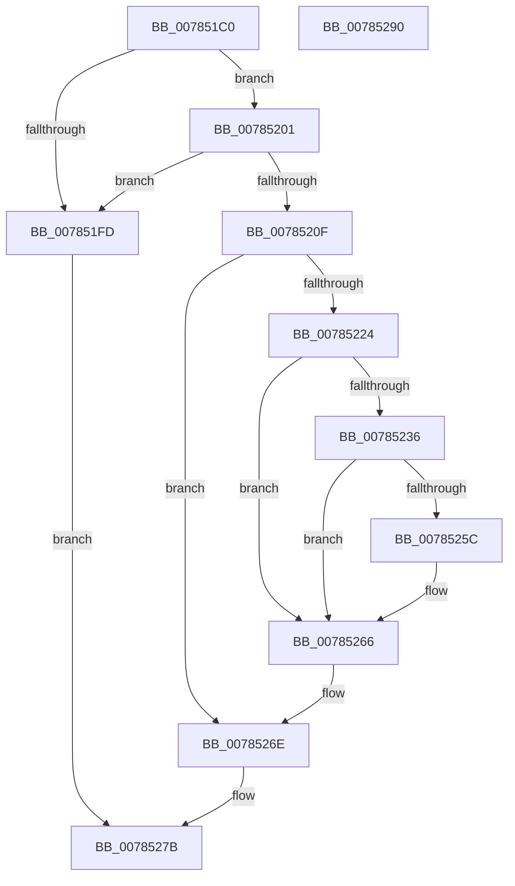

# PspQueryProcessInterferenceCountCallback

- RVA: `0x007851C0`–`0x00785291` (길이 `209` bytes)
- VA: `0x00000001407851C0`
- 실행 섹션: `PAGE`
- PDB 이름 있음: `예`; PDB Function 태그: `아니요`
- unwind 정보 RVA: `0x000CF1F0`
- 디코드: `64`개 명령, `209/209` bytes 표시
- 미해석 바이트: `0` (있으면 어셈블리에 `.byte`로 보존)

> 이 문서는 커널 이미지의 기계어와 PDB 기호를 분석해 생성했습니다. 4번과 5번은 함수 원형과 자료형을 바이너리 사용 방식에서 추정한 C 해석이며 원본 소스 복구 결과는 아닙니다.

## 1. Dependencies

- 직접 호출 지점: **5**; 고유 호출 대상: **5**
- 직접 호출자로 확인된 함수: **0**
- RIP 상대 이미지 참조: **0**

### Outgoing calls
- `0x00785206` → [ObReferenceObjectSafeWithTag](../../text/21/ObReferenceObjectSafeWithTag_function_00210EE0.md) (function, `0x00210EE0`)
- `0x00785219` → [ExAcquireRundownProtection](../../text/21/ExAcquireRundownProtection_function_00216620.md) (function, `0x00216620`)
- `0x00785251` → [PsInvokeWin32Callout](../91/PsInvokeWin32Callout_function_009133C0.md) (function, `0x009133C0`)
- `0x00785269` → [ExReleaseRundownProtection](../../text/34/ExReleaseRundownProtection_function_00349E80.md) (function, `0x00349E80`)
- `0x00785276` → [ObfDereferenceObjectWithTag](../../text/2F/ObfDereferenceObjectWithTag_function_002F78E0.md) (function, `0x002F78E0`)

### Direct callers
- 이 함수 시작 RVA로 연결되는 직접 call은 확인되지 않았습니다. 간접 호출은 완전히 역산할 수 없습니다.

### Static image references
- 디코드된 RIP-relative 메모리 참조가 없습니다.

## 2. Other-region calls and transfers

- 다른 실행 섹션으로 향하는 call: **4**
  - `0x00785206` → [ObReferenceObjectSafeWithTag](../../text/21/ObReferenceObjectSafeWithTag_function_00210EE0.md) (`PAGE` → `.text`)
  - `0x00785219` → [ExAcquireRundownProtection](../../text/21/ExAcquireRundownProtection_function_00216620.md) (`PAGE` → `.text`)
  - `0x00785269` → [ExReleaseRundownProtection](../../text/34/ExReleaseRundownProtection_function_00349E80.md) (`PAGE` → `.text`)
  - `0x00785276` → [ObfDereferenceObjectWithTag](../../text/2F/ObfDereferenceObjectWithTag_function_002F78E0.md) (`PAGE` → `.text`)
- 별도 외부 분기/꼬리 이동을 확인하지 못했습니다.

## 3. Assembly (complete function range)

```asm
007851C0  48 89 5C 24 10                  mov qword ptr [rsp + 0x10], rbx
007851C5  48 89 74 24 20                  mov qword ptr [rsp + 0x20], rsi
007851CA  55                              push rbp
007851CB  57                              push rdi
007851CC  41 56                           push r14
007851CE  48 8B EC                        mov rbp, rsp
007851D1  48 83 EC 40                     sub rsp, 0x40
007851D5  83 65 30 00                     and dword ptr [rbp + 0x30], 0
007851D9  33 C0                           xor eax, eax
007851DB  83 65 20 00                     and dword ptr [rbp + 0x20], 0
007851DF  0F 57 C0                        xorps xmm0, xmm0
007851E2  48 89 45 F0                     mov qword ptr [rbp - 0x10], rax
007851E6  4C 8B F2                        mov r14, rdx
007851E9  89 45 F8                        mov dword ptr [rbp - 8], eax
007851EC  48 8B F9                        mov rdi, rcx
007851EF  8B 81 F0 01 00 00               mov eax, dword ptr [rcx + 0x1f0]
007851F5  0F 11 45 E0                     movups xmmword ptr [rbp - 0x20], xmm0
007851F9  A8 01                           test al, 1
007851FB  74 04                           je 0x140785201
007851FD  33 DB                           xor ebx, ebx
007851FF  EB 7A                           jmp 0x14078527b
00785201  BA 50 73 4A 62                  mov edx, 0x624a7350
00785206  E8 D5 BC A8 FF                  call 0x140210ee0
0078520B  84 C0                           test al, al
0078520D  74 EE                           je 0x1407851fd
0078520F  48 8D B7 E8 01 00 00            lea rsi, [rdi + 0x1e8]
00785216  48 8B CE                        mov rcx, rsi
00785219  E8 02 14 A9 FF                  call 0x140216620
0078521E  33 DB                           xor ebx, ebx
00785220  84 C0                           test al, al
00785222  74 4A                           je 0x14078526e
00785224  49 8B 46 08                     mov rax, qword ptr [r14 + 8]
00785228  8B 88 40 02 00 00               mov ecx, dword ptr [rax + 0x240]
0078522E  89 4D 20                        mov dword ptr [rbp + 0x20], ecx
00785231  83 F9 FD                        cmp ecx, -3
00785234  77 30                           ja 0x140785266
00785236  48 8D 45 30                     lea rax, [rbp + 0x30]
0078523A  48 89 7D F0                     mov qword ptr [rbp - 0x10], rdi
0078523E  4C 8D 4D 20                     lea r9, [rbp + 0x20]
00785242  48 89 45 F8                     mov qword ptr [rbp - 8], rax
00785246  44 8D 43 01                     lea r8d, [rbx + 1]
0078524A  48 8D 55 E0                     lea rdx, [rbp - 0x20]
0078524E  8D 4B 18                        lea ecx, [rbx + 0x18]
00785251  E8 6A E1 18 00                  call 0x1409133c0
00785256  8B D8                           mov ebx, eax
00785258  85 C0                           test eax, eax
0078525A  78 0A                           js 0x140785266
0078525C  4D 8B 0E                        mov r9, qword ptr [r14]
0078525F  44 8B 45 30                     mov r8d, dword ptr [rbp + 0x30]
00785263  4D 01 01                        add qword ptr [r9], r8
00785266  48 8B CE                        mov rcx, rsi
00785269  E8 12 4C BC FF                  call 0x140349e80
0078526E  BA 50 73 4A 62                  mov edx, 0x624a7350
00785273  48 8B CF                        mov rcx, rdi
00785276  E8 65 26 B7 FF                  call 0x1402f78e0
0078527B  48 8B 74 24 78                  mov rsi, qword ptr [rsp + 0x78]
00785280  8B C3                           mov eax, ebx
00785282  48 8B 5C 24 68                  mov rbx, qword ptr [rsp + 0x68]
00785287  48 83 C4 40                     add rsp, 0x40
0078528B  41 5E                           pop r14
0078528D  5F                              pop rdi
0078528E  5D                              pop rbp
0078528F  C3                              ret
00785290  CC                              int3
```

## 4. C-style interpretation (structured pseudocode)

```c
__int64 __fastcall PspQueryProcessInterferenceCountCallback(__int64 a1, __int64 a2)
{
    __int64 result;
    __int64 v_rbx;
    __int64 v_rsp;
    unsigned int v_stack_m20;
    unsigned __int64 v_stack_m28;
    unsigned __int64 v_stack_m38;
    unsigned __int64 v_stack_p10;
    unsigned int v_stack_p18;
    unsigned __int64 v_stack_p20;
    unsigned int v_stack_p8;

    v_stack_p10 = v_rbx;
    v_stack_p20 = v_rsi;
    v_rsp = (v_rsp) - (64);
    result = 0;
    v_stack_m28 = 0;
    v_stack_m20 = 0;
    v_stack_m38 = v_xmm0;
    if ((((unsigned __int8)((unsigned int)(*(unsigned int *)(a1 + 496)))) & (1)) == 0) goto loc_00785201;
loc_007851FD:
    v_rbx = 0;
    goto loc_0078527B;
loc_00785201:
    result = ObReferenceObjectSafeWithTag(a1, (unsigned int)(0x624A7350ULL), a3, a4);
    if ((unsigned __int8)(result) == 0) goto loc_007851FD;
    result = ExAcquireRundownProtection(a1 + 488, (unsigned int)(0x624A7350ULL), a3, a4);
    v_rbx = 0;
    if ((unsigned __int8)(result) == 0) goto loc_0078526E;
    v_stack_p8 = (unsigned int)((unsigned int)(*(unsigned int *)(*(unsigned __int64 *)(a2 + 8) + 576)));
    if (((unsigned int)((unsigned int)(*(unsigned int *)(*(unsigned __int64 *)(a2 + 8) + 576)))) > -3) goto loc_00785266;
    v_stack_m28 = a1;
    v_stack_m20 = v_stack_p18;
    result = PsInvokeWin32Callout(v_rbx + 24, v_stack_m38, v_rbx + 1, v_stack_p8);
    if (!(sign_flag)) {
        a4 = *(unsigned __int64 *)(a2);
        a3 = v_stack_p18;
    }
    result = ExReleaseRundownProtection(a1 + 488, v_stack_m38, a3, a4);
loc_0078526E:
    result = ObfDereferenceObjectWithTag(a1, (unsigned int)(0x624A7350ULL), a3, a4);
loc_0078527B:
    v_rsp = (v_rsp) + (64);
    return (unsigned int)((unsigned int)((unsigned int)((unsigned int)(result))));
}
```

## 5. (Beta) C Style

```c
int64_t PspQueryProcessInterferenceCountCallback(void *Arg1, void *Arg2)
{
    uint8_t *arg1 = (uint8_t *)Arg1;
    uint8_t *arg2 = (uint8_t *)Arg2;

    int64_t result;
    int64_t local_rbx;
    int64_t local_rsp;
    uint32_t v_stack_m20;
    uint64_t v_stack_m28;
    uint64_t v_stack_m38;
    uint64_t v_stack_p10;
    uint32_t v_stack_p18;
    uint64_t v_stack_p20;
    uint32_t v_stack_p8;

    v_stack_p10 = local_rbx;
    v_stack_p20 = local_rsi;
    local_rsp = (local_rsp) - (64);
    result = 0;
    v_stack_m28 = 0;
    v_stack_m20 = 0;
    v_stack_m38 = v_xmm0;
    if ((((uint8_t)((uint32_t)(*(uint32_t *)(arg1 + 0x1F0)))) & (1)) == 0) goto loc_00785201;
loc_007851FD:
    local_rbx = 0;
    goto loc_0078527B;
loc_00785201:
    result = ObReferenceObjectSafeWithTag(Arg1, (uint32_t)(0x624A7350ULL), a3, a4);
    if ((uint8_t)(result) == 0) goto loc_007851FD;
    result = ExAcquireRundownProtection(Arg1 + 488, (uint32_t)(0x624A7350ULL), a3, a4);
    local_rbx = 0;
    if ((uint8_t)(result) == 0) goto loc_0078526E;
    v_stack_p8 = (uint32_t)((uint32_t)(*(uint32_t *)(*(uint64_t *)(arg2 + 0x8) + 0x240)));
    if (((uint32_t)((uint32_t)(*(uint32_t *)(*(uint64_t *)(arg2 + 0x8) + 0x240)))) > -3) goto loc_00785266;
    v_stack_m28 = Arg1;
    v_stack_m20 = v_stack_p18;
    result = PsInvokeWin32Callout(local_rbx + 24, v_stack_m38, local_rbx + 1, v_stack_p8);
    if (!(sign_flag)) {
        a4 = *(uint64_t *)(arg2);
        a3 = v_stack_p18;
    }
    result = ExReleaseRundownProtection(Arg1 + 488, v_stack_m38, a3, a4);
loc_0078526E:
    result = ObfDereferenceObjectWithTag(Arg1, (uint32_t)(0x624A7350ULL), a3, a4);
loc_0078527B:
    local_rsp = (local_rsp) + (64);
    return (uint32_t)((uint32_t)((uint32_t)((uint32_t)(result))));
}
```

### 관측된 메모리 오프셋

구조체 형식이 확인되지 않은 접근은 인자 기준의 오프셋으로만 기록했습니다.

| 기준 인자 | 오프셋 표현 | 폭 (bit) | 접근 |
|---|---:|---:|---|
| `Arg1` | `+ 0x1E8` | `64` | `R` |
| `Arg1` | `+ 0x1F0` | `32` | `R` |
| `Arg2` | `+ 0x0` | `64` | `R` |
| `Arg2` | `+ 0x8` | `64` | `R` |

## 6. Execution-region graph

[열기: 2D/3D 그래프와 함수 탐색 컨트롤 패널](../../../control-panel.html?section=page&rva=0x007851C0&view=graph)

- 2D 그래프는 위에서 아래로 흐르고, 3D 그래프는 빈 공간을 드래그해 회전합니다. Shift+드래그는 이동, 휠은 확대·축소, 함수 노드 선택은 대상 보고서 이동입니다.

### Static fallback


