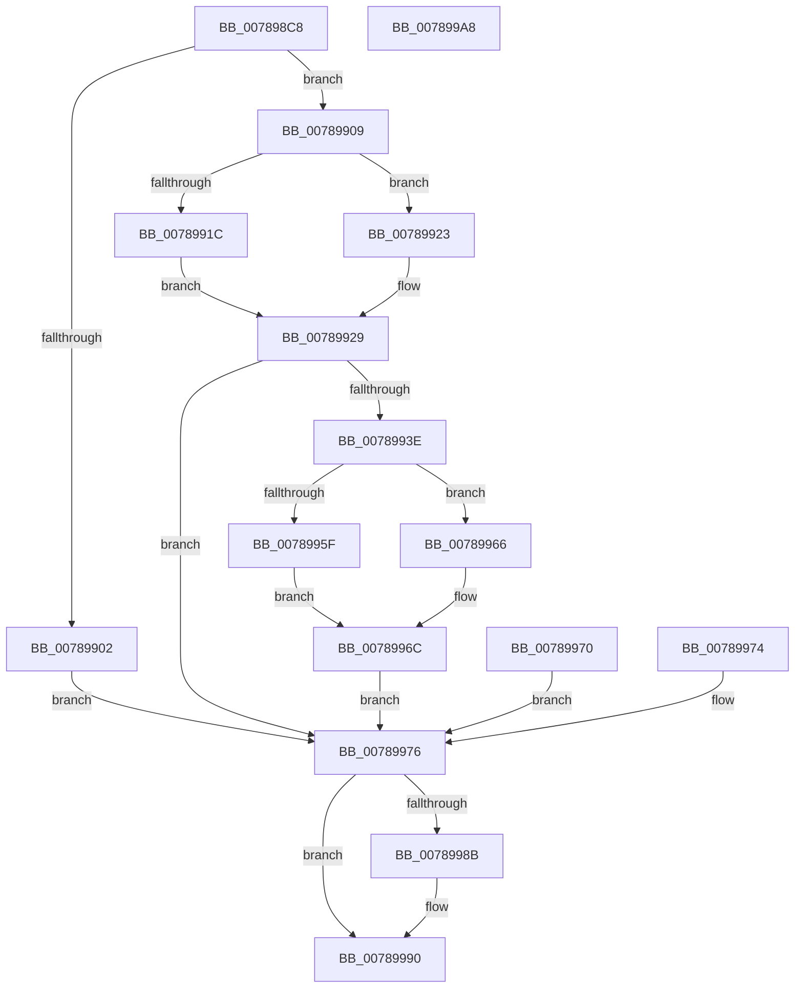

# PspQueryWobTicketPriority

- RVA: `0x007898C8`–`0x007899A9` (길이 `225` bytes)
- VA: `0x00000001407898C8`
- 실행 섹션: `PAGE`
- PDB 이름 있음: `예`; PDB Function 태그: `아니요`
- unwind 정보 RVA: `0x000CF5D4`
- 디코드: `66`개 명령, `225/225` bytes 표시
- 미해석 바이트: `0` (있으면 어셈블리에 `.byte`로 보존)

> 이 문서는 커널 이미지의 기계어와 PDB 기호를 분석해 생성했습니다. 4번과 5번은 함수 원형과 자료형을 바이너리 사용 방식에서 추정한 C 해석이며 원본 소스 복구 결과는 아닙니다.

## 1. Dependencies

- 직접 호출 지점: **8**; 고유 호출 대상: **7**
- 직접 호출자로 확인된 함수: **1**
- RIP 상대 이미지 참조: **1**

### Outgoing calls
- `0x0078991C` → [RtlCopyFromUser](../../text/4F/RtlCopyFromUser_function_004FDAE8.md) (function, `0x004FDAE8`)
- `0x00789923` → [RtlCopyVolatileMemory](../../text/6B/RtlCopyVolatileMemory_function_006BC9D0.md) (function, `0x006BC9D0`)
- `0x00789933` → [PspThreadFromTicket](../8C/PspThreadFromTicket_function_008CB9B0.md) (function, `0x008CB9B0`)
- `0x00789943` → [KeQueryPriorityThread](../../text/38/KeQueryPriorityThread_function_0038F4F0.md) (function, `0x0038F4F0`)
- `0x0078995F` → [RtlCopyToUser](../70/RtlCopyToUser_function_00705D68.md) (function, `0x00705D68`)
- `0x00789966` → [RtlCopyVolatileMemory](../../text/6B/RtlCopyVolatileMemory_function_006BC9D0.md) (function, `0x006BC9D0`)
- `0x0078998B` → [ObfDereferenceObject](../../text/2F/ObfDereferenceObject_function_002F9350.md) (function, `0x002F9350`)
- `0x0078999A` → [_security_check_cookie](../../text/6A/_security_check_cookie_function_006AC640.md) (function, `0x006AC640`)

### Direct callers
- [NtManageWobTicket](NtManageWobTicket_function_00789AC0.md) at `0x00789B0A`

### Static image references
- `0x007898D4` → RVA `0x00E0A740` (`.data`; read)

## 2. Other-region calls and transfers

- 다른 실행 섹션으로 향하는 call: **6**
  - `0x0078991C` → [RtlCopyFromUser](../../text/4F/RtlCopyFromUser_function_004FDAE8.md) (`PAGE` → `.text`)
  - `0x00789923` → [RtlCopyVolatileMemory](../../text/6B/RtlCopyVolatileMemory_function_006BC9D0.md) (`PAGE` → `.text`)
  - `0x00789943` → [KeQueryPriorityThread](../../text/38/KeQueryPriorityThread_function_0038F4F0.md) (`PAGE` → `.text`)
  - `0x00789966` → [RtlCopyVolatileMemory](../../text/6B/RtlCopyVolatileMemory_function_006BC9D0.md) (`PAGE` → `.text`)
  - `0x0078998B` → [ObfDereferenceObject](../../text/2F/ObfDereferenceObject_function_002F9350.md) (`PAGE` → `.text`)
  - `0x0078999A` → [_security_check_cookie](../../text/6A/_security_check_cookie_function_006AC640.md) (`PAGE` → `.text`)
- 별도 외부 분기/꼬리 이동을 확인하지 못했습니다.

## 3. Assembly (complete function range)

```asm
007898C8  88 54 24 10                     mov byte ptr [rsp + 0x10], dl
007898CC  53                              push rbx
007898CD  56                              push rsi
007898CE  41 56                           push r14
007898D0  48 83 EC 50                     sub rsp, 0x50
007898D4  48 8B 05 65 0E 68 00            mov rax, qword ptr [rip + 0x680e65]
007898DB  48 33 C4                        xor rax, rsp
007898DE  48 89 44 24 40                  mov qword ptr [rsp + 0x40], rax
007898E3  44 8A F2                        mov r14b, dl
007898E6  48 8B F1                        mov rsi, rcx
007898E9  4C 89 4C 24 28                  mov qword ptr [rsp + 0x28], r9
007898EE  48 83 64 24 20 00               and qword ptr [rsp + 0x20], 0
007898F4  0F 57 C0                        xorps xmm0, xmm0
007898F7  0F 11 44 24 30                  movups xmmword ptr [rsp + 0x30], xmm0
007898FC  41 83 F8 10                     cmp r8d, 0x10
00789900  73 07                           jae 0x140789909
00789902  BB 04 00 00 C0                  mov ebx, 0xc0000004
00789907  EB 6D                           jmp 0x140789976
00789909  41 B8 10 00 00 00               mov r8d, 0x10
0078990F  48 8B D6                        mov rdx, rsi
00789912  48 8D 4C 24 30                  lea rcx, [rsp + 0x30]
00789917  45 84 F6                        test r14b, r14b
0078991A  74 07                           je 0x140789923
0078991C  E8 C7 41 D7 FF                  call 0x1404fdae8
00789921  EB 06                           jmp 0x140789929
00789923  E8 A8 30 F3 FF                  call 0x1406bc9d0
00789928  90                              nop
00789929  48 8D 54 24 20                  lea rdx, [rsp + 0x20]
0078992E  48 8D 4C 24 30                  lea rcx, [rsp + 0x30]
00789933  E8 78 20 14 00                  call 0x1408cb9b0
00789938  8B D8                           mov ebx, eax
0078993A  85 C0                           test eax, eax
0078993C  78 38                           js 0x140789976
0078993E  48 8B 4C 24 20                  mov rcx, qword ptr [rsp + 0x20]
00789943  E8 A8 5B C0 FF                  call 0x14038f4f0
00789948  89 44 24 38                     mov dword ptr [rsp + 0x38], eax
0078994C  41 B8 10 00 00 00               mov r8d, 0x10
00789952  48 8D 54 24 30                  lea rdx, [rsp + 0x30]
00789957  48 8B CE                        mov rcx, rsi
0078995A  45 84 F6                        test r14b, r14b
0078995D  74 07                           je 0x140789966
0078995F  E8 04 C4 F7 FF                  call 0x140705d68
00789964  EB 06                           jmp 0x14078996c
00789966  E8 65 30 F3 FF                  call 0x1406bc9d0
0078996B  90                              nop
0078996C  33 DB                           xor ebx, ebx
0078996E  EB 06                           jmp 0x140789976
00789970  8B D8                           mov ebx, eax
00789972  EB 02                           jmp 0x140789976
00789974  8B D8                           mov ebx, eax
00789976  48 8B 44 24 28                  mov rax, qword ptr [rsp + 0x28]
0078997B  C7 00 10 00 00 00               mov dword ptr [rax], 0x10
00789981  48 8B 4C 24 20                  mov rcx, qword ptr [rsp + 0x20]
00789986  48 85 C9                        test rcx, rcx
00789989  74 05                           je 0x140789990
0078998B  E8 C0 F9 B6 FF                  call 0x1402f9350
00789990  8B C3                           mov eax, ebx
00789992  48 8B 4C 24 40                  mov rcx, qword ptr [rsp + 0x40]
00789997  48 33 CC                        xor rcx, rsp
0078999A  E8 A1 2C F2 FF                  call 0x1406ac640
0078999F  48 83 C4 50                     add rsp, 0x50
007899A3  41 5E                           pop r14
007899A5  5E                              pop rsi
007899A6  5B                              pop rbx
007899A7  C3                              ret
007899A8  CC                              int3
```

## 4. C-style interpretation (structured pseudocode)

```c
__int64 __fastcall PspQueryWobTicketPriority(__int64 a1, unsigned __int8 a2, int a3, __int64 a4)
{
    __int64 result;
    __int64 v_rbx;
    __int64 v_rsp;
    unsigned __int64 v_stack_m28;
    unsigned int v_stack_m30;
    unsigned __int64 v_stack_m38;
    unsigned __int64 v_stack_m40;
    unsigned __int64 v_stack_m48;
    unsigned __int8 v_stack_p10;

    v_stack_p10 = a2;
    v_rsp = (v_rsp) - (80);
    result = (*(unsigned __int64 *)(v_rip + 6819429)) ^ (v_rsp);
    v_stack_m28 = result;
    v_stack_m40 = a4;
    v_stack_m38 = v_xmm0;
    if (a3 >= 16) goto loc_00789909;
    goto loc_00789976;
loc_00789909:
    if (a2 == 0) goto loc_00789923;
    result = RtlCopyFromUser(v_stack_m38, a1, 16, a4);
    goto loc_00789929;
loc_00789923:
    result = RtlCopyVolatileMemory(v_stack_m38, a1, 16, a4);
loc_00789929:
    result = PspThreadFromTicket(v_stack_m38, v_stack_m48, 16, a4);
    if (sign_flag) goto loc_00789976;
    result = KeQueryPriorityThread(v_stack_m48, v_stack_m48, 16, a4);
    v_stack_m30 = (unsigned int)(result);
    if (a2 == 0) goto loc_00789966;
    result = RtlCopyToUser(a1, v_stack_m38, 16, a4);
    goto loc_0078996C;
loc_00789966:
    result = RtlCopyVolatileMemory(a1, v_stack_m38, 16, a4);
loc_0078996C:
    v_rbx = 0;
    goto loc_00789976;
loc_00789976:
    *(unsigned int *)(v_stack_m40) = 16;
    result = v_stack_m40;
    if (v_stack_m48 != 0) {
        result = ObfDereferenceObject(v_stack_m48, v_stack_m38, 16, a4);
    }
    a1 = (v_stack_m28) ^ (v_rsp);
    result = _security_check_cookie(a1, v_stack_m38, 16, a4);
    v_rsp = (v_rsp) + (80);
    return result;
}
```

## 5. (Beta) C Style

```c
int64_t PspQueryWobTicketPriority(int64_t Arg1, uint8_t Arg2, int32_t Arg3, int64_t Arg4)
{
    int64_t result;
    int64_t local_rbx;
    int64_t local_rsp;
    uint64_t v_stack_m28;
    uint32_t v_stack_m30;
    uint64_t v_stack_m38;
    uint64_t v_stack_m40;
    uint64_t v_stack_m48;
    uint8_t v_stack_p10;

    v_stack_p10 = Arg2;
    local_rsp = (local_rsp) - (80);
    result = (*(uint64_t *)(v_rip + 0x680E65)) ^ (local_rsp);
    v_stack_m28 = result;
    v_stack_m40 = Arg4;
    v_stack_m38 = v_xmm0;
    if (Arg3 >= 16) goto loc_00789909;
    goto loc_00789976;
loc_00789909:
    if (Arg2 == 0) goto loc_00789923;
    result = RtlCopyFromUser(v_stack_m38, Arg1, 16, Arg4);
    goto loc_00789929;
loc_00789923:
    result = RtlCopyVolatileMemory(v_stack_m38, Arg1, 16, Arg4);
loc_00789929:
    result = PspThreadFromTicket(v_stack_m38, v_stack_m48, 16, Arg4);
    if (sign_flag) goto loc_00789976;
    result = KeQueryPriorityThread(v_stack_m48, v_stack_m48, 16, Arg4);
    v_stack_m30 = (uint32_t)(result);
    if (Arg2 == 0) goto loc_00789966;
    result = RtlCopyToUser(Arg1, v_stack_m38, 16, Arg4);
    goto loc_0078996C;
loc_00789966:
    result = RtlCopyVolatileMemory(Arg1, v_stack_m38, 16, Arg4);
loc_0078996C:
    local_rbx = 0;
    goto loc_00789976;
loc_00789976:
    *(uint32_t *)(v_stack_m40) = 16;
    result = v_stack_m40;
    if (v_stack_m48 != 0) {
        result = ObfDereferenceObject(v_stack_m48, v_stack_m38, 16, Arg4);
    }
    Arg1 = (v_stack_m28) ^ (local_rsp);
    result = _security_check_cookie(Arg1, v_stack_m38, 16, Arg4);
    local_rsp = (local_rsp) + (80);
    return result;
}
```

## 6. Execution-region graph

[열기: 2D/3D 그래프와 함수 탐색 컨트롤 패널](../../../control-panel.html?section=page&rva=0x007898C8&view=graph)

- 2D 그래프는 위에서 아래로 흐르고, 3D 그래프는 빈 공간을 드래그해 회전합니다. Shift+드래그는 이동, 휠은 확대·축소, 함수 노드 선택은 대상 보고서 이동입니다.

### Static fallback


