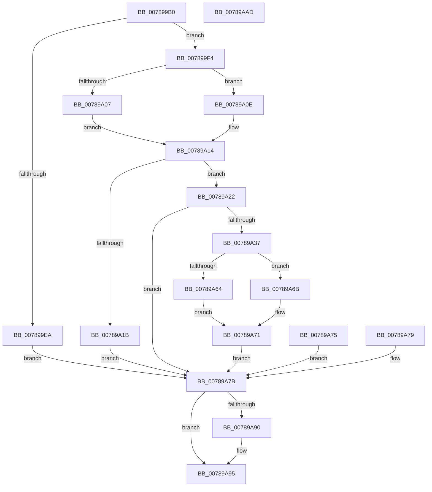

# PspQueryWobTicketQos

- RVA: `0x007899B0`–`0x00789AAE` (길이 `254` bytes)
- VA: `0x00000001407899B0`
- 실행 섹션: `PAGE`
- PDB 이름 있음: `예`; PDB Function 태그: `아니요`
- unwind 정보 RVA: `0x000CF610`
- 디코드: `72`개 명령, `254/254` bytes 표시
- 미해석 바이트: `0` (있으면 어셈블리에 `.byte`로 보존)

> 이 문서는 커널 이미지의 기계어와 PDB 기호를 분석해 생성했습니다. 4번과 5번은 함수 원형과 자료형을 바이너리 사용 방식에서 추정한 C 해석이며 원본 소스 복구 결과는 아닙니다.

## 1. Dependencies

- 직접 호출 지점: **7**; 고유 호출 대상: **6**
- 직접 호출자로 확인된 함수: **1**
- RIP 상대 이미지 참조: **2**

### Outgoing calls
- `0x00789A07` → [RtlCopyFromUser](../../text/4F/RtlCopyFromUser_function_004FDAE8.md) (function, `0x004FDAE8`)
- `0x00789A0E` → [RtlCopyVolatileMemory](../../text/6B/RtlCopyVolatileMemory_function_006BC9D0.md) (function, `0x006BC9D0`)
- `0x00789A2C` → [PspThreadFromTicket](../8C/PspThreadFromTicket_function_008CB9B0.md) (function, `0x008CB9B0`)
- `0x00789A64` → [RtlCopyToUser](../70/RtlCopyToUser_function_00705D68.md) (function, `0x00705D68`)
- `0x00789A6B` → [RtlCopyVolatileMemory](../../text/6B/RtlCopyVolatileMemory_function_006BC9D0.md) (function, `0x006BC9D0`)
- `0x00789A90` → [ObfDereferenceObject](../../text/2F/ObfDereferenceObject_function_002F9350.md) (function, `0x002F9350`)
- `0x00789A9F` → [_security_check_cookie](../../text/6A/_security_check_cookie_function_006AC640.md) (function, `0x006AC640`)

### Direct callers
- [NtManageWobTicket](NtManageWobTicket_function_00789AC0.md) at `0x00789B1C`

### Static image references
- `0x007899BC` → RVA `0x00E0A740` (`.data`; read)
- `0x00789A43` → RVA `0x0002C450` (`.rdata`; read)

## 2. Other-region calls and transfers

- 다른 실행 섹션으로 향하는 call: **5**
  - `0x00789A07` → [RtlCopyFromUser](../../text/4F/RtlCopyFromUser_function_004FDAE8.md) (`PAGE` → `.text`)
  - `0x00789A0E` → [RtlCopyVolatileMemory](../../text/6B/RtlCopyVolatileMemory_function_006BC9D0.md) (`PAGE` → `.text`)
  - `0x00789A6B` → [RtlCopyVolatileMemory](../../text/6B/RtlCopyVolatileMemory_function_006BC9D0.md) (`PAGE` → `.text`)
  - `0x00789A90` → [ObfDereferenceObject](../../text/2F/ObfDereferenceObject_function_002F9350.md) (`PAGE` → `.text`)
  - `0x00789A9F` → [_security_check_cookie](../../text/6A/_security_check_cookie_function_006AC640.md) (`PAGE` → `.text`)
- 별도 외부 분기/꼬리 이동을 확인하지 못했습니다.

## 3. Assembly (complete function range)

```asm
007899B0  88 54 24 10                     mov byte ptr [rsp + 0x10], dl
007899B4  53                              push rbx
007899B5  56                              push rsi
007899B6  41 56                           push r14
007899B8  48 83 EC 50                     sub rsp, 0x50
007899BC  48 8B 05 7D 0D 68 00            mov rax, qword ptr [rip + 0x680d7d]
007899C3  48 33 C4                        xor rax, rsp
007899C6  48 89 44 24 40                  mov qword ptr [rsp + 0x40], rax
007899CB  44 8A F2                        mov r14b, dl
007899CE  48 8B F1                        mov rsi, rcx
007899D1  4C 89 4C 24 28                  mov qword ptr [rsp + 0x28], r9
007899D6  48 83 64 24 20 00               and qword ptr [rsp + 0x20], 0
007899DC  0F 57 C0                        xorps xmm0, xmm0
007899DF  0F 11 44 24 30                  movups xmmword ptr [rsp + 0x30], xmm0
007899E4  41 83 F8 10                     cmp r8d, 0x10
007899E8  73 0A                           jae 0x1407899f4
007899EA  BB 04 00 00 C0                  mov ebx, 0xc0000004
007899EF  E9 87 00 00 00                  jmp 0x140789a7b
007899F4  41 B8 10 00 00 00               mov r8d, 0x10
007899FA  48 8B D6                        mov rdx, rsi
007899FD  48 8D 4C 24 30                  lea rcx, [rsp + 0x30]
00789A02  45 84 F6                        test r14b, r14b
00789A05  74 07                           je 0x140789a0e
00789A07  E8 DC 40 D7 FF                  call 0x1404fdae8
00789A0C  EB 06                           jmp 0x140789a14
00789A0E  E8 BD 2F F3 FF                  call 0x1406bc9d0
00789A13  90                              nop
00789A14  83 7C 24 30 01                  cmp dword ptr [rsp + 0x30], 1
00789A19  74 07                           je 0x140789a22
00789A1B  BB 59 00 00 C0                  mov ebx, 0xc0000059
00789A20  EB 59                           jmp 0x140789a7b
00789A22  48 8D 54 24 20                  lea rdx, [rsp + 0x20]
00789A27  48 8D 4C 24 38                  lea rcx, [rsp + 0x38]
00789A2C  E8 7F 1F 14 00                  call 0x1408cb9b0
00789A31  8B D8                           mov ebx, eax
00789A33  85 C0                           test eax, eax
00789A35  78 44                           js 0x140789a7b
00789A37  48 8B 44 24 20                  mov rax, qword ptr [rsp + 0x20]
00789A3C  0F B6 80 04 02 00 00            movzx eax, byte ptr [rax + 0x204]
00789A43  48 8D 0D 06 2A 8A FF            lea rcx, [rip - 0x75d5fa]
00789A4A  8B 04 81                        mov eax, dword ptr [rcx + rax*4]
00789A4D  89 44 24 34                     mov dword ptr [rsp + 0x34], eax
00789A51  41 B8 10 00 00 00               mov r8d, 0x10
00789A57  48 8D 54 24 30                  lea rdx, [rsp + 0x30]
00789A5C  48 8B CE                        mov rcx, rsi
00789A5F  45 84 F6                        test r14b, r14b
00789A62  74 07                           je 0x140789a6b
00789A64  E8 FF C2 F7 FF                  call 0x140705d68
00789A69  EB 06                           jmp 0x140789a71
00789A6B  E8 60 2F F3 FF                  call 0x1406bc9d0
00789A70  90                              nop
00789A71  33 DB                           xor ebx, ebx
00789A73  EB 06                           jmp 0x140789a7b
00789A75  8B D8                           mov ebx, eax
00789A77  EB 02                           jmp 0x140789a7b
00789A79  8B D8                           mov ebx, eax
00789A7B  48 8B 44 24 28                  mov rax, qword ptr [rsp + 0x28]
00789A80  C7 00 10 00 00 00               mov dword ptr [rax], 0x10
00789A86  48 8B 4C 24 20                  mov rcx, qword ptr [rsp + 0x20]
00789A8B  48 85 C9                        test rcx, rcx
00789A8E  74 05                           je 0x140789a95
00789A90  E8 BB F8 B6 FF                  call 0x1402f9350
00789A95  8B C3                           mov eax, ebx
00789A97  48 8B 4C 24 40                  mov rcx, qword ptr [rsp + 0x40]
00789A9C  48 33 CC                        xor rcx, rsp
00789A9F  E8 9C 2B F2 FF                  call 0x1406ac640
00789AA4  48 83 C4 50                     add rsp, 0x50
00789AA8  41 5E                           pop r14
00789AAA  5E                              pop rsi
00789AAB  5B                              pop rbx
00789AAC  C3                              ret
00789AAD  CC                              int3
```

## 4. C-style interpretation (structured pseudocode)

```c
__int64 __fastcall PspQueryWobTicketQos(__int64 a1, unsigned __int8 a2, int a3, __int64 a4)
{
    __int64 result;
    __int64 v_rbx;
    __int64 v_rsp;
    unsigned __int64 v_stack_m28;
    unsigned __int64 v_stack_m30;
    unsigned int v_stack_m34;
    unsigned __int64 v_stack_m38;
    unsigned __int64 v_stack_m40;
    unsigned __int64 v_stack_m48;
    unsigned __int8 v_stack_p10;

    v_stack_p10 = a2;
    v_rsp = (v_rsp) - (80);
    result = (*(unsigned __int64 *)(v_rip + 6819197)) ^ (v_rsp);
    v_stack_m28 = result;
    v_stack_m40 = a4;
    v_stack_m38 = v_xmm0;
    if (a3 >= 16) goto loc_007899F4;
    goto loc_00789A7B;
loc_007899F4:
    if (a2 == 0) goto loc_00789A0E;
    result = RtlCopyFromUser(v_stack_m38, a1, 16, a4);
    goto loc_00789A14;
loc_00789A0E:
    result = RtlCopyVolatileMemory(v_stack_m38, a1, 16, a4);
loc_00789A14:
    if (v_stack_m38 == 1) goto loc_00789A22;
    goto loc_00789A7B;
loc_00789A22:
    result = PspThreadFromTicket(v_stack_m30, v_stack_m48, 16, a4);
    if (sign_flag) goto loc_00789A7B;
    v_stack_m34 = (unsigned int)((unsigned int)(*(unsigned int *)(v_rip - 7722490 + *(unsigned __int8 *)(v_stack_m48 + 516) * 4)));
    if (a2 == 0) goto loc_00789A6B;
    result = RtlCopyToUser(a1, v_stack_m38, 16, a4);
    goto loc_00789A71;
loc_00789A6B:
    result = RtlCopyVolatileMemory(a1, v_stack_m38, 16, a4);
loc_00789A71:
    v_rbx = 0;
    goto loc_00789A7B;
loc_00789A7B:
    *(unsigned int *)(v_stack_m40) = 16;
    result = v_stack_m40;
    if (v_stack_m48 != 0) {
        result = ObfDereferenceObject(v_stack_m48, v_stack_m38, 16, a4);
    }
    a1 = (v_stack_m28) ^ (v_rsp);
    result = _security_check_cookie(a1, v_stack_m38, 16, a4);
    v_rsp = (v_rsp) + (80);
    return result;
}
```

## 5. (Beta) C Style

```c
int64_t PspQueryWobTicketQos(int64_t Arg1, uint8_t Arg2, int32_t Arg3, int64_t Arg4)
{
    int64_t result;
    int64_t local_rbx;
    int64_t local_rsp;
    uint64_t v_stack_m28;
    uint64_t v_stack_m30;
    uint32_t v_stack_m34;
    uint64_t v_stack_m38;
    uint64_t v_stack_m40;
    uint64_t v_stack_m48;
    uint8_t v_stack_p10;

    v_stack_p10 = Arg2;
    local_rsp = (local_rsp) - (80);
    result = (*(uint64_t *)(v_rip + 0x680D7D)) ^ (local_rsp);
    v_stack_m28 = result;
    v_stack_m40 = Arg4;
    v_stack_m38 = v_xmm0;
    if (Arg3 >= 16) goto loc_007899F4;
    goto loc_00789A7B;
loc_007899F4:
    if (Arg2 == 0) goto loc_00789A0E;
    result = RtlCopyFromUser(v_stack_m38, Arg1, 16, Arg4);
    goto loc_00789A14;
loc_00789A0E:
    result = RtlCopyVolatileMemory(v_stack_m38, Arg1, 16, Arg4);
loc_00789A14:
    if (v_stack_m38 == 1) goto loc_00789A22;
    goto loc_00789A7B;
loc_00789A22:
    result = PspThreadFromTicket(v_stack_m30, v_stack_m48, 16, Arg4);
    if (sign_flag) goto loc_00789A7B;
    v_stack_m34 = (uint32_t)((uint32_t)(*(uint32_t *)(v_rip - 0x75D5FA + *(uint8_t *)(v_stack_m48 + 0x204) * 4)));
    if (Arg2 == 0) goto loc_00789A6B;
    result = RtlCopyToUser(Arg1, v_stack_m38, 16, Arg4);
    goto loc_00789A71;
loc_00789A6B:
    result = RtlCopyVolatileMemory(Arg1, v_stack_m38, 16, Arg4);
loc_00789A71:
    local_rbx = 0;
    goto loc_00789A7B;
loc_00789A7B:
    *(uint32_t *)(v_stack_m40) = 16;
    result = v_stack_m40;
    if (v_stack_m48 != 0) {
        result = ObfDereferenceObject(v_stack_m48, v_stack_m38, 16, Arg4);
    }
    Arg1 = (v_stack_m28) ^ (local_rsp);
    result = _security_check_cookie(Arg1, v_stack_m38, 16, Arg4);
    local_rsp = (local_rsp) + (80);
    return result;
}
```

## 6. Execution-region graph

[열기: 2D/3D 그래프와 함수 탐색 컨트롤 패널](../../../control-panel.html?section=page&rva=0x007899B0&view=graph)

- 2D 그래프는 위에서 아래로 흐르고, 3D 그래프는 빈 공간을 드래그해 회전합니다. Shift+드래그는 이동, 휠은 확대·축소, 함수 노드 선택은 대상 보고서 이동입니다.

### Static fallback


