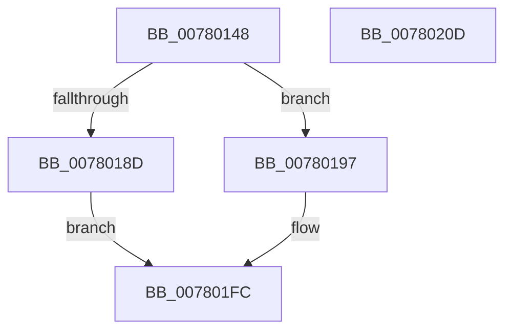

# PspQueueDeferredWorkAndWait

- RVA: `0x00780148`–`0x0078020E` (길이 `198` bytes)
- VA: `0x0000000140780148`
- 실행 섹션: `PAGE`
- PDB 이름 있음: `예`; PDB Function 태그: `아니요`
- unwind 정보 RVA: `0x000B3F9C`
- 디코드: `45`개 명령, `198/198` bytes 표시
- 미해석 바이트: `0` (있으면 어셈블리에 `.byte`로 보존)

> 이 문서는 커널 이미지의 기계어와 PDB 기호를 분석해 생성했습니다. 4번과 5번은 함수 원형과 자료형을 바이너리 사용 방식에서 추정한 C 해석이며 원본 소스 복구 결과는 아닙니다.

## 1. Dependencies

- 직접 호출 지점: **4**; 고유 호출 대상: **4**
- 직접 호출자로 확인된 함수: **1**
- RIP 상대 이미지 참조: **2**

### Outgoing calls
- `0x00780190` → [PspInitializeServerSiloDeferred](../77/PspInitializeServerSiloDeferred_function_0077FEE0.md) (function, `0x0077FEE0`)
- `0x007801A2` → [KeInitializeEvent](../../text/40/KeInitializeEvent_function_0040DD10.md) (function, `0x0040DD10`)
- `0x007801DB` → [ExQueueWorkItem](../../text/2F/ExQueueWorkItem_function_002F9520.md) (function, `0x002F9520`)
- `0x007801F4` → [KeWaitForSingleObject](../../text/20/KeWaitForSingleObject_function_0020E6B0.md) (function, `0x0020E6B0`)

### Direct callers
- [PspConvertSiloToServerSilo](../77/PspConvertSiloToServerSilo_function_0077F9B4.md) at `0x0077FB15`

### Static image references
- `0x007801AB` → RVA `0x0077FEE0` (`PspInitializeServerSiloDeferred`; read)
- `0x007801C4` → RVA `0x0077FB50` (`PspDeferredWorkerRoutine`; read)

## 2. Other-region calls and transfers

- 다른 실행 섹션으로 향하는 call: **3**
  - `0x007801A2` → [KeInitializeEvent](../../text/40/KeInitializeEvent_function_0040DD10.md) (`PAGE` → `.text`)
  - `0x007801DB` → [ExQueueWorkItem](../../text/2F/ExQueueWorkItem_function_002F9520.md) (`PAGE` → `.text`)
  - `0x007801F4` → [KeWaitForSingleObject](../../text/20/KeWaitForSingleObject_function_0020E6B0.md) (`PAGE` → `.text`)
- 별도 외부 분기/꼬리 이동을 확인하지 못했습니다.

## 3. Assembly (complete function range)

```asm
00780148  48 89 5C 24 08                  mov qword ptr [rsp + 8], rbx
0078014D  55                              push rbp
0078014E  48 8B EC                        mov rbp, rsp
00780151  48 81 EC 80 00 00 00            sub rsp, 0x80
00780158  48 83 65 B8 00                  and qword ptr [rbp - 0x48], 0
0078015D  0F 57 C0                        xorps xmm0, xmm0
00780160  48 83 65 D0 00                  and qword ptr [rbp - 0x30], 0
00780165  48 8B DA                        mov rbx, rdx
00780168  83 65 FC 00                     and dword ptr [rbp - 4], 0
0078016C  F3 0F 7F 45 D8                  movdqu xmmword ptr [rbp - 0x28], xmm0
00780171  65 48 8B 04 25 88 01 00 00      mov rax, qword ptr gs:[0x188]
0078017A  48 8B 88 B8 00 00 00            mov rcx, qword ptr [rax + 0xb8]
00780181  F7 81 FC 05 00 00 00 10 00 00   test dword ptr [rcx + 0x5fc], 0x1000
0078018B  74 0A                           je 0x140780197
0078018D  48 8B CA                        mov rcx, rdx
00780190  E8 4B FD FF FF                  call 0x14077fee0
00780195  EB 65                           jmp 0x1407801fc
00780197  45 33 C0                        xor r8d, r8d
0078019A  48 8D 4D D0                     lea rcx, [rbp - 0x30]
0078019E  41 8D 50 01                     lea edx, [r8 + 1]
007801A2  E8 69 DB C8 FF                  call 0x14040dd10
007801A7  83 65 F8 00                     and dword ptr [rbp - 8], 0
007801AB  48 8D 05 2E FD FF FF            lea rax, [rip - 0x2d2]
007801B2  48 83 65 B0 00                  and qword ptr [rbp - 0x50], 0
007801B7  48 8D 4D B0                     lea rcx, [rbp - 0x50]
007801BB  48 89 45 E8                     mov qword ptr [rbp - 0x18], rax
007801BF  BA 01 00 00 00                  mov edx, 1
007801C4  48 8D 05 85 F9 FF FF            lea rax, [rip - 0x67b]
007801CB  48 89 5D F0                     mov qword ptr [rbp - 0x10], rbx
007801CF  48 89 45 C0                     mov qword ptr [rbp - 0x40], rax
007801D3  48 8D 45 D0                     lea rax, [rbp - 0x30]
007801D7  48 89 45 C8                     mov qword ptr [rbp - 0x38], rax
007801DB  E8 40 93 B7 FF                  call 0x1402f9520
007801E0  48 83 64 24 20 00               and qword ptr [rsp + 0x20], 0
007801E6  48 8D 4D D0                     lea rcx, [rbp - 0x30]
007801EA  45 33 C9                        xor r9d, r9d
007801ED  45 33 C0                        xor r8d, r8d
007801F0  41 8D 51 06                     lea edx, [r9 + 6]
007801F4  E8 B7 E4 A8 FF                  call 0x14020e6b0
007801F9  8B 45 F8                        mov eax, dword ptr [rbp - 8]
007801FC  48 8B 9C 24 90 00 00 00         mov rbx, qword ptr [rsp + 0x90]
00780204  48 81 C4 80 00 00 00            add rsp, 0x80
0078020B  5D                              pop rbp
0078020C  C3                              ret
0078020D  CC                              int3
```

## 4. C-style interpretation (structured pseudocode)

```c
__int64 __fastcall PspQueueDeferredWorkAndWait(__int64 a1, __int64 a2, int a3, int a4)
{
    __int64 result;
    __int64 v_rsp;
    unsigned int v_stack_m10;
    unsigned __int64 v_stack_m18;
    unsigned __int64 v_stack_m20;
    unsigned __int64 v_stack_m30;
    unsigned __int64 v_stack_m38;
    unsigned __int64 v_stack_m40;
    unsigned __int64 v_stack_m48;
    unsigned __int64 v_stack_m50;
    unsigned __int64 v_stack_m58;
    unsigned __int64 v_stack_m68;
    unsigned int v_stack_mC;
    unsigned __int64 v_stack_p8;

    v_stack_p8 = v_rbx;
    v_rsp = (v_rsp) - (128);
    v_stack_m30 = v_xmm0;
    if (((*(unsigned int *)(*(unsigned __int64 *)(*(unsigned __int64 *)(gs_base + (0 + 392)) + 184) + 1532)) & (0x1000ULL)) == 0) goto loc_00780197;
    result = PspInitializeServerSiloDeferred(a2, a2, a3, a4);
    goto loc_007801FC;
loc_00780197:
    a3 = 0;
    result = KeInitializeEvent(v_stack_m38, a3 + 1, a3, a4);
    v_stack_m20 = v_rip - 722;
    v_stack_m18 = a2;
    v_stack_m48 = v_rip - 1659;
    v_stack_m40 = v_stack_m38;
    result = ExQueueWorkItem(v_stack_m58, 1, a3, a4);
    a4 = 0;
    a3 = 0;
    result = KeWaitForSingleObject(v_stack_m38, a4 + 6, a3, a4);
loc_007801FC:
    v_rsp = (v_rsp) + (128);
    return (unsigned int)(v_stack_m10);
}
```

## 5. (Beta) C Style

```c
int64_t PspQueueDeferredWorkAndWait(int64_t Arg1, int64_t Arg2, int32_t Arg3, int32_t Arg4)
{
    int64_t result;
    int64_t local_rsp;
    uint32_t v_stack_m10;
    uint64_t v_stack_m18;
    uint64_t v_stack_m20;
    uint64_t v_stack_m30;
    uint64_t v_stack_m38;
    uint64_t v_stack_m40;
    uint64_t v_stack_m48;
    uint64_t v_stack_m50;
    uint64_t v_stack_m58;
    uint64_t v_stack_m68;
    uint32_t v_stack_mC;
    uint64_t v_stack_p8;

    v_stack_p8 = local_rbx;
    local_rsp = (local_rsp) - (128);
    v_stack_m30 = v_xmm0;
    if (((*(uint32_t *)(*(uint64_t *)(*(uint64_t *)(gs_base + (0 + 0x188)) + 0xB8) + 0x5FC)) & (0x1000ULL)) == 0) goto loc_00780197;
    result = PspInitializeServerSiloDeferred(Arg2, Arg2, Arg3, Arg4);
    goto loc_007801FC;
loc_00780197:
    Arg3 = 0;
    result = KeInitializeEvent(v_stack_m38, Arg3 + 1, Arg3, Arg4);
    v_stack_m20 = v_rip - 722;
    v_stack_m18 = Arg2;
    v_stack_m48 = v_rip - 1659;
    v_stack_m40 = v_stack_m38;
    result = ExQueueWorkItem(v_stack_m58, 1, Arg3, Arg4);
    Arg4 = 0;
    Arg3 = 0;
    result = KeWaitForSingleObject(v_stack_m38, Arg4 + 6, Arg3, Arg4);
loc_007801FC:
    local_rsp = (local_rsp) + (128);
    return (uint32_t)(v_stack_m10);
}
```

## 6. Execution-region graph

[열기: 2D/3D 그래프와 함수 탐색 컨트롤 패널](../../../control-panel.html?section=page&rva=0x00780148&view=graph)

- 2D 그래프는 위에서 아래로 흐르고, 3D 그래프는 빈 공간을 드래그해 회전합니다. Shift+드래그는 이동, 휠은 확대·축소, 함수 노드 선택은 대상 보고서 이동입니다.

### Static fallback


