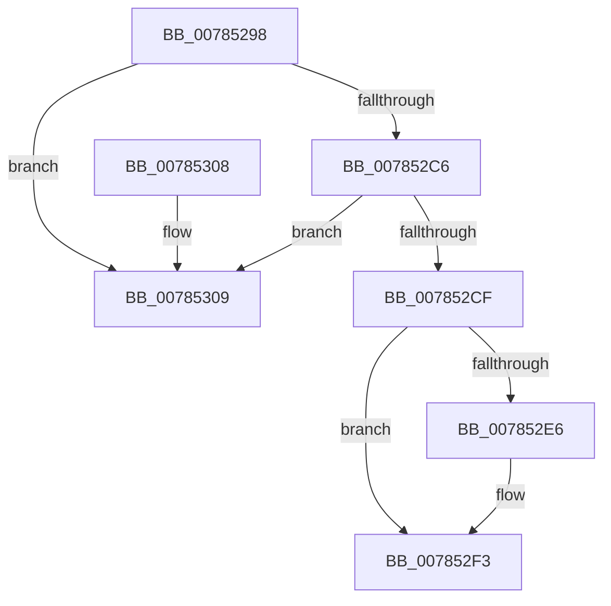

# PspQuitNextJobProcess

- RVA: `0x00785298`–`0x00785310` (길이 `120` bytes)
- VA: `0x0000000140785298`
- 실행 섹션: `PAGE`
- PDB 이름 있음: `예`; PDB Function 태그: `아니요`
- unwind 정보 RVA: `0x00069AD0`
- 디코드: `35`개 명령, `120/120` bytes 표시
- 미해석 바이트: `0` (있으면 어셈블리에 `.byte`로 보존)

> 이 문서는 커널 이미지의 기계어와 PDB 기호를 분석해 생성했습니다. 4번과 5번은 함수 원형과 자료형을 바이너리 사용 방식에서 추정한 C 해석이며 원본 소스 복구 결과는 아닙니다.

## 1. Dependencies

- 직접 호출 지점: **3**; 고유 호출 대상: **3**
- 직접 호출자로 확인된 함수: **1**
- RIP 상대 이미지 참조: **0**

### Outgoing calls
- `0x007852B8` → [PspLockJobExclusive](../91/PspLockJobExclusive_function_0091A4B8.md) (function, `0x0091A4B8`)
- `0x007852DC` → [PspUnlockJob](../91/PspUnlockJob_function_00919E00.md) (function, `0x00919E00`)
- `0x007852EE` → [ObfDereferenceObjectWithTag](../../text/2F/ObfDereferenceObjectWithTag_function_002F78E0.md) (function, `0x002F78E0`)

### Direct callers
- [PspAssignProcessToJob](../A2/PspAssignProcessToJob_function_00A23370.md) at `0x00A23414`

### Static image references
- 디코드된 RIP-relative 메모리 참조가 없습니다.

## 2. Other-region calls and transfers

- 다른 실행 섹션으로 향하는 call: **1**
  - `0x007852EE` → [ObfDereferenceObjectWithTag](../../text/2F/ObfDereferenceObjectWithTag_function_002F78E0.md) (`PAGE` → `.text`)
- 별도 외부 분기/꼬리 이동을 확인하지 못했습니다.

## 3. Assembly (complete function range)

```asm
00785298  48 89 5C 24 08                  mov qword ptr [rsp + 8], rbx
0078529D  48 89 6C 24 10                  mov qword ptr [rsp + 0x10], rbp
007852A2  48 89 74 24 18                  mov qword ptr [rsp + 0x18], rsi
007852A7  57                              push rdi
007852A8  48 83 EC 20                     sub rsp, 0x20
007852AC  49 8B F9                        mov rdi, r9
007852AF  49 8B D8                        mov rbx, r8
007852B2  48 8B F2                        mov rsi, rdx
007852B5  48 8B E9                        mov rbp, rcx
007852B8  E8 FB 51 19 00                  call 0x14091a4b8
007852BD  4C 8B 03                        mov r8, qword ptr [rbx]
007852C0  49 39 58 08                     cmp qword ptr [r8 + 8], rbx
007852C4  75 43                           jne 0x140785309
007852C6  48 8B 43 08                     mov rax, qword ptr [rbx + 8]
007852CA  48 39 18                        cmp qword ptr [rax], rbx
007852CD  75 3A                           jne 0x140785309
007852CF  4C 89 00                        mov qword ptr [rax], r8
007852D2  48 8B D6                        mov rdx, rsi
007852D5  48 8B CD                        mov rcx, rbp
007852D8  49 89 40 08                     mov qword ptr [r8 + 8], rax
007852DC  E8 1F 4B 19 00                  call 0x140919e00
007852E1  48 85 FF                        test rdi, rdi
007852E4  74 0D                           je 0x1407852f3
007852E6  BA 50 73 4A 62                  mov edx, 0x624a7350
007852EB  48 8B CF                        mov rcx, rdi
007852EE  E8 ED 25 B7 FF                  call 0x1402f78e0
007852F3  48 8B 5C 24 30                  mov rbx, qword ptr [rsp + 0x30]
007852F8  48 8B 6C 24 38                  mov rbp, qword ptr [rsp + 0x38]
007852FD  48 8B 74 24 40                  mov rsi, qword ptr [rsp + 0x40]
00785302  48 83 C4 20                     add rsp, 0x20
00785306  5F                              pop rdi
00785307  C3                              ret
00785308  CC                              int3
00785309  B9 03 00 00 00                  mov ecx, 3
0078530E  CD 29                           int 0x29
```

## 4. C-style interpretation (structured pseudocode)

```c
__int64 __fastcall PspQuitNextJobProcess(__int64 a1, __int64 a2, __int64 a3, __int64 a4)
{
    __int64 result;
    __int64 v_rsp;
    unsigned __int64 v_stack_p10;
    unsigned __int64 v_stack_p18;
    unsigned __int64 v_stack_p8;

    v_stack_p8 = v_rbx;
    v_stack_p10 = v_rbp;
    v_stack_p18 = v_rsi;
    v_rsp = (v_rsp) - (32);
    result = PspLockJobExclusive(a1, a2, a3, a4);
    if ((*(unsigned __int64 *)(*(unsigned __int64 *)(a3) + 8)) != a3) goto loc_00785309;
    if ((*(unsigned __int64 *)(*(unsigned __int64 *)(a3 + 8))) != a3) goto loc_00785309;
    *(unsigned __int64 *)(*(unsigned __int64 *)(a3 + 8)) = *(unsigned __int64 *)(a3);
    *(unsigned __int64 *)(*(unsigned __int64 *)(a3) + 8) = *(unsigned __int64 *)(a3 + 8);
    result = PspUnlockJob(a1, a2, *(unsigned __int64 *)(a3), a4);
    if (a4 != 0) {
        a2 = 0x624A7350ULL;
        a1 = a4;
        result = ObfDereferenceObjectWithTag(a1, a2, *(unsigned __int64 *)(a3), a4);
    }
    v_rsp = (v_rsp) + (32);
    return result;
loc_00785309:
    return result;
}
```

## 5. (Beta) C Style

```c
int64_t PspQuitNextJobProcess(int64_t Arg1, int64_t Arg2, void *Arg3, int64_t Arg4)
{
    uint8_t *arg3 = (uint8_t *)Arg3;

    int64_t result;
    int64_t local_rsp;
    uint64_t v_stack_p10;
    uint64_t v_stack_p18;
    uint64_t v_stack_p8;

    v_stack_p8 = local_rbx;
    v_stack_p10 = local_rbp;
    v_stack_p18 = local_rsi;
    local_rsp = (local_rsp) - (32);
    result = PspLockJobExclusive(Arg1, Arg2, Arg3, Arg4);
    if ((*(uint64_t *)(*(uint64_t *)(arg3) + 0x8)) != Arg3) goto loc_00785309;
    if ((*(uint64_t *)(*(uint64_t *)(arg3 + 0x8))) != Arg3) goto loc_00785309;
    *(uint64_t *)(*(uint64_t *)(arg3 + 0x8)) = *(uint64_t *)(arg3);
    *(uint64_t *)(*(uint64_t *)(arg3) + 0x8) = *(uint64_t *)(arg3 + 0x8);
    result = PspUnlockJob(Arg1, Arg2, *(uint64_t *)(arg3), Arg4);
    if (Arg4 != 0) {
        Arg2 = 0x624A7350ULL;
        Arg1 = Arg4;
        result = ObfDereferenceObjectWithTag(Arg1, Arg2, *(uint64_t *)(arg3), Arg4);
    }
    local_rsp = (local_rsp) + (32);
    return result;
loc_00785309:
    return result;
}
```

### 관측된 메모리 오프셋

구조체 형식이 확인되지 않은 접근은 인자 기준의 오프셋으로만 기록했습니다.

| 기준 인자 | 오프셋 표현 | 폭 (bit) | 접근 |
|---|---:|---:|---|
| `Arg3` | `+ 0x0` | `64` | `R` |
| `Arg3` | `+ 0x8` | `64` | `R` |

## 6. Execution-region graph

[열기: 2D/3D 그래프와 함수 탐색 컨트롤 패널](../../../control-panel.html?section=page&rva=0x00785298&view=graph)

- 2D 그래프는 위에서 아래로 흐르고, 3D 그래프는 빈 공간을 드래그해 회전합니다. Shift+드래그는 이동, 휠은 확대·축소, 함수 노드 선택은 대상 보고서 이동입니다.

### Static fallback


