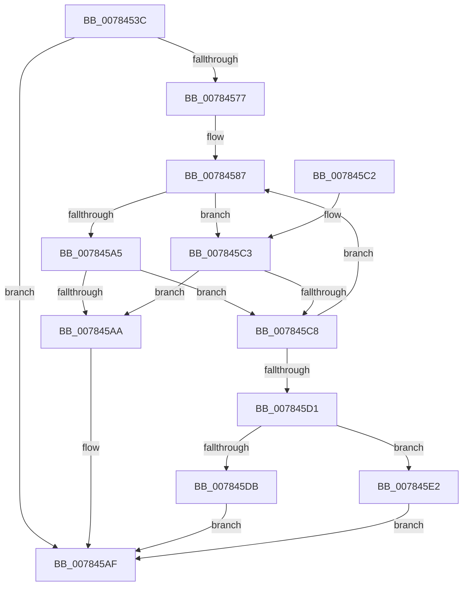

# PspReadIFEOAntiTamperOptions

- RVA: `0x0078453C`–`0x007845E9` (길이 `173` bytes)
- VA: `0x000000014078453C`
- 실행 섹션: `PAGE`
- PDB 이름 있음: `예`; PDB Function 태그: `아니요`
- unwind 정보 RVA: `0x000CEE20`
- 디코드: `52`개 명령, `173/173` bytes 표시
- 미해석 바이트: `0` (있으면 어셈블리에 `.byte`로 보존)

> 이 문서는 커널 이미지의 기계어와 PDB 기호를 분석해 생성했습니다. 4번과 5번은 함수 원형과 자료형을 바이너리 사용 방식에서 추정한 C 해석이며 원본 소스 복구 결과는 아닙니다.

## 1. Dependencies

- 직접 호출 지점: **2**; 고유 호출 대상: **2**
- 직접 호출자로 확인된 함수: **1**
- RIP 상대 이미지 참조: **2**

### Outgoing calls
- `0x0078456E` → [PspReadOptionsMapFromIFEO](../A2/PspReadOptionsMapFromIFEO_function_00A2D078.md) (function, `0x00A2D078`)
- `0x007845B7` → [_security_check_cookie](../../text/6A/_security_check_cookie_function_006AC640.md) (function, `0x006AC640`)

### Direct callers
- [PspAllocateProcess](../A1/PspAllocateProcess_function_00A13B3C.md) at `0x00A159AF`

### Static image references
- `0x00784542` → RVA `0x00E0A740` (`.data`; read)
- `0x00784563` → RVA `0x00B04F60` (` ?? ::NNGAKEGL::`string'`; read)

## 2. Other-region calls and transfers

- 다른 실행 섹션으로 향하는 call: **1**
  - `0x007845B7` → [_security_check_cookie](../../text/6A/_security_check_cookie_function_006AC640.md) (`PAGE` → `.text`)
- 별도 외부 분기/꼬리 이동을 확인하지 못했습니다.

## 3. Assembly (complete function range)

```asm
0078453C  40 53                           push rbx
0078453E  48 83 EC 30                     sub rsp, 0x30
00784542  48 8B 05 F7 61 68 00            mov rax, qword ptr [rip + 0x6861f7]
00784549  48 33 C4                        xor rax, rsp
0078454C  48 89 44 24 28                  mov qword ptr [rsp + 0x28], rax
00784551  33 C0                           xor eax, eax
00784553  4C 8D 44 24 20                  lea r8, [rsp + 0x20]
00784558  48 21 44 24 20                  and qword ptr [rsp + 0x20], rax
0078455D  48 8B DA                        mov rbx, rdx
00784560  48 89 02                        mov qword ptr [rdx], rax
00784563  48 8D 15 F6 09 38 00            lea rdx, [rip + 0x3809f6]
0078456A  44 8D 48 08                     lea r9d, [rax + 8]
0078456E  E8 05 8B 2A 00                  call 0x140a2d078
00784573  85 C0                           test eax, eax
00784575  78 38                           js 0x1407845af
00784577  48 8B 44 24 20                  mov rax, qword ptr [rsp + 0x20]
0078457C  45 33 C0                        xor r8d, r8d
0078457F  48 89 44 24 20                  mov qword ptr [rsp + 0x20], rax
00784584  41 B2 03                        mov r10b, 3
00784587  43 8D 0C 00                     lea ecx, [r8 + r8]
0078458B  8B D1                           mov edx, ecx
0078458D  83 E1 3F                        and ecx, 0x3f
00784590  48 C1 EA 06                     shr rdx, 6
00784594  4C 8B 4C D4 20                  mov r9, qword ptr [rsp + rdx*8 + 0x20]
00784599  49 D3 E9                        shr r9, cl
0078459C  45 22 CA                        and r9b, r10b
0078459F  41 83 F8 0C                     cmp r8d, 0xc
007845A3  73 1E                           jae 0x1407845c3
007845A5  45 3A CA                        cmp r9b, r10b
007845A8  75 1E                           jne 0x1407845c8
007845AA  B8 0D 00 00 C0                  mov eax, 0xc000000d
007845AF  48 8B 4C 24 28                  mov rcx, qword ptr [rsp + 0x28]
007845B4  48 33 CC                        xor rcx, rsp
007845B7  E8 84 80 F2 FF                  call 0x1406ac640
007845BC  48 83 C4 30                     add rsp, 0x30
007845C0  5B                              pop rbx
007845C1  C3                              ret
007845C2  CC                              int3
007845C3  45 84 C9                        test r9b, r9b
007845C6  75 E2                           jne 0x1407845aa
007845C8  41 FF C0                        inc r8d
007845CB  41 83 F8 20                     cmp r8d, 0x20
007845CF  72 B6                           jb 0x140784587
007845D1  8A C8                           mov cl, al
007845D3  41 22 CA                        and cl, r10b
007845D6  80 F9 01                        cmp cl, 1
007845D9  74 07                           je 0x1407845e2
007845DB  B8 25 02 00 C0                  mov eax, 0xc0000225
007845E0  EB CD                           jmp 0x1407845af
007845E2  48 89 03                        mov qword ptr [rbx], rax
007845E5  33 C0                           xor eax, eax
007845E7  EB C6                           jmp 0x1407845af
```

## 4. C-style interpretation (structured pseudocode)

```c
__int64 __fastcall PspReadIFEOAntiTamperOptions(__int64 a1, __int64 a2)
{
    __int64 result;
    __int64 v_rsp;
    unsigned __int64 v_stack_m10;
    unsigned __int64 v_stack_m18;

    v_rsp = (v_rsp) - (48);
    result = (*(unsigned __int64 *)(v_rip + 6840823)) ^ (v_rsp);
    v_stack_m10 = result;
    result = 0;
    *(unsigned __int64 *)(a2) = 0;
    result = PspReadOptionsMapFromIFEO(a1, v_rip + 3672566, v_stack_m18, result + 8);
    if (sign_flag) goto loc_007845AF;
    a3 = 0;
    v_stack_m18 = v_stack_m18;
loc_00784587:
    a1 = (unsigned int)((a3 + a3 * 1) & (63));
    a2 = ((unsigned int)((unsigned int)(a3 + a3 * 1))) >> (6);
    a4 = (*(unsigned __int64 *)(v_rsp + a2 * 8 + 32)) >> ((unsigned __int8)(a1));
    a4 = (unsigned __int8)((a4) & (3));
    if (0 >= 12) goto loc_007845C3;
    if (((unsigned __int8)(a4)) != 3) goto loc_007845C8;
loc_007845AA:
loc_007845AF:
    a1 = (v_stack_m10) ^ (v_rsp);
    result = _security_check_cookie(a1, a2, a3, a4);
    v_rsp = (v_rsp) + (48);
    return result;
loc_007845C3:
    if ((unsigned __int8)(a4) != 0) goto loc_007845AA;
loc_007845C8:
    a3 = (unsigned int)((a3) + 1);
    if (((unsigned int)(a3)) < 32) goto loc_00784587;
    a1 = (unsigned __int8)(((unsigned __int8)(result)) & (3));
    if (((unsigned __int8)(a1)) == 1) goto loc_007845E2;
    goto loc_007845AF;
loc_007845E2:
    *(unsigned __int64 *)(a2) = (unsigned int)(0xC0000225ULL);
    result = 0;
    goto loc_007845AF;
}
```

## 5. (Beta) C Style

```c
int64_t PspReadIFEOAntiTamperOptions(int64_t Arg1, void *Arg2)
{
    uint8_t *arg2 = (uint8_t *)Arg2;

    int64_t result;
    int64_t local_rsp;
    uint64_t v_stack_m10;
    uint64_t v_stack_m18;

    local_rsp = (local_rsp) - (48);
    result = (*(uint64_t *)(v_rip + 0x6861F7)) ^ (local_rsp);
    v_stack_m10 = result;
    result = 0;
    *(uint64_t *)(arg2) = 0;
    result = PspReadOptionsMapFromIFEO(Arg1, v_rip + 3672566, v_stack_m18, result + 8);
    if (sign_flag) goto loc_007845AF;
    a3 = 0;
    v_stack_m18 = v_stack_m18;
loc_00784587:
    Arg1 = (uint32_t)((a3 + a3 * 1) & (63));
    Arg2 = ((uint32_t)((uint32_t)(a3 + a3 * 1))) >> (6);
    a4 = (*(uint64_t *)(local_rsp + arg2 * 8 + 0x20)) >> ((uint8_t)(Arg1));
    a4 = (uint8_t)((a4) & (3));
    if (0 >= 12) goto loc_007845C3;
    if (((uint8_t)(a4)) != 3) goto loc_007845C8;
loc_007845AA:
loc_007845AF:
    Arg1 = (v_stack_m10) ^ (local_rsp);
    result = _security_check_cookie(Arg1, Arg2, a3, a4);
    local_rsp = (local_rsp) + (48);
    return result;
loc_007845C3:
    if ((uint8_t)(a4) != 0) goto loc_007845AA;
loc_007845C8:
    a3 = (uint32_t)((a3) + 1);
    if (((uint32_t)(a3)) < 32) goto loc_00784587;
    Arg1 = (uint8_t)(((uint8_t)(result)) & (3));
    if (((uint8_t)(Arg1)) == 1) goto loc_007845E2;
    goto loc_007845AF;
loc_007845E2:
    *(uint64_t *)(arg2) = (uint32_t)(0xC0000225ULL);
    result = 0;
    goto loc_007845AF;
}
```

### 관측된 메모리 오프셋

구조체 형식이 확인되지 않은 접근은 인자 기준의 오프셋으로만 기록했습니다.

| 기준 인자 | 오프셋 표현 | 폭 (bit) | 접근 |
|---|---:|---:|---|
| `Arg2` | `+ 0x0` | `64` | `W` |

## 6. Execution-region graph

[열기: 2D/3D 그래프와 함수 탐색 컨트롤 패널](../../../control-panel.html?section=page&rva=0x0078453C&view=graph)

- 2D 그래프는 위에서 아래로 흐르고, 3D 그래프는 빈 공간을 드래그해 회전합니다. Shift+드래그는 이동, 휠은 확대·축소, 함수 노드 선택은 대상 보고서 이동입니다.

### Static fallback


