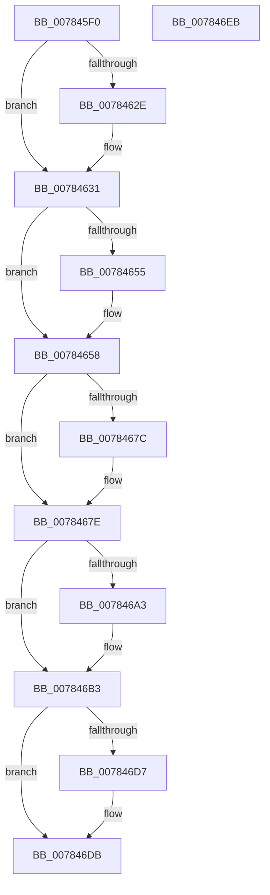

# PspReadIFEOPerfOptions

- RVA: `0x007845F0`–`0x007846EC` (길이 `252` bytes)
- VA: `0x00000001407845F0`
- 실행 섹션: `PAGE`
- PDB 이름 있음: `예`; PDB Function 태그: `아니요`
- unwind 정보 RVA: `0x000CE124`
- 디코드: `67`개 명령, `252/252` bytes 표시
- 미해석 바이트: `0` (있으면 어셈블리에 `.byte`로 보존)

> 이 문서는 커널 이미지의 기계어와 PDB 기호를 분석해 생성했습니다. 4번과 5번은 함수 원형과 자료형을 바이너리 사용 방식에서 추정한 C 해석이며 원본 소스 복구 결과는 아닙니다.

## 1. Dependencies

- 직접 호출 지점: **5**; 고유 호출 대상: **1**
- 직접 호출자로 확인된 함수: **1**
- RIP 상대 이미지 참조: **5**

### Outgoing calls
- `0x00784625` → [RtlQueryImageFileKeyOption](../A2/RtlQueryImageFileKeyOption_function_00A2D110.md) (function, `0x00A2D110`)
- `0x0078464C` → [RtlQueryImageFileKeyOption](../A2/RtlQueryImageFileKeyOption_function_00A2D110.md) (function, `0x00A2D110`)
- `0x00784673` → [RtlQueryImageFileKeyOption](../A2/RtlQueryImageFileKeyOption_function_00A2D110.md) (function, `0x00A2D110`)
- `0x0078469A` → [RtlQueryImageFileKeyOption](../A2/RtlQueryImageFileKeyOption_function_00A2D110.md) (function, `0x00A2D110`)
- `0x007846CE` → [RtlQueryImageFileKeyOption](../A2/RtlQueryImageFileKeyOption_function_00A2D110.md) (function, `0x00A2D110`)

### Direct callers
- [PspAllocateProcess](../A1/PspAllocateProcess_function_00A13B3C.md) at `0x00A1499B`

### Static image references
- `0x0078461B` → RVA `0x00B04CF0` (` ?? ::NNGAKEGL::`string'`; read)
- `0x00784642` → RVA `0x00B04CD0` (` ?? ::NNGAKEGL::`string'`; read)
- `0x00784669` → RVA `0x00B04E10` (` ?? ::NNGAKEGL::`string'`; read)
- `0x00784690` → RVA `0x00B04DE0` (` ?? ::NNGAKEGL::`string'`; read)
- `0x007846C4` → RVA `0x00B04DA0` (` ?? ::NNGAKEGL::`string'`; read)

## 2. Other-region calls and transfers

- 다른 실행 섹션으로 향하는 call: **0**
- 별도 외부 분기/꼬리 이동을 확인하지 못했습니다.

## 3. Assembly (complete function range)

```asm
007845F0  48 8B C4                        mov rax, rsp
007845F3  48 89 58 08                     mov qword ptr [rax + 8], rbx
007845F7  48 89 70 18                     mov qword ptr [rax + 0x18], rsi
007845FB  57                              push rdi
007845FC  48 83 EC 30                     sub rsp, 0x30
00784600  48 83 60 F0 00                  and qword ptr [rax - 0x10], 0
00784605  4C 8D 4A 08                     lea r9, [rdx + 8]
00784609  83 60 10 00                     and dword ptr [rax + 0x10], 0
0078460D  BE 04 00 00 00                  mov esi, 4
00784612  48 8B DA                        mov rbx, rdx
00784615  89 70 E8                        mov dword ptr [rax - 0x18], esi
00784618  44 8B C6                        mov r8d, esi
0078461B  48 8D 15 CE 06 38 00            lea rdx, [rip + 0x3806ce]
00784622  48 8B F9                        mov rdi, rcx
00784625  E8 E6 8A 2A 00                  call 0x140a2d110
0078462A  85 C0                           test eax, eax
0078462C  78 03                           js 0x140784631
0078462E  83 0B 01                        or dword ptr [rbx], 1
00784631  48 83 64 24 28 00               and qword ptr [rsp + 0x28], 0
00784637  4C 8D 4B 0C                     lea r9, [rbx + 0xc]
0078463B  44 8B C6                        mov r8d, esi
0078463E  89 74 24 20                     mov dword ptr [rsp + 0x20], esi
00784642  48 8D 15 87 06 38 00            lea rdx, [rip + 0x380687]
00784649  48 8B CF                        mov rcx, rdi
0078464C  E8 BF 8A 2A 00                  call 0x140a2d110
00784651  85 C0                           test eax, eax
00784653  78 03                           js 0x140784658
00784655  83 0B 02                        or dword ptr [rbx], 2
00784658  48 83 64 24 28 00               and qword ptr [rsp + 0x28], 0
0078465E  4C 8D 4B 10                     lea r9, [rbx + 0x10]
00784662  44 8B C6                        mov r8d, esi
00784665  89 74 24 20                     mov dword ptr [rsp + 0x20], esi
00784669  48 8D 15 A0 07 38 00            lea rdx, [rip + 0x3807a0]
00784670  48 8B CF                        mov rcx, rdi
00784673  E8 98 8A 2A 00                  call 0x140a2d110
00784678  85 C0                           test eax, eax
0078467A  78 02                           js 0x14078467e
0078467C  09 33                           or dword ptr [rbx], esi
0078467E  48 83 64 24 28 00               and qword ptr [rsp + 0x28], 0
00784684  4C 8D 4C 24 48                  lea r9, [rsp + 0x48]
00784689  44 8B C6                        mov r8d, esi
0078468C  89 74 24 20                     mov dword ptr [rsp + 0x20], esi
00784690  48 8D 15 49 07 38 00            lea rdx, [rip + 0x380749]
00784697  48 8B CF                        mov rcx, rdi
0078469A  E8 71 8A 2A 00                  call 0x140a2d110
0078469F  85 C0                           test eax, eax
007846A1  78 10                           js 0x1407846b3
007846A3  8B 44 24 48                     mov eax, dword ptr [rsp + 0x48]
007846A7  48 C1 E8 02                     shr rax, 2
007846AB  83 4B 04 01                     or dword ptr [rbx + 4], 1
007846AF  48 89 43 18                     mov qword ptr [rbx + 0x18], rax
007846B3  48 83 64 24 28 00               and qword ptr [rsp + 0x28], 0
007846B9  4C 8D 4B 20                     lea r9, [rbx + 0x20]
007846BD  44 8B C6                        mov r8d, esi
007846C0  89 74 24 20                     mov dword ptr [rsp + 0x20], esi
007846C4  48 8D 15 D5 06 38 00            lea rdx, [rip + 0x3806d5]
007846CB  48 8B CF                        mov rcx, rdi
007846CE  E8 3D 8A 2A 00                  call 0x140a2d110
007846D3  85 C0                           test eax, eax
007846D5  78 04                           js 0x1407846db
007846D7  83 4B 04 02                     or dword ptr [rbx + 4], 2
007846DB  48 8B 5C 24 40                  mov rbx, qword ptr [rsp + 0x40]
007846E0  48 8B 74 24 50                  mov rsi, qword ptr [rsp + 0x50]
007846E5  48 83 C4 30                     add rsp, 0x30
007846E9  5F                              pop rdi
007846EA  C3                              ret
007846EB  CC                              int3
```

## 4. C-style interpretation (structured pseudocode)

```c
__int64 __fastcall PspReadIFEOPerfOptions(__int64 a1, __int64 a2)
{
    __int64 result;
    __int64 v_rsp;
    unsigned __int64 v_stack_m10;
    unsigned int v_stack_m18;
    unsigned __int64 v_stack_p10;
    unsigned __int64 v_stack_p18;
    unsigned __int64 v_stack_p8;

    *(unsigned __int64 *)(v_rsp + 8) = v_rbx;
    *(unsigned __int64 *)(v_rsp + 24) = v_rsi;
    v_rsp = (v_rsp) - (48);
    *(unsigned int *)(v_rsp - 24) = 4;
    result = RtlQueryImageFileKeyOption(a1, v_rip + 3671758, 4, a2 + 8);
    if (!(sign_flag)) {
    }
    v_stack_m18 = 4;
    result = RtlQueryImageFileKeyOption(a1, v_rip + 3671687, 4, a2 + 12);
    if (!(sign_flag)) {
    }
    v_stack_m18 = 4;
    result = RtlQueryImageFileKeyOption(a1, v_rip + 3671968, 4, a2 + 16);
    if (!(sign_flag)) {
    }
    v_stack_m18 = 4;
    result = RtlQueryImageFileKeyOption(a1, v_rip + 3671881, 4, v_stack_p10);
    if (!(sign_flag)) {
        result = v_stack_p10;
        result = (result) >> (2);
        *(unsigned __int64 *)(a2 + 24) = result;
    }
    v_stack_m18 = 4;
    result = RtlQueryImageFileKeyOption(a1, v_rip + 3671765, 4, a2 + 32);
    if (!(sign_flag)) {
    }
    v_rsp = (v_rsp) + (48);
    return result;
}
```

## 5. (Beta) C Style

```c
int64_t PspReadIFEOPerfOptions(int64_t Arg1, void *Arg2)
{
    uint8_t *arg2 = (uint8_t *)Arg2;

    int64_t result;
    int64_t local_rsp;
    uint64_t v_stack_m10;
    uint32_t v_stack_m18;
    uint64_t v_stack_p10;
    uint64_t v_stack_p18;
    uint64_t v_stack_p8;

    *(uint64_t *)(local_rsp + 0x8) = local_rbx;
    *(uint64_t *)(local_rsp + 0x18) = local_rsi;
    local_rsp = (local_rsp) - (48);
    *(uint32_t *)(local_rsp - 0x18) = 4;
    result = RtlQueryImageFileKeyOption(Arg1, v_rip + 3671758, 4, Arg2 + 8);
    if (!(sign_flag)) {
    }
    v_stack_m18 = 4;
    result = RtlQueryImageFileKeyOption(Arg1, v_rip + 3671687, 4, Arg2 + 12);
    if (!(sign_flag)) {
    }
    v_stack_m18 = 4;
    result = RtlQueryImageFileKeyOption(Arg1, v_rip + 3671968, 4, Arg2 + 16);
    if (!(sign_flag)) {
    }
    v_stack_m18 = 4;
    result = RtlQueryImageFileKeyOption(Arg1, v_rip + 3671881, 4, v_stack_p10);
    if (!(sign_flag)) {
        result = v_stack_p10;
        result = (result) >> (2);
        *(uint64_t *)(arg2 + 0x18) = result;
    }
    v_stack_m18 = 4;
    result = RtlQueryImageFileKeyOption(Arg1, v_rip + 3671765, 4, Arg2 + 32);
    if (!(sign_flag)) {
    }
    local_rsp = (local_rsp) + (48);
    return result;
}
```

### 관측된 메모리 오프셋

구조체 형식이 확인되지 않은 접근은 인자 기준의 오프셋으로만 기록했습니다.

| 기준 인자 | 오프셋 표현 | 폭 (bit) | 접근 |
|---|---:|---:|---|
| `Arg2` | `+ 0x0` | `32` | `R/W` |
| `Arg2` | `+ 0x4` | `32` | `R/W` |
| `Arg2` | `+ 0x8` | `64` | `R` |
| `Arg2` | `+ 0xC` | `64` | `R` |
| `Arg2` | `+ 0x10` | `64` | `R` |
| `Arg2` | `+ 0x18` | `64` | `W` |
| `Arg2` | `+ 0x20` | `64` | `R` |

## 6. Execution-region graph

[열기: 2D/3D 그래프와 함수 탐색 컨트롤 패널](../../../control-panel.html?section=page&rva=0x007845F0&view=graph)

- 2D 그래프는 위에서 아래로 흐르고, 3D 그래프는 빈 공간을 드래그해 회전합니다. Shift+드래그는 이동, 휠은 확대·축소, 함수 노드 선택은 대상 보고서 이동입니다.

### Static fallback


