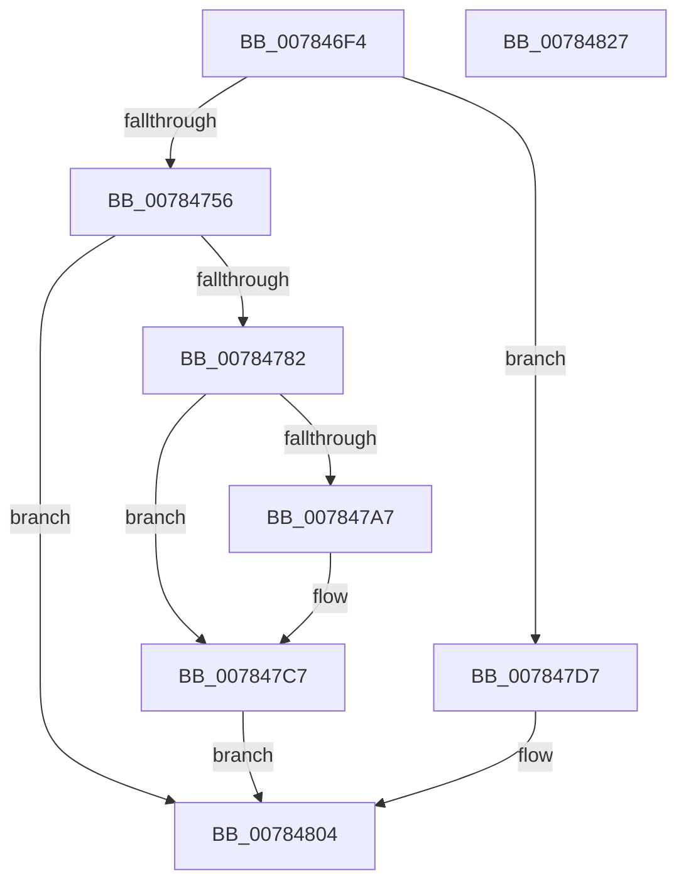

# PspReferenceCpuPartitionByHandle

- RVA: `0x007846F4`–`0x00784828` (길이 `308` bytes)
- VA: `0x00000001407846F4`
- 실행 섹션: `PAGE`
- PDB 이름 있음: `예`; PDB Function 태그: `아니요`
- unwind 정보 RVA: `0x000CEDB4`
- 디코드: `69`개 명령, `308/308` bytes 표시
- 미해석 바이트: `0` (있으면 어셈블리에 `.byte`로 보존)

> 이 문서는 커널 이미지의 기계어와 PDB 기호를 분석해 생성했습니다. 4번과 5번은 함수 원형과 자료형을 바이너리 사용 방식에서 추정한 C 해석이며 원본 소스 복구 결과는 아닙니다.

## 1. Dependencies

- 직접 호출 지점: **8**; 고유 호출 대상: **7**
- 직접 호출자로 확인된 함수: **4**
- RIP 상대 이미지 참조: **3**

### Outgoing calls
- `0x00784732` → [memset](../../text/6C/memset_function_006C6C40.md) (function, `0x006C6C40`)
- `0x00784747` → [memset](../../text/6C/memset_function_006C6C40.md) (function, `0x006C6C40`)
- `0x00784771` → [SeCreateAccessState](../8C/SeCreateAccessState_function_008C6AC0.md) (function, `0x008C6AC0`)
- `0x0078479E` → [ObCheckObjectAccess](../87/ObCheckObjectAccess_function_00872260.md) (function, `0x00872260`)
- `0x007847B8` → [ObfReferenceObjectWithTag](../../text/21/ObfReferenceObjectWithTag_function_00210710.md) (function, `0x00210710`)
- `0x007847CC` → [SeDeleteAccessState](../8C/SeDeleteAccessState_function_008C5F70.md) (function, `0x008C5F70`)
- `0x007847FF` → [ObpReferenceObjectByHandleWithTag](../86/ObpReferenceObjectByHandleWithTag_function_00869650.md) (function, `0x00869650`)
- `0x0078480F` → [_security_check_cookie](../../text/6A/_security_check_cookie_function_006AC640.md) (function, `0x006AC640`)

### Direct callers
- [NtCreateCpuPartition](NtCreateCpuPartition_function_00782E30.md) at `0x00782F63`
- [NtQueryInformationCpuPartition](NtQueryInformationCpuPartition_function_00783320.md) at `0x007833C8`
- [NtSetInformationCpuPartition](NtSetInformationCpuPartition_function_00783510.md) at `0x00783701`
- [NtSetInformationCpuPartition](NtSetInformationCpuPartition_function_00783510.md) at `0x00783724`
- [PspAssignCpuPartitionsToProcess](PspAssignCpuPartitionsToProcess_function_00783FB4.md) at `0x00784047`

### Static image references
- `0x00784703` → RVA `0x00E0A740` (`.data`; read)
- `0x00784756` → RVA `0x00FC6DF0` (`ALMOSTRO`; read)
- `0x00784782` → RVA `0x00FC6D78` (`ALMOSTRO`; read)

## 2. Other-region calls and transfers

- 다른 실행 섹션으로 향하는 call: **4**
  - `0x00784732` → [memset](../../text/6C/memset_function_006C6C40.md) (`PAGE` → `.text`)
  - `0x00784747` → [memset](../../text/6C/memset_function_006C6C40.md) (`PAGE` → `.text`)
  - `0x007847B8` → [ObfReferenceObjectWithTag](../../text/21/ObfReferenceObjectWithTag_function_00210710.md) (`PAGE` → `.text`)
  - `0x0078480F` → [_security_check_cookie](../../text/6A/_security_check_cookie_function_006AC640.md) (`PAGE` → `.text`)
- 별도 외부 분기/꼬리 이동을 확인하지 못했습니다.

## 3. Assembly (complete function range)

```asm
007846F4  48 89 5C 24 20                  mov qword ptr [rsp + 0x20], rbx
007846F9  55                              push rbp
007846FA  56                              push rsi
007846FB  57                              push rdi
007846FC  48 81 EC E0 01 00 00            sub rsp, 0x1e0
00784703  48 8B 05 36 60 68 00            mov rax, qword ptr [rip + 0x686036]
0078470A  48 33 C4                        xor rax, rsp
0078470D  48 89 84 24 D0 01 00 00         mov qword ptr [rsp + 0x1d0], rax
00784715  48 8B 9C 24 20 02 00 00         mov rbx, qword ptr [rsp + 0x220]
0078471D  41 8A F8                        mov dil, r8b
00784720  8B F2                           mov esi, edx
00784722  48 8B E9                        mov rbp, rcx
00784725  33 D2                           xor edx, edx
00784727  48 8D 4C 24 50                  lea rcx, [rsp + 0x50]
0078472C  41 B8 A0 00 00 00               mov r8d, 0xa0
00784732  E8 09 25 F4 FF                  call 0x1406c6c40
00784737  33 D2                           xor edx, edx
00784739  48 8D 8C 24 F0 00 00 00         lea rcx, [rsp + 0xf0]
00784741  41 B8 E0 00 00 00               mov r8d, 0xe0
00784747  E8 F4 24 F4 FF                  call 0x1406c6c40
0078474C  48 83 FD FF                     cmp rbp, -1
00784750  0F 85 81 00 00 00               jne 0x1407847d7
00784756  4C 8B 0D 93 26 84 00            mov r9, qword ptr [rip + 0x842693]
0078475D  48 8D 94 24 F0 00 00 00         lea rdx, [rsp + 0xf0]
00784765  49 83 C1 4C                     add r9, 0x4c
00784769  48 8D 4C 24 50                  lea rcx, [rsp + 0x50]
0078476E  44 8B C6                        mov r8d, esi
00784771  E8 4A 23 14 00                  call 0x1408c6ac0
00784776  89 44 24 40                     mov dword ptr [rsp + 0x40], eax
0078477A  85 C0                           test eax, eax
0078477C  0F 88 82 00 00 00               js 0x140784804
00784782  48 8B 0D EF 25 84 00            mov rcx, qword ptr [rip + 0x8425ef]
00784789  48 8D 44 24 40                  lea rax, [rsp + 0x40]
0078478E  44 8A CF                        mov r9b, dil
00784791  48 89 44 24 20                  mov qword ptr [rsp + 0x20], rax
00784796  45 33 C0                        xor r8d, r8d
00784799  48 8D 54 24 50                  lea rdx, [rsp + 0x50]
0078479E  E8 BD DA 0E 00                  call 0x140872260
007847A3  84 C0                           test al, al
007847A5  74 20                           je 0x1407847c7
007847A7  83 64 24 40 00                  and dword ptr [rsp + 0x40], 0
007847AC  BA 50 73 70 50                  mov edx, 0x50707350
007847B1  48 8B 0D C0 25 84 00            mov rcx, qword ptr [rip + 0x8425c0]
007847B8  E8 53 BF A8 FF                  call 0x140210710
007847BD  48 8B 05 B4 25 84 00            mov rax, qword ptr [rip + 0x8425b4]
007847C4  48 89 03                        mov qword ptr [rbx], rax
007847C7  48 8D 4C 24 50                  lea rcx, [rsp + 0x50]
007847CC  E8 9F 17 14 00                  call 0x1408c5f70
007847D1  8B 44 24 40                     mov eax, dword ptr [rsp + 0x40]
007847D5  EB 2D                           jmp 0x140784804
007847D7  48 83 64 24 38 00               and qword ptr [rsp + 0x38], 0
007847DD  44 8A CF                        mov r9b, dil
007847E0  48 83 64 24 30 00               and qword ptr [rsp + 0x30], 0
007847E6  8B D6                           mov edx, esi
007847E8  4C 8B 05 01 26 84 00            mov r8, qword ptr [rip + 0x842601]
007847EF  48 8B CD                        mov rcx, rbp
007847F2  48 89 5C 24 28                  mov qword ptr [rsp + 0x28], rbx
007847F7  C7 44 24 20 50 73 70 50         mov dword ptr [rsp + 0x20], 0x50707350
007847FF  E8 4C 4E 0E 00                  call 0x140869650
00784804  48 8B 8C 24 D0 01 00 00         mov rcx, qword ptr [rsp + 0x1d0]
0078480C  48 33 CC                        xor rcx, rsp
0078480F  E8 2C 7E F2 FF                  call 0x1406ac640
00784814  48 8B 9C 24 18 02 00 00         mov rbx, qword ptr [rsp + 0x218]
0078481C  48 81 C4 E0 01 00 00            add rsp, 0x1e0
00784823  5F                              pop rdi
00784824  5E                              pop rsi
00784825  5D                              pop rbp
00784826  C3                              ret
00784827  CC                              int3
```

## 4. C-style interpretation (structured pseudocode)

```c
__int64 __fastcall PspReferenceCpuPartitionByHandle(__int64 a1, int a2, unsigned __int8 a3, __int64 a4, __int64 a5)
{
    __int64 result;
    __int64 v_rsp;
    unsigned __int64 v_stack_m108;
    unsigned __int64 v_stack_m1A8;
    unsigned int v_stack_m1B8;
    unsigned __int64 v_stack_m1C0;
    unsigned __int64 v_stack_m1C8;
    unsigned __int64 v_stack_m1D0;
    unsigned __int64 v_stack_m1D8;
    unsigned __int64 v_stack_m28;
    unsigned __int64 v_stack_p20;

    v_stack_p20 = v_rbx;
    v_rsp = (v_rsp) - (480);
    result = (*(unsigned __int64 *)(v_rip + 6840374)) ^ (v_rsp);
    v_stack_m28 = result;
    a2 = 0;
    result = memset(v_stack_m1A8, a2, 160, a4);
    a2 = 0;
    result = memset(v_stack_m108, a2, 224, a4);
    if (a1 != -1) goto loc_007847D7;
    a4 = (*(unsigned __int64 *)(v_rip + 8660627)) + (76);
    result = SeCreateAccessState(v_stack_m1A8, v_stack_m108, (unsigned int)((unsigned int)((unsigned int)(a2))), a4);
    v_stack_m1B8 = (unsigned int)(result);
    if (sign_flag) goto loc_00784804;
    v_stack_m1D8 = v_stack_m1B8;
    a3 = 0;
    result = ObCheckObjectAccess(*(unsigned __int64 *)(v_rip + 8660463), v_stack_m1A8, a3, a3);
    if ((unsigned __int8)(result) != 0) {
        a2 = 0x50707350ULL;
        a1 = *(unsigned __int64 *)(v_rip + 8660416);
        result = ObfReferenceObjectWithTag(a1, a2, a3, a3);
        result = *(unsigned __int64 *)(v_rip + 8660404);
        *(unsigned __int64 *)(a5) = result;
    }
    result = SeDeleteAccessState(v_stack_m1A8, a2, a3, a3);
    goto loc_00784804;
loc_007847D7:
    v_stack_m1D0 = a5;
    v_stack_m1D8 = 0x50707350ULL;
    result = ObpReferenceObjectByHandleWithTag(a1, (unsigned int)((unsigned int)((unsigned int)(a2))), *(unsigned __int64 *)(v_rip + 8660481), 0);
loc_00784804:
    a1 = (v_stack_m28) ^ (v_rsp);
    result = _security_check_cookie(a1, (unsigned int)((unsigned int)((unsigned int)(a2))), *(unsigned __int64 *)(v_rip + 8660481), 0);
    v_rsp = (v_rsp) + (480);
    return result;
}
```

## 5. (Beta) C Style

```c
int64_t PspReferenceCpuPartitionByHandle(int64_t Arg1, int32_t Arg2, uint8_t Arg3, int64_t Arg4, void *Arg5)
{
    uint8_t *arg5 = (uint8_t *)Arg5;

    int64_t result;
    int64_t local_rsp;
    uint64_t v_stack_m108;
    uint64_t v_stack_m1A8;
    uint32_t v_stack_m1B8;
    uint64_t v_stack_m1C0;
    uint64_t v_stack_m1C8;
    uint64_t v_stack_m1D0;
    uint64_t v_stack_m1D8;
    uint64_t v_stack_m28;
    uint64_t v_stack_p20;

    v_stack_p20 = local_rbx;
    local_rsp = (local_rsp) - (480);
    result = (*(uint64_t *)(v_rip + 0x686036)) ^ (local_rsp);
    v_stack_m28 = result;
    Arg2 = 0;
    result = memset(v_stack_m1A8, Arg2, 160, Arg4);
    Arg2 = 0;
    result = memset(v_stack_m108, Arg2, 224, Arg4);
    if (Arg1 != -1) goto loc_007847D7;
    Arg4 = (*(uint64_t *)(v_rip + 0x842693)) + (76);
    result = SeCreateAccessState(v_stack_m1A8, v_stack_m108, (uint32_t)((uint32_t)((uint32_t)(Arg2))), Arg4);
    v_stack_m1B8 = (uint32_t)(result);
    if (sign_flag) goto loc_00784804;
    v_stack_m1D8 = v_stack_m1B8;
    Arg3 = 0;
    result = ObCheckObjectAccess(*(uint64_t *)(v_rip + 0x8425EF), v_stack_m1A8, Arg3, Arg3);
    if ((uint8_t)(result) != 0) {
        Arg2 = 0x50707350ULL;
        Arg1 = *(uint64_t *)(v_rip + 0x8425C0);
        result = ObfReferenceObjectWithTag(Arg1, Arg2, Arg3, Arg3);
        result = *(uint64_t *)(v_rip + 0x8425B4);
        *(uint64_t *)(arg5) = result;
    }
    result = SeDeleteAccessState(v_stack_m1A8, Arg2, Arg3, Arg3);
    goto loc_00784804;
loc_007847D7:
    v_stack_m1D0 = Arg5;
    v_stack_m1D8 = 0x50707350ULL;
    result = ObpReferenceObjectByHandleWithTag(Arg1, (uint32_t)((uint32_t)((uint32_t)(Arg2))), *(uint64_t *)(v_rip + 0x842601), 0);
loc_00784804:
    Arg1 = (v_stack_m28) ^ (local_rsp);
    result = _security_check_cookie(Arg1, (uint32_t)((uint32_t)((uint32_t)(Arg2))), *(uint64_t *)(v_rip + 0x842601), 0);
    local_rsp = (local_rsp) + (480);
    return result;
}
```

### 관측된 메모리 오프셋

구조체 형식이 확인되지 않은 접근은 인자 기준의 오프셋으로만 기록했습니다.

| 기준 인자 | 오프셋 표현 | 폭 (bit) | 접근 |
|---|---:|---:|---|
| `Arg5` | `+ 0x0` | `64` | `W` |

## 6. Execution-region graph

[열기: 2D/3D 그래프와 함수 탐색 컨트롤 패널](../../../control-panel.html?section=page&rva=0x007846F4&view=graph)

- 2D 그래프는 위에서 아래로 흐르고, 3D 그래프는 빈 공간을 드래그해 회전합니다. Shift+드래그는 이동, 휠은 확대·축소, 함수 노드 선택은 대상 보고서 이동입니다.

### Static fallback


