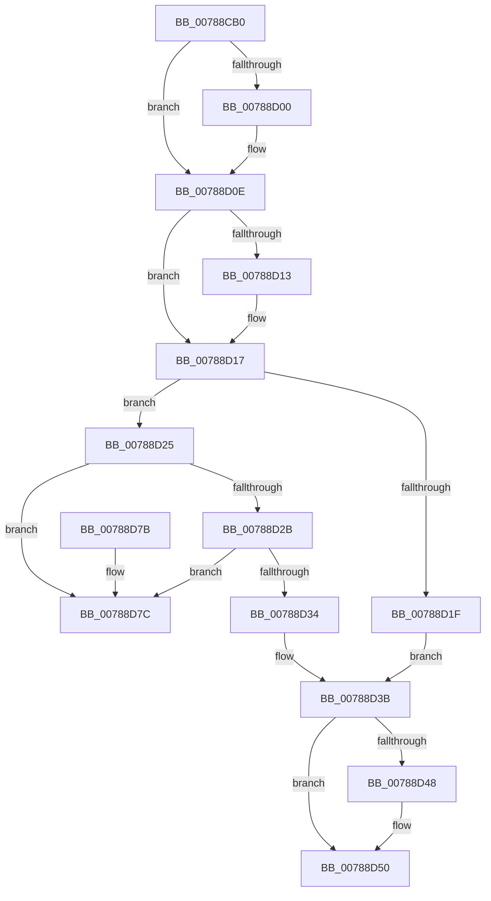

# PspRemoveEnclaveThreadWait

- RVA: `0x00788CB0`–`0x00788D83` (길이 `211` bytes)
- VA: `0x0000000140788CB0`
- 실행 섹션: `PAGE`
- PDB 이름 있음: `예`; PDB Function 태그: `아니요`
- unwind 정보 RVA: `0x0006B020`
- 디코드: `60`개 명령, `211/211` bytes 표시
- 미해석 바이트: `0` (있으면 어셈블리에 `.byte`로 보존)

> 이 문서는 커널 이미지의 기계어와 PDB 기호를 분석해 생성했습니다. 4번과 5번은 함수 원형과 자료형을 바이너리 사용 방식에서 추정한 C 해석이며 원본 소스 복구 결과는 아닙니다.

## 1. Dependencies

- 직접 호출 지점: **5**; 고유 호출 대상: **5**
- 직접 호출자로 확인된 함수: **1**
- RIP 상대 이미지 참조: **0**

### Outgoing calls
- `0x00788CF0` → [KeAbPreAcquire](../../text/21/KeAbPreAcquire_function_00210230.md) (function, `0x00210230`)
- `0x00788D09` → [ExfAcquirePushLockExclusiveEx](../../text/20/ExfAcquirePushLockExclusiveEx_function_0020FC90.md) (function, `0x0020FC90`)
- `0x00788D4B` → [ExfTryToWakePushLock](../../text/26/ExfTryToWakePushLock_function_00265DD0.md) (function, `0x00265DD0`)
- `0x00788D53` → [KeAbPostRelease](../../text/2E/KeAbPostRelease_function_002E1600.md) (function, `0x002E1600`)
- `0x00788D58` → [KeLeaveCriticalRegion](../../text/25/KeLeaveCriticalRegion_function_0025D8B0.md) (function, `0x0025D8B0`)

### Direct callers
- [sub_00B36710](../B3/Unknown_function_00B36710.md) at `0x00B3677E`

### Static image references
- 디코드된 RIP-relative 메모리 참조가 없습니다.

## 2. Other-region calls and transfers

- 다른 실행 섹션으로 향하는 call: **5**
  - `0x00788CF0` → [KeAbPreAcquire](../../text/21/KeAbPreAcquire_function_00210230.md) (`PAGE` → `.text`)
  - `0x00788D09` → [ExfAcquirePushLockExclusiveEx](../../text/20/ExfAcquirePushLockExclusiveEx_function_0020FC90.md) (`PAGE` → `.text`)
  - `0x00788D4B` → [ExfTryToWakePushLock](../../text/26/ExfTryToWakePushLock_function_00265DD0.md) (`PAGE` → `.text`)
  - `0x00788D53` → [KeAbPostRelease](../../text/2E/KeAbPostRelease_function_002E1600.md) (`PAGE` → `.text`)
  - `0x00788D58` → [KeLeaveCriticalRegion](../../text/25/KeLeaveCriticalRegion_function_0025D8B0.md) (`PAGE` → `.text`)
- 별도 외부 분기/꼬리 이동을 확인하지 못했습니다.

## 3. Assembly (complete function range)

```asm
00788CB0  48 8B C4                        mov rax, rsp
00788CB3  48 89 58 08                     mov qword ptr [rax + 8], rbx
00788CB7  48 89 68 10                     mov qword ptr [rax + 0x10], rbp
00788CBB  48 89 70 18                     mov qword ptr [rax + 0x18], rsi
00788CBF  48 89 78 20                     mov qword ptr [rax + 0x20], rdi
00788CC3  41 56                           push r14
00788CC5  48 83 EC 20                     sub rsp, 0x20
00788CC9  65 48 8B 04 25 88 01 00 00      mov rax, qword ptr gs:[0x188]
00788CD2  48 8D 79 70                     lea rdi, [rcx + 0x70]
00788CD6  45 8B F0                        mov r14d, r8d
00788CD9  48 8B F2                        mov rsi, rdx
00788CDC  48 83 CB FF                     or rbx, 0xffffffffffffffff
00788CE0  45 33 C0                        xor r8d, r8d
00788CE3  33 D2                           xor edx, edx
00788CE5  48 8B CF                        mov rcx, rdi
00788CE8  66 01 98 E4 01 00 00            add word ptr [rax + 0x1e4], bx
00788CEF  90                              nop
00788CF0  E8 3B 75 A8 FF                  call 0x140210230
00788CF5  F0 48 0F BA 2F 00               lock bts qword ptr [rdi], 0
00788CFB  48 8B E8                        mov rbp, rax
00788CFE  73 0E                           jae 0x140788d0e
00788D00  4C 8B C7                        mov r8, rdi
00788D03  48 8B D0                        mov rdx, rax
00788D06  48 8B CF                        mov rcx, rdi
00788D09  E8 82 6F A8 FF                  call 0x14020fc90
00788D0E  48 85 ED                        test rbp, rbp
00788D11  74 04                           je 0x140788d17
00788D13  C6 45 0A 01                     mov byte ptr [rbp + 0xa], 1
00788D17  48 8B 06                        mov rax, qword ptr [rsi]
00788D1A  48 85 C0                        test rax, rax
00788D1D  75 06                           jne 0x140788d25
00788D1F  44 8B 76 28                     mov r14d, dword ptr [rsi + 0x28]
00788D23  EB 16                           jmp 0x140788d3b
00788D25  48 39 70 08                     cmp qword ptr [rax + 8], rsi
00788D29  75 51                           jne 0x140788d7c
00788D2B  48 8B 4E 08                     mov rcx, qword ptr [rsi + 8]
00788D2F  48 39 31                        cmp qword ptr [rcx], rsi
00788D32  75 48                           jne 0x140788d7c
00788D34  48 89 01                        mov qword ptr [rcx], rax
00788D37  48 89 48 08                     mov qword ptr [rax + 8], rcx
00788D3B  F0 48 0F C1 1F                  lock xadd qword ptr [rdi], rbx
00788D40  80 E3 06                        and bl, 6
00788D43  80 FB 02                        cmp bl, 2
00788D46  75 08                           jne 0x140788d50
00788D48  48 8B CF                        mov rcx, rdi
00788D4B  E8 80 D0 AD FF                  call 0x140265dd0
00788D50  48 8B CF                        mov rcx, rdi
00788D53  E8 A8 88 B5 FF                  call 0x1402e1600
00788D58  E8 53 4B AD FF                  call 0x14025d8b0
00788D5D  48 8B 5C 24 30                  mov rbx, qword ptr [rsp + 0x30]
00788D62  41 8B C6                        mov eax, r14d
00788D65  48 8B 6C 24 38                  mov rbp, qword ptr [rsp + 0x38]
00788D6A  48 8B 74 24 40                  mov rsi, qword ptr [rsp + 0x40]
00788D6F  48 8B 7C 24 48                  mov rdi, qword ptr [rsp + 0x48]
00788D74  48 83 C4 20                     add rsp, 0x20
00788D78  41 5E                           pop r14
00788D7A  C3                              ret
00788D7B  CC                              int3
00788D7C  B9 03 00 00 00                  mov ecx, 3
00788D81  CD 29                           int 0x29
```

## 4. C-style interpretation (structured pseudocode)

```c
__int64 __fastcall PspRemoveEnclaveThreadWait(__int64 a1, __int64 a2, int a3)
{
    __int64 result;
    __int64 v_rbx;
    __int64 v_rsp;
    unsigned __int64 v_stack_p10;
    unsigned __int64 v_stack_p18;
    unsigned __int64 v_stack_p20;
    unsigned __int64 v_stack_p8;

    *(unsigned __int64 *)(v_rsp + 8) = v_rbx;
    *(unsigned __int64 *)(v_rsp + 16) = v_rbp;
    *(unsigned __int64 *)(v_rsp + 24) = v_rsi;
    *(unsigned __int64 *)(v_rsp + 32) = v_rdi;
    v_rsp = (v_rsp) - (32);
    v_rbx = (v_rbx) | (-1);
    a3 = 0;
    a2 = 0;
    result = KeAbPreAcquire(a1 + 112, a2, a3, a4);
    if (!(condition_is_above_or_equal)) {
        a3 = a1 + 112;
        a2 = result;
        a1 = a1 + 112;
        result = ExfAcquirePushLockExclusiveEx(a1, a2, a3, a4);
    }
    if (result != 0) {
        *(unsigned __int8 *)(result + 10) = 1;
    }
    if (*(unsigned __int64 *)(a2) != 0) goto loc_00788D25;
    goto loc_00788D3B;
loc_00788D25:
    if ((*(unsigned __int64 *)(*(unsigned __int64 *)(a2) + 8)) != a2) goto loc_00788D7C;
    if ((*(unsigned __int64 *)(*(unsigned __int64 *)(a2 + 8))) != a2) goto loc_00788D7C;
    *(unsigned __int64 *)(*(unsigned __int64 *)(a2 + 8)) = *(unsigned __int64 *)(a2);
    *(unsigned __int64 *)(*(unsigned __int64 *)(a2) + 8) = *(unsigned __int64 *)(a2 + 8);
loc_00788D3B:
    v_rbx = (unsigned __int8)((v_rbx) & (6));
    result = *(unsigned __int64 *)(a2);
    if (((unsigned __int8)(v_rbx)) == 2) {
        a1 = a1 + 112;
        result = ExfTryToWakePushLock(a1, a2, a3, a4);
    }
    result = KeAbPostRelease(a1 + 112, a2, a3, a4);
    result = KeLeaveCriticalRegion(a1 + 112, a2, a3, a4);
    v_rsp = (v_rsp) + (32);
    return (unsigned int)((unsigned int)((unsigned int)(*(unsigned int *)(a2 + 40))));
loc_00788D7C:
    return (unsigned int)((unsigned int)((unsigned int)(*(unsigned int *)(a2 + 40))));
}
```

## 5. (Beta) C Style

```c
int64_t PspRemoveEnclaveThreadWait(void *Arg1, void *Arg2, int32_t Arg3)
{
    uint8_t *arg1 = (uint8_t *)Arg1;
    uint8_t *arg2 = (uint8_t *)Arg2;

    int64_t result;
    int64_t local_rbx;
    int64_t local_rsp;
    uint64_t v_stack_p10;
    uint64_t v_stack_p18;
    uint64_t v_stack_p20;
    uint64_t v_stack_p8;

    *(uint64_t *)(local_rsp + 0x8) = local_rbx;
    *(uint64_t *)(local_rsp + 0x10) = local_rbp;
    *(uint64_t *)(local_rsp + 0x18) = local_rsi;
    *(uint64_t *)(local_rsp + 0x20) = local_rdi;
    local_rsp = (local_rsp) - (32);
    local_rbx = (local_rbx) | (-1);
    Arg3 = 0;
    Arg2 = 0;
    result = KeAbPreAcquire(Arg1 + 112, Arg2, Arg3, a4);
    if (!(condition_is_above_or_equal)) {
        Arg3 = Arg1 + 112;
        Arg2 = result;
        Arg1 = Arg1 + 112;
        result = ExfAcquirePushLockExclusiveEx(Arg1, Arg2, Arg3, a4);
    }
    if (result != 0) {
        *(uint8_t *)(result + 0xA) = 1;
    }
    if (*(uint64_t *)(arg2) != 0) goto loc_00788D25;
    goto loc_00788D3B;
loc_00788D25:
    if ((*(uint64_t *)(*(uint64_t *)(arg2) + 0x8)) != Arg2) goto loc_00788D7C;
    if ((*(uint64_t *)(*(uint64_t *)(arg2 + 0x8))) != Arg2) goto loc_00788D7C;
    *(uint64_t *)(*(uint64_t *)(arg2 + 0x8)) = *(uint64_t *)(arg2);
    *(uint64_t *)(*(uint64_t *)(arg2) + 0x8) = *(uint64_t *)(arg2 + 0x8);
loc_00788D3B:
    local_rbx = (uint8_t)((local_rbx) & (6));
    result = *(uint64_t *)(arg2);
    if (((uint8_t)(local_rbx)) == 2) {
        Arg1 = Arg1 + 112;
        result = ExfTryToWakePushLock(Arg1, Arg2, Arg3, a4);
    }
    result = KeAbPostRelease(Arg1 + 112, Arg2, Arg3, a4);
    result = KeLeaveCriticalRegion(Arg1 + 112, Arg2, Arg3, a4);
    local_rsp = (local_rsp) + (32);
    return (uint32_t)((uint32_t)((uint32_t)(*(uint32_t *)(arg2 + 0x28))));
loc_00788D7C:
    return (uint32_t)((uint32_t)((uint32_t)(*(uint32_t *)(arg2 + 0x28))));
}
```

### 관측된 메모리 오프셋

구조체 형식이 확인되지 않은 접근은 인자 기준의 오프셋으로만 기록했습니다.

| 기준 인자 | 오프셋 표현 | 폭 (bit) | 접근 |
|---|---:|---:|---|
| `Arg1` | `+ 0x0` | `64` | `R/W` |
| `Arg1` | `+ 0x70` | `64` | `R` |
| `Arg2` | `+ 0x0` | `64` | `R` |
| `Arg2` | `+ 0x8` | `64` | `R` |
| `Arg2` | `+ 0x28` | `32` | `R` |

## 6. Execution-region graph

[열기: 2D/3D 그래프와 함수 탐색 컨트롤 패널](../../../control-panel.html?section=page&rva=0x00788CB0&view=graph)

- 2D 그래프는 위에서 아래로 흐르고, 3D 그래프는 빈 공간을 드래그해 회전합니다. Shift+드래그는 이동, 휠은 확대·축소, 함수 노드 선택은 대상 보고서 이동입니다.

### Static fallback


