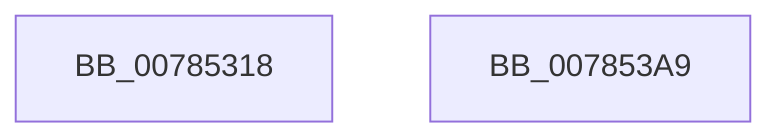

# PspRemoveRateControl

- RVA: `0x00785318`–`0x007853AA` (길이 `146` bytes)
- VA: `0x0000000140785318`
- 실행 섹션: `PAGE`
- PDB 이름 있음: `예`; PDB Function 태그: `아니요`
- unwind 정보 RVA: `0x0008C33C`
- 디코드: `35`개 명령, `146/146` bytes 표시
- 미해석 바이트: `0` (있으면 어셈블리에 `.byte`로 보존)

> 이 문서는 커널 이미지의 기계어와 PDB 기호를 분석해 생성했습니다. 4번과 5번은 함수 원형과 자료형을 바이너리 사용 방식에서 추정한 C 해석이며 원본 소스 복구 결과는 아닙니다.

## 1. Dependencies

- 직접 호출 지점: **3**; 고유 호출 대상: **3**
- 직접 호출자로 확인된 함수: **2**
- RIP 상대 이미지 참조: **2**

### Outgoing calls
- `0x00785374` → [PspEnumJobsAndProcessesInJobHierarchy](../91/PspEnumJobsAndProcessesInJobHierarchy_function_0091A1EC.md) (function, `0x0091A1EC`)
- `0x00785384` → [PspModifyAncestorBits](PspModifyAncestorBits_function_0078508C.md) (function, `0x0078508C`)
- `0x00785392` → [PspFreeRateControl](../99/PspFreeRateControl_function_0099E1BC.md) (function, `0x0099E1BC`)

### Direct callers
- [PspJobDelete](../../text/4B/PspJobDelete_function_004BF8F0.md) at `0x004BF9CF`
- [PspSetJobRateControl](PspSetJobRateControl_function_0078572C.md) at `0x0078588D`

### Static image references
- `0x0078534A` → RVA `0x00785CC0` (`PspSetRateControlProcessCallback`; read)
- `0x0078535B` → RVA `0x00785C80` (`PspSetRateControlJobPreCallback`; read)

## 2. Other-region calls and transfers

- 다른 실행 섹션으로 향하는 call: **0**
- 별도 외부 분기/꼬리 이동을 확인하지 못했습니다.

## 3. Assembly (complete function range)

```asm
00785318  48 8B C4                        mov rax, rsp
0078531B  48 89 58 08                     mov qword ptr [rax + 8], rbx
0078531F  57                              push rdi
00785320  48 83 EC 60                     sub rsp, 0x60
00785324  33 FF                           xor edi, edi
00785326  48 8B D9                        mov rbx, rcx
00785329  66 89 78 ED                     mov word ptr [rax - 0x13], di
0078532D  40 88 78 EF                     mov byte ptr [rax - 0x11], dil
00785331  F0 81 A1 10 06 00 00 FF FF FF FB  lock and dword ptr [rcx + 0x610], 0xfbffffff
0078533C  C7 40 C0 05 00 00 00            mov dword ptr [rax - 0x40], 5
00785343  0F 57 C0                        xorps xmm0, xmm0
00785346  48 89 78 C8                     mov qword ptr [rax - 0x38], rdi
0078534A  4C 8D 0D 6F 09 00 00            lea r9, [rip + 0x96f]
00785351  48 89 78 D0                     mov qword ptr [rax - 0x30], rdi
00785355  45 33 C0                        xor r8d, r8d
00785358  89 78 E8                        mov dword ptr [rax - 0x18], edi
0078535B  48 8D 15 1E 09 00 00            lea rdx, [rip + 0x91e]
00785362  40 88 78 EC                     mov byte ptr [rax - 0x14], dil
00785366  F3 0F 7F 40 D8                  movdqu xmmword ptr [rax - 0x28], xmm0
0078536B  48 8D 40 C8                     lea rax, [rax - 0x38]
0078536F  48 89 44 24 20                  mov qword ptr [rsp + 0x20], rax
00785374  E8 73 4E 19 00                  call 0x14091a1ec
00785379  45 33 C0                        xor r8d, r8d
0078537C  BA 00 00 00 02                  mov edx, 0x2000000
00785381  48 8B CB                        mov rcx, rbx
00785384  E8 03 FD FF FF                  call 0x14078508c
00785389  48 8B 8B 08 06 00 00            mov rcx, qword ptr [rbx + 0x608]
00785390  33 D2                           xor edx, edx
00785392  E8 25 8E 21 00                  call 0x14099e1bc
00785397  48 89 BB 08 06 00 00            mov qword ptr [rbx + 0x608], rdi
0078539E  48 8B 5C 24 70                  mov rbx, qword ptr [rsp + 0x70]
007853A3  48 83 C4 60                     add rsp, 0x60
007853A7  5F                              pop rdi
007853A8  C3                              ret
007853A9  CC                              int3
```

## 4. C-style interpretation (structured pseudocode)

```c
__int64 __fastcall PspRemoveRateControl(__int64 a1, __int64 a2, int a3)
{
    __int64 result;
    __int64 v_rdi;
    __int64 v_rsp;
    unsigned __int64 v_stack_m48;
    unsigned __int64 v_stack_p8;

    *(unsigned __int64 *)(v_rsp + 8) = v_rbx;
    v_rsp = (v_rsp) - (96);
    v_rdi = 0;
    *(unsigned __int16 *)(v_rsp - 19) = 0;
    *(unsigned __int8 *)(v_rsp - 17) = 0;
    *(unsigned int *)(v_rsp - 64) = 5;
    *(unsigned __int64 *)(v_rsp - 56) = 0;
    *(unsigned __int64 *)(v_rsp - 48) = 0;
    a3 = 0;
    *(unsigned int *)(v_rsp - 24) = 0;
    *(unsigned __int8 *)(v_rsp - 20) = 0;
    *(unsigned __int64 *)(v_rsp - 40) = v_xmm0;
    v_stack_m48 = v_rsp - 56;
    result = PspEnumJobsAndProcessesInJobHierarchy(a1, v_rip + 2334, a3, v_rip + 2415);
    a3 = 0;
    result = PspModifyAncestorBits(a1, (unsigned int)(0x2000000ULL), a3, v_rip + 2415);
    a2 = 0;
    result = PspFreeRateControl(*(unsigned __int64 *)(a1 + 1544), a2, a3, v_rip + 2415);
    *(unsigned __int64 *)(a1 + 1544) = 0;
    v_rsp = (v_rsp) + (96);
    return result;
}
```

## 5. (Beta) C Style

```c
int64_t PspRemoveRateControl(void *Arg1, int64_t Arg2, int32_t Arg3)
{
    uint8_t *arg1 = (uint8_t *)Arg1;

    int64_t result;
    int64_t local_rdi;
    int64_t local_rsp;
    uint64_t v_stack_m48;
    uint64_t v_stack_p8;

    *(uint64_t *)(local_rsp + 0x8) = local_rbx;
    local_rsp = (local_rsp) - (96);
    local_rdi = 0;
    *(uint16_t *)(local_rsp - 0x13) = 0;
    *(uint8_t *)(local_rsp - 0x11) = 0;
    *(uint32_t *)(local_rsp - 0x40) = 5;
    *(uint64_t *)(local_rsp - 0x38) = 0;
    *(uint64_t *)(local_rsp - 0x30) = 0;
    Arg3 = 0;
    *(uint32_t *)(local_rsp - 0x18) = 0;
    *(uint8_t *)(local_rsp - 0x14) = 0;
    *(uint64_t *)(local_rsp - 0x28) = v_xmm0;
    v_stack_m48 = local_rsp - 56;
    result = PspEnumJobsAndProcessesInJobHierarchy(Arg1, v_rip + 2334, Arg3, v_rip + 2415);
    Arg3 = 0;
    result = PspModifyAncestorBits(Arg1, (uint32_t)(0x2000000ULL), Arg3, v_rip + 2415);
    Arg2 = 0;
    result = PspFreeRateControl(*(uint64_t *)(arg1 + 0x608), Arg2, Arg3, v_rip + 2415);
    *(uint64_t *)(arg1 + 0x608) = 0;
    local_rsp = (local_rsp) + (96);
    return result;
}
```

### 관측된 메모리 오프셋

구조체 형식이 확인되지 않은 접근은 인자 기준의 오프셋으로만 기록했습니다.

| 기준 인자 | 오프셋 표현 | 폭 (bit) | 접근 |
|---|---:|---:|---|
| `Arg1` | `+ 0x608` | `64` | `R` |
| `Arg1` | `+ 0x608` | `64` | `W` |
| `Arg1` | `+ 0x610` | `32` | `R/W` |

## 6. Execution-region graph

[열기: 2D/3D 그래프와 함수 탐색 컨트롤 패널](../../../control-panel.html?section=page&rva=0x00785318&view=graph)

- 2D 그래프는 위에서 아래로 흐르고, 3D 그래프는 빈 공간을 드래그해 회전합니다. Shift+드래그는 이동, 휠은 확대·축소, 함수 노드 선택은 대상 보고서 이동입니다.

### Static fallback


