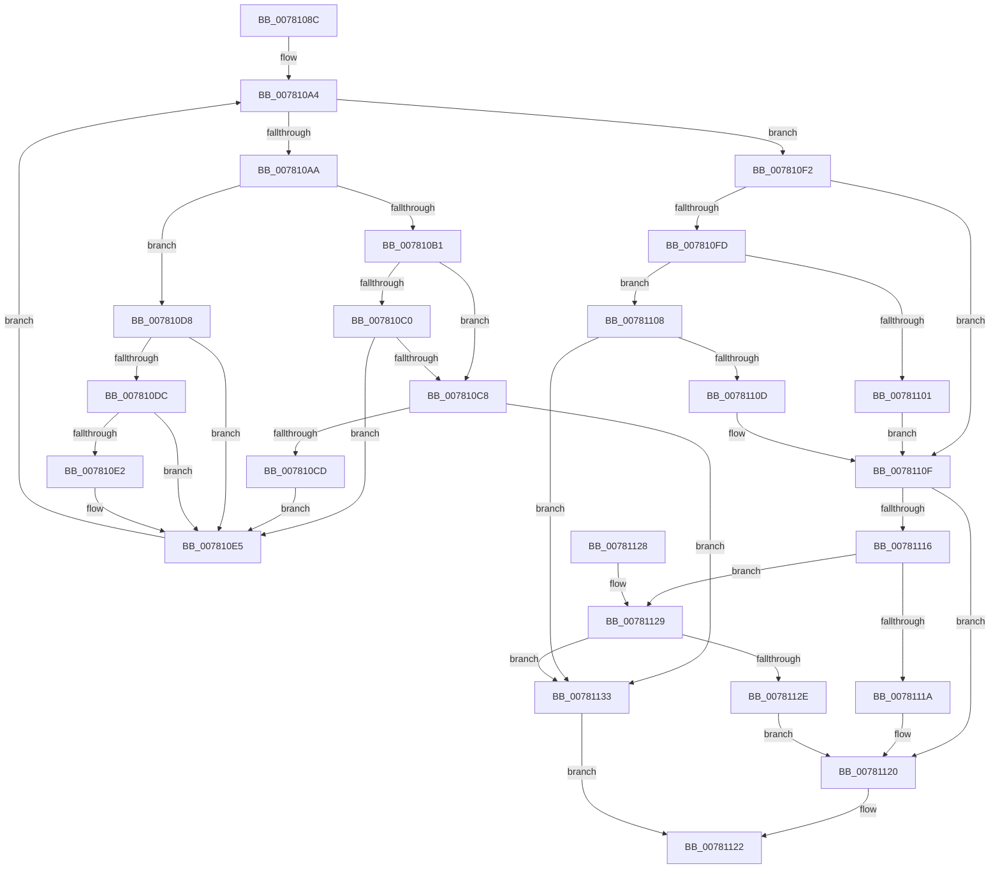

# PspSanitizeResourceLimits

- RVA: `0x0078108C`–`0x0078113A` (길이 `174` bytes)
- VA: `0x000000014078108C`
- 실행 섹션: `PAGE`
- PDB 이름 있음: `예`; PDB Function 태그: `아니요`
- unwind 정보 RVA: `0x000CE2D8`
- 디코드: `63`개 명령, `174/174` bytes 표시
- 미해석 바이트: `0` (있으면 어셈블리에 `.byte`로 보존)

> 이 문서는 커널 이미지의 기계어와 PDB 기호를 분석해 생성했습니다. 4번과 5번은 함수 원형과 자료형을 바이너리 사용 방식에서 추정한 C 해석이며 원본 소스 복구 결과는 아닙니다.

## 1. Dependencies

- 직접 호출 지점: **0**; 고유 호출 대상: **0**
- 직접 호출자로 확인된 함수: **2**
- RIP 상대 이미지 참조: **1**

### Outgoing calls
- 직접 디코드된 call 명령이 없습니다.

### Direct callers
- [sub_00B3EB8C](../B3/Unknown_function_00B3EB8C.md) at `0x00B3ECB0`
- [PsInitializeQuotaSystem](../../init/C4/PsInitializeQuotaSystem_function_00C46364.md) at `0x00C464A0`

### Static image references
- `0x00781094` → RVA `0x00FC7350` (`ALMOSTRO`; read)

## 2. Other-region calls and transfers

- 다른 실행 섹션으로 향하는 call: **0**
- 별도 외부 분기/꼬리 이동을 확인하지 못했습니다.

## 3. Assembly (complete function range)

```asm
0078108C  48 89 5C 24 08                  mov qword ptr [rsp + 8], rbx
00781091  45 33 D2                        xor r10d, r10d
00781094  4C 8D 1D B5 62 84 00            lea r11, [rip + 0x8462b5]
0078109B  83 CB FF                        or ebx, 0xffffffff
0078109E  44 8B CA                        mov r9d, edx
007810A1  4C 8B C1                        mov r8, rcx
007810A4  41 83 FA 04                     cmp r10d, 4
007810A8  7D 48                           jge 0x1407810f2
007810AA  41 8A 03                        mov al, byte ptr [r11]
007810AD  A8 02                           test al, 2
007810AF  74 27                           je 0x1407810d8
007810B1  41 8B 10                        mov edx, dword ptr [r8]
007810B4  8B C2                           mov eax, edx
007810B6  83 E0 7F                        and eax, 0x7f
007810B9  FF C8                           dec eax
007810BB  83 F8 63                        cmp eax, 0x63
007810BE  77 08                           ja 0x1407810c8
007810C0  81 FA 80 00 00 00               cmp edx, 0x80
007810C6  72 1D                           jb 0x1407810e5
007810C8  45 85 C9                        test r9d, r9d
007810CB  74 66                           je 0x140781133
007810CD  83 E2 E4                        and edx, 0xffffffe4
007810D0  83 CA 64                        or edx, 0x64
007810D3  41 89 10                        mov dword ptr [r8], edx
007810D6  EB 0D                           jmp 0x1407810e5
007810D8  A8 01                           test al, 1
007810DA  74 09                           je 0x1407810e5
007810DC  41 83 38 00                     cmp dword ptr [r8], 0
007810E0  75 03                           jne 0x1407810e5
007810E2  41 89 18                        mov dword ptr [r8], ebx
007810E5  41 FF C2                        inc r10d
007810E8  49 83 C3 08                     add r11, 8
007810EC  49 83 C0 04                     add r8, 4
007810F0  EB B2                           jmp 0x1407810a4
007810F2  8B 01                           mov eax, dword ptr [rcx]
007810F4  BA FF 0F 00 00                  mov edx, 0xfff
007810F9  3B C3                           cmp eax, ebx
007810FB  74 12                           je 0x14078110f
007810FD  3B C2                           cmp eax, edx
007810FF  73 07                           jae 0x140781108
00781101  C1 E0 14                        shl eax, 0x14
00781104  89 01                           mov dword ptr [rcx], eax
00781106  EB 07                           jmp 0x14078110f
00781108  45 85 C9                        test r9d, r9d
0078110B  74 26                           je 0x140781133
0078110D  89 19                           mov dword ptr [rcx], ebx
0078110F  8B 41 04                        mov eax, dword ptr [rcx + 4]
00781112  3B C3                           cmp eax, ebx
00781114  74 0A                           je 0x140781120
00781116  3B C2                           cmp eax, edx
00781118  73 0F                           jae 0x140781129
0078111A  C1 E0 14                        shl eax, 0x14
0078111D  89 41 04                        mov dword ptr [rcx + 4], eax
00781120  33 C0                           xor eax, eax
00781122  48 8B 5C 24 08                  mov rbx, qword ptr [rsp + 8]
00781127  C3                              ret
00781128  CC                              int3
00781129  45 85 C9                        test r9d, r9d
0078112C  74 05                           je 0x140781133
0078112E  89 59 04                        mov dword ptr [rcx + 4], ebx
00781131  EB ED                           jmp 0x140781120
00781133  B8 0D 00 00 C0                  mov eax, 0xc000000d
00781138  EB E8                           jmp 0x140781122
```

## 4. C-style interpretation (structured pseudocode)

```c
__int64 __fastcall PspSanitizeResourceLimits(__int64 a1, int a2)
{
    __int64 result;
    __int64 v_r10;
    __int64 v_r11;
    __int64 v_rbx;
    unsigned __int64 v_stack_p8;

    v_stack_p8 = v_rbx;
    v_r10 = 0;
    v_rbx = (unsigned int)((v_rbx) | (0xFFFFFFFFULL));
loc_007810A4:
    if (0 >= 4) goto loc_007810F2;
    if ((((unsigned __int8)(*(unsigned __int8 *)(v_rip + 8676021))) & (2)) == 0) goto loc_007810D8;
    result = (unsigned int)(((unsigned int)((unsigned int)((unsigned int)(*(unsigned int *)(a1))))) & (127));
    result = (unsigned int)((result) - 1);
    if (((unsigned int)(result)) > 99) goto loc_007810C8;
    if (((unsigned int)((unsigned int)(*(unsigned int *)(a1)))) < 128) goto loc_007810E5;
loc_007810C8:
    if ((unsigned int)((unsigned int)(a2)) == 0) goto loc_00781133;
    a2 = (unsigned int)(((unsigned int)(*(unsigned int *)(a1))) & (0xFFFFFFE4ULL));
    a2 = (unsigned int)((a2) | (100));
    *(unsigned int *)(a1) = a2;
    goto loc_007810E5;
loc_007810D8:
    if ((((unsigned __int8)(result)) & (1)) == 0) goto loc_007810E5;
    if ((*(unsigned int *)(a1)) == 0) {
        *(unsigned int *)(a1) = (unsigned int)(v_rbx);
    }
    v_r10 = (unsigned int)((v_r10) + 1);
    v_r11 = (v_rip + 8676021) + (8);
    a3 = (a1) + (4);
    goto loc_007810A4;
loc_007810F2:
    if (((unsigned int)((unsigned int)(*(unsigned int *)(a1)))) == ((unsigned int)(v_rbx))) goto loc_0078110F;
    if (((unsigned int)((unsigned int)(*(unsigned int *)(a1)))) >= ((unsigned int)((unsigned int)(0xFFFULL)))) goto loc_00781108;
    result = (unsigned int)(((unsigned int)(*(unsigned int *)(a1))) << (20));
    *(unsigned int *)(a1) = (unsigned int)(result);
    goto loc_0078110F;
loc_00781108:
    if ((unsigned int)((unsigned int)(a2)) == 0) goto loc_00781133;
    *(unsigned int *)(a1) = (unsigned int)(v_rbx);
loc_0078110F:
    if (((unsigned int)((unsigned int)(*(unsigned int *)(a1 + 4)))) == ((unsigned int)(v_rbx))) goto loc_00781120;
    if (((unsigned int)((unsigned int)(*(unsigned int *)(a1 + 4)))) >= ((unsigned int)((unsigned int)(0xFFFULL)))) goto loc_00781129;
    result = (unsigned int)(((unsigned int)(*(unsigned int *)(a1 + 4))) << (20));
    *(unsigned int *)(a1 + 4) = (unsigned int)(result);
loc_00781120:
    result = 0;
loc_00781122:
    return result;
loc_00781129:
    if ((unsigned int)((unsigned int)(a2)) == 0) goto loc_00781133;
    *(unsigned int *)(a1 + 4) = (unsigned int)(v_stack_p8);
    goto loc_00781120;
loc_00781133:
    goto loc_00781122;
}
```

## 5. (Beta) C Style

```c
int64_t PspSanitizeResourceLimits(void *Arg1, int32_t Arg2)
{
    uint8_t *arg1 = (uint8_t *)Arg1;

    int64_t result;
    int64_t local_r10;
    int64_t local_r11;
    int64_t local_rbx;
    uint64_t v_stack_p8;

    v_stack_p8 = local_rbx;
    local_r10 = 0;
    local_rbx = (uint32_t)((local_rbx) | (0xFFFFFFFFULL));
loc_007810A4:
    if (0 >= 4) goto loc_007810F2;
    if ((((uint8_t)(*(uint8_t *)(v_rip + 0x8462B5))) & (2)) == 0) goto loc_007810D8;
    result = (uint32_t)(((uint32_t)((uint32_t)((uint32_t)(*(uint32_t *)(arg1))))) & (127));
    result = (uint32_t)((result) - 1);
    if (((uint32_t)(result)) > 99) goto loc_007810C8;
    if (((uint32_t)((uint32_t)(*(uint32_t *)(arg1)))) < 128) goto loc_007810E5;
loc_007810C8:
    if ((uint32_t)((uint32_t)(Arg2)) == 0) goto loc_00781133;
    Arg2 = (uint32_t)(((uint32_t)(*(uint32_t *)(arg1))) & (0xFFFFFFE4ULL));
    Arg2 = (uint32_t)((Arg2) | (100));
    *(uint32_t *)(arg1) = Arg2;
    goto loc_007810E5;
loc_007810D8:
    if ((((uint8_t)(result)) & (1)) == 0) goto loc_007810E5;
    if ((*(uint32_t *)(arg1)) == 0) {
        *(uint32_t *)(arg1) = (uint32_t)(local_rbx);
    }
    local_r10 = (uint32_t)((local_r10) + 1);
    local_r11 = (v_rip + 8676021) + (8);
    a3 = (Arg1) + (4);
    goto loc_007810A4;
loc_007810F2:
    if (((uint32_t)((uint32_t)(*(uint32_t *)(arg1)))) == ((uint32_t)(local_rbx))) goto loc_0078110F;
    if (((uint32_t)((uint32_t)(*(uint32_t *)(arg1)))) >= ((uint32_t)((uint32_t)(0xFFFULL)))) goto loc_00781108;
    result = (uint32_t)(((uint32_t)(*(uint32_t *)(arg1))) << (20));
    *(uint32_t *)(arg1) = (uint32_t)(result);
    goto loc_0078110F;
loc_00781108:
    if ((uint32_t)((uint32_t)(Arg2)) == 0) goto loc_00781133;
    *(uint32_t *)(arg1) = (uint32_t)(local_rbx);
loc_0078110F:
    if (((uint32_t)((uint32_t)(*(uint32_t *)(arg1 + 0x4)))) == ((uint32_t)(local_rbx))) goto loc_00781120;
    if (((uint32_t)((uint32_t)(*(uint32_t *)(arg1 + 0x4)))) >= ((uint32_t)((uint32_t)(0xFFFULL)))) goto loc_00781129;
    result = (uint32_t)(((uint32_t)(*(uint32_t *)(arg1 + 0x4))) << (20));
    *(uint32_t *)(arg1 + 0x4) = (uint32_t)(result);
loc_00781120:
    result = 0;
loc_00781122:
    return result;
loc_00781129:
    if ((uint32_t)((uint32_t)(Arg2)) == 0) goto loc_00781133;
    *(uint32_t *)(arg1 + 0x4) = (uint32_t)(v_stack_p8);
    goto loc_00781120;
loc_00781133:
    goto loc_00781122;
}
```

### 관측된 메모리 오프셋

구조체 형식이 확인되지 않은 접근은 인자 기준의 오프셋으로만 기록했습니다.

| 기준 인자 | 오프셋 표현 | 폭 (bit) | 접근 |
|---|---:|---:|---|
| `Arg1` | `+ 0x0` | `32` | `R` |
| `Arg1` | `+ 0x0` | `32` | `W` |
| `Arg1` | `+ 0x4` | `32` | `R` |
| `Arg1` | `+ 0x4` | `32` | `W` |

## 6. Execution-region graph

[열기: 2D/3D 그래프와 함수 탐색 컨트롤 패널](../../../control-panel.html?section=page&rva=0x0078108C&view=graph)

- 2D 그래프는 위에서 아래로 흐르고, 3D 그래프는 빈 공간을 드래그해 회전합니다. Shift+드래그는 이동, 휠은 확대·축소, 함수 노드 선택은 대상 보고서 이동입니다.

### Static fallback


