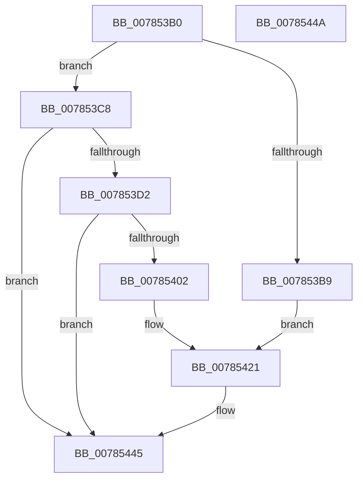

# PspSendNoWakeChargeLimitNotification

- RVA: `0x007853B0`–`0x0078544B` (길이 `155` bytes)
- VA: `0x00000001407853B0`
- 실행 섹션: `PAGE`
- PDB 이름 있음: `예`; PDB Function 태그: `아니요`
- unwind 정보 RVA: `0x00063458`
- 디코드: `35`개 명령, `155/155` bytes 표시
- 미해석 바이트: `0` (있으면 어셈블리에 `.byte`로 보존)

> 이 문서는 커널 이미지의 기계어와 PDB 기호를 분석해 생성했습니다. 4번과 5번은 함수 원형과 자료형을 바이너리 사용 방식에서 추정한 C 해석이며 원본 소스 복구 결과는 아닙니다.

## 1. Dependencies

- 직접 호출 지점: **2**; 고유 호출 대상: **2**
- 직접 호출자로 확인된 함수: **1**
- RIP 상대 이미지 참조: **4**

### Outgoing calls
- `0x007853F3` → [PspEnumJobsAndProcessesInJobHierarchy](../91/PspEnumJobsAndProcessesInJobHierarchy_function_0091A1EC.md) (function, `0x0091A1EC`)
- `0x00785440` → [ZwUpdateWnfStateData](../../text/6B/ZwUpdateWnfStateData_function_006B0D10.md) (function, `0x006B0D10`)

### Direct callers
- [PspEnforceLimitsJobPostCallback](../91/PspEnforceLimitsJobPostCallback_function_00919720.md) at `0x00919D7A`
- [PspEnforceLimitsJobPostCallback](../91/PspEnforceLimitsJobPostCallback_function_00919720.md) at `0x00919D8B`

### Static image references
- `0x007853C8` → RVA `0x00FD9DA0` (`PAGEDATA`; read)
- `0x007853E2` → RVA `0x00785010` (`PspGetProcessInJobHierarchyCallback`; read)
- `0x0078541A` → RVA `0x00FD9DA0` (`PAGEDATA`; write)
- `0x00785430` → RVA `0x00020BA0` (`.rdata`; read)

## 2. Other-region calls and transfers

- 다른 실행 섹션으로 향하는 call: **1**
  - `0x00785440` → [ZwUpdateWnfStateData](../../text/6B/ZwUpdateWnfStateData_function_006B0D10.md) (`PAGE` → `.text`)
- 별도 외부 분기/꼬리 이동을 확인하지 못했습니다.

## 3. Assembly (complete function range)

```asm
007853B0  48 83 EC 48                     sub rsp, 0x48
007853B4  48 85 C9                        test rcx, rcx
007853B7  75 0F                           jne 0x1407853c8
007853B9  83 4C 24 50 FF                  or dword ptr [rsp + 0x50], 0xffffffff
007853BE  44 8D 41 04                     lea r8d, [rcx + 4]
007853C2  21 4C 24 54                     and dword ptr [rsp + 0x54], ecx
007853C6  EB 59                           jmp 0x140785421
007853C8  48 83 3D D0 49 85 00 00         cmp qword ptr [rip + 0x8549d0], 0
007853D0  75 73                           jne 0x140785445
007853D2  83 64 24 28 00                  and dword ptr [rsp + 0x28], 0
007853D7  48 8D 44 24 58                  lea rax, [rsp + 0x58]
007853DC  48 83 64 24 58 00               and qword ptr [rsp + 0x58], 0
007853E2  4C 8D 0D 27 FC FF FF            lea r9, [rip - 0x3d9]
007853E9  45 33 C0                        xor r8d, r8d
007853EC  48 89 44 24 20                  mov qword ptr [rsp + 0x20], rax
007853F1  33 D2                           xor edx, edx
007853F3  E8 F4 4D 19 00                  call 0x14091a1ec
007853F8  48 8B 4C 24 58                  mov rcx, qword ptr [rsp + 0x58]
007853FD  48 85 C9                        test rcx, rcx
00785400  74 43                           je 0x140785445
00785402  C7 44 24 50 01 00 00 00         mov dword ptr [rsp + 0x50], 1
0078540A  41 B8 08 00 00 00               mov r8d, 8
00785410  8B 81 D0 01 00 00               mov eax, dword ptr [rcx + 0x1d0]
00785416  89 44 24 54                     mov dword ptr [rsp + 0x54], eax
0078541A  48 89 0D 7F 49 85 00            mov qword ptr [rip + 0x85497f], rcx
00785421  83 64 24 30 00                  and dword ptr [rsp + 0x30], 0
00785426  48 8D 54 24 50                  lea rdx, [rsp + 0x50]
0078542B  83 64 24 28 00                  and dword ptr [rsp + 0x28], 0
00785430  48 8D 0D 69 B7 89 FF            lea rcx, [rip - 0x764897]
00785437  48 83 64 24 20 00               and qword ptr [rsp + 0x20], 0
0078543D  45 33 C9                        xor r9d, r9d
00785440  E8 CB B8 F2 FF                  call 0x1406b0d10
00785445  48 83 C4 48                     add rsp, 0x48
00785449  C3                              ret
0078544A  CC                              int3
```

## 4. C-style interpretation (structured pseudocode)

```c
__int64 __fastcall PspSendNoWakeChargeLimitNotification(__int64 a1, int a2)
{
    __int64 result;
    __int64 v_rsp;
    unsigned int v_stack_m18;
    unsigned int v_stack_m20;
    unsigned __int64 v_stack_m28;
    unsigned __int64 v_stack_p10;
    unsigned int v_stack_p8;
    unsigned int v_stack_pC;

    v_rsp = (v_rsp) - (72);
    if (a1 != 0) goto loc_007853C8;
    goto loc_00785421;
loc_007853C8:
    if ((*(unsigned __int64 *)(v_rip + 8735184)) != 0) goto loc_00785445;
    a3 = 0;
    v_stack_m28 = v_stack_p10;
    a2 = 0;
    result = PspEnumJobsAndProcessesInJobHierarchy(a1, a2, a3, v_rip - 985);
    if (v_stack_p10 == 0) goto loc_00785445;
    v_stack_p8 = 1;
    v_stack_pC = (unsigned int)((unsigned int)(*(unsigned int *)(v_stack_p10 + 464)));
    *(unsigned __int64 *)(v_rip + 8735103) = v_stack_p10;
loc_00785421:
    a4 = 0;
    result = ZwUpdateWnfStateData(v_rip - 7751831, v_stack_p8, 8, a4);
loc_00785445:
    v_rsp = (v_rsp) + (72);
    return result;
}
```

## 5. (Beta) C Style

```c
int64_t PspSendNoWakeChargeLimitNotification(int64_t Arg1, int32_t Arg2)
{
    int64_t result;
    int64_t local_rsp;
    uint32_t v_stack_m18;
    uint32_t v_stack_m20;
    uint64_t v_stack_m28;
    uint64_t v_stack_p10;
    uint32_t v_stack_p8;
    uint32_t v_stack_pC;

    local_rsp = (local_rsp) - (72);
    if (Arg1 != 0) goto loc_007853C8;
    goto loc_00785421;
loc_007853C8:
    if ((*(uint64_t *)(v_rip + 0x8549D0)) != 0) goto loc_00785445;
    a3 = 0;
    v_stack_m28 = v_stack_p10;
    Arg2 = 0;
    result = PspEnumJobsAndProcessesInJobHierarchy(Arg1, Arg2, a3, v_rip - 985);
    if (v_stack_p10 == 0) goto loc_00785445;
    v_stack_p8 = 1;
    v_stack_pC = (uint32_t)((uint32_t)(*(uint32_t *)(v_stack_p10 + 0x1D0)));
    *(uint64_t *)(v_rip + 0x85497F) = v_stack_p10;
loc_00785421:
    a4 = 0;
    result = ZwUpdateWnfStateData(v_rip - 7751831, v_stack_p8, 8, a4);
loc_00785445:
    local_rsp = (local_rsp) + (72);
    return result;
}
```

## 6. Execution-region graph

[열기: 2D/3D 그래프와 함수 탐색 컨트롤 패널](../../../control-panel.html?section=page&rva=0x007853B0&view=graph)

- 2D 그래프는 위에서 아래로 흐르고, 3D 그래프는 빈 공간을 드래그해 회전합니다. Shift+드래그는 이동, 휠은 확대·축소, 함수 노드 선택은 대상 보고서 이동입니다.

### Static fallback


