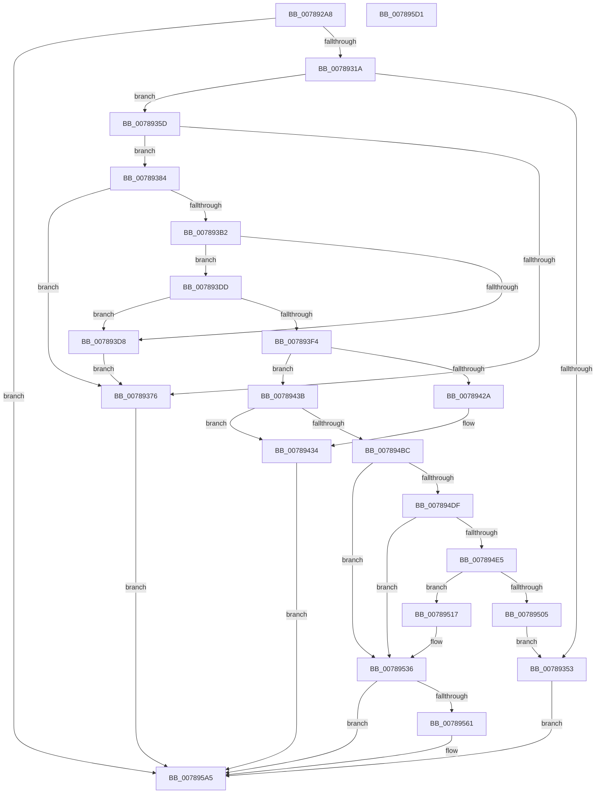

# PspSessionObjectCreate

- RVA: `0x007892A8`–`0x007895D2` (길이 `810` bytes)
- VA: `0x00000001407892A8`
- 실행 섹션: `PAGE`
- PDB 이름 있음: `예`; PDB Function 태그: `아니요`
- unwind 정보 RVA: `0x000BF214`
- 디코드: `198`개 명령, `810/810` bytes 표시
- 미해석 바이트: `0` (있으면 어셈블리에 `.byte`로 보존)

> 이 문서는 커널 이미지의 기계어와 PDB 기호를 분석해 생성했습니다. 4번과 5번은 함수 원형과 자료형을 바이너리 사용 방식에서 추정한 C 해석이며 원본 소스 복구 결과는 아닙니다.

## 1. Dependencies

- 직접 호출 지점: **22**; 고유 호출 대상: **16**
- 직접 호출자로 확인된 함수: **1**
- RIP 상대 이미지 참조: **6**

### Outgoing calls
- `0x0078930D` → [RtlCreateSecurityDescriptor](../9F/RtlCreateSecurityDescriptor_function_009F1DF0.md) (function, `0x009F1DF0`)
- `0x00789321` → [RtlLengthSid](../../text/45/RtlLengthSid_function_0045D270.md) (function, `0x0045D270`)
- `0x0078932F` → [RtlLengthSid](../../text/45/RtlLengthSid_function_0045D270.md) (function, `0x0045D270`)
- `0x00789346` → [ExAllocatePool2](../../poolcode/B8/ExAllocatePool2_function_00B820F0.md) (function, `0x00B820F0`)
- `0x00789368` → [RtlCreateAcl](../91/RtlCreateAcl_function_00916F00.md) (function, `0x00916F00`)
- `0x00789378` → [ExFreePoolWithTag](../../poolcode/B8/ExFreePoolWithTag_function_00B82870.md) (function, `0x00B82870`)
- `0x007893A4` → [RtlpAddKnownAce](../92/RtlpAddKnownAce_function_00929A20.md) (function, `0x00929A20`)
- `0x007893CD` → [RtlpAddKnownAce](../92/RtlpAddKnownAce_function_00929A20.md) (function, `0x00929A20`)
- `0x007893E9` → [RtlSetDaclSecurityDescriptor](../9E/RtlSetDaclSecurityDescriptor_function_009EC210.md) (function, `0x009EC210`)
- `0x0078941F` → [RtlStringCchPrintfW](../../text/48/RtlStringCchPrintfW_function_00482D5C.md) (function, `0x00482D5C`)
- `0x0078942F` → [ExFreePoolWithTag](../../poolcode/B8/ExFreePoolWithTag_function_00B82870.md) (function, `0x00B82870`)
- `0x00789443` → [RtlInitUnicodeString](../../text/42/RtlInitUnicodeString_function_0042A780.md) (function, `0x0042A780`)
- `0x007894A3` → [ObCreateObjectEx](../89/ObCreateObjectEx_function_0089B1E0.md) (function, `0x0089B1E0`)
- `0x007894AF` → [ExFreePoolWithTag](../../poolcode/B8/ExFreePoolWithTag_function_00B82870.md) (function, `0x00B82870`)
- `0x007894CD` → [KeInitializeEvent](../../text/40/KeInitializeEvent_function_0040DD10.md) (function, `0x0040DD10`)
- `0x007894E5` → [KeGetSchedulingGroupSize](../../text/4B/KeGetSchedulingGroupSize_function_004B7934.md) (function, `0x004B7934`)
- `0x007894F7` → [ExAllocatePool2](../../poolcode/B8/ExAllocatePool2_function_00B820F0.md) (function, `0x00B820F0`)
- `0x0078950D` → [ObfDereferenceObjectWithTag](../../text/2F/ObfDereferenceObjectWithTag_function_002F78E0.md) (function, `0x002F78E0`)
- `0x00789531` → [KeInsertSchedulingGroup](../../text/46/KeInsertSchedulingGroup_function_0046D324.md) (function, `0x0046D324`)
- `0x00789556` → [ObInsertObjectEx](../8B/ObInsertObjectEx_function_008B97A0.md) (function, `0x008B97A0`)
- `0x0078959E` → [KeInitializeEvent](../../text/40/KeInitializeEvent_function_0040DD10.md) (function, `0x0040DD10`)
- `0x007895AF` → [_security_check_cookie](../../text/6A/_security_check_cookie_function_006AC640.md) (function, `0x006AC640`)

### Direct callers
- [PsSessionCreate](../70/PsSessionCreate_function_00700438.md) at `0x00700581`

### Static image references
- `0x007892CA` → RVA `0x00E0A740` (`.data`; read)
- `0x0078931A` → RVA `0x00FD9A68` (`PAGEDATA`; read)
- `0x00789326` → RVA `0x00E67D58` (`.data`; read)
- `0x007893FD` → RVA `0x00B050B0` (` ?? ::NNGAKEGL::`string'`; read)
- `0x00789448` → RVA `0x00FC6E08` (`ALMOSTRO`; read)
- `0x007894D6` → RVA `0x00FC6ABE` (`ALMOSTRO`; read)

## 2. Other-region calls and transfers

- 다른 실행 섹션으로 향하는 call: **15**
  - `0x00789321` → [RtlLengthSid](../../text/45/RtlLengthSid_function_0045D270.md) (`PAGE` → `.text`)
  - `0x0078932F` → [RtlLengthSid](../../text/45/RtlLengthSid_function_0045D270.md) (`PAGE` → `.text`)
  - `0x00789346` → [ExAllocatePool2](../../poolcode/B8/ExAllocatePool2_function_00B820F0.md) (`PAGE` → `POOLCODE`)
  - `0x00789378` → [ExFreePoolWithTag](../../poolcode/B8/ExFreePoolWithTag_function_00B82870.md) (`PAGE` → `POOLCODE`)
  - `0x0078941F` → [RtlStringCchPrintfW](../../text/48/RtlStringCchPrintfW_function_00482D5C.md) (`PAGE` → `.text`)
  - `0x0078942F` → [ExFreePoolWithTag](../../poolcode/B8/ExFreePoolWithTag_function_00B82870.md) (`PAGE` → `POOLCODE`)
  - `0x00789443` → [RtlInitUnicodeString](../../text/42/RtlInitUnicodeString_function_0042A780.md) (`PAGE` → `.text`)
  - `0x007894AF` → [ExFreePoolWithTag](../../poolcode/B8/ExFreePoolWithTag_function_00B82870.md) (`PAGE` → `POOLCODE`)
  - `0x007894CD` → [KeInitializeEvent](../../text/40/KeInitializeEvent_function_0040DD10.md) (`PAGE` → `.text`)
  - `0x007894E5` → [KeGetSchedulingGroupSize](../../text/4B/KeGetSchedulingGroupSize_function_004B7934.md) (`PAGE` → `.text`)
  - `0x007894F7` → [ExAllocatePool2](../../poolcode/B8/ExAllocatePool2_function_00B820F0.md) (`PAGE` → `POOLCODE`)
  - `0x0078950D` → [ObfDereferenceObjectWithTag](../../text/2F/ObfDereferenceObjectWithTag_function_002F78E0.md) (`PAGE` → `.text`)
  - `0x00789531` → [KeInsertSchedulingGroup](../../text/46/KeInsertSchedulingGroup_function_0046D324.md) (`PAGE` → `.text`)
  - `0x0078959E` → [KeInitializeEvent](../../text/40/KeInitializeEvent_function_0040DD10.md) (`PAGE` → `.text`)
  - `0x007895AF` → [_security_check_cookie](../../text/6A/_security_check_cookie_function_006AC640.md) (`PAGE` → `.text`)
- 별도 외부 분기/꼬리 이동을 확인하지 못했습니다.

## 3. Assembly (complete function range)

```asm
007892A8  48 8B C4                        mov rax, rsp
007892AB  48 89 58 08                     mov qword ptr [rax + 8], rbx
007892AF  48 89 70 10                     mov qword ptr [rax + 0x10], rsi
007892B3  48 89 78 18                     mov qword ptr [rax + 0x18], rdi
007892B7  4C 89 70 20                     mov qword ptr [rax + 0x20], r14
007892BB  55                              push rbp
007892BC  48 8D A8 18 FF FF FF            lea rbp, [rax - 0xe8]
007892C3  48 81 EC E0 01 00 00            sub rsp, 0x1e0
007892CA  48 8B 05 6F 14 68 00            mov rax, qword ptr [rip + 0x68146f]
007892D1  48 33 C4                        xor rax, rsp
007892D4  48 89 85 D0 00 00 00            mov qword ptr [rbp + 0xd0], rax
007892DB  45 33 F6                        xor r14d, r14d
007892DE  48 8D 4D A8                     lea rcx, [rbp - 0x58]
007892E2  0F 57 C0                        xorps xmm0, xmm0
007892E5  4C 89 74 24 60                  mov qword ptr [rsp + 0x60], r14
007892EA  33 C0                           xor eax, eax
007892EC  44 89 74 24 6C                  mov dword ptr [rsp + 0x6c], r14d
007892F1  44 89 75 84                     mov dword ptr [rbp - 0x7c], r14d
007892F5  0F 11 45 A8                     movups xmmword ptr [rbp - 0x58], xmm0
007892F9  48 89 45 C8                     mov qword ptr [rbp - 0x38], rax
007892FD  8D 50 01                        lea edx, [rax + 1]
00789300  4C 89 74 24 58                  mov qword ptr [rsp + 0x58], r14
00789305  0F 11 45 B8                     movups xmmword ptr [rbp - 0x48], xmm0
00789309  0F 11 45 98                     movups xmmword ptr [rbp - 0x68], xmm0
0078930D  E8 DE 8A 26 00                  call 0x1409f1df0
00789312  85 C0                           test eax, eax
00789314  0F 88 8B 02 00 00               js 0x1407895a5
0078931A  48 8B 0D 47 07 85 00            mov rcx, qword ptr [rip + 0x850747]
00789321  E8 4A 3F CD FF                  call 0x14045d270
00789326  48 8B 0D 2B EA 6D 00            mov rcx, qword ptr [rip + 0x6dea2b]
0078932D  8B D8                           mov ebx, eax
0078932F  E8 3C 3F CD FF                  call 0x14045d270
00789334  B9 00 01 00 00                  mov ecx, 0x100
00789339  41 B8 44 61 63 6C               mov r8d, 0x6c636144
0078933F  8D 78 20                        lea edi, [rax + 0x20]
00789342  03 FB                           add edi, ebx
00789344  8B D7                           mov edx, edi
00789346  E8 A5 8D 3F 00                  call 0x140b820f0
0078934B  48 8B D8                        mov rbx, rax
0078934E  48 85 C0                        test rax, rax
00789351  75 0A                           jne 0x14078935d
00789353  B8 9A 00 00 C0                  mov eax, 0xc000009a
00789358  E9 48 02 00 00                  jmp 0x1407895a5
0078935D  41 B8 02 00 00 00               mov r8d, 2
00789363  8B D7                           mov edx, edi
00789365  48 8B CB                        mov rcx, rbx
00789368  E8 93 DB 18 00                  call 0x140916f00
0078936D  8B F8                           mov edi, eax
0078936F  48 8B CB                        mov rcx, rbx
00789372  85 C0                           test eax, eax
00789374  79 0E                           jns 0x140789384
00789376  33 D2                           xor edx, edx
00789378  E8 F3 94 3F 00                  call 0x140b82870
0078937D  8B C7                           mov eax, edi
0078937F  E9 21 02 00 00                  jmp 0x1407895a5
00789384  48 8B 05 DD 06 85 00            mov rax, qword ptr [rip + 0x8506dd]
0078938B  45 33 C0                        xor r8d, r8d
0078938E  BE 03 00 0F 00                  mov esi, 0xf0003
00789393  44 88 74 24 28                  mov byte ptr [rsp + 0x28], r14b
00789398  44 8B CE                        mov r9d, esi
0078939B  48 89 44 24 20                  mov qword ptr [rsp + 0x20], rax
007893A0  41 8D 50 02                     lea edx, [r8 + 2]
007893A4  E8 77 06 1A 00                  call 0x140929a20
007893A9  8B F8                           mov edi, eax
007893AB  48 8B CB                        mov rcx, rbx
007893AE  85 C0                           test eax, eax
007893B0  78 C4                           js 0x140789376
007893B2  48 8B 05 9F E9 6D 00            mov rax, qword ptr [rip + 0x6de99f]
007893B9  45 33 C0                        xor r8d, r8d
007893BC  44 88 74 24 28                  mov byte ptr [rsp + 0x28], r14b
007893C1  44 8B CE                        mov r9d, esi
007893C4  48 89 44 24 20                  mov qword ptr [rsp + 0x20], rax
007893C9  41 8D 50 02                     lea edx, [r8 + 2]
007893CD  E8 4E 06 1A 00                  call 0x140929a20
007893D2  8B F8                           mov edi, eax
007893D4  85 C0                           test eax, eax
007893D6  79 05                           jns 0x1407893dd
007893D8  48 8B CB                        mov rcx, rbx
007893DB  EB 99                           jmp 0x140789376
007893DD  45 33 C9                        xor r9d, r9d
007893E0  48 8D 4D A8                     lea rcx, [rbp - 0x58]
007893E4  4C 8B C3                        mov r8, rbx
007893E7  B2 01                           mov dl, 1
007893E9  E8 22 2E 26 00                  call 0x1409ec210
007893EE  8B F8                           mov edi, eax
007893F0  85 C0                           test eax, eax
007893F2  78 E4                           js 0x1407893d8
007893F4  65 48 8B 04 25 88 01 00 00      mov rax, qword ptr gs:[0x188]
007893FD  4C 8D 05 AC BC 37 00            lea r8, [rip + 0x37bcac]
00789404  BA 80 00 00 00                  mov edx, 0x80
00789409  48 8B 88 B8 00 00 00            mov rcx, qword ptr [rax + 0xb8]
00789410  48 8B B9 E8 02 00 00            mov rdi, qword ptr [rcx + 0x2e8]
00789417  48 8D 4D D0                     lea rcx, [rbp - 0x30]
0078941B  44 8B 4F 08                     mov r9d, dword ptr [rdi + 8]
0078941F  E8 38 99 CF FF                  call 0x140482d5c
00789424  8B F0                           mov esi, eax
00789426  85 C0                           test eax, eax
00789428  79 11                           jns 0x14078943b
0078942A  33 D2                           xor edx, edx
0078942C  48 8B CB                        mov rcx, rbx
0078942F  E8 3C 94 3F 00                  call 0x140b82870
00789434  8B C6                           mov eax, esi
00789436  E9 6A 01 00 00                  jmp 0x1407895a5
0078943B  48 8D 55 D0                     lea rdx, [rbp - 0x30]
0078943F  48 8D 4D 98                     lea rcx, [rbp - 0x68]
00789443  E8 38 13 CA FF                  call 0x14042a780
00789448  48 8B 15 B9 D9 83 00            mov rdx, qword ptr [rip + 0x83d9b9]
0078944F  48 8D 45 98                     lea rax, [rbp - 0x68]
00789453  4C 89 74 24 48                  mov qword ptr [rsp + 0x48], r14
00789458  4C 8D 44 24 68                  lea r8, [rsp + 0x68]
0078945D  48 89 44 24 78                  mov qword ptr [rsp + 0x78], rax
00789462  45 33 C9                        xor r9d, r9d
00789465  48 8D 45 A8                     lea rax, [rbp - 0x58]
00789469  C7 44 24 68 30 00 00 00         mov dword ptr [rsp + 0x68], 0x30
00789471  48 89 45 88                     mov qword ptr [rbp - 0x78], rax
00789475  33 C9                           xor ecx, ecx
00789477  48 8D 44 24 58                  lea rax, [rsp + 0x58]
0078947C  4C 89 74 24 70                  mov qword ptr [rsp + 0x70], r14
00789481  48 89 44 24 40                  mov qword ptr [rsp + 0x40], rax
00789486  44 89 74 24 38                  mov dword ptr [rsp + 0x38], r14d
0078948B  44 89 74 24 30                  mov dword ptr [rsp + 0x30], r14d
00789490  C7 44 24 28 28 00 00 00         mov dword ptr [rsp + 0x28], 0x28
00789498  C7 45 80 00 02 00 00            mov dword ptr [rbp - 0x80], 0x200
0078949F  4C 89 75 90                     mov qword ptr [rbp - 0x70], r14
007894A3  E8 38 1D 11 00                  call 0x14089b1e0
007894A8  33 D2                           xor edx, edx
007894AA  48 8B CB                        mov rcx, rbx
007894AD  8B F0                           mov esi, eax
007894AF  E8 BC 93 3F 00                  call 0x140b82870
007894B4  85 F6                           test esi, esi
007894B6  0F 88 78 FF FF FF               js 0x140789434
007894BC  48 8B 5C 24 58                  mov rbx, qword ptr [rsp + 0x58]
007894C1  45 33 C0                        xor r8d, r8d
007894C4  33 D2                           xor edx, edx
007894C6  48 8B CB                        mov rcx, rbx
007894C9  48 89 7B 18                     mov qword ptr [rbx + 0x18], rdi
007894CD  E8 3E 48 C8 FF                  call 0x14040dd10
007894D2  4C 89 73 20                     mov qword ptr [rbx + 0x20], r14
007894D6  44 38 35 E1 D5 83 00            cmp byte ptr [rip + 0x83d5e1], r14b
007894DD  74 57                           je 0x140789536
007894DF  44 39 77 08                     cmp dword ptr [rdi + 8], r14d
007894E3  74 51                           je 0x140789536
007894E5  E8 4A E4 D2 FF                  call 0x1404b7934
007894EA  8B D0                           mov edx, eax
007894EC  B9 48 00 00 00                  mov ecx, 0x48
007894F1  41 B8 53 47 72 70               mov r8d, 0x70724753
007894F7  E8 F4 8B 3F 00                  call 0x140b820f0
007894FC  48 89 43 20                     mov qword ptr [rbx + 0x20], rax
00789500  48 85 C0                        test rax, rax
00789503  75 12                           jne 0x140789517
00789505  BA 4D 6D 53 73                  mov edx, 0x73536d4d
0078950A  48 8B CB                        mov rcx, rbx
0078950D  E8 CE E3 B6 FF                  call 0x1402f78e0
00789512  E9 3C FE FF FF                  jmp 0x140789353
00789517  B9 05 00 00 00                  mov ecx, 5
0078951C  4C 89 74 24 50                  mov qword ptr [rsp + 0x50], r14
00789521  66 89 4C 24 50                  mov word ptr [rsp + 0x50], cx
00789526  45 33 C0                        xor r8d, r8d
00789529  48 8B 54 24 50                  mov rdx, qword ptr [rsp + 0x50]
0078952E  48 8B C8                        mov rcx, rax
00789531  E8 EE 3D CE FF                  call 0x14046d324
00789536  45 33 C9                        xor r9d, r9d
00789539  48 8D 44 24 60                  lea rax, [rsp + 0x60]
0078953E  48 89 44 24 30                  mov qword ptr [rsp + 0x30], rax
00789543  33 D2                           xor edx, edx
00789545  4C 89 74 24 28                  mov qword ptr [rsp + 0x28], r14
0078954A  48 8B CB                        mov rcx, rbx
0078954D  44 89 74 24 20                  mov dword ptr [rsp + 0x20], r14d
00789552  45 8D 41 01                     lea r8d, [r9 + 1]
00789556  E8 45 02 13 00                  call 0x1408b97a0
0078955B  8B D8                           mov ebx, eax
0078955D  85 C0                           test eax, eax
0078955F  78 44                           js 0x1407895a5
00789561  83 4F 04 04                     or dword ptr [rdi + 4], 4
00789565  F0 FF 47 0C                     lock inc dword ptr [rdi + 0xc]
00789569  48 8B 44 24 60                  mov rax, qword ptr [rsp + 0x60]
0078956E  48 8D 8F 88 00 00 00            lea rcx, [rdi + 0x88]
00789575  48 89 47 28                     mov qword ptr [rdi + 0x28], rax
00789579  41 B0 01                        mov r8b, 1
0078957C  48 8B 44 24 58                  mov rax, qword ptr [rsp + 0x58]
00789581  BA 01 00 00 00                  mov edx, 1
00789586  48 89 47 20                     mov qword ptr [rdi + 0x20], rax
0078958A  C7 87 80 00 00 00 02 00 00 00   mov dword ptr [rdi + 0x80], 2
00789594  C7 87 84 00 00 00 01 00 00 00   mov dword ptr [rdi + 0x84], 1
0078959E  E8 6D 47 C8 FF                  call 0x14040dd10
007895A3  8B C3                           mov eax, ebx
007895A5  48 8B 8D D0 00 00 00            mov rcx, qword ptr [rbp + 0xd0]
007895AC  48 33 CC                        xor rcx, rsp
007895AF  E8 8C 30 F2 FF                  call 0x1406ac640
007895B4  4C 8D 9C 24 E0 01 00 00         lea r11, [rsp + 0x1e0]
007895BC  49 8B 5B 10                     mov rbx, qword ptr [r11 + 0x10]
007895C0  49 8B 73 18                     mov rsi, qword ptr [r11 + 0x18]
007895C4  49 8B 7B 20                     mov rdi, qword ptr [r11 + 0x20]
007895C8  4D 8B 73 28                     mov r14, qword ptr [r11 + 0x28]
007895CC  49 8B E3                        mov rsp, r11
007895CF  5D                              pop rbp
007895D0  C3                              ret
007895D1  CC                              int3
```

## 4. C-style interpretation (structured pseudocode)

```c
__int64 __fastcall PspSessionObjectCreate(void)
{
    __int64 result;
    __int64 v_r14;
    __int64 v_rdi;
    __int64 v_rsp;
    unsigned __int64 v_stack_m170;
    unsigned __int64 v_stack_m178;
    unsigned int v_stack_m17C;
    unsigned __int64 v_stack_m180;
    unsigned __int64 v_stack_m188;
    unsigned __int64 v_stack_m190;
    unsigned __int64 v_stack_m198;
    unsigned __int64 v_stack_m1A0;
    unsigned __int64 v_stack_m1A8;
    unsigned int v_stack_m1B0;
    unsigned int v_stack_m1B8;
    unsigned __int8 v_stack_m1C0;
    unsigned __int64 v_stack_m1C8;
    unsigned __int64 v_stack_m8;

    *(unsigned __int64 *)(v_rsp + 8) = v_rbx;
    *(unsigned __int64 *)(v_rsp + 16) = v_rsi;
    *(unsigned __int64 *)(v_rsp + 24) = v_rdi;
    *(unsigned __int64 *)(v_rsp + 32) = v_r14;
    v_rsp = (v_rsp) - (480);
    result = (*(unsigned __int64 *)(v_rip + 6820975)) ^ (v_rsp);
    *(unsigned __int64 *)(v_rsp - 232 + 208) = result;
    v_r14 = 0;
    v_stack_m188 = 0;
    result = 0;
    v_stack_m17C = 0;
    *(unsigned int *)(v_rsp - 232 - 124) = 0;
    *(unsigned __int64 *)(v_rsp - 232 - 88) = v_xmm0;
    *(unsigned __int64 *)(v_rsp - 232 - 56) = 0;
    v_stack_m190 = 0;
    *(unsigned __int64 *)(v_rsp - 232 - 72) = v_xmm0;
    *(unsigned __int64 *)(v_rsp - 232 - 104) = v_xmm0;
    result = RtlCreateSecurityDescriptor(v_rsp - 232 - 88, result + 1, a3, a4);
    if (sign_flag) goto loc_007895A5;
    result = RtlLengthSid(*(unsigned __int64 *)(v_rip + 8718151), result + 1, a3, a4);
    result = RtlLengthSid(*(unsigned __int64 *)(v_rip + 7203371), result + 1, a3, a4);
    v_rdi = (unsigned int)((result + 32) + ((unsigned int)((unsigned int)((unsigned int)(result)))));
    result = ExAllocatePool2(256, (unsigned int)((unsigned int)(v_rdi)), (unsigned int)(0x6C636144ULL), a4);
    if (result != 0) goto loc_0078935D;
loc_00789353:
    goto loc_007895A5;
loc_0078935D:
    result = RtlCreateAcl(result, (unsigned int)((unsigned int)(v_rdi)), 2, a4);
    if (!sign_flag) goto loc_00789384;
loc_00789376:
    a2 = 0;
    result = ExFreePoolWithTag(result, a2, 2, a4);
    goto loc_007895A5;
loc_00789384:
    a3 = 0;
    v_stack_m1C0 = 0;
    v_stack_m1C8 = *(unsigned __int64 *)(v_rip + 8718045);
    result = RtlpAddKnownAce(result, a3 + 2, a3, (unsigned int)((unsigned int)((unsigned int)(0xF0003ULL))));
    if (sign_flag) goto loc_00789376;
    a3 = 0;
    v_stack_m1C0 = 0;
    v_stack_m1C8 = *(unsigned __int64 *)(v_rip + 7203231);
    result = RtlpAddKnownAce(result, a3 + 2, a3, (unsigned int)((unsigned int)((unsigned int)(0xF0003ULL))));
    if (!sign_flag) goto loc_007893DD;
loc_007893D8:
    goto loc_00789376;
loc_007893DD:
    a4 = 0;
    result = RtlSetDaclSecurityDescriptor(v_rsp - 232 - 88, 1, result, a4);
    if (sign_flag) goto loc_007893D8;
    result = RtlStringCchPrintfW(v_rsp - 232 - 48, 128, v_rip + 3652780, (unsigned int)(*(unsigned int *)(*(unsigned __int64 *)(*(unsigned __int64 *)(*(unsigned __int64 *)(gs_base + (0 + 392)) + 184) + 744) + 8)));
    if (!sign_flag) goto loc_0078943B;
    a2 = 0;
    result = ExFreePoolWithTag(result, a2, v_rip + 3652780, (unsigned int)(*(unsigned int *)(*(unsigned __int64 *)(*(unsigned __int64 *)(*(unsigned __int64 *)(gs_base + (0 + 392)) + 184) + 744) + 8)));
loc_00789434:
    goto loc_007895A5;
loc_0078943B:
    result = RtlInitUnicodeString(v_rsp - 232 - 104, v_rsp - 232 - 48, v_rip + 3652780, (unsigned int)(*(unsigned int *)(*(unsigned __int64 *)(*(unsigned __int64 *)(*(unsigned __int64 *)(gs_base + (0 + 392)) + 184) + 744) + 8)));
    v_stack_m1A0 = 0;
    v_stack_m170 = v_rsp - 232 - 104;
    a4 = 0;
    v_stack_m180 = 48;
    *(unsigned __int64 *)(v_rsp - 232 - 120) = v_rsp - 232 - 88;
    a1 = 0;
    v_stack_m178 = 0;
    v_stack_m1A8 = v_stack_m190;
    v_stack_m1B0 = 0;
    v_stack_m1B8 = 0;
    v_stack_m1C0 = 40;
    *(unsigned int *)(v_rsp - 232 - 128) = 512;
    *(unsigned __int64 *)(v_rsp - 232 - 112) = 0;
    result = ObCreateObjectEx(a1, *(unsigned __int64 *)(v_rip + 8640953), v_stack_m180, a4);
    a2 = 0;
    result = ExFreePoolWithTag(result, a2, v_stack_m180, a4);
    if (sign_flag) goto loc_00789434;
    a3 = 0;
    a2 = 0;
    *(unsigned __int64 *)(v_stack_m190 + 24) = *(unsigned __int64 *)(*(unsigned __int64 *)(*(unsigned __int64 *)(gs_base + (0 + 392)) + 184) + 744);
    result = KeInitializeEvent(v_stack_m190, a2, a3, a4);
    *(unsigned __int64 *)(v_stack_m190 + 32) = 0;
    if ((*(unsigned __int8 *)(v_rip + 8639969)) == 0) goto loc_00789536;
    if ((*(unsigned int *)(*(unsigned __int64 *)(*(unsigned __int64 *)(*(unsigned __int64 *)(gs_base + (0 + 392)) + 184) + 744) + 8)) == 0) goto loc_00789536;
    result = KeGetSchedulingGroupSize(v_stack_m190, a2, a3, a4);
    result = ExAllocatePool2(72, (unsigned int)((unsigned int)(result)), (unsigned int)(0x70724753ULL), a4);
    *(unsigned __int64 *)(v_stack_m190 + 32) = result;
    if (result != 0) goto loc_00789517;
    result = ObfDereferenceObjectWithTag(v_stack_m190, (unsigned int)(0x73536D4DULL), (unsigned int)(0x70724753ULL), a4);
    goto loc_00789353;
loc_00789517:
    v_stack_m198 = 0;
    v_stack_m198 = 5;
    a3 = 0;
    result = KeInsertSchedulingGroup(result, v_stack_m198, a3, a4);
loc_00789536:
    a4 = 0;
    v_stack_m1B8 = v_stack_m188;
    a2 = 0;
    v_stack_m1C0 = 0;
    v_stack_m1C8 = 0;
    result = ObInsertObjectEx(v_stack_m190, a2, a4 + 1, a4);
    if (!(sign_flag)) {
        result = v_stack_m188;
        a1 = *(unsigned __int64 *)(*(unsigned __int64 *)(*(unsigned __int64 *)(gs_base + (0 + 392)) + 184) + 744) + 136;
        *(unsigned __int64 *)(*(unsigned __int64 *)(*(unsigned __int64 *)(*(unsigned __int64 *)(gs_base + (0 + 392)) + 184) + 744) + 40) = result;
        a3 = 1;
        result = v_stack_m190;
        a2 = 1;
        *(unsigned __int64 *)(*(unsigned __int64 *)(*(unsigned __int64 *)(*(unsigned __int64 *)(gs_base + (0 + 392)) + 184) + 744) + 32) = result;
        *(unsigned int *)(*(unsigned __int64 *)(*(unsigned __int64 *)(*(unsigned __int64 *)(gs_base + (0 + 392)) + 184) + 744) + 128) = 2;
        *(unsigned int *)(*(unsigned __int64 *)(*(unsigned __int64 *)(*(unsigned __int64 *)(gs_base + (0 + 392)) + 184) + 744) + 132) = 1;
        result = KeInitializeEvent(a1, a2, a3, a4);
        result = (unsigned int)((unsigned int)((unsigned int)(result)));
    }
    a1 = (*(unsigned __int64 *)(v_rsp - 232 + 208)) ^ (v_rsp);
    result = _security_check_cookie(a1, a2, a3, a4);
    return result;
}
```

## 5. (Beta) C Style

```c
void PspSessionObjectCreate(void)
{
    int64_t result;
    int64_t local_r14;
    int64_t local_rdi;
    int64_t local_rsp;
    uint64_t v_stack_m170;
    uint64_t v_stack_m178;
    uint32_t v_stack_m17C;
    uint64_t v_stack_m180;
    uint64_t v_stack_m188;
    uint64_t v_stack_m190;
    uint64_t v_stack_m198;
    uint64_t v_stack_m1A0;
    uint64_t v_stack_m1A8;
    uint32_t v_stack_m1B0;
    uint32_t v_stack_m1B8;
    uint8_t v_stack_m1C0;
    uint64_t v_stack_m1C8;
    uint64_t v_stack_m8;

    *(uint64_t *)(local_rsp + 0x8) = local_rbx;
    *(uint64_t *)(local_rsp + 0x10) = local_rsi;
    *(uint64_t *)(local_rsp + 0x18) = local_rdi;
    *(uint64_t *)(local_rsp + 0x20) = local_r14;
    local_rsp = (local_rsp) - (480);
    result = (*(uint64_t *)(v_rip + 0x68146F)) ^ (local_rsp);
    *(uint64_t *)(local_rsp - 0xE8 + 0xD0) = result;
    local_r14 = 0;
    v_stack_m188 = 0;
    result = 0;
    v_stack_m17C = 0;
    *(uint32_t *)(local_rsp - 0xE8 - 0x7C) = 0;
    *(uint64_t *)(local_rsp - 0xE8 - 0x58) = v_xmm0;
    *(uint64_t *)(local_rsp - 0xE8 - 0x38) = 0;
    v_stack_m190 = 0;
    *(uint64_t *)(local_rsp - 0xE8 - 0x48) = v_xmm0;
    *(uint64_t *)(local_rsp - 0xE8 - 0x68) = v_xmm0;
    result = RtlCreateSecurityDescriptor(local_rsp - 232 - 88, result + 1, a3, a4);
    if (sign_flag) goto loc_007895A5;
    result = RtlLengthSid(*(uint64_t *)(v_rip + 0x850747), result + 1, a3, a4);
    result = RtlLengthSid(*(uint64_t *)(v_rip + 0x6DEA2B), result + 1, a3, a4);
    local_rdi = (uint32_t)((result + 32) + ((uint32_t)((uint32_t)((uint32_t)(result)))));
    result = ExAllocatePool2(256, (uint32_t)((uint32_t)(local_rdi)), (uint32_t)(0x6C636144ULL), a4);
    if (result != 0) goto loc_0078935D;
loc_00789353:
    goto loc_007895A5;
loc_0078935D:
    result = RtlCreateAcl(result, (uint32_t)((uint32_t)(local_rdi)), 2, a4);
    if (!sign_flag) goto loc_00789384;
loc_00789376:
    a2 = 0;
    result = ExFreePoolWithTag(result, a2, 2, a4);
    goto loc_007895A5;
loc_00789384:
    a3 = 0;
    v_stack_m1C0 = 0;
    v_stack_m1C8 = *(uint64_t *)(v_rip + 0x8506DD);
    result = RtlpAddKnownAce(result, a3 + 2, a3, (uint32_t)((uint32_t)((uint32_t)(0xF0003ULL))));
    if (sign_flag) goto loc_00789376;
    a3 = 0;
    v_stack_m1C0 = 0;
    v_stack_m1C8 = *(uint64_t *)(v_rip + 0x6DE99F);
    result = RtlpAddKnownAce(result, a3 + 2, a3, (uint32_t)((uint32_t)((uint32_t)(0xF0003ULL))));
    if (!sign_flag) goto loc_007893DD;
loc_007893D8:
    goto loc_00789376;
loc_007893DD:
    a4 = 0;
    result = RtlSetDaclSecurityDescriptor(local_rsp - 232 - 88, 1, result, a4);
    if (sign_flag) goto loc_007893D8;
    result = RtlStringCchPrintfW(local_rsp - 232 - 48, 128, v_rip + 3652780, (uint32_t)(*(uint32_t *)(*(uint64_t *)(*(uint64_t *)(*(uint64_t *)(gs_base + (0 + 0x188)) + 0xB8) + 0x2E8) + 0x8)));
    if (!sign_flag) goto loc_0078943B;
    a2 = 0;
    result = ExFreePoolWithTag(result, a2, v_rip + 3652780, (uint32_t)(*(uint32_t *)(*(uint64_t *)(*(uint64_t *)(*(uint64_t *)(gs_base + (0 + 0x188)) + 0xB8) + 0x2E8) + 0x8)));
loc_00789434:
    goto loc_007895A5;
loc_0078943B:
    result = RtlInitUnicodeString(local_rsp - 232 - 104, local_rsp - 232 - 48, v_rip + 3652780, (uint32_t)(*(uint32_t *)(*(uint64_t *)(*(uint64_t *)(*(uint64_t *)(gs_base + (0 + 0x188)) + 0xB8) + 0x2E8) + 0x8)));
    v_stack_m1A0 = 0;
    v_stack_m170 = local_rsp - 232 - 104;
    a4 = 0;
    v_stack_m180 = 48;
    *(uint64_t *)(local_rsp - 0xE8 - 0x78) = local_rsp - 232 - 88;
    a1 = 0;
    v_stack_m178 = 0;
    v_stack_m1A8 = v_stack_m190;
    v_stack_m1B0 = 0;
    v_stack_m1B8 = 0;
    v_stack_m1C0 = 40;
    *(uint32_t *)(local_rsp - 0xE8 - 0x80) = 512;
    *(uint64_t *)(local_rsp - 0xE8 - 0x70) = 0;
    result = ObCreateObjectEx(a1, *(uint64_t *)(v_rip + 0x83D9B9), v_stack_m180, a4);
    a2 = 0;
    result = ExFreePoolWithTag(result, a2, v_stack_m180, a4);
    if (sign_flag) goto loc_00789434;
    a3 = 0;
    a2 = 0;
    *(uint64_t *)(v_stack_m190 + 0x18) = *(uint64_t *)(*(uint64_t *)(*(uint64_t *)(gs_base + (0 + 0x188)) + 0xB8) + 0x2E8);
    result = KeInitializeEvent(v_stack_m190, a2, a3, a4);
    *(uint64_t *)(v_stack_m190 + 0x20) = 0;
    if ((*(uint8_t *)(v_rip + 0x83D5E1)) == 0) goto loc_00789536;
    if ((*(uint32_t *)(*(uint64_t *)(*(uint64_t *)(*(uint64_t *)(gs_base + (0 + 0x188)) + 0xB8) + 0x2E8) + 0x8)) == 0) goto loc_00789536;
    result = KeGetSchedulingGroupSize(v_stack_m190, a2, a3, a4);
    result = ExAllocatePool2(72, (uint32_t)((uint32_t)(result)), (uint32_t)(0x70724753ULL), a4);
    *(uint64_t *)(v_stack_m190 + 0x20) = result;
    if (result != 0) goto loc_00789517;
    result = ObfDereferenceObjectWithTag(v_stack_m190, (uint32_t)(0x73536D4DULL), (uint32_t)(0x70724753ULL), a4);
    goto loc_00789353;
loc_00789517:
    v_stack_m198 = 0;
    v_stack_m198 = 5;
    a3 = 0;
    result = KeInsertSchedulingGroup(result, v_stack_m198, a3, a4);
loc_00789536:
    a4 = 0;
    v_stack_m1B8 = v_stack_m188;
    a2 = 0;
    v_stack_m1C0 = 0;
    v_stack_m1C8 = 0;
    result = ObInsertObjectEx(v_stack_m190, a2, a4 + 1, a4);
    if (!(sign_flag)) {
        result = v_stack_m188;
        a1 = *(uint64_t *)(*(uint64_t *)(*(uint64_t *)(gs_base + (0 + 0x188)) + 0xB8) + 0x2E8) + 136;
        *(uint64_t *)(*(uint64_t *)(*(uint64_t *)(*(uint64_t *)(gs_base + (0 + 0x188)) + 0xB8) + 0x2E8) + 0x28) = result;
        a3 = 1;
        result = v_stack_m190;
        a2 = 1;
        *(uint64_t *)(*(uint64_t *)(*(uint64_t *)(*(uint64_t *)(gs_base + (0 + 0x188)) + 0xB8) + 0x2E8) + 0x20) = result;
        *(uint32_t *)(*(uint64_t *)(*(uint64_t *)(*(uint64_t *)(gs_base + (0 + 0x188)) + 0xB8) + 0x2E8) + 0x80) = 2;
        *(uint32_t *)(*(uint64_t *)(*(uint64_t *)(*(uint64_t *)(gs_base + (0 + 0x188)) + 0xB8) + 0x2E8) + 0x84) = 1;
        result = KeInitializeEvent(a1, a2, a3, a4);
        result = (uint32_t)((uint32_t)((uint32_t)(result)));
    }
    a1 = (*(uint64_t *)(local_rsp - 0xE8 + 0xD0)) ^ (local_rsp);
    result = _security_check_cookie(a1, a2, a3, a4);
    return result;
}
```

## 6. Execution-region graph

[열기: 2D/3D 그래프와 함수 탐색 컨트롤 패널](../../../control-panel.html?section=page&rva=0x007892A8&view=graph)

- 2D 그래프는 위에서 아래로 흐르고, 3D 그래프는 빈 공간을 드래그해 회전합니다. Shift+드래그는 이동, 휠은 확대·축소, 함수 노드 선택은 대상 보고서 이동입니다.

### Static fallback


