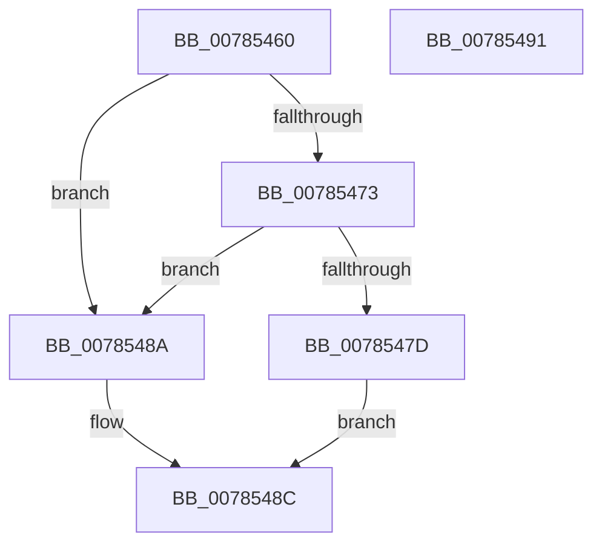

# PspSetAffinityLimitCallback

- RVA: `0x00785460`–`0x00785492` (길이 `50` bytes)
- VA: `0x0000000140785460`
- 실행 섹션: `PAGE`
- PDB 이름 있음: `예`; PDB Function 태그: `아니요`
- unwind 정보 RVA: `0x0005C788`
- 디코드: `15`개 명령, `50/50` bytes 표시
- 미해석 바이트: `0` (있으면 어셈블리에 `.byte`로 보존)

> 이 문서는 커널 이미지의 기계어와 PDB 기호를 분석해 생성했습니다. 4번과 5번은 함수 원형과 자료형을 바이너리 사용 방식에서 추정한 C 해석이며 원본 소스 복구 결과는 아닙니다.

## 1. Dependencies

- 직접 호출 지점: **1**; 고유 호출 대상: **1**
- 직접 호출자로 확인된 함수: **0**
- RIP 상대 이미지 참조: **0**

### Outgoing calls
- `0x00785483` → [PspCheckJobAccessState](PspCheckJobAccessState_function_00784D94.md) (function, `0x00784D94`)

### Direct callers
- 이 함수 시작 RVA로 연결되는 직접 call은 확인되지 않았습니다. 간접 호출은 완전히 역산할 수 없습니다.

### Static image references
- 디코드된 RIP-relative 메모리 참조가 없습니다.

## 2. Other-region calls and transfers

- 다른 실행 섹션으로 향하는 call: **0**
- 별도 외부 분기/꼬리 이동을 확인하지 못했습니다.

## 3. Assembly (complete function range)

```asm
00785460  48 83 EC 28                     sub rsp, 0x28
00785464  F7 81 F4 01 00 00 00 00 00 04   test dword ptr [rcx + 0x1f4], 0x4000000
0078546E  4C 8B C2                        mov r8, rdx
00785471  74 17                           je 0x14078548a
00785473  8B 81 F0 01 00 00               mov eax, dword ptr [rcx + 0x1f0]
00785479  A8 01                           test al, 1
0078547B  75 0D                           jne 0x14078548a
0078547D  48 8B D1                        mov rdx, rcx
00785480  49 8B C8                        mov rcx, r8
00785483  E8 0C F9 FF FF                  call 0x140784d94
00785488  EB 02                           jmp 0x14078548c
0078548A  33 C0                           xor eax, eax
0078548C  48 83 C4 28                     add rsp, 0x28
00785490  C3                              ret
00785491  CC                              int3
```

## 4. C-style interpretation (structured pseudocode)

```c
__int64 __fastcall PspSetAffinityLimitCallback(__int64 a1, __int64 a2)
{
    __int64 result;
    __int64 v_rsp;

    v_rsp = (v_rsp) - (40);
    if (((*(unsigned int *)(a1 + 500)) & (0x4000000ULL)) == 0) goto loc_0078548A;
    if ((((unsigned __int8)((unsigned int)(*(unsigned int *)(a1 + 496)))) & (1)) != 0) goto loc_0078548A;
    result = PspCheckJobAccessState(a2, a1, a2, a4);
    goto loc_0078548C;
loc_0078548A:
    result = 0;
loc_0078548C:
    v_rsp = (v_rsp) + (40);
    return result;
}
```

## 5. (Beta) C Style

```c
int64_t PspSetAffinityLimitCallback(void *Arg1, int64_t Arg2)
{
    uint8_t *arg1 = (uint8_t *)Arg1;

    int64_t result;
    int64_t local_rsp;

    local_rsp = (local_rsp) - (40);
    if (((*(uint32_t *)(arg1 + 0x1F4)) & (0x4000000ULL)) == 0) goto loc_0078548A;
    if ((((uint8_t)((uint32_t)(*(uint32_t *)(arg1 + 0x1F0)))) & (1)) != 0) goto loc_0078548A;
    result = PspCheckJobAccessState(Arg2, Arg1, Arg2, a4);
    goto loc_0078548C;
loc_0078548A:
    result = 0;
loc_0078548C:
    local_rsp = (local_rsp) + (40);
    return result;
}
```

### 관측된 메모리 오프셋

구조체 형식이 확인되지 않은 접근은 인자 기준의 오프셋으로만 기록했습니다.

| 기준 인자 | 오프셋 표현 | 폭 (bit) | 접근 |
|---|---:|---:|---|
| `Arg1` | `+ 0x1F0` | `32` | `R` |
| `Arg1` | `+ 0x1F4` | `32` | `R` |

## 6. Execution-region graph

[열기: 2D/3D 그래프와 함수 탐색 컨트롤 패널](../../../control-panel.html?section=page&rva=0x00785460&view=graph)

- 2D 그래프는 위에서 아래로 흐르고, 3D 그래프는 빈 공간을 드래그해 회전합니다. Shift+드래그는 이동, 휠은 확대·축소, 함수 노드 선택은 대상 보고서 이동입니다.

### Static fallback


