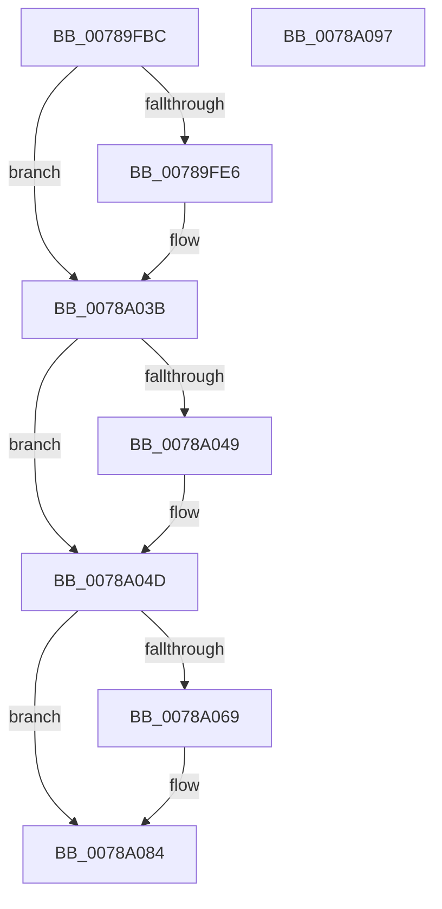

# PspSetContextState

- RVA: `0x00789FBC`–`0x0078A098` (길이 `220` bytes)
- VA: `0x0000000140789FBC`
- 실행 섹션: `PAGE`
- PDB 이름 있음: `예`; PDB Function 태그: `아니요`
- unwind 정보 RVA: `0x000701D4`
- 디코드: `58`개 명령, `220/220` bytes 표시
- 미해석 바이트: `0` (있으면 어셈블리에 `.byte`로 보존)

> 이 문서는 커널 이미지의 기계어와 PDB 기호를 분석해 생성했습니다. 4번과 5번은 함수 원형과 자료형을 바이너리 사용 방식에서 추정한 C 해석이며 원본 소스 복구 결과는 아닙니다.

## 1. Dependencies

- 직접 호출 지점: **4**; 고유 호출 대상: **4**
- 직접 호출자로 확인된 함수: **1**
- RIP 상대 이미지 참조: **0**

### Outgoing calls
- `0x0078A006` → [RtlGetExtendedContextLength](../../text/3D/RtlGetExtendedContextLength_function_003D7190.md) (function, `0x003D7190`)
- `0x0078A015` → [memset](../../text/6C/memset_function_006C6C40.md) (function, `0x006C6C40`)
- `0x0078A028` → [RtlInitializeExtendedContext](../../text/3D/RtlInitializeExtendedContext_function_003D7220.md) (function, `0x003D7220`)
- `0x0078A056` → [RtlCopyContext](../8D/RtlCopyContext_function_008D5940.md) (function, `0x008D5940`)

### Direct callers
- [sub_00B2D612](../B2/Unknown_function_00B2D612.md) at `0x00B2D619`

### Static image references
- 디코드된 RIP-relative 메모리 참조가 없습니다.

## 2. Other-region calls and transfers

- 다른 실행 섹션으로 향하는 call: **3**
  - `0x0078A006` → [RtlGetExtendedContextLength](../../text/3D/RtlGetExtendedContextLength_function_003D7190.md) (`PAGE` → `.text`)
  - `0x0078A015` → [memset](../../text/6C/memset_function_006C6C40.md) (`PAGE` → `.text`)
  - `0x0078A028` → [RtlInitializeExtendedContext](../../text/3D/RtlInitializeExtendedContext_function_003D7220.md) (`PAGE` → `.text`)
- 별도 외부 분기/꼬리 이동을 확인하지 못했습니다.

## 3. Assembly (complete function range)

```asm
00789FBC  48 89 5C 24 10                  mov qword ptr [rsp + 0x10], rbx
00789FC1  48 89 6C 24 18                  mov qword ptr [rsp + 0x18], rbp
00789FC6  56                              push rsi
00789FC7  57                              push rdi
00789FC8  41 56                           push r14
00789FCA  48 83 EC 20                     sub rsp, 0x20
00789FCE  83 64 24 40 00                  and dword ptr [rsp + 0x40], 0
00789FD3  48 8B FA                        mov rdi, rdx
00789FD6  F6 41 03 08                     test byte ptr [rcx + 3], 8
00789FDA  48 8B E9                        mov rbp, rcx
00789FDD  4C 8B B1 A8 06 00 00            mov r14, qword ptr [rcx + 0x6a8]
00789FE4  75 55                           jne 0x14078a03b
00789FE6  48 B8 D8 03 00 00 80 F7 FF FF   movabs rax, 0xfffff780000003d8
00789FF0  48 8D 54 24 40                  lea rdx, [rsp + 0x40]
00789FF5  48 8B 00                        mov rax, qword ptr [rax]
00789FF8  48 F7 D8                        neg rax
00789FFB  1B DB                           sbb ebx, ebx
00789FFD  83 E3 40                        and ebx, 0x40
0078A000  8D 8B 00 00 10 00               lea ecx, [rbx + 0x100000]
0078A006  E8 85 D1 C4 FF                  call 0x1403d7190
0078A00B  44 8B 44 24 40                  mov r8d, dword ptr [rsp + 0x40]
0078A010  33 D2                           xor edx, edx
0078A012  49 8B CE                        mov rcx, r14
0078A015  E8 26 CC F3 FF                  call 0x1406c6c40
0078A01A  4C 8D 44 24 40                  lea r8, [rsp + 0x40]
0078A01F  49 8B CE                        mov rcx, r14
0078A022  8D 93 00 00 10 00               lea edx, [rbx + 0x100000]
0078A028  E8 F3 D1 C4 FF                  call 0x1403d7220
0078A02D  41 C7 46 30 00 00 10 00         mov dword ptr [r14 + 0x30], 0x100000
0078A035  F0 0F BA 6D 00 1B               lock bts dword ptr [rbp], 0x1b
0078A03B  8B 47 30                        mov eax, dword ptr [rdi + 0x30]
0078A03E  B9 40 00 10 00                  mov ecx, 0x100040
0078A043  23 C1                           and eax, ecx
0078A045  3B C1                           cmp eax, ecx
0078A047  75 04                           jne 0x14078a04d
0078A049  41 09 4E 30                     or dword ptr [r14 + 0x30], ecx
0078A04D  8B 57 30                        mov edx, dword ptr [rdi + 0x30]
0078A050  4C 8B C7                        mov r8, rdi
0078A053  49 8B CE                        mov rcx, r14
0078A056  E8 E5 B8 14 00                  call 0x1408d5940
0078A05B  8B 47 30                        mov eax, dword ptr [rdi + 0x30]
0078A05E  B9 08 00 10 00                  mov ecx, 0x100008
0078A063  23 C1                           and eax, ecx
0078A065  3B C1                           cmp eax, ecx
0078A067  75 1B                           jne 0x14078a084
0078A069  0F AE 5C 24 40                  stmxcsr dword ptr [rsp + 0x40]
0078A06E  8B 44 24 40                     mov eax, dword ptr [rsp + 0x40]
0078A072  89 87 18 01 00 00               mov dword ptr [rdi + 0x118], eax
0078A078  B8 3F 1F 00 00                  mov eax, 0x1f3f
0078A07D  66 21 87 00 01 00 00            and word ptr [rdi + 0x100], ax
0078A084  48 8B 5C 24 48                  mov rbx, qword ptr [rsp + 0x48]
0078A089  48 8B 6C 24 50                  mov rbp, qword ptr [rsp + 0x50]
0078A08E  48 83 C4 20                     add rsp, 0x20
0078A092  41 5E                           pop r14
0078A094  5F                              pop rdi
0078A095  5E                              pop rsi
0078A096  C3                              ret
0078A097  CC                              int3
```

## 4. C-style interpretation (structured pseudocode)

```c
__int64 __fastcall PspSetContextState(__int64 a1, __int64 a2)
{
    __int64 result;
    __int64 v_rbx;
    __int64 v_rsp;
    unsigned __int64 v_stack_p10;
    unsigned __int64 v_stack_p18;
    unsigned int v_stack_p8;

    v_stack_p10 = v_rbx;
    v_stack_p18 = v_rbp;
    v_rsp = (v_rsp) - (32);
    if (((*(unsigned __int8 *)(a1 + 3)) & (8)) == 0) {
        a2 = v_stack_p8;
        result = *(unsigned __int64 *)(result);
        result = -(result);
        v_rbx = (unsigned int)((v_rbx) & (64));
        a1 = v_rbx + 1048576;
        result = RtlGetExtendedContextLength(a1, a2, a3, a4);
        a3 = v_stack_p8;
        a2 = 0;
        a1 = *(unsigned __int64 *)(a1 + 1704);
        result = memset(a1, a2, a3, a4);
        a3 = v_stack_p8;
        a1 = *(unsigned __int64 *)(a1 + 1704);
        a2 = v_rbx + 1048576;
        result = RtlInitializeExtendedContext(a1, a2, a3, a4);
        *(unsigned int *)(*(unsigned __int64 *)(a1 + 1704) + 48) = 0x100000ULL;
    }
    result = (unsigned int)(((unsigned int)(*(unsigned int *)(a2 + 48))) & ((unsigned int)((unsigned int)(0x100040ULL))));
    if (((unsigned int)(result)) == ((unsigned int)((unsigned int)(0x100040ULL)))) {
    }
    result = RtlCopyContext(*(unsigned __int64 *)(a1 + 1704), (unsigned int)(*(unsigned int *)(a2 + 48)), a2, a4);
    result = (unsigned int)(((unsigned int)(*(unsigned int *)(a2 + 48))) & ((unsigned int)((unsigned int)(0x100008ULL))));
    if (((unsigned int)(result)) == ((unsigned int)((unsigned int)(0x100008ULL)))) {
        result = v_stack_p8;
        *(unsigned int *)(a2 + 280) = (unsigned int)(result);
        result = 0x1F3FULL;
    }
    v_rsp = (v_rsp) + (32);
    return result;
}
```

## 5. (Beta) C Style

```c
int64_t PspSetContextState(void *Arg1, void *Arg2)
{
    uint8_t *arg1 = (uint8_t *)Arg1;
    uint8_t *arg2 = (uint8_t *)Arg2;

    int64_t result;
    int64_t local_rbx;
    int64_t local_rsp;
    uint64_t v_stack_p10;
    uint64_t v_stack_p18;
    uint32_t v_stack_p8;

    v_stack_p10 = local_rbx;
    v_stack_p18 = local_rbp;
    local_rsp = (local_rsp) - (32);
    if (((*(uint8_t *)(arg1 + 0x3)) & (8)) == 0) {
        Arg2 = v_stack_p8;
        result = *(uint64_t *)(result);
        result = -(result);
        local_rbx = (uint32_t)((local_rbx) & (64));
        Arg1 = local_rbx + 1048576;
        result = RtlGetExtendedContextLength(Arg1, Arg2, a3, a4);
        a3 = v_stack_p8;
        Arg2 = 0;
        Arg1 = *(uint64_t *)(arg1 + 0x6A8);
        result = memset(Arg1, Arg2, a3, a4);
        a3 = v_stack_p8;
        Arg1 = *(uint64_t *)(arg1 + 0x6A8);
        Arg2 = local_rbx + 1048576;
        result = RtlInitializeExtendedContext(Arg1, Arg2, a3, a4);
        *(uint32_t *)(*(uint64_t *)(arg1 + 0x6A8) + 0x30) = 0x100000ULL;
    }
    result = (uint32_t)(((uint32_t)(*(uint32_t *)(arg2 + 0x30))) & ((uint32_t)((uint32_t)(0x100040ULL))));
    if (((uint32_t)(result)) == ((uint32_t)((uint32_t)(0x100040ULL)))) {
    }
    result = RtlCopyContext(*(uint64_t *)(arg1 + 0x6A8), (uint32_t)(*(uint32_t *)(arg2 + 0x30)), Arg2, a4);
    result = (uint32_t)(((uint32_t)(*(uint32_t *)(arg2 + 0x30))) & ((uint32_t)((uint32_t)(0x100008ULL))));
    if (((uint32_t)(result)) == ((uint32_t)((uint32_t)(0x100008ULL)))) {
        result = v_stack_p8;
        *(uint32_t *)(arg2 + 0x118) = (uint32_t)(result);
        result = 0x1F3FULL;
    }
    local_rsp = (local_rsp) + (32);
    return result;
}
```

### 관측된 메모리 오프셋

구조체 형식이 확인되지 않은 접근은 인자 기준의 오프셋으로만 기록했습니다.

| 기준 인자 | 오프셋 표현 | 폭 (bit) | 접근 |
|---|---:|---:|---|
| `Arg1` | `+ 0x0` | `32` | `R/W` |
| `Arg1` | `+ 0x3` | `8` | `R` |
| `Arg1` | `+ 0x6A8` | `64` | `R` |
| `Arg2` | `+ 0x30` | `32` | `R` |
| `Arg2` | `+ 0x100` | `16` | `R/W` |
| `Arg2` | `+ 0x118` | `32` | `W` |

## 6. Execution-region graph

[열기: 2D/3D 그래프와 함수 탐색 컨트롤 패널](../../../control-panel.html?section=page&rva=0x00789FBC&view=graph)

- 2D 그래프는 위에서 아래로 흐르고, 3D 그래프는 빈 공간을 드래그해 회전합니다. Shift+드래그는 이동, 휠은 확대·축소, 함수 노드 선택은 대상 보고서 이동입니다.

### Static fallback


