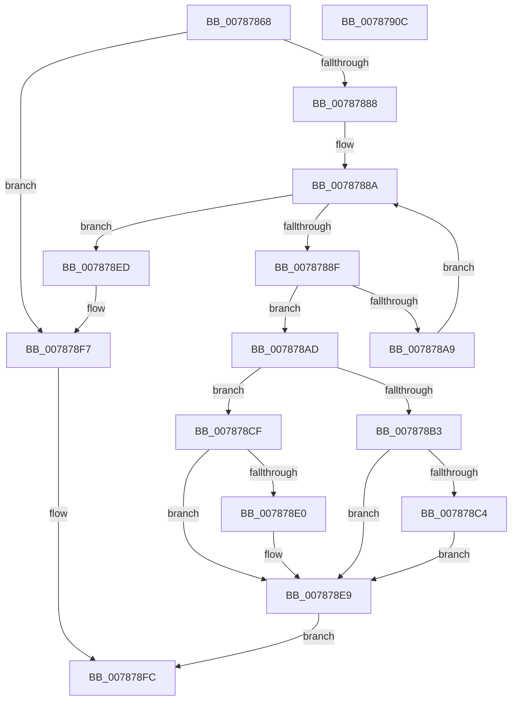

# PspSetCreateThreadNotifyRoutine

- RVA: `0x00787868`–`0x0078790D` (길이 `165` bytes)
- VA: `0x0000000140787868`
- 실행 섹션: `PAGE`
- PDB 이름 있음: `예`; PDB Function 태그: `아니요`
- unwind 정보 RVA: `0x00060BC4`
- 디코드: `47`개 명령, `165/165` bytes 표시
- 미해석 바이트: `0` (있으면 어셈블리에 `.byte`로 보존)

> 이 문서는 커널 이미지의 기계어와 PDB 기호를 분석해 생성했습니다. 4번과 5번은 함수 원형과 자료형을 바이너리 사용 방식에서 추정한 C 해석이며 원본 소스 복구 결과는 아닙니다.

## 1. Dependencies

- 직접 호출 지점: **3**; 고유 호출 대상: **3**
- 직접 호출자로 확인된 함수: **2**
- RIP 상대 이미지 참조: **5**

### Outgoing calls
- `0x0078787B` → [ExAllocateCallBack](../AA/ExAllocateCallBack_function_00AA1AE0.md) (function, `0x00AA1AE0`)
- `0x007878A0` → [ExCompareExchangeCallBack](../../text/41/ExCompareExchangeCallBack_function_0041BCD0.md) (function, `0x0041BCD0`)
- `0x007878F2` → [ExFreePoolWithTag](../../poolcode/B8/ExFreePoolWithTag_function_00B82870.md) (function, `0x00B82870`)

### Direct callers
- [PsSetCreateThreadNotifyRoutine](PsSetCreateThreadNotifyRoutine_function_007877D0.md) at `0x007877D6`
- [PsSetCreateThreadNotifyRoutineEx](PsSetCreateThreadNotifyRoutineEx_function_007877F0.md) at `0x00787836`

### Static image references
- `0x0078788F` → RVA `0x00F06120` (`.data`; read)
- `0x007878B3` → RVA `0x00FD9E20` (`PAGEDATA`; read/write)
- `0x007878BA` → RVA `0x00FD9A88` (`PAGEDATA`; read)
- `0x007878C4` → RVA `0x00FD9A88` (`PAGEDATA`; read/write)
- `0x007878CF` → RVA `0x00FD9E14` (`PAGEDATA`; read/write)

## 2. Other-region calls and transfers

- 다른 실행 섹션으로 향하는 call: **2**
  - `0x007878A0` → [ExCompareExchangeCallBack](../../text/41/ExCompareExchangeCallBack_function_0041BCD0.md) (`PAGE` → `.text`)
  - `0x007878F2` → [ExFreePoolWithTag](../../poolcode/B8/ExFreePoolWithTag_function_00B82870.md) (`PAGE` → `POOLCODE`)
- 별도 외부 분기/꼬리 이동을 확인하지 못했습니다.

## 3. Assembly (complete function range)

```asm
00787868  48 89 5C 24 08                  mov qword ptr [rsp + 8], rbx
0078786D  48 89 74 24 10                  mov qword ptr [rsp + 0x10], rsi
00787872  57                              push rdi
00787873  48 83 EC 20                     sub rsp, 0x20
00787877  8B F2                           mov esi, edx
00787879  8B D2                           mov edx, edx
0078787B  E8 60 A2 31 00                  call 0x140aa1ae0
00787880  48 8B F8                        mov rdi, rax
00787883  48 85 C0                        test rax, rax
00787886  74 6F                           je 0x1407878f7
00787888  33 DB                           xor ebx, ebx
0078788A  83 FB 40                        cmp ebx, 0x40
0078788D  73 5E                           jae 0x1407878ed
0078788F  48 8D 0D 8A E8 77 00            lea rcx, [rip + 0x77e88a]
00787896  45 33 C0                        xor r8d, r8d
00787899  48 8D 0C D9                     lea rcx, [rcx + rbx*8]
0078789D  48 8B D7                        mov rdx, rdi
007878A0  E8 2B 44 C9 FF                  call 0x14041bcd0
007878A5  84 C0                           test al, al
007878A7  75 04                           jne 0x1407878ad
007878A9  FF C3                           inc ebx
007878AB  EB DD                           jmp 0x14078788a
007878AD  40 F6 C6 01                     test sil, 1
007878B1  74 1C                           je 0x1407878cf
007878B3  F0 FF 05 66 25 85 00            lock inc dword ptr [rip + 0x852566]
007878BA  8B 05 C8 21 85 00               mov eax, dword ptr [rip + 0x8521c8]
007878C0  A8 10                           test al, 0x10
007878C2  75 25                           jne 0x1407878e9
007878C4  F0 0F BA 2D BB 21 85 00 04      lock bts dword ptr [rip + 0x8521bb], 4
007878CD  EB 1A                           jmp 0x1407878e9
007878CF  F0 FF 05 3E 25 85 00            lock inc dword ptr [rip + 0x85253e]
007878D6  8B 05 AC 21 85 00               mov eax, dword ptr [rip + 0x8521ac]
007878DC  A8 08                           test al, 8
007878DE  75 09                           jne 0x1407878e9
007878E0  F0 0F BA 2D 9F 21 85 00 03      lock bts dword ptr [rip + 0x85219f], 3
007878E9  33 C0                           xor eax, eax
007878EB  EB 0F                           jmp 0x1407878fc
007878ED  33 D2                           xor edx, edx
007878EF  48 8B CF                        mov rcx, rdi
007878F2  E8 79 AF 3F 00                  call 0x140b82870
007878F7  B8 9A 00 00 C0                  mov eax, 0xc000009a
007878FC  48 8B 5C 24 30                  mov rbx, qword ptr [rsp + 0x30]
00787901  48 8B 74 24 38                  mov rsi, qword ptr [rsp + 0x38]
00787906  48 83 C4 20                     add rsp, 0x20
0078790A  5F                              pop rdi
0078790B  C3                              ret
0078790C  CC                              int3
```

## 4. C-style interpretation (structured pseudocode)

```c
__int64 __fastcall PspSetCreateThreadNotifyRoutine(__int64 a1, int a2, int a3)
{
    __int64 result;
    __int64 v_rbx;
    __int64 v_rsp;
    unsigned __int64 v_stack_p10;
    unsigned __int64 v_stack_p8;

    v_stack_p8 = v_rbx;
    v_stack_p10 = v_rsi;
    v_rsp = (v_rsp) - (32);
    result = ExAllocateCallBack(a1, (unsigned int)(a2), a3, a4);
    if (result == 0) goto loc_007878F7;
    v_rbx = 0;
loc_0078788A:
    if (0 >= 64) goto loc_007878ED;
    a3 = 0;
    result = ExCompareExchangeCallBack(v_rip + 7858314 + v_rbx * 8, result, a3, a4);
    if ((unsigned __int8)(result) != 0) goto loc_007878AD;
    v_rbx = (unsigned int)((v_rbx) + 1);
    goto loc_0078788A;
loc_007878AD:
    if ((((unsigned __int8)((unsigned int)(a2))) & (1)) == 0) goto loc_007878CF;
    if ((((unsigned __int8)((unsigned int)(*(unsigned int *)(v_rip + 8724936)))) & (16)) != 0) goto loc_007878E9;
    goto loc_007878E9;
loc_007878CF:
    if ((((unsigned __int8)((unsigned int)(*(unsigned int *)(v_rip + 8724908)))) & (8)) == 0) {
    }
    result = 0;
    goto loc_007878FC;
loc_007878ED:
    a2 = 0;
    result = ExFreePoolWithTag(0, a2, a3, a4);
loc_007878F7:
loc_007878FC:
    v_rsp = (v_rsp) + (32);
    return (unsigned int)(0xC000009AULL);
}
```

## 5. (Beta) C Style

```c
int64_t PspSetCreateThreadNotifyRoutine(int64_t Arg1, int32_t Arg2, int32_t Arg3)
{
    int64_t result;
    int64_t local_rbx;
    int64_t local_rsp;
    uint64_t v_stack_p10;
    uint64_t v_stack_p8;

    v_stack_p8 = local_rbx;
    v_stack_p10 = local_rsi;
    local_rsp = (local_rsp) - (32);
    result = ExAllocateCallBack(Arg1, (uint32_t)(Arg2), Arg3, a4);
    if (result == 0) goto loc_007878F7;
    local_rbx = 0;
loc_0078788A:
    if (0 >= 64) goto loc_007878ED;
    Arg3 = 0;
    result = ExCompareExchangeCallBack(v_rip + 7858314 + local_rbx * 8, result, Arg3, a4);
    if ((uint8_t)(result) != 0) goto loc_007878AD;
    local_rbx = (uint32_t)((local_rbx) + 1);
    goto loc_0078788A;
loc_007878AD:
    if ((((uint8_t)((uint32_t)(Arg2))) & (1)) == 0) goto loc_007878CF;
    if ((((uint8_t)((uint32_t)(*(uint32_t *)(v_rip + 0x8521C8)))) & (16)) != 0) goto loc_007878E9;
    goto loc_007878E9;
loc_007878CF:
    if ((((uint8_t)((uint32_t)(*(uint32_t *)(v_rip + 0x8521AC)))) & (8)) == 0) {
    }
    result = 0;
    goto loc_007878FC;
loc_007878ED:
    Arg2 = 0;
    result = ExFreePoolWithTag(0, Arg2, Arg3, a4);
loc_007878F7:
loc_007878FC:
    local_rsp = (local_rsp) + (32);
    return (uint32_t)(0xC000009AULL);
}
```

## 6. Execution-region graph

[열기: 2D/3D 그래프와 함수 탐색 컨트롤 패널](../../../control-panel.html?section=page&rva=0x00787868&view=graph)

- 2D 그래프는 위에서 아래로 흐르고, 3D 그래프는 빈 공간을 드래그해 회전합니다. Shift+드래그는 이동, 휠은 확대·축소, 함수 노드 선택은 대상 보고서 이동입니다.

### Static fallback


