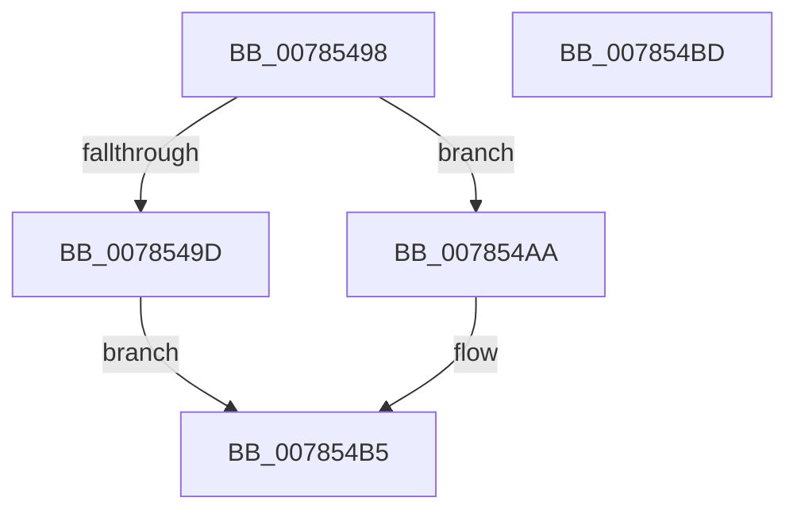

# PspSetEffectiveRateControlJob

- RVA: `0x00785498`–`0x007854BE` (길이 `38` bytes)
- VA: `0x0000000140785498`
- 실행 섹션: `PAGE`
- PDB 이름 있음: `예`; PDB Function 태그: `아니요`
- unwind 정보 RVA: `0x000DB714`
- 디코드: `8`개 명령, `38/38` bytes 표시
- 미해석 바이트: `0` (있으면 어셈블리에 `.byte`로 보존)

> 이 문서는 커널 이미지의 기계어와 PDB 기호를 분석해 생성했습니다. 4번과 5번은 함수 원형과 자료형을 바이너리 사용 방식에서 추정한 C 해석이며 원본 소스 복구 결과는 아닙니다.

## 1. Dependencies

- 직접 호출 지점: **0**; 고유 호출 대상: **0**
- 직접 호출자로 확인된 함수: **2**
- RIP 상대 이미지 참조: **0**

### Outgoing calls
- 직접 디코드된 call 명령이 없습니다.

### Direct callers
- [PspSetRateControlJobPreCallback](PspSetRateControlJobPreCallback_function_00785C80.md) at `0x00785C8D`
- [PspEstablishJobHierarchy](../87/PspEstablishJobHierarchy_function_0087E17C.md) at `0x0087E4F0`

### Static image references
- 디코드된 RIP-relative 메모리 참조가 없습니다.

## 2. Other-region calls and transfers

- 다른 실행 섹션으로 향하는 call: **0**
- 별도 외부 분기/꼬리 이동을 확인하지 못했습니다.

## 3. Assembly (complete function range)

```asm
00785498  48 85 D2                        test rdx, rdx
0078549B  74 0D                           je 0x1407854aa
0078549D  F0 81 89 10 06 00 00 00 00 00 02  lock or dword ptr [rcx + 0x610], 0x2000000
007854A8  EB 0B                           jmp 0x1407854b5
007854AA  F0 81 A1 10 06 00 00 FF FF FF FD  lock and dword ptr [rcx + 0x610], 0xfdffffff
007854B5  48 89 91 10 04 00 00            mov qword ptr [rcx + 0x410], rdx
007854BC  C3                              ret
007854BD  CC                              int3
```

## 4. C-style interpretation (structured pseudocode)

```c
void __fastcall PspSetEffectiveRateControlJob(__int64 a1, __int64 a2)
{
    if (a2 == 0) goto loc_007854AA;
    goto loc_007854B5;
loc_007854AA:
loc_007854B5:
    *(unsigned __int64 *)(a1 + 1040) = a2;
    return;
}
```

## 5. (Beta) C Style

```c
void PspSetEffectiveRateControlJob(void *Arg1, int64_t Arg2)
{
    uint8_t *arg1 = (uint8_t *)Arg1;

    if (Arg2 == 0) goto loc_007854AA;
    goto loc_007854B5;
loc_007854AA:
loc_007854B5:
    *(uint64_t *)(arg1 + 0x410) = Arg2;
    return;
}
```

### 관측된 메모리 오프셋

구조체 형식이 확인되지 않은 접근은 인자 기준의 오프셋으로만 기록했습니다.

| 기준 인자 | 오프셋 표현 | 폭 (bit) | 접근 |
|---|---:|---:|---|
| `Arg1` | `+ 0x410` | `64` | `W` |
| `Arg1` | `+ 0x610` | `32` | `R/W` |

## 6. Execution-region graph

[열기: 2D/3D 그래프와 함수 탐색 컨트롤 패널](../../../control-panel.html?section=page&rva=0x00785498&view=graph)

- 2D 그래프는 위에서 아래로 흐르고, 3D 그래프는 빈 공간을 드래그해 회전합니다. Shift+드래그는 이동, 휠은 확대·축소, 함수 노드 선택은 대상 보고서 이동입니다.

### Static fallback


